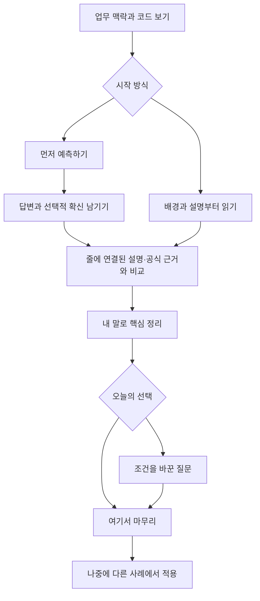

# Code And Command Learning Design Plan

## Metadata

- Status: `active`
- Parent PRD: [PRD-0023](../prd/prd-0023-code-and-command-learning.md)
- Created: `2026-10-17`
- Updated: `2026-10-27`
- Plan type: information hierarchy and learning-interaction redesign
- Execution profile: `fullstack-product`
- Surface lanes: evidence/data → Dashboard/reader → source/candidate management → review history
- [Initial interactive storyboard](code-and-command-learning-preview.html): synthetic
  2026-10-17 design artifact predating the article revision; it does not connect
  to the application or store answers. Section A below owns the current article layout.

## Purpose

### Owner Return: A Work-Based Technical Article

On 2026-10-17 the owner rejected the answer-as-note result as shallow in content
and unsatisfactory in presentation. The active fullstack-product pass reconstructs
two real work examples into reviewed technical articles. A short answer is not an
article body. This supersedes the initial short-answer composition; section A now
records the article layout, preserving explanation-first reading and optional practice.

Concrete mismatches: no conceptual development or worked example, an exercise-like
card, evidence metadata competing with prose, and no section hierarchy or reading
measure. The owner's blog supplies article title/deck, connected paragraphs, code,
section navigation and References. Native shell/title/tokens stay literal; no
unrelated widgets, fake reading estimates or decorative metrics enter.

Bounded batches:
1. Content/contract: optional reviewed articles on v2 packets hold an intro,
   exact scene range, 2–5 sourced sections and a takeaway. Reauthor the command
   and Spring diff as new private revisions; retain old records.
2. Presentation: one editorial surface with a main reading column, genuine
   section links and a reference rail; narrow screens use document flow. Home
   and an individual article route share one renderer; library opens articles
   when available. Older packets retain their complete explanation.
3. Inspection/docs: inspect actual initial desktop/narrow renders, parse syntax
   and update owners. No tests or personal responses are created unless requested;
   full functional acceptance remains open.

Content exit: connect the actual operation to a mental model, a consequential
distinction and a reusable judgment, with evidence/version limits beside claims.
Screen exit: connected technical prose with subordinate practice and references.
Owner review of the reading experience remains due; layout inspection alone does
not establish educational value.

실제 코드·diff·명령을 읽고 이유를 설명하는 학습을 중심으로 기존 위젯, 질문 폼,
출처 표시, 복습 목록을 연결한다. 학습한 개념과 업무 장면을 함께 기억하고 다른
조건에서 판단해 볼 수 있게 한다. 기존 페이지의 색이나 제목을 새로 정하는 작업은 아니다.

## Baseline

아래는 재설계 전 관측이다. 승인 후 구현 상태는 마지막 Delivery 절에 기록한다.

- 사용자 요구와 실제/제안 경계는 [PRD-0023](../prd/prd-0023-code-and-command-learning.md)이 소유한다.
- [Current learning policy](../../policies/project/work-grounded-learning.md),
  [current home](../../../src/localbrain/templates/dashboard.html),
  [reader](../../../src/localbrain/templates/learning-reader.html),
  [library](../../../src/localbrain/templates/learning-library.html)를 읽었다.
- 현재 home과 첫 reader를 브라우저로 열람했다. home은 4개 위젯과 복원한 제목이며,
  reader는 긴 텍스트 질문과 답변 폼을 먼저 보여 준다. 코드/명령의 독립된 읽기 영역은 없다.
- [Design Constitution](../../policies/design/design-constitution.md),
  [Design Evaluation](../../policies/design/design-evaluation.md),
  [Interaction Evaluation](../../policies/experience/interaction-evaluation.md)가 후속 구현/평가 기준이다.
- explain-diff의 배경·직관·코드·질문 연결을 일일 장면에 적용한다. 긴 PR 해설과
  고정 5문항은 일일 화면의 필수 계약으로 채택하지 않는다.
- 기존 workflow-map design plan은 다른 중단된 트랙이다. 이 계획은 그 실행을 재개하지 않는다.

## Scope And Non-Goals

대상은 학습 위젯, 코드/명령 reader, 개념을 연결한 복습과 재료 관리다.
이 문서는 제안 배치·상태·순서·검토 조건을 소유한다. 현재 앱의 durable 동작이나
데이터 스키마를 정의한 것처럼 사용하지 않는다. 실제 수집·모델 실행·운영 명령
실행·자동 채점·위젯 편집기·브랜드 변경은 이번 계획 산출물에 포함하지 않는다.

## Invariants

- 상단 문구는 `CURRENT WORK` / `Dashboard` /
  `진행 중인 큰 주제와 다음 행동을 한 화면에서 이어봅니다.`를 유지한다.
- shared navigation/search와 native semantic color/type/space/radius를 사용한다.
- 실제 업무 자료, 설명자의 해석, 공식 규칙, 생성한 변형, 개인 응답을 구분한다.
- 원문 코드의 공백과 줄 번호, 추가/삭제·이전/이후 구분을 보존한다. 색만으로 의미를 전달하지 않는다.
- 근거를 보거나 예시를 실행하지 않았다는 상태를 숨기지 않는다. “학습하기”는 명령 실행이 아니다.
- 초안/버전 미확인/재검토/원본 없음은 학습자의 실패 상태가 아니다.
- 읽기·힌트·정답 공개와 독립 답변을 구분하며, 오답 강제나 매일 분류 작업을 요구하지 않는다.
- 기존 수업/답변은 유지하고 새 UI로 옮길 때 없는 코드 근거·숙련도를 만들어 넣지 않는다.

## Findings

| Category | Current gap | Design consequence |
|---|---|---|
| 학습 대상 | 질문에 실제 코드가 동반되지 않음 | 보존된 코드/명령 장면을 항상 함께 보여 줌 |
| 시작 부담 | 긴 답변 폼·확신 선택이 첫 화면의 대부분 | 한 줄 예측 또는 설명 먼저 읽기; 확신은 짧은 선택, 목표 이해가 우선 |
| 깊이 | 수업별 고정 질문 순환 | 역할 이해→원리 설명→조건 변경→다른 사례 적용을 선택적으로 이어감 |
| 출처 | 근거가 화면 아래에서 별도로 보임 | 설명의 특정 주장/줄과 공식 절을 연결하고 원문 보기 유지 |
| 추천 신뢰 | 첫 등록 순서가 학습 우선순위처럼 보일 수 있음 | 실제 후보 이유와 자료 부족을 표시; 이해도 진단으로 표현하지 않음 |
| 수집 범위 | 모든 도구 호출에 인자/결과가 보존되지 않음 | snapshot 준비 상태를 먼저 해결, 원본 없는 가상 diff 금지 |
| 기록 의미 | 완료 횟수가 이해 깊이를 대신할 위험 | 자기 설명·도움 사용·새 조건 적용의 기록을 따로 보여 줌 |

## Proposed Screen Composition

### A. Dashboard: 업무에서 재구성한 기술 글

사용자는 [자신의 기술 블로그 글](https://chochita0311.github.io/archive/note?id=43)을
참조로 제시하고 **짧은 해설을 먼저 읽고, 질문은 선택해서 풀기**를 선택했다.
이후 짧은 정답 해설만 옮긴 결과는 내용과 UI 모두 거절했다. 설명 우선 순서를
유지하면서 작업 장면에서 개념의 원리·조건·판단 기준까지 이어지는 글을
독립적으로 작성한다. 현재 구성은 다음과 같다.

| Region | Information / interaction |
|---|---|
| Article heading | `오늘의 배움`, 주제, 글 제목과 요지 |
| Context | 실제 자료/예시 구분, 작업 날짜, 어떤 상황에서 무엇을 이해할지 연결하는 도입 |
| Code | 보존한 장면의 명시적 연속 구간, 최대 24줄; 언어·줄 번호·발췌 범위·diff 표시, 어두운 읽기 토큰과 문법 강조, 자체 가로 스크롤 |
| Explanation | 독립적으로 검토한 2–5개 절: 원리·헷갈리는 차이·조건·다음 작업의 적용 기준. 선택한 질문의 정답과 분리 |
| References | 절마다 근거 번호; 공식 문서 링크, 버전·확인일, 검토 주체와 적용 한계. 데스크톱은 목차와 함께 오른쪽, 좁은 화면은 글 아래 |
| Optional question | 기본은 접힘. `읽은 내용을 내 말로 설명해 보기`로 해설을 참고한 연습 진입 |
| Finish | 명시적 `읽은 내용 기록`, `다른 글 둘러보기`; 방문만으로 기록하지 않음 |

짧은 diff는 지정 구간 전체를 표시할 수 있고, 전체 파일과 원천 관리 목록은
원본 reader에서 확인한다. 첫 구현 뒤 사용자가
`왜 이 질문인가요?`, `배움의 근거`, `하던 일 이어가기` 위젯을 모두 제거하도록
요청했다. 현재 Dashboard에는 하나의 글과 그 목차·References를 표시한다. 선정 안내와
업무 선정 이유는 기존 학습 목록에서, 전체 근거는 reader에서 확인한다. 공식 References는
글의 일부이며 별도 근거 위젯을 복원하지 않는다. 읽기 폭을 제한하고 본문·제목·소제목의
위계를 나누되 기존 Dashboard 제목과 shell을 유지한다. 일일 목록이 끝나면
계속 채우지 않는다. 자료가 없으면 실제 준비 경로를 보여 준다.

### B. Reader: 코드를 보며 생각하기

데스크톱은 **코드/명령 영역 + 설명/질문 영역**의 두 열을 기본 제안으로 둔다.
별도의 대화창을 추가하지 않는다. 선택한 줄은 두 영역에서 같은 근거를 가리킨다.

| Region | Content and behavior |
|---|---|
| 상단 | 업무 목적, 이 장면에서 설명할 목표, 출처/판본, 적용 조건 |
| 코드 영역 | 기본은 필요한 hunk/명령 묶음. 변경 전후·주변 호출부·관련 설정을 펼칠 수 있음 |
| 명령의 문맥 | 명령 제안/실행/결과 확인 상태, 필요한 변수·namespace·자원 관계와 관련 출력 |
| 학습 영역 | 먼저 예상하기 또는 배경부터 읽기; 용어 풀이와 도움 사용의 상태 |
| 비교 설명 | 선택한 줄의 효과→작동 원리→조건/예외→공식 절을 연결 |
| 다음 질문 | 같은 코드의 조건 변경 또는 근거가 있는 다른 장면; 생성 변형이면 명시 |
| 마무리 | 설명 가능했던 부분과 다시 보고 싶은 부분, 실제 저장 결과, 다음에 이어갈 위치 |

한 수업 안에서는 코드가 사라지는 독립 퀴즈 페이지로 보내지 않는다. 배경·직관·
코드 설명·질문은 같은 읽기 흐름에 있고 필요한 깊이를 펼친다. 필수 전제는 접힌
배경 속에만 두지 않는다. 익숙한 사용자가 먼저 답할 때 설명은 아직 공개하지 않는다.

긴 코드는 자체 가로 스크롤을 사용할 수 있지만 페이지 전체를 밀어내지 않는다.
폭이 좁으면 두 열을 코드→질문→설명 순서로 합치고, 질문에서 코드로 돌아오는
위치를 유지한다. 긴 화면에서 코드/질문이 각각 화면보다 큰 고정 높이의 내부
스크롤이 되어 읽기를 막지 않도록 한다. 세부 breakpoint는 후속 Spec에서 고정한다.

### C. 질문의 진행과 도움

설명을 먼저 읽은 경우 같은 문항의 후속 답을 독립 회상 성공으로 올리지 않는다.
힌트/원문/설명을 열었다면 해당 시도에서 사용한 도움을 표시한다. 명시적으로
기록 가능한 노출만 사용하며 사용자의 다른 창·기억을 감시하거나 추정하지 않는다.
상세 화면을 나갔다 돌아와도 작성 중 답과 마지막 위치를 보존하는 동작을 제안한다.
첫 구현은 승인된 계약에 따라 같은 브라우저 탭의 sessionStorage에 답변·확신·도움
여부를 임시 보관한다. 스크롤 위치 복원은 아직 구현하지 않았다.

### D. 학습 재료함과 기록

일일 학습과 별도 화면으로 둔다. 새 영구 내비게이션을 당장 추가하기보다
학습 목록의 `학습 재료` 진입을 먼저 제안한다.

| View | User question it answers |
|---|---|
| 업무 자료 | 어느 저장소/세션을 읽는가? 당시 코드/명령을 확보했는가? |
| 공식 근거 | 어떤 버전과 절을 읽었는가? 언제 내용 검토했는가? 무엇이 바뀌었는가? |
| 후보 | 왜 제안됐는가? 생성/검토 주체는 누구인가? 준비·보류 이유는 무엇인가? |
| 개념별 기록 | 어느 장면에서 무엇을 설명했고 어떤 도움을 썼는가? 다음에는 무엇을 바꿔 물을 것인가? |

학습자는 관심 없음·나중에 보기·이미 익숙함으로 추천을 조절할 수 있다.
사용자가 수업 내용 오류를 발견하면 `설명에 의문이 있어요`로 해당 주장·근거를
재검토 대상으로 만들고 자신의 오답으로 처리하지 않는 흐름을 제안한다.
편집·재검토 권한과 자동 노출 기준은 후속 승인 대상이다.

## State And Recovery Matrix

| State | Required presentation / recovery |
|---|---|
| 준비된 장면 없음 | 업무 자료 선택/수동 준비 경로, 자동 출제 완료를 암시하는 빈 버튼 금지 |
| 원본 없음·변경됨 | 보존된 당시 판본과 현재 원본의 차이를 구분, 최신 checkout으로 대체하지 않음 |
| 주변 코드/변수 부족 | 모르는 조건을 보여 주고 답을 확정하지 않음; 자료 보충 또는 해당 질문 보류 |
| 버전 미확인 | 학습은 범위가 명확한 예시로 제한하고 실제 환경 적용 판정 보류 |
| 공식 근거 변경 | 영향을 받는 문항의 재검토 상태, 과거 답변 당시의 설명 유지 |
| 답변 저장 실패 | 입력과 코드 위치 유지, 저장 실패를 알리고 재시도 제공 |
| 생성 실패·모델 없음 | 검토된 기존 수업은 읽기 가능, 중간 생성물을 완성된 수업으로 노출하지 않음 |
| 중단 후 복귀 | 같은 질문/판본/답변 초안을 복원, 새 생성 결과로 바꾸지 않음 |
| 일일 학습 완료 | 종료 지점과 선택적 추가 읽기, 자동 목록 무한 보충 금지 |
| 과거 수업 열기 | 당시 코드/문서/설명을 유지하고 현재 판본과 구분 |

## Planned Work

### Batch 1 — 근거와 질문 구조

- Goal: 당시 자료와 한 개념을 묶는 학습 단위 확정.
- Why: 코드 화면과 출제 모두 같은 신뢰할 수 있는 입력이 필요하다.
- Targets: source snapshot, Git range/worktree, command/result state, context,
  concept/question/response/revision 관계. PRD의 foundation 후보에 대응한다.
- Guardrails: 현재 수업/답변 재해석 금지; 누락된 명령 출력이나 호출부 합성 금지.
- Validation: 변경된 branch, 삭제된 원문, 미실행 명령, 누락된 alias, 버전 미확인
  사례를 합성 자료로 구분할 수 있는지 후속 승인된 검증에서 확인한다.
- Exit gate: 근거의 신원·불확실성·보존·갱신 계약을 검토하고 승인.

### Batch 2 — 검토한 장면의 읽기 흐름

- Goal: 명령과 코드 diff를 각각 한 장면씩 읽고 이유를 설명할 수 있는 첫 제품 경로.
- Why: 자동 생성 품질과 학습 UI의 가치를 따로 확인할 수 있다.
- Targets: Dashboard widget → reader → 비교 설명/출처 → 마무리; 기존 library 연결.
- Guardrails: native shell/제목 유지, 실제 코드와 합성 예시 구분, 한 핵심 질문으로 시작.
- Validation: desktop/320px, 코드 공백과 긴 줄, 키보드, 설명 먼저 읽기, 답변 보존과
  중단/복귀, 출처 확인, 저장 실패. 실제 검증은 구현 승인 이후 별도 수행.
- Exit gate: 근거가 보이는 두 입력 유형의 일상 학습 흐름을 사용자가 검토.

### Batch 3 — 재료 관리와 출제 준비

- Goal: 어떤 자료가 왜 문제로 만들어졌는지 설명 가능하게 한다.
- Why: 문제 수를 늘리기 전에 근거 부족·버전 변경·생성 오류를 다룰 수 있어야 한다.
- Targets: 허용 원천과 공식 문서 목록, 후보 이유, 검토/보류, 원문 변경 영향.
- Guardrails: 일일 분류 의무 금지, Qwen 자동 노출은 별도 품질 경계 뒤 결정.
- Validation: 출처 없는 주장, 조건 누락, 중복 후보, 버전 충돌, 문서 변경 사례.
- Exit gate: 검토/보류 흐름과 모델 품질·자원 예산의 승인.

### Batch 4 — 개념과 새 상황의 복습

- Goal: 같은 원리를 다른 코드/조건에 적용하는 흐름.
- Why: 클릭 수·같은 문항 반복과 이해의 확장을 구분해야 한다.
- Targets: 개념별 응답 증거, 도움 사용, 다른 사례와 변형 질문, 자기 평가 이력.
- Guardrails: 초기 추천량/간격을 검증된 학습 법칙으로 표시하지 않음.
- Validation: 같은 날 반복, 설명 후 응답, 새 판본, 이미 익숙함, 다른 조건의 사례를
  구분하고 시간이 지난 설명·적용을 실사용에서 관측.
- Exit gate: 사용자의 부담과 독립 설명에 대한 실사용 피드백; 기능 PASS와 별도 기록.

## Validation Gates And Evidence Limits

계획 단계의 산출물은 PRD, 이 설계 문서, 합성 HTML 시안이다. 시안의 버튼은
화면 흐름을 표현할 뿐 DB·출제·개인화·복습 일정을 구현하지 않는다. 실제 학습
기록을 만들거나 동작 테스트를 실행하지 않는다. 이 계획을 구현할 때 required
evaluators는 contract/design/functional/ux-heuristic이며 승인된 범위에서 수행한다.

### Prototype Observation — 2026-10-17

브라우저에서 현재 Dashboard/reader와 합성 시안의 PDB 시작 화면을 데스크톱·320px
폭으로, Spring 설명 화면을 데스크톱으로 열람했다. 관측한 시안에서 데스크톱은
코드와 질문/설명이 나란히 보였고, 좁은 화면은 코드 다음에 질문을 배치했다.
긴 명령은 코드 영역 안에서 가로로 넘길 수 있었으며 페이지 전체의 가로 넘침은
관측하지 않았다. Spring 설명 화면에서는 코드가 설명 옆에 유지됐다.

이 기록은 해당 화면 상태의 시각적 관측에 한정한다. URL로 연 화면 상태이며
버튼·키보드·접근성·저장/복귀·모델 동작을 검증하지 않았다. 테스트를 추가하거나
실행하지 않았고, 실제 학습 기록도 만들지 않았다. 제품 기능 또는 디자인 전체의
PASS 근거로 사용하지 않는다.

## Risks / Open Questions

- 호출부까지 충분히 보존하면 자료량이 늘지만 hunk만 남기면 의미가 손실된다.
  실제 사례에서 목표 하나를 설명하는 최소 문맥의 범위를 정해야 한다.
- 사용자가 이미 아는 개념을 반복 제안할 수 있다. 후보 이유와 관심 조절을 제공하고
  익숙함을 검증된 숙련도로 전환하지 않는다.
- 원문이 바뀐 뒤의 과거 코드와 현재 공식 규칙을 섞으면 잘못된 교재가 된다.
  버전별 보존과 재검토가 필요하다.
- 언어·프레임워크·운영 개념을 한꺼번에 늘리면 깊이가 얕아질 수 있다.
  첫 제품은 실제 명령과 실제 diff의 작은 사례로 흐름을 확인한다.
- 초기 초안 위치와 추천/간격 정책은 [현재 계약](../../policies/project/code-command-learning.md)에 고정했다.
  자동 탐색 원천 범위, 자동 출제 노출 기준과 모델은 미확정이다.

## Exit Goal And Handoff

사용자가 실제 코드/명령을 보며 한 원리를 설명하고, 공식 근거를 확인하며,
다른 상황에 적용해 보는 화면과 생산 과정을 검토할 수 있으면 이번 설계가 완성된다.
소유자의 계속 진행 승인으로 Batch 1과 수동 검토 reader의 경계를 고정했다. 기존 PRD-0022의 미완료
기능 검증이나 모델 품질 문제를 이 설계·시안의 완성으로 통과 처리하지 않는다.

## First Delivery — 2026-10-17

- Batch 1: [FEAT-0126](../feature/feat-0126-code-learning-contract.md)의 문서 계약 완료.
- Batch 2: [FEAT-0127 / RUN-165](../run/run-20261017-165-code-command-reader.md)에서
  실제 명령과 diff를 질문·피드백 옆에 두는 reader, 원문 전후/실행 근거 표시,
  한 장면 선정 이유, 도움 기록과 탭 초안을 구현했다. 실제 업무 2개 장면·6문항은
  private DB에만 보존하며 원본 명령을 실행하거나 사용자 답변을 만들지 않았다.
- Batch 4 중 초기 규칙: 이해→예측→조건 변경의 질문과 선택적 추가 연습,
  서로 다른 이전 응답일의 자기 평가/도움 기록에 따른 추천을 구현했다.
  다른 수업 간 개념 동등성, 자동 변형 생성과 객관적 숙련도는 추론하지 않는다.
- 관측: 실제 Dashboard와 두 reader의 desktop, 명령 reader의 320×850 초기 화면.
  최초 코드 줄 표시 문제를 수정했다. 설명/저장/복귀·날짜 전환·키보드·no-script는
  실행 검증하지 않았다. 형식/초기 화면 관측은 기능 PASS가 아니며 Run은 active다.
- Batch 3 자동 원천 관리·Qwen 출제와 장기 학습 효과는 후속 작업이다.
  시안은 설계 참고용이며 현재 구현의 자동화 상태를 대신하지 않는다.
