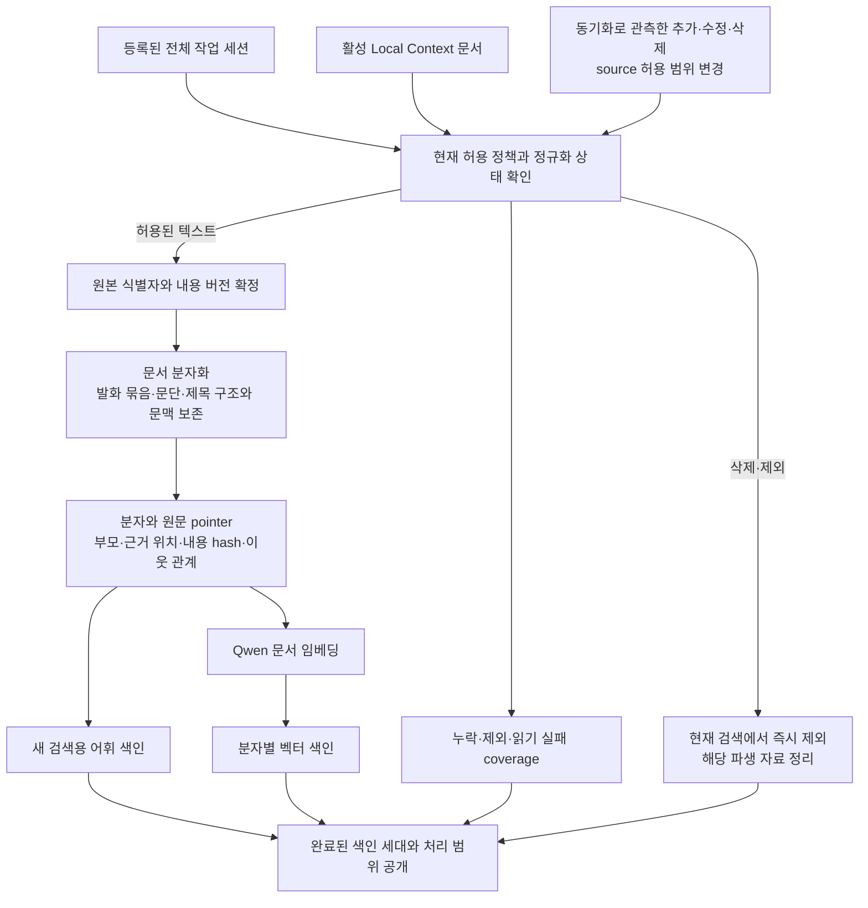
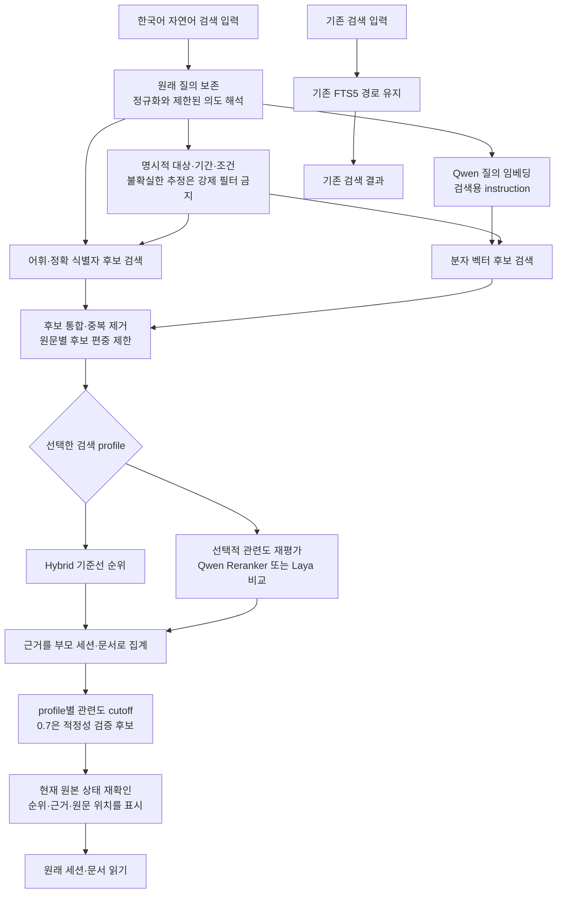
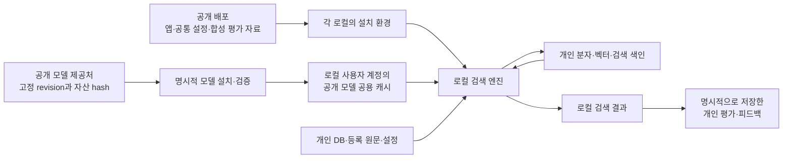

# PRD-0020: Local Natural Language Search

## Metadata

- ID: `prd-0020`
- Status: `approved`
- Owner role: `human`
- Created: `2026-10-12`
- Updated: `2026-10-16`
- Current boundary: 사용자가 PRD와 후속 명세·구현·로컬 모델 비교·테스트를 승인했고, 이후 세션 문서 정리·subagent 리뷰·검증·commit·push를 승인했다. 게시 대상은 검토된 공통 코드·문서·합성 평가 자료이며 개인 자료·질의·색인·원시 평가 기록은 계속 로컬에 둔다.

## Current Search Entry — 2026-10-16

사용자가 병렬 비교 단계의 후속 정리를 승인했다. 현재 공유 헤더는 원래 전역 검색 위치의 입력 하나와 `세션, 질문, 문서 통합 검색` placeholder를 유지한다. 보이는 자연어/키워드 모드 문구를 제거하고, Search 클릭과 Enter 모두 같은 입력값을 `/natural-search`로 제출한다. 키워드 검색 `/search`는 deprecated로 표시해 기존 URL 호환용으로 보존하며 일반 탐색·복구 안내에서는 노출하지 않는다. Atlassian의 화면 내부 검색 예외와 자연어 검색의 원문·색인·순위·준비 상태 계약은 유지한다.

아래 초기 병렬 입력·전환 보류 설명은 비교 단계의 이력이며, 현재 전역 검색 진입과 해당 수용 기준은 이 후속 결정 및 [검색 정책](../../policies/project/natural-language-search.md#product-surface)이 대체한다. 기존 검색 구현·FTS의 실제 삭제나 검색 모델 변경은 이 정리에 포함되지 않는다.

## Request Summary

등록된 전체 작업 세션과 Local Context 문서를 한국어 자연어로 검색한다. 원문을 내부적으로 문서 분자화하여 의미와 근거 위치를 찾기 쉽게 만들고, 사용자는 문서 구조나 프로젝트 이름을 몰라도 관련 세션·문서를 찾을 수 있어야 한다. 기존 검색의 왼쪽에 새 검색 입력창을 나란히 두어 설명과 반복 비교에 사용한다.

공개 배포물로 다른 사용자가 자기 로컬에 설치할 수 있게 공통 프로그램·모델 자원과 개인 자료를 분리한다. 실제 품질·자원 검증은 요청자의 현재 Apple Silicon Mac 한 대에서만 수행하는 범위다. 최초 작성은 planning-only였으며, 후속 전체 승인으로 명세·구현·이 Mac에서의 모델 비교·테스트를 진행했다. 이후 사용자가 공개 가능한 작업물의 문서 리뷰·검증·commit·push를 별도로 승인했다. 개인 자료의 외부 전송은 이 승인에 포함하지 않는다.

## Source Set

### Human Direction

- 문서 분자화는 원래 세션·문서 아래에 있는 내부 검색 구조다. 별도 문서 분류 체계, 지식 저장소 화면, 사용자 관리 계층을 만들지 않는다.
- “만들던 앱과 관련된 세션을 보여줘”처럼 정확한 프로젝트명을 쓰지 않아도 전체 자료에서 관련 후보를 찾고, 순위와 threshold에 따라 보여주는 자연어 검색을 원한다.
- 목표는 쓸모 있는 자연어 검색이다. 평가 자료가 있더라도 100% 분류 정확도나 정답 없는 질의의 오탐 0건을 제품 수용 조건으로 삼지 않는다.
- 검색 대상은 전체 작업 세션과 Context로 등록된 문서다. 현재 화면·최근 활동·특정 프로젝트를 기본 검색 범위로 사용하지 않는다. 새로운 검색 자료 체계가 생기면 이후에 확장할 수 있어야 한다.
- 질의에 명시한 조건을 명확히 해석할 수 있으면 필터로 적용하고, 모호하면 후보를 넓게 유지한다. 적용한 검색 범위를 확인할 수 있어야 한다.
- 기존 검색을 유지하며 새 입력창을 왼쪽에 나란히 둔다. 병렬 검색 구성은 설명과 비교를 위한 것이고, 입력 영역·검색 버튼을 추후 제거하려는 의도는 후속 정리 경계로 남긴다.
- threshold는 우선 내부 기본값으로 관리한다. `0.7`이 적절한지 검증하며, 앱 설정으로 노출하는 작업은 나중이다.
- 최초 활성화와 검색 준비 이후, 동기화된 세션·Context 변경분에 맞춰 검색 색인을 로컬에서 자동 갱신한다.
- 사용자가 정본 자료로 선택한 영역을 검색한다. maintenance·subsession·분석 Run 및 부수 생성물의 기존 제외 방향을 유지한다. 분자 크기와 전체 색인의 저장 비용을 함께 검토한다.
- 저장 위치 분리안을 채택했다. 주요 DB·사용자 설정/판단은 기존 data 영역, 새 분자·벡터·어휘 색인은 private cache 영역, 공개 모델은 기존 공용 모델 캐시에서 관리한다. 색인 캐시가 없어지면 원문·사용자 선택을 보존하며 검색 준비를 다시 하는 방향이다.
- Laya를 검토하는 주요 이유는 빠른 처리다. Qwen 임베딩만으로 속도·한국어 품질을 충족하는지와 Laya 결합의 실제 이득을 비교하고 특정 모델 채택을 미리 결정하지 않는다.
- 공개·재사용 가능한 설치를 원하지만, 다른 기기에서의 별도 검증을 요구하지 않는다. Windows 설치형 제작은 향후 선택 사항이며 이번 약속이 아니다.

### Repository Authorities And Implementation

- [PRD And Feature Management](../../policies/harness/prd-feature-management.md): draft 및 후속 승인 경계.
- [Project Architecture](../../policies/project/architecture.md), [Installation And Local Storage](../../policies/project/installation-and-storage.md), [Privacy And Data Handling](../../policies/project/privacy-and-data.md): 설치·저장·원본·공개 경계.
- [Derived Retrieval Index](../../policies/project/data-model/derived-retrieval-index.md): 현재 검색 대상의 허용 정책과 재생성 가능한 색인.
- [Design Constitution](../../policies/design/design-constitution.md), [Design Evaluation](../../policies/design/design-evaluation.md), [Interaction Evaluation](../../policies/experience/interaction-evaluation.md): 공유 헤더, 검색 화면, 상태·상세 복귀 규칙.
- [Shared header](../../../src/localbrain/templates/base.html), [search query](../../../src/localbrain/queries.py), [search route](../../../src/localbrain/main.py), [model catalog](../../../src/localbrain/model_catalog.py), [embedding adapter](../../../src/localbrain/session_simulation_model.py), [simulation projection](../../../src/localbrain/session_simulation.py).

### Research Evidence And Limits

- [Qwen3-Embedding-0.6B](https://huggingface.co/Qwen/Qwen3-Embedding-0.6B)는 다국어 임베딩과 검색용 질의 instruction을 지원한다. query와 document의 입력 계약을 구분해야 한다. 초기 조사에서는 이 앱의 한국어 검색 품질을 측정하지 않았으며, 후속 측정은 FEAT-0121의 평가를 따른다.
- [Qwen3-Reranker-0.6B](https://huggingface.co/Qwen/Qwen3-Reranker-0.6B)는 질의와 후보 문서의 관련도를 평가하는 별도 모델이다. 임베딩 모델과 교체 가능한 동일 역할로 취급하지 않는다.
- [Laya](https://huggingface.co/convaiinnovations/laya)는 multilingual 체크포인트와 구조화된 선택·판정을 제공하며 기존 체크포인트로 실행할 수 있다. 개인별 학습은 실행의 필수 조건이 아니다. 제공자의 한계 설명상 범용 zero-shot 판정 품질을 전제할 수 없으므로 한국어 후보 판정 실험 대상으로 둔다.
- [Laya의 공개 속도 측정](https://github.com/NandhaKishorM/laya/blob/main/BENCHMARKS.md)은 T4뿐 아니라 Apple MPS에서도 조건별 차이를 보고한다. 짧은 입력의 개별 판정 시간과 전체 corpus 검색 시간을 구분하고 이 앱의 Qwen 검색 지연과 직접 동등 비교하지 않는다. [Laya 평가 문서](https://github.com/NandhaKishorM/laya/blob/main/docs/evals.md)도 후보 누락과 후보 내 판정 실패를 구분한다.
- [Jev](https://docs.typesafe.ai/models)는 호스팅 API이며 공식 문서도 언어별 성능 차이를 밝힌다. 로컬 설치의 필수 자원으로 포함하지 않는다.
- 제공된 [Jev 활용 영상](https://www.youtube.com/watch?v=3iDiWTt8lok)은 의미 기반 탐색과 분류 사용례의 참고 자료다. 앞선 검토는 화면 표본 관찰이며 전체 음성 전사나 한국어·로컬 성능 평가가 아니다.
- 위 공개 자료는 `2026-10-12`에 확인한 연구 근거다. 특정 모델의 채택, 한국어 정확도, 처리 속도 또는 설치 호환성 승인을 뜻하지 않는다.

## Product Intent

사용자는 자료가 어느 폴더·세션에 있는지, 어떤 프로젝트명이나 단어로 기록됐는지 몰라도 자신이 찾는 내용을 문장으로 표현할 수 있다. 시스템은 등록된 전체 자료에서 관련 근거를 찾아 원래 세션·문서 단위로 보여준다. 결과를 열면 왜 관련됐는지 원문의 해당 위치에서 확인할 수 있다.

설치자는 개발자의 다른 저장소·개인 데이터·학습 결과 없이 공통 배포물과 공개 모델을 설치해 같은 검색 방식을 사용할 수 있어야 한다. “비슷한 성능”은 고정된 배포 설정과 공개 평가 자료로 품질을 재현할 수 있다는 목표로 구체화한다. 개인별 자료와 하드웨어가 다르므로 모든 사람의 실제 정확도·속도가 동일하다고 약속하지 않는다. 검증된 환경과 미검증 환경을 구분한다.

## Baseline Before Implementation

아래 표는 실행 승인 전 확인한 출발점이다. 현재 구현과 측정 상태는 Decisions And Remaining Review 및 연결된 Feature/evaluation이 소유한다.

| 영역 | 승인 전 확인된 상태 | 설계와의 관계 |
| --- | --- | --- |
| 기존 상단 검색 | `/search`, SQLite FTS5 `unicode61`, 질의 앞 12개 토큰의 AND 조합, BM25 정렬 | LIKE 검색이 아니다. 동작을 유지하는 비교 기준이다. |
| 검색 대상 | 기존 검색은 세션·Context 문서 외에도 별도 정책의 Atlassian 자료를 지원 | 새 검색의 첫 corpus는 세션·Context 문서다. 대상 범위가 다른 전체 검색끼리 품질 수치를 섞지 않는다. |
| 로컬 임베딩 | 모델 ID·revision·asset fingerprint가 고정된 Qwen3-Embedding-0.6B 설치와 affinity용 처리가 존재 | 공개 가중치·검증·저장 경계는 재사용 후보다. 검색용 질의 경로나 의미 단위 분자화가 이미 구현됐다는 뜻은 아니다. |
| 설치·저장 | macOS용 독립 설치와 wheel의 package resources, 선택적 모델 설치, 공개 가중치 캐시와 private 데이터·캐시 분리가 존재 | 새 검색이 이 경계를 확장한다. 배포물에 개인 색인이나 개발자의 경로를 포함하지 않는다. |
| 품질 근거 | 한국어 자연어 검색, `0.7` cutoff, 이 검색 경로의 속도·메모리 측정 없음 | 본 문서의 흐름과 모델 역할은 제안이며 평가 결과가 아니다. |

## Confirmed Scope

1. **전체 정본 자료 검색:** 사용자가 선택한 source 영역 안에서 등록·동기화된 기본 작업 세션과 활성 Local Context의 검색 허용 문서를 대상으로 한다. 최근 N개·일부 샘플·현재 폴더만으로 실제 검색 범위를 제한하지 않는다. 질의의 명확한 조건은 필터로 적용하고 현재 적용 범위를 알아볼 수 있게 한다. 모호한 해석으로 후보를 강제 제외하지 않는다. maintenance·subsession·분석 Run 출력·임시 자료·파생 색인을 원문 corpus로 자동 편입하지 않는다.
2. **한국어 자연어 입력:** 프로젝트명을 생략한 설명, 한국어 조사·띄어쓰기 차이, 한영 혼용 개발 문맥에서 관련 자료를 찾는 품질을 핵심으로 삼는다. 특정 사용자 프로젝트명 목록을 공통 프로그램에 넣지 않는다.
3. **내부 문서 분자화:** 원문을 근거 위치와 주변 문맥이 보존된 검색 단위로 분해한다. 분자는 재생성 가능한 내부 데이터이고 사용자의 정본이나 분류 체계를 대체하지 않는다.
4. **원래 자료 중심 결과:** 분자를 검색해도 화면의 기본 결과는 원래 세션·문서다. 같은 원문의 중복 결과를 줄이고 관련 근거를 원문 위치와 함께 제공한다. 별도 분자 탐색·관리 화면은 만들지 않는다.
5. **기존 검색과 병렬 비교:** 기존 입력창 왼쪽에 자연어 검색 입력창을 둔다. 기존 `/search`의 질의·정렬·필터를 변경하지 않고 새 경로를 구분한다. 병렬 입력은 설명과 반복 검증을 위한 현재 구성이다.
6. **관련도와 내부 threshold:** 결과 순위와 표시 cutoff를 갖는다. `0.7`은 적정성을 검증할 초기 후보값이며 승인된 정확도나 정답 확률이 아니다. 앱 설정 UI로의 분리는 후속 범위다.
7. **공개 설치와 개인 자원 분리:** 공통 코드·기본 설정·공개 모델 설치 정보를 배포 가능하게 하고, 개인 자료·색인·벡터·질의·판정 기록은 각 로컬에 남긴다. 개인 학습이나 사전 작성이 기본 검색 시작의 필수 단계가 되지 않아야 한다.
8. **검증 범위:** 요청자의 현재 Apple Silicon Mac과 보유 자원에서 비교를 반복한다. 다른 기기·운영체제 검증, Windows 패키징 또는 일반 사용자 전체의 성능 보증을 이번 범위에 포함하지 않는다.
9. **확장 가능한 corpus 경계:** 향후 새로운 자료 종류는 원본 식별·허용 정책·텍스트·위치·갱신 의미를 제공하는 별도 source adapter로 추가할 수 있게 책임을 구분한다. 이번에 다른 corpus를 추가하지 않는다.
10. **증분 자동 갱신:** 최초 활성화 후 동기화로 관측된 추가·수정·삭제를 검색 색인에 자동 반영한다. 매번 전체 원문을 재임베딩하거나 사용자가 별도로 갱신을 실행하게 하지 않는다. 재사용 여부는 실제 임베딩 입력과 처리 설정의 호환성으로 판단한다.
11. **용량과 응답 성능:** 분자 수·벡터 차원·본문 중복·어휘 색인·갱신 세대별 디스크 사용량과 모델/검색의 메모리·지연을 구분해 확인한다. Qwen 단독 검색과 Laya를 포함한 구성을 같은 정본 corpus와 질의로 비교한다.
12. **로컬 저장 위치 분리:** 주요 DB·source 설정·명시적으로 저장한 개인 판단과 모델 등록 정보는 기존 `<data>`에 보존하고, 새 검색의 재생성 가능한 분자·벡터·어휘 색인은 `<cache>/natural-search/`에 둔다. 공개 pretrained 자산은 기존 Hub 캐시를 재사용한다. 기본 경로와 override는 기존 저장 계약을 따르며, 캐시 손실 시 재생성 대기와 검색 준비 상태를 다룬다. 실제 재색인 비용은 계속 측정하되 저장 위치를 미확정 사항으로 남기지 않는다.

## Excluded Scope

- 원문 이동·수정·삭제, 문서 분류 체계나 새로운 지식 저장소 UI, Workstream/Thread 자동 재조직.
- 기존 검색 제거·랭킹 변경, 앱 전체 설정 화면 추가. 사용자가 언급한 추후 입력 영역·버튼 제거는 대상과 시점을 별도로 정한다.
- 전체 디스크 수집, 미등록 문서, 새 OCR·음성 전사·영상 이해, 새 원격 수집, Atlassian corpus의 새 검색 편입.
- 기본 검색을 위한 원격 AI·임베딩 API, Jev 의무 사용, 개인 자료의 자동 전송·학습·공유.
- 개인 corpus로 학습한 가중치의 공통 배포, 설치자마다 수작업 라벨링·튜닝을 해야 하는 기본 사용 방식.
- 답변 생성 챗봇, 자율 작업 실행, 문서 속 지시문 실행, 검증되지 않은 프로젝트 관계나 과거 업무 상태의 확정.
- Windows 설치형 제작, 다른 기기 검증. 모델 설치·실행·평가는 후속 전체 승인에 포함되었고, 공통 코드·문서·합성 자료의 commit·push는 이후 별도 승인되었다. 개인 자료 게시나 새 배포 패키지·릴리스 발행으로 확대하지 않는다.

## User Flows And Interaction Expectations

### Search And Read

1. 공유 헤더에서 왼쪽 자연어 검색 또는 기존 오른쪽 검색을 명확히 선택한다. 두 입력의 값·제출 대상·검색 방식이 섞이지 않는다.
2. 자연어 문장을 제출하면 전체 eligible corpus에서 후보를 찾고 관련도 순위와 내부 cutoff를 적용한다. 명확히 해석된 질의 조건만 필터로 적용해 표시하고, 모호하면 넓은 후보를 유지한다. 이전 화면의 프로젝트·날짜를 묵시적으로 가져오지 않는다.
3. 결과는 세션·문서 이름, 출처, 관련된 원문 근거와 접근 가능한 원문 위치를 제공한다. 점수를 표시한다면 정답 확률로 표현하지 않는다.
4. 원문을 읽고 돌아오면 검색어·결과 위치·명시적 필터를 유지한다. 다른 방식으로 같은 문장을 검색하여 비교할 수 있어야 한다. 자동 양쪽 실행이나 별도 비교 대시보드는 아직 범위가 아니다.
5. 자료 없음, 일치 결과 없음, 일부 자료 준비 중, 모델 미설치·실행 실패를 구분한다. 실패를 정상적인 무결과로 표현하지 않는다.

Atlassian 화면은 기존의 local query 소유를 유지한다. 두 전역 입력은 기존 전역 입력이 노출되는 화면에 함께 두며, Atlassian에서는 둘 다 노출하지 않는다. 이 예외를 바꾸는 작업은 후속 UI 범위다.

좁은 화면에서도 두 검색의 식별·제출·키보드 접근을 유지해야 한다. 정확한 반응형 배열은 후속 UI 경계에서 확정한다. 기본 결과 화면에는 벡터 차원, chunk ID, 모델 프롬프트 등 구현 정보를 노출하지 않는다.

### Install And Prepare — Proposed Experience

독립 설치 → 공개 모델과 로컬 처리 범위 확인 → 검색 기능 준비 → 등록 자료의 색인 생성 → 검색 순서를 제안한다. 모델을 설치하지 않은 상태에서도 기본 앱과 기존 검색은 사용할 수 있다. 새 검색의 단순 화면 진입과 네트워크 다운로드는 구분하고, 자산을 준비한 뒤의 검색·색인은 로컬에서 수행한다.

사용자는 최초 준비 이후 동기화된 변경분을 자동 반영하는 방향을 선택했다. 검색어를 입력할 때마다 전체 자료를 다시 분해·임베딩하지 않는다. 갱신은 앱의 단일 writer가 배치 단위로 수행하고, 중단한 호환 입력은 재사용하며 질의 인코딩은 배치 사이에서 우선 처리한다. 동기화에서 아직 관측하지 못한 외부 파일 변경까지 실시간 감지한다고 약속하지 않는다.

## Architecture Proposal

아래는 PRD 검토를 위한 책임·데이터 흐름이다. API, 물리 스키마, 작업 스케줄러, 저장 엔진 또는 구현 순서를 확정한 Spec이 아니다.

설계 당시 검토한 후보 경로도 함께 남겨 둔다. 현재 구현의 분해·갱신·검색 흐름과
모델 역할은 [자연어 검색 계약](../../policies/project/natural-language-search.md#implemented-data-flow)이
소유하며, 아래의 선택적 Laya/Reranker 경로가 기본 검색에 추가됐다는 뜻은 아니다.

### A. Source Preparation And Molecularization

분자는 단순히 짧게 자른 문자열이 아니다. 예를 들어 한 메시지의 “그 부분은 취소하고 오프라인 저장으로 바꾸자”는 앞선 요청 없이는 무엇을 취소했는지 알 수 없다. 발화자·요청과 응답·조건·부정·수정의 연결을 보존하고, 필요한 앞뒤 원문으로 이동할 수 있어야 한다. 문서는 제목 경로, 문단, 목록의 소개와 항목, 코드 설명과 코드처럼 함께 읽어야 하는 구조를 고려한다.

**채택한 첫 기준선**은 원문 구조와 제한된 인접 문맥을 보존하는 분해다. 모든 문장을 모델이 요약하거나 새 사실로 바꾸는 것을 전제로 하지 않는다. 주제 경계 탐지나 생성형 문맥 설명이 단순 구조 분해보다 실제 검색을 개선하는지는 별도 비교 사항이다. 긴 자료를 몇 부분만 표본 추출하거나 원문 전체를 하나의 평균 벡터로만 축약해 유일한 검색 경로로 삼지 않는다.

| 분자가 알아야 할 것 | 의미와 필요한 이유 |
| --- | --- |
| 원본 소속 | source 종류·안정된 원본 ID·부모 세션/문서 ID. 결과를 원래 자료로 묶는다. |
| 내용 버전 | 관측한 원본 revision 또는 대응 버전, source content hash와 분자 content hash. 원본 변경과 분해 변경을 구분한다. |
| 정확한 근거 | 세션 event/message 및 발화자·문자 범위, 문서 section/line 또는 대응 위치, 원문 발췌. 실제 가능한 locator만 저장한다. |
| 문맥 연결 | 같은 원문 안의 제목·선행 요청·인접 분자 pointer와 사용된 근거. 전혀 다른 작업의 관계를 자동 확정하지 않는다. |
| 관측 메타데이터 | 원래 제목·언어·관측 시각·경로/프로젝트 관측. 기록된 실행 폴더가 실제 업무 정체성을 보증하지 않는다. |
| 파생 처리 이력 | 추출·분해 버전, 실제 임베딩 입력 hash, 모델 ID·revision·asset fingerprint, tokenizer·차원·instruction·runtime 설정 식별. 호환 캐시만 재사용한다. |
| 허용·유효 상태 | source 활성 상태, 색인 허용, 원문 접근·신선도·갱신 세대. 제외된 자료가 오래된 벡터를 통해 계속 나오지 않게 한다. |

`pointer`는 **원래 근거를 다시 찾는 주소와 버전 정보**다. Qwen은 실제 검색용 텍스트를 벡터화하고, Laya 같은 판정 모델에는 질의와 후보의 원문·필요 문맥을 전달해야 한다. ID나 벡터만 넘겨 원문의 의미를 이해한다고 가정하지 않는다.

원본 또는 허용 정책이 바뀌면 관련 파생 자료를 무효화한다. 재색인은 완료 세대를 구분해 중간 상태를 완성된 전체 색인으로 표시하지 않고, 중단 시 재개할 수 있어야 한다. 원문 삭제·비활성화는 검색 시 현재 상태도 확인해 즉시 제외하고, 잔여 파생 자료의 정리는 정해진 수명주기로 처리한다. 모델·분해·입력 계약이 달라진 벡터를 같은 공간에 혼합하지 않는다.

### Embedding Representation And Refresh

검색 색인은 **분자·원문 위치 + 어휘 검색 자료 + 임베딩 벡터 + 갱신 상태**를 포함한다. Qwen 임베딩은 이 중 텍스트를 숫자 벡터로 바꾸는 단계다. Qwen에 개인 자료를 학습시키거나 원문을 모델 내부에 영구 저장하는 작업이 아니다.

기존 문서 유사도 처리의 모델 설치·공개 가중치·검증 방식을 활용하되, 일부 창을 표본 추출해 원문별 평균 벡터로 합치는 방식은 새 검색의 기본 표현으로 채택하지 않는다. 검색에서는 긴 자료의 작은 주제도 독립적으로 찾을 수 있어야 하므로 모든 eligible 본문 범위를 분자로 다루고 각각의 벡터와 원문 pointer를 보존한다.

| 책임 | 제안하는 표현·실행 방식 | 남은 검증 |
| --- | --- | --- |
| 모델 자산 | 현재 LocalBrain catalog의 고정 Qwen3-Embedding-0.6B 가중치를 재사용. 검증된 같은 자산은 공용 캐시에서 읽고 원격 추론 없이 로컬 실행. | 실제 검색에 사용할 runtime·정밀도·device 고정. 기존에 계산한 개인 벡터의 호환성은 별도 판정. |
| 분자 본문 | 발화·요청/응답 묶음, 문단·목록 등 의미가 유지되는 단위. 한 원문의 모든 eligible 본문 범위를 다루고 긴 입력의 꼬리를 묵시적으로 자르지 않는다. | 아래의 본문 512토큰 목표안을 시작 가설로 비교한다. 고정 글자 수만으로 의미 보존을 주장하지 않는다. |
| 문맥 포함 입력 | 실제 원문 제목·section 경로, 필요한 같은 원문의 선행 요청/주변 발화와 분자 본문을 조립. 포함한 내용마다 근거 pointer 유지. | 본문과 보조 문맥의 예산, 무관한 문맥의 오염, 지시어·수정 문맥. 생성한 설명은 채택 시 추론으로 별도 구분. |
| 분자 벡터 | 각 분자의 조립된 텍스트를 Qwen에 배치 입력해 정규화 벡터 저장. 원문별 평균 하나로 대체하지 않는다. | 기존 512차원 구성을 출발 후보로 두고 1024차원과 품질·저장 비용 비교 후 공통 기본값 고정. 차원이 다른 벡터를 혼합하지 않는다. |
| 질의 벡터 | 원문과 보수적인 주제·행동 표현에 같은 고정 검색 instruction을 적용해 한 배치에서 같은 모델·차원으로 변환. 변화가 없거나 인용·부정·해석 모호성이 있으면 원문 하나만 사용. | 조건·표시·복귀 링크는 원문을 보존한다. 추가 표현은 번역·주제 동의어 생성이 아니며 문서 입력과 질의 instruction은 구분한다. |
| 후보 판정 입력 | 선택적 Laya/Reranker에 질의와 선택된 분자의 원문·필요 문맥을 제공. | 각 모델의 별도 token 예산에서 근거·조건이 잘리지 않는지 확인. 임베딩 입력 한도를 그대로 복사하지 않는다. |
| 실행 위치와 비용 | 이 Mac의 로컬 모델 runtime을 사용하고 변경분을 배치 처리. 검색 중 전체 corpus를 재인코딩하지 않는다. | MPS/CPU 실제 실행 조건, 배치 크기·동시성·메모리, 검색과 갱신의 우선순위. CPU fallback의 속도를 MPS와 같다고 보지 않는다. |

자동 갱신은 source별 원본 버전·본문 변화와 **실제 임베딩 입력 hash + 모델/처리 설정**을 비교한다. 내용과 문맥 입력이 그대로면 벡터를 재사용한다. 새 메시지·수정된 문단은 해당 분자와 그 문맥에 의존하는 이웃만 다시 계산한다. 제목을 임베딩 입력에 포함했다면 제목 변경도 영향을 주고, 입력에 포함되지 않는 경로·위치만 바뀌었다면 pointer 갱신과 재임베딩을 구분한다. 삭제·비활성화는 새 임베딩을 만들지 않고 검색 대상에서 제외한다. 모델·분해·instruction 변경으로 기존 표현이 호환되지 않을 때는 별도 세대로 재생성한다.

저장은 별도 private SQLite 세대, 실행은 앱 내부 단일 refresh worker로 확정했다. 실제 분자 수·지연·메모리 근거 없이 별도 상시 벡터 서버를 필수 자원으로 추가하지 않는다.

### Initial Molecularization Size

첫 구현은 **본문 512 Qwen 토큰**을 목표로 사용한다. 토큰은 해당 tokenizer가 나눈 단위이며 한국어 글자 수나 단어 수와 같지 않다. 아래는 비교를 시작한 설계 범위이며 현재 기본 overlap은0, 차원은512다. 256/512/768 비교는 실시했지만512가 모든 corpus에 최적이라는 뜻은 아니다.

| 부분 | 첫 제안 | 의미 보존 조건 |
| --- | --- | --- |
| 본문 | 512토큰 목표, 문장·발화·문단 경계에 따라 조절, 본문 최대 768토큰 | 짧은 내용은 억지로 채우지 않는다. 같은 요청 안에서 연결된 짧은 발화는 묶을 수 있지만 무관한 주제를 크기 때문에 합치지 않는다. |
| 보조 문맥 | 원문 제목·section 경로·필요한 선행 요청 등 최대 128토큰 예산 | 가능한 원문 근거만 사용하고 필요한 나머지 문맥은 이웃 pointer로 접근한다. 예산을 맞춘 발췌가 원래 조건이나 부정을 훼손하면 경계·조립 방식을 다시 정한다. |
| 전체 모델 입력 | 포맷·특수 토큰을 포함해 1024토큰 이내를 첫 가설로 사용 | tokenizer로 실제 입력 길이를 확인하고 넘치는 꼬리를 자동 절단하지 않는다. 필요한 의미 단위가 들어가지 않으면 재분해·문맥 확장 정책의 미해결 사례로 남긴다. |
| 겹침 | 일괄 중복 없이 시작하고, 긴 연속 블록의 분할에 필요한 경우 최대 64토큰 | 겹친 텍스트도 본문·입력 예산에 포함한다. 원문 전체·선행 대화 전체를 분자마다 복사하지 않는다. |
| 비교 크기 | 본문 목표 256 / 512 / 768토큰 | 같은 자료에서 근거 회수·부모 순위·분자 수·색인 크기·갱신/검색 시간을 함께 비교한다. |

내용의 경계와 계산용 token window는 구분한다. 긴 코드·목록·요청/응답이 나뉘면 같은 원문의 여러 근거 범위와 앞뒤 연결을 유지한다. 본문을 모두 다룬다는 요구는 분자 길이의 하한을 강제하거나 모든 문장을 각각 벡터화하라는 뜻이 아니다. Laya의 tokenizer와 질문/선택지 예산은 별도이므로 Qwen 입력 길이를 그대로 복사하지 않는다.

### B. Query Understanding, Retrieval And Results

여기서 profile은 모델·입력·순위·threshold의 버전을 묶은 검색 설정을 뜻한다. 일반 사용자에게 선택을 강요하는 새 UI는 아니다.

그림은 비교할 후보 경로를 함께 나타낸다. Qwen 단독 구성은 벡터 경로만, 어휘 + Laya 구성은 어휘 후보와 판정 경로만 사용한다. 모든 비교에서 두 후보 경로와 추가 판정 모델을 항상 실행한다는 뜻은 아니다.

1. **자연어 의미:** Qwen은 질의와 내용의 의미적 유사성으로 후보를 찾는다. 따라서 원문에 프로젝트명이 있고 질의에는 없더라도, “앱 개발”과 관련된 내용이 근거가 되어 후보가 될 수 있다. 관련 단어를 찾아내는 것과 문장의 부정·시간·지시 대상을 정확히 해석하는 것은 서로 다른 품질 항목이다.
2. **조건과 추정:** 사용자가 선택한 방향은 명확한 조건을 필터로 적용하고 모호한 조건은 후보를 넓게 유지하는 것이다. “세션을 보여줘”의 자료 종류와 “지난주”의 기간처럼 해석한 조건을 사용자가 확인할 수 있어야 한다. 날짜는 기준 시각·시간대·어느 timestamp를 쓰는지 정의가 필요하고, “배포 작업은 제외” 같은 내용 조건은 단어 한 개의 유무만으로 확정하지 않는다. 모호한 “만들던”을 임의로 최근 며칠이나 미완료 상태로 바꾸지 않는다. 분류 결과로 특정 프로젝트만 남기는 강제 라우팅을 기본 경로로 사용하지 않는다.
3. **넓은 후보 회수:** 새 검색 내부의 어휘 경로는 정확한 이름·파일명·식별자를 보완하고, 벡터 경로는 의미를 보완한다. 한국어 어휘 정규화·분석 방식은 비교로 선택하며 기존 FTS 입력 처리를 변경하지 않는다. 후보 수 제한과 최종 표시 threshold는 다른 조절값이다.
4. **통합과 재평가:** BM25, cosine, 순위 결합 점수는 척도가 다르므로 단순히 더하거나 같은 cutoff를 적용하지 않는다. 순위 기반 통합을 후보로 두고, 선택적 reranker는 동일한 후보 집합에서 개선 여부를 비교한다. Laya는 이 단계의 관련성·의도 판정 후보이며, 검색 전 필수 문지기로 두지 않는다. 한국어·코드 혼합 평가에서도 multilingual 체크포인트를 명시해 자동 언어 라우팅으로 비교 조건이 바뀌지 않게 한다.
5. **부모 단위 결과:** 겹치는 분자와 같은 근거의 반복을 합친다. 긴 세션이 분자를 많이 가졌다는 이유로 모든 상위 결과를 차지하지 않게 해야 한다. 결과 순위를 위한 부모 점수와 대표 근거 선택의 정확한 규칙은 후속 계약에서 고정한다.
6. **threshold의 의미:** `0.7`은 모델이 정답이라고 70% 확신한다는 뜻이 아니다. 첫 임베딩 기준선에서는 정규화 벡터의 cosine cutoff 후보로 검토할 수 있다. 순위 통합 값에 바로 적용할 수 없고, reranker·부모 집계 방식이 바뀌면 점수의 의미와 기준을 다시 정해야 한다. cutoff 전후의 누락·오탐·무결과를 함께 확인한다.
7. **장애와 복귀:** 선택적 판정 단계가 실패하면 사용한 기본 순위와 제한을 구분할 수 있어야 한다. 임베딩이 준비되지 않았으면 의미 검색 성공처럼 표시하지 않고 준비·재시도 또는 기존 검색으로 이동할 수 있게 한다. 허용되지 않은 원격 모델로 자동 전환하지 않는다.

예를 들어 가상의 서로 다른 앱에 관한 세션들이 실제로 존재할 때, “만들던 앱 관련 세션”만으로는 하나를 유일하게 선택할 수 없다. 전체 corpus에서 관련 후보를 순위화해 보여주고, 추가 설명으로 좁힐 수 있게 하는 것이 이번 방향이다. 특정 앱을 골라내지 못한 것을 단순 threshold 조절만으로 해결하려 하지 않는다. 원문에도 없는 정체성·상태를 만들어내지 않는다.

### C. Distribution And Local Ownership

공용 캐시는 여러 사용자의 정보를 모으는 원격 공유 저장소가 아니다. 같은 로컬 사용자 계정의 앱들이 동일한 공개 pretrained 파일을 재사용하는 저장 영역이다. 각 PC는 필요한 공개 자산을 준비하고, 자신의 자료로 자신의 색인을 만든다.

| 자원 | 소유·저장 경계 | 배포·원격 게시 원칙 |
| --- | --- | --- |
| 앱·공통 검색 설정·설치 manifest 형식·모델 자산 목록 | 공개 코드와 package resources | 공개 가능. 개인 프로젝트명·절대 경로·자료를 포함하지 않는다. |
| 공개 pretrained 가중치·tokenizer | 기존 로컬 Hub 캐시, 공식 제공처와 고정 revision·hash로 확인 | 기본 배포물에 개인 캐시를 복사하지 않는다. 공식 자산 다운로드를 재사용하고 재배포 여부는 해당 라이선스·배포 계약에 따른다. |
| 모델 등록 정보 | 기존 private data의 모델별 manifest·lock | 작은 설치 메타데이터. 개인 경로·환경 정보가 포함될 수 있으므로 사용자 파일 자체를 공통 배포하지 않는다. |
| 원문·정규화 DB·source 설정·사용자 선택 | 기존 private data 소유자 또는 원래 사용자 파일 | 원격 게시 금지. 앱 설치·제거로 원래 문서를 삭제하지 않는다. |
| 분자·문맥 발췌·벡터·어휘/벡터 색인·추론 결과 캐시 | 기존 private cache 아래 기능별 재생성 가능 상태 | private 파생 데이터. 공개 모델 캐시·Git·wheel에 포함하지 않는다. 벡터와 hash도 자동 공개 가능한 익명 자료로 보지 않는다. |
| 개인 질의·정답 판정·피드백·저장한 평가 기록 | 저장을 선택한 경우 private durable data 또는 기존 개발 평가 보관소 | 로컬 보존·삭제 정책을 정한다. 자동 telemetry·업로드·학습은 하지 않는다. 일반 검색 로그에 본문을 남기지 않는다. |
| 공개 합성 corpus·질의·정답·평가 방법 | 출판 가능한 작성 자료 | 다른 설치에서 같은 절차를 재현하는 자료. 실제 개인 자료를 이름만 바꿔 복사하지 않는다. |
| 향후 개인 학습 adapter·checkpoint | 별도 승인 시 private durable owner | 원천 자료처럼 private 취급한다. 공통 모델로 자동 승격하지 않는다. |

설치 재현에는 모델 이름뿐 아니라 정확한 자산 revision·hash, 런타임·tokenizer, 질의 instruction, 분해·문맥 조립, 벡터 차원·정밀도, 후보 통합·부모 점수·threshold의 버전이 필요하다. 공개 가중치가 같아도 실제 입력이나 이 설정이 다르면 기존 벡터 재사용과 결과 동등성을 가정할 수 없다. CPU fallback·정밀도 변경 등 실제 실행 조건도 기록한다. 인덱싱은 개인 자료의 벡터·색인을 만드는 처리이며 공유 모델 가중치를 학습·수정하지 않는다.

기존 macOS wheel/선택적 모델 설치 경계를 활용한다. 앱 제거와 private 자료 삭제, 공용 모델 캐시 삭제의 소유권을 구분하고 업데이트는 호환 색인만 재사용한다. 다른 저장소나 개발 체크아웃이 런타임 전제가 되지 않아야 한다. 향후 Windows 포장은 이 원칙을 가져갈 수 있으나 이번에 경로 구현·설치물·성능 검증을 만들지 않는다.

### Local Index Location And Capacity

색인 결과는 개인 로컬에 저장한다. 현재 FTS는 기존 `<data>/localbrain.db` 안에 있다. 사용자는 주요 data와 재생성 가능한 검색 cache의 분리안을 채택했으며, 새 분자·벡터·어휘 색인의 위치는 **`<cache>/natural-search/`**로 정한다. 이 디렉터리에 원문 locator·분자 본문·FTS·이진 벡터를 저장하는 구현이 추가되었다. durable data와 cache의 최상위 경로·권한·override는 [기존 저장 계약](../../policies/project/installation-and-storage.md#storage-ownership-and-configuration)을 따른다.

| 역할 | 기본 경로 | 수명주기 |
| --- | --- | --- |
| 정규화 DB·source 설정·명시적으로 저장한 개인 판단·모델 등록 정보 | `~/Library/Application Support/LocalBrain/` | 원문에서 자동 복원할 수 없는 사용자 선택을 포함해 보존한다. 원래 사용자 파일은 해당 위치에 그대로 둔다. 모델 등록 정보와 공개 가중치의 소유권을 구분한다. |
| 새 분자·벡터·어휘 색인 | `~/Library/Caches/LocalBrain/natural-search/` | private이며 재생성 가능. 캐시 제거 시 원문·사용자 선택은 남지만 검색 준비를 다시 해야 한다. |
| 공개 pretrained 가중치 | `~/.cache/huggingface/hub/` 등 기존 cache resolver의 결과 | 공개 자산을 같은 계정에서 재사용. 개인 색인·본문을 넣지 않는다. |

이 결정은 파일 형식에 따른 구분이 아니다. 기존 주요 DB에는 사용자 상태와 파생 검색 자료가 함께 있으므로 전체를 보존 대상으로 유지한다. 새 검색 색인이 DB 형식이어도 재생성 가능한 캐시의 수명주기를 따른다. 분리된 저장 영역을 앱이 일관되게 관리하고, 캐시 손실을 원문 손실이나 정상 무결과로 표시하지 않는다. 재생성 시간·메모리·검색 제한은 FEAT-0121의 실측 항목이며, 측정 결과 때문에 저장 보존 등급을 바꿔야 한다면 이 확정 경계로 돌아와 변경을 검토한다.

벡터 payload의 산술 비용은 `분자 수 × 차원 수 × 원소당 bytes`다. float32 binary 저장을 가정하면 512차원은 분자당 2KiB, 1024차원은 4KiB다. **분자 10만 개의 벡터만** 각각 약 195MiB와 391MiB이며, 실제 전체 색인 크기는 이보다 크다. JSON 표현, 원문/발췌 중복, locator·문맥 연결·hash·버전, 어휘 postings, SQLite/벡터 검색 구조의 부가 공간과 모델 파일은 이 계산에 포함되지 않는다.

용량 확인은 다음을 따로 기록한다.

- 최초 준비 전 원문 개수·허용 본문 token 수와 크기별 분자 수 시나리오. 실제 의미 경계를 적용하기 전 계산은 추정으로 표시한다. tokenizer 집계 시간은 모델 임베딩 또는 검색 속도로 보고하지 않는다.
- 준비 후 실제 분자 수, 벡터 payload, 텍스트·메타데이터·어휘/벡터 색인 부가 공간, 총 logical/allocated disk 사용량. 모델 가중치와 기존 DB·다른 기능 캐시는 별도 합산한다.
- 증분 갱신과 전체 재색인 중 최대 사용량. 활성 세대와 새 세대가 공존하는 공간, journal/WAL·작업 임시 공간을 포함한다. 전환 후 비활성 소유 세대를 정리하고, 명시적으로 보존한 평가 기록은 해당 durable owner를 따른다.
- 모델 상주·벡터 조회·재평가·백그라운드 임베딩의 실제 메모리 최대치. 디스크의 벡터 bytes만으로 실행 RAM을 추정하지 않는다.

원문 전체와 조립된 전체 문맥을 각 분자마다 영구 복사하지 않고 필요한 locator와 제한된 텍스트를 소유자에서 조립하는 방향을 제안한다. 동일한 실제 입력·모델·설정의 벡터는 재사용하더라도 source별 근거 위치·허용 상태는 분리한다. 저장량을 맞추기 위해 정본 corpus의 일부를 묵시적으로 제외하지 않는다. 보존·용량 한도는 실제 색인의 부가 비용과 재색인 peak를 확인한 뒤 확정한다.

## Repeated Comparison And Quality Envelope

다음은 승인된 평가 설계다. 실제 실행 결과와 증거 범위는 [비교 평가](../evaluation/eval-0121-functional-natural-search-local-comparison.md)가 소유한다. 평가는 같은 자료 snapshot·같은 질의·같은 정답 기준으로 수행하고, 기존 검색과 새 검색을 동시에 볼 수 있다는 사실만으로 품질 향상을 주장하지 않는다.

| 비교 대상 | 구분해서 확인할 효과 |
| --- | --- |
| 기존 FTS 검색 | 현재 회수와 누락의 기준선. 세션·Context 동일 대상 범위로 비교한다. |
| 새 어휘 검색만 | 한국어 어휘 처리·분자화의 효과. 기존 `/search`는 보존한다. |
| Qwen 임베딩만 | 추가 판정 모델 없이 의미 후보 회수·순위가 한국어 품질과 응답 목표를 충족하는지. |
| 어휘 + Qwen 임베딩, 재평가 없음 | 임베딩 단독에 정확 식별자·어휘 후보를 더한 효과와 비용. |
| 어휘 후보 + Laya multilingual, Qwen 없음 | 질의 임베딩을 생략한 구성의 속도와 어휘 후보 누락. 후보에 없는 의미 정답은 Laya의 판정 정확도로 복구했다고 간주하지 않는다. |
| 같은 후보 + Qwen Reranker / Laya multilingual | 후보 검색 효과와 분리한 판정·재정렬의 추가 가치 및 시간·메모리 비용. |
| 내부 cutoff 변화 | `0.7`을 포함한 후보값에서 오탐과 누락, 무결과·결과량 변화. 점수 계약이 다른 방식은 따로 평가한다. |

**속도에 관한 구조적 비교:** Qwen 구성은 본문 벡터를 미리 만들고 일반 검색 때는 질의를 임베딩한 뒤 저장 벡터를 조회한다. Laya로 질의-본문 관련도를 판정하는 구성은 선택한 후보들의 텍스트를 검색 시점에 읽는다. 개별 판정이 빨라도 전체 분자에 매번 적용하면 질의당 처리량이 커질 수 있다. 후보를 좁히는 경로와 판정 경로를 함께 비교해야 하며, 현재 구성의 실측 지연과 채택 근거는 FEAT-0121 평가에 기록하며, 이 구조 설명만으로 모든 runtime의 우열을 주장하지 않는다.

전체 경로 비교와 **동일 후보 집합에서의 재평가 비교**를 구분한다. 같은 질의·자료 snapshot·정답·조건 해석 범위를 사용하고 후보 수 10/20/50 같은 가설을 비교할 때 누락률도 함께 측정한다. 후보 수를 줄여 빨라진 결과를 품질이 같은 개선으로 취급하지 않는다. 최초 모델 로딩, 준비된 모델의 질의 인코딩, 벡터/어휘 조회, 후보 본문 읽기, 판정, 부모 집계, 결과 전달·표시를 구분해 전체 지연을 기록한다. 재방문 질의 캐시와 새 질의, 색인 갱신 동시 실행도 나눠 본다. MPS 작업은 완료 시점을 기준으로 측정하고 model/runtime·정밀도·배치·스레드·기기 조건을 고정한다.

Qwen만으로 목표를 충족하면 Laya를 기본 경로에 넣을 이유가 없는지 판단하고, Laya가 필요한 오류를 개선한다면 추가 지연·메모리 비용과 함께 채택을 검토한다. 전체 체감 속도와 한국어 품질을 함께 판단하며 설치한 모델 수를 성공 기준으로 삼지 않는다. 실제 모델 실행은 사용자의 후속 연속 진행 승인 범위에 들어갔다. 설계에 적힌 비교 항목만으로 측정 완료를 주장하지 않는다.

공개 합성 reference set은 배포 설정의 재현에, 명시적으로 선택한 private 질의·자료와 사람이 정한 기대 결과는 실제 개인 품질에 사용한다. 둘 다 이 Mac에서만 검증하며, 합성 통과를 개인 corpus 전체의 품질로 일반화하지 않는다. 개발용과 보류 평가용 자료를 원문/유사 문서 계열 기준으로 나눠 중복 누출을 줄인다. 같은 모델이 만든 답을 검토 없이 정답으로 삼지 않고, 공개 holdout을 반복 튜닝해 독립 검증이라고 부르지 않는다.

평가와 개선은 **유용한 관련 자료가 상위에서 발견되는지**, 여러 관련 원문을 충분히 회수하는지, 무관한 결과가 유용한 결과를 밀어내거나 탐색을 방해하는지, 빠르게 원문 근거를 확인할 수 있는지를 우선한다. 낮은 순위에 느슨한 관련 후보가 섞이는 사실만으로 검색 실패를 판정하지 않는다. 정답 없는 질의의 오탐은 cutoff와 불필요한 탐색 부담을 살피는 진단 지표다. 오탐 수치만 낮추려고 유용한 자료의 회수를 줄이거나 추가 모델의 지연을 감수하지 않으며, 변경의 가치는 회수·순위·탐색 부담·응답 시간을 함께 비교해 판단한다.

측정에는 이름 없는 의역, 조사·띄어쓰기·한영 혼용, 정확 식별자, 주제가 비슷하지만 다른 자료, 부정·조건, 긴 세션의 중간·끝, 여러 정답이 있는 질의, 정답 없음, 변경·삭제·준비 안 된 자료를 포함한다. 조건 해석은 필터 자체의 정확성과 필터 적용 후 회수율, 모호한 경우 후보 유지까지 확인한다. 날짜 기준 등 세부 계약이 미확정된 항목은 먼저 기준을 고정한다.

- **자료 coverage:** 전체 eligible 부모·분자 중 색인된 비율, 미처리·제외·실패 사유. 자료를 읽지 못한 경우와 검색 실패를 구분한다.
- **후보 회수:** 정답 근거와 부모가 후보 상위 K개 안에 들어왔는지(Recall@K). 후보에 없으면 재정렬만으로 복구되지 않는다.
- **최종 결과:** 부모 단위 상위 결과의 유용성·관련도 순서(nDCG@K), 한 개 이상 찾는 비율(Hit@K), 여러 정답의 회수율과 정밀도. “관련 세션들” 요청을 정답 하나만 맞힌 것으로 충분하다고 평가하지 않는다.
- **cutoff:** threshold 전후 지표, 정답이 있는 질의의 무결과율, 정답 없는 질의의 오탐, 정확 식별자의 회귀. 점수 분포를 확인하고 임의 정규화로 `0.7`만 맞추지 않는다.
- **체감 비용:** 첫 모델 로딩과 이후 검색의 p50/p95 지연, 최대 메모리, 최초·증분 색인 시간·크기, 검색과 색인 동시 수행 영향. 실제 모델·runtime·corpus 크기와 함께 기록한다.
- **근거 신뢰성:** 올바른 부모·원문 위치·버전, 중복 억제, 삭제·비활성 자료 제외, 실패 상태의 정직한 표시.

개인별 학습은 기준선 뒤에도 반복되는 판정 오류가 있고 실제 개선을 보일 때 별도 판단한다. 자료 추출·분해·후보 회수의 실패를 Laya 학습으로 모두 해결하려 하지 않는다. 개인 피드백 수집이 가중치 변경으로 자동 이어지지 않는다.

## Constraints

- 현재 인덱싱 허용 정책을 따른다. 첫 구현은 기본 작업 세션의 정규화 user/assistant 메시지 본문을 검색한다. 허용된 tool 이름은 관측 메타데이터로 사용할 수 있지만 별도 tool payload를 검색 본문으로 편입하지 않는다. maintenance·subsession·index 제외 내용도 편입하지 않는다. Context는 활성·읽기 가능·기존 추출 가능한 자료다. 전체 검색의 coverage에는 이 제외와 읽기 실패를 명확히 반영한다. 여기서 정본은 사용자가 선택한 원문 source 영역이며 모든 발화의 사실성을 보증하는 분류가 아니다. 분석 Run의 출력·임시 artifact·분자/벡터 색인이 스스로 다시 검색 원문이 되는 순환을 막는다. 정상 작업 세션에서 분석을 논의했다는 내용만으로 그 세션을 제외하지 않는다.
- 원문과 사용자가 확정한 조직·메타데이터는 권위 있는 소유자에 남는다. 분자·임베딩·모델 판정이 이를 덮어쓰지 않는다. 과거 수정·부정·계획과 실제 완료를 단순 키워드나 시간 순서로 동일시하지 않는다.
- 운영 데이터와 개인 평가 자료는 저장소·설치 패키지 밖에 둔다. 모델 설치 외에 검색을 이유로 외부 통신하거나 새 자산을 암묵적으로 내려받지 않는다. 원문 속 지시문은 검색 데이터이며 실행 권한이 아니다.
- 기존 affinity와 검색이 같은 모델 가중치를 써도 소비자·색인·승인 상태는 별개다. 과거 workflow extraction의 품질 실패를 이번 PRD가 해제하지 않는다.
- 실행은 승인된 Feature 계약을 따른다. 엔진은 Backend Product, 헤더/결과/원문 복귀는 Fullstack Product, 모델·비교 근거는 Infra Devtool profile로 분리했다. 다른 Feature의 미해결 계약을 숨기거나 검증 전 통과를 기록하지 않는다.

## Decisions And Remaining Review

| 항목 | 실행 결정·근거 | 남은 검토 또는 재개 조건 |
| --- | --- | --- |
| 부모 점수와 cutoff | FEAT-0123은 원문 질의와 보수적으로 추린 주제·행동 표현을 함께 사용한다. 둘 중 하나의 cosine이0.45 이상이면 후보로 유지하고 두 점수의 평균으로 정렬한다. 인용·부정·해석 모호성은 원문 하나만 사용한다. 정확한 단일 영문 식별자의 어휘 보조 경로, 부모별 가장 강한 근거와 서로 다른 근거 최대3개를 유지한다. 전체 순위·개수 계산 후 현재 페이지의 원문 발췌만 읽는다. | 유용한 상위 결과·관련 업무 회수·탐색 부담·속도로 판단한다. 합성 비교는 개인 자료 전체의 정답표가 아니며 개별 순위 하락과 일부 중의어 오류는 남는다. 반복되는 실사용 불편을 확인할 때 다시 평가하고 오탐0건을 목표로 삼지 않는다. |
| 분자 경계와 문맥 | 본문 목표512/최대768, 보조 문맥128, 전체1024토큰, overlap0. 문장·문단 경계와 원문 offset 보존. 256/512/768·512/1024차원 비교. | 생성 설명·주제 모델·발화 병합은 미채택. 별도 측정 없이 추가하지 않는다. |
| 조건 해석 | 명시한 종류, 달력 기간, 인용된 literal 제외만 규칙으로 적용한다. Session 최종 활동·문서 수정시각과 로컬 timezone을 쓰며 조건을 표시한다. 충돌/모호한 주제 제외는 넓게 유지한다. | 표현 확장이 필요하면 규칙 및 회귀 사례를 먼저 추가한다. |
| 판정 모델 채택 | 현재 Qwen 임베딩+어휘 검색 채택. Laya multilingual과 Qwen Reranker는 같은 후보에서 비교했으며 기본 경로에는 넣지 않는다. | 새로운 한국어 자료/후보 예산에서 품질 이득이 지연 비용을 상쇄할 때 재검토. 개인 학습은 이번 범위 밖이다. |
| 처리 예산과 품질 | 현재 Mac만 측정. 선택 자료와 주제 계열이 다른 별도 합성 검증, 전체 private 색인·재사용·메모리·실행 지연을 평가 소유자에 기록한다. | 고정 수치를 모든 기기/개인 corpus의 SLA로 확대하지 않는다. 실측하지 않은 단계는 미검증 상태로 남긴다. |
| 갱신 운영 | SQLite 별도 세대·단일 writer·배치 commit·호환 벡터 재사용·원자적 교체. 앱 worker가 Sync 후 변경을 합치고 질의를 배치 사이에서 우선 처리한다. 기본 batch8. | 최초 활성화/모델 설치는 명시적이다. 설정 UI·다른 OS runtime은 후속 범위다. |
| 개인 비교 기록 | 자동 질의 수집 없음. 승인된 로컬 평가 원자료는 별도 private Development owner에 보존한다. FEAT-0122에서 사용자가 알려준 기대 주제와 primary가 확인한 사례를 구분해 비교했다. 원문·질의·개인 정답은 공개 문서에 복사하지 않는다. | 사용자가 직접 판정한 전체 개인 정답 세트는 없으며, 주제 설명과 일부 사례 확인을 전체 품질 승인으로 표시하지 않는다. 피드백 UI·개인 학습은 별도 결정이다. |
| 병렬 입력의 후속 정리 | 2026-10-16 승인으로 공유 헤더를 기존 placeholder의 단일 입력으로 통합했다. Search 클릭·Enter는 동일한 자연어 검색 폼을 제출한다. 키워드 검색은 deprecated 기존 URL 호환 경로로 보존한다. | 키워드 검색 구현·FTS의 실제 삭제는 별도 범위다. |
| 헤더 예외와 반응형 | Atlassian의 기존 local query 소유와 전역 입력 비노출을 유지한다. 다른 공유 헤더에서는 숨긴 접근성 label과 단일 자연어 검색 폼을 제공한다. 기존 토큰·Search family·조합 중 Enter 이벤트 방어를 유지한다. | 초기 병렬 입력의 320/700/920/1440px 및 IME 자동 확인은 과거 평가 근거다. 변경된 단일 입력의 동작을 입증하는 새 결과로 사용하지 않는다. OS 한글 IME의 실제 키보드 입력 전체는 별도 실사용 관찰 대상이다. |

## Acceptance Envelope

아래는 후속 Feature가 충족해야 할 요구의 씨앗이다. 세부 수치·실행 조건을 확정하기 전 평가 통과로 사용할 수 없다.

1. 공유 헤더의 단일 입력은 기존 placeholder와 접근성 label을 유지하며, Search 클릭·Enter 모두 같은 질의를 자연어 검색으로 제출한다. deprecated 키워드 검색은 기존 URL 호환용으로 보존하고 일반 탐색·복구 안내에서 제거한다. 키보드·한국어 입력·좁은 화면에서 혼동을 만들지 않는다.
2. 등록된 전체 eligible 세션·Context 문서를 다루고 처리 범위를 확인할 수 있다. 숨은 프로젝트·기간·개수 상한 때문에 일부 자료만 검색하면서 전체라고 표시하지 않는다. 질의에서 명확히 해석된 필터는 표시·적용하고, 모호한 조건은 후보를 유지한다.
3. 정확한 프로젝트명이 없는 한국어 표현에서 관련 부모 자료와 검증 가능한 근거를 찾는다. 여러 정답·유사 오답·무결과를 포함한 합의된 비교에서 현재 기준선 대비 개선을 입증한다.
4. `0.7`을 포함한 cutoff의 오탐·누락을 확인하고 선택한 점수 함수·부모 집계·버전에 맞는 내부 기본값을 기록한다. 설정 UI를 먼저 만들 필요는 없다.
5. 최초 활성화 이후 동기화된 변경분을 자동 반영한다. 분자와 벡터는 원문 변경·삭제·허용 범위·모델 버전을 따라 무효화·재생성되고, 변하지 않은 호환 입력은 재임베딩하지 않는다. 검색 결과는 현재 접근 가능한 정확한 부모·근거로 연결된다.
6. 원문·질의·벡터·개인 평가가 외부로 전송되거나 공개 배포물에 포함되지 않는다. 공개 모델 자산과 private 파생 데이터의 설치·업데이트·제거 소유권이 분명하다.
7. 같은 Apple Silicon 환경에서 개발자의 다른 저장소·개인 색인 없이 독립 설치와 공개 기준 자료를 재현할 수 있다. 일반 사용자나 Windows에서 수행하지 않은 검증을 주장하지 않는다.
8. 모델 미설치·처리 중·부분 coverage·실패·정상 무결과를 구분하고 기존 검색 접근을 유지한다. 합의한 이 Mac의 시간·메모리 예산을 함께 충족한다.
9. 선택한 분자 크기에서 실제 전체 색인과 재색인 peak 저장량을 확인한다. 벡터 payload만 보고 전체 용량을 보증하지 않으며, source 선택·제외 정책과 정본 자료의 회수를 보존한다.

## Execution Features

사용자의 연속 진행 승인 범위는 다음 Feature로 구체화했다. 각 계약의 모호함을 숨기거나 검증 전 통과를 기록하지 않는다.

| Feature | 결과 책임 |
| --- | --- |
| [FEAT-0115](../feature/feat-0115-search-molecule-contract.md) | 부모·문맥·locator·버전·허용·무효화의 분자 계약 |
| [FEAT-0116](../feature/feat-0116-natural-search-query-contract.md) | 후보·필터·순위·cutoff·실패 의미의 검색 계약 |
| [FEAT-0117](../feature/feat-0117-natural-search-storage-contract.md) | 독립 설치·공개/개인 자원·갱신·복구 계약 |
| [FEAT-0118](../feature/feat-0118-natural-search-evaluation-contract.md) | 공개 합성·개인 평가·정답·분할·측정·보존 계약 |
| [FEAT-0119](../feature/feat-0119-local-natural-search-engine.md) | 실제 색인·검색·자동 갱신 엔진 |
| [FEAT-0120](../feature/feat-0120-parallel-natural-search.md) | 상단 병렬 입력·상태·부모 결과·원문 복귀 |
| [FEAT-0121](../feature/feat-0121-natural-search-local-comparison.md) | 실제 로컬 모델 비교·전체 corpus·통합 검증 |
| [FEAT-0122](../feature/feat-0122-natural-search-ranking-precision.md) | 순위 정밀도 개선·새 합성 검증·명시한 개인 사례 비교 |
| [FEAT-0123](../feature/feat-0123-general-work-search.md) | 여러 업무 분야의 일반 검색 개선·이중 질의 표현·페이지 단위 발췌 읽기 |

기초 계약의 미해결점을 제품 Feature 안에서 임의 결정하지 않는다. 승인된 범위 안에서 실행 가능한 크기와 의존성으로 분해한다.

### PRD Review Readiness

사용자가 전체 범위와 테스트까지의 연속 진행을 승인했고, 기초 계약·엔진·UI·실제 모델 비교·전체 색인·통합 검증을 완료했다. 이후 정밀도 개선을 요청하여 [FEAT-0122](../feature/feat-0122-natural-search-ranking-precision.md)에서 순위 변경과 새 합성 검증을 진행했다. 업무 전반의 후속 개선인 [FEAT-0123](../feature/feat-0123-general-work-search.md)은 원문·핵심 표현을 함께 사용하며 일부 첫 결과를 개선했지만 회수·순위의 개별 퇴보와 새 holdout의 향상 없음도 기록했다. 현재 결정은 위 표와 [자연어 검색 계약](../../policies/project/natural-language-search.md), 최초 모델·전체 corpus·통합 검사 결과는 [FEAT-0121](../feature/feat-0121-natural-search-local-comparison.md)이 소유한다. 현재 구현은 기록된 검증 범위에서 로컬 사용과 작업 정리가 가능한 기준선이다. 반환 정밀도 및 일부 중의적 질의의 순위 잡음은 반복되는 실사용 불편이 확인될 때 다시 여는 선택적 후속 개선이다. 사용자 정답 검토나 다른 기기의 품질 승인을 대신하지 않는다. 새 범위나 기존 결정의 변경은 이 PRD로 돌아온다.

## Continuity Notes

- `2026-10-13`: 사용자가 세션 전체의 문서 정리, docs-structuring/docs-shaping subagent 리뷰와 검증 후 commit·push를 승인했다. Qwen 임베딩 추론과 개인 학습의 차이, 비교용 Laya/Reranker 및 별도 4B/8B의 역할, 공용 가중치와 private 색인의 저장 경계를 소유 문서에 명확히 했다. Python SSL 환경 교체와 현재 환경의 검증은 [RUN-160 후속 정리](../run/run-20261013-160-general-work-search.md#session-closeout--2026-10-13)에 구분해 기록한다. 과거 품질·지연 측정의 runtime과 남은 중의어 한계는 유지한다. 공개 허용 작업물만 게시하며 개인 자료·모델 캐시·원시 평가 기록은 포함하지 않는다.
- `2026-10-13`: 사용자는 보안을 포함한 업무 전반의 쓸모 있는 자연어 검색을 개선하도록 요청했다. FEAT-0123은 여러 분야의 개발 자료와 새 holdout을 작성하고 원문·핵심 표현 결합을 선택했다. 별도 모델·개인 학습·업무별 사전 없이 기존 색인을 재사용한다. 100% 분류나 오탐0건을 수용 조건으로 두지 않는 평가 우선순위는 계속 적용한다.
- `2026-10-12`: 사용자가 정밀도 개선과 후속 테스트를 요청했다. FEAT-0122는 어휘 순위가 약한 의미 근거를 과도하게 끌어올리는 문제를 비교하고, 추가 모델·재임베딩 없이 의미 점수 중심 순위를 선택했다. 사용자가 알려준 개인 기대 주제는 private 평가에만 반영했다. 새 합성 holdout은 선택을 고정한 뒤 관측했으며, 기존 holdout은 회귀 자료로 구분했다. 넓은 주제·중의어·정답 없는 질의와 개별 순위 하락의 한계는 후속 평가에 남긴다.
- `2026-10-12`: 승인된 Feature와 실행 검증을 완료했다. 전체 private 본문 구간 일치, 변경 없는 갱신의 재사용, 별도 세대 재생성·SQLite 임시 공간, 실제 검색·페이지 응답, Qwen/Laya/reranker 비교, 별도 합성 평가, 1,106개 회귀 테스트와 독립 wheel의 실제 MPS 검색을 확인했다. 공개 문서는 합성 지표와 공통 계약을, 개인 자료·실측 원자료는 private Development owner를 따른다. functional 결과의 개선 제안은 반환 정밀도와 순위 잡음이며, 실사용 정답 검토가 완료됐다고 표시하지 않는다.
- `2026-10-12`: 사용자가 “모두 승인할게 테스트까지 쭉 진행해봐”라고 승인했다. PRD를 approved로 전환하고 후속 Feature 경계·명세·구현·이 Mac에서의 모델 실행과 테스트를 순서대로 진행한다. 원격 게시나 개인 자료 외부 전송은 승인 범위에 포함되지 않는다. 기존 draft 시점의 실행 금지 설명은 당시 경계이며 현재 승인 범위는 이 기록과 Metadata를 따른다.

- `2026-10-12`: 사용자가 data/cache/공개 모델 자산의 저장 위치 분리안을 채택했다. 새 검색 색인을 `<cache>/natural-search/`에 두는 방향을 제안에서 확정 범위로 옮기고 캐시 손실 후 재생성·검색 준비 상태와 기존 주요 DB 보존을 명시했다. 후속 Feature 계획을 위한 PRD 검토 준비 상태를 정리했으며, 저장 분리안 채택을 전체 PRD·Feature·모델 실행·평가 승인으로 확대하지 않았다.
- `2026-10-12`: 사용자는 분해 단위·저장량·로컬 저장 위치와 Laya의 속도상 이점을 추가 검토하도록 요청하고 정본 source 중심의 maintenance/subsession/분석 Run 제외를 재확인했다. 본문 512토큰 중심의 비교 가설, 기존 data/cache 소유권에 맞춘 새 색인 위치, 전체 디스크·메모리 비용, Qwen 단독과 Laya 결합의 속도·품질 비교를 보강했다. 읽기 전용 집계·산술 추정은 수행했으며 개인 inventory와 세부 수치는 공개 문서에 복사하지 않았다. 모델 실행·검색 평가·구현 승인 상태는 변하지 않았다.
- `2026-10-12`: 한국어 자연어 검색 연구를 새 PRD draft로 정리했다. 문서 분자화는 내부 검색 구조이며 별도 문서 분류 UI가 아니다. 사용자는 전체 세션·Local Context 검색, 현재 Apple Silicon 한 대에서의 검증, 기존 검색 왼쪽의 나란한 입력, 내부 threshold와 `0.7` 적정성 확인을 명시했다. 명확한 질의 조건은 필터로 적용하고 모호하면 후보를 유지하며, 최초 활성화 후 Sync 변경분을 로컬에서 자동 갱신하는 방향도 선택했다. 후속 질문에 따라 검색 색인과 임베딩의 차이, 분자별 입력·벡터·질의 처리, 변경 의존성에 따른 재사용을 구체화했다. 설정 UI·Windows 설치형·기존 검색 제거는 이번 실행 범위가 아니다. 구조·공개/개인 자원·반복 비교·남은 결정을 기록했으며 PRD 승인을 받거나 구현·평가를 시작한 상태가 아니다.
