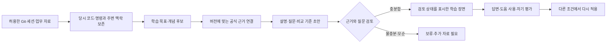

# PRD-0023: Code And Command Learning

## Metadata

- ID: `prd-0023`
- Status: `approved`
- Owner role: `human`
- Created: `2026-10-17`
- Updated: `2026-10-27`
- Preceding increment: [PRD-0022](prd-0022-work-grounded-learning-dashboard.md)
- Design track: [Code And Command Learning Design Plan](../design/code-and-command-learning-design-plan.md)
- Approval boundary: on 2026-10-17 the owner said “확인한대로 진행해봐” after
  reviewing this design. The source contract and manually reviewed code/command
  reader are approved to proceed in sequence. Automatic discovery, official-source
  monitoring and model execution/exposure remain separately bounded later work.

## Request Summary

### 2026-10-17: 학습 글의 내용과 화면 재구성

사용자는 짧은 정답 해설을 노트처럼 배치한 결과가 내용과 UI 모두 부족하다고
판단했다. 설명을 먼저 읽고 질문은 선택한다는 순서는 유지하되, 실제 업무를
재료로 개념의 작동 원리·구분·조건·다음 작업의 판단 기준까지 연결하는 기술
글로 재구성한다. 이 요청은 기존 첫 구현 범위 안에서 예시 두 편의 재작성과
본문·코드·목차·References 중심 화면 수정을 허용한다. 검토된 글은 질문의
정답과 분리된 불변 판본으로 보존한다. 자동 수집·생성·공식 자료 최신화는
이 변경에 포함하지 않으며, 학습 효과와 사용자 수용은 아직 확인되지 않았다.

### Original Request

업무를 진행하기 위해 충분히 이해하지 못한 명령어를 먼저 사용하거나 AI가 작성한
변경을 적용할 수 있다. 이후 **그때의 실제 명령어·코드·diff를 다시 보면서,
무엇이 달라졌고 왜 필요한지, 어떤 조건에서 원칙이 달라지는지** 배울 수 있게 한다.
일일 질문은 이 이해를 돕는 짧은 활동이다. 출발점을 사용자가 미리 적어 둔
약점 목록이나 기술명 목록에 한정하지 않는다.

사용자는 Kubernetes/on-prem/Azure 자원 정리, Java·Spring·Go 변경을 예로 들었다.
이것은 고정 커리큘럼이나 모든 분야를 첫 릴리스에 구현하라는 승인으로 해석하지 않는다.
대시보드의 위젯 구조와 기존 디자인을 사용하고, 복원한 Dashboard 제목은 유지한다.
첫 구현 후 사용자는 `왜 이 질문인가요?`, `배움의 근거`, `하던 일 이어가기`를
모두 제거하도록 요청했다. Dashboard에는 `오늘의 배움`만 한 열로 표시하며,
기존 학습 목록과 reader의 선정 안내·출처·기록은 유지한다.

## Source Set

| Source | Role and evidence boundary |
|---|---|
| 2026-10-17 owner request | 실제 diff·명령, 코드 수준 설명, 원리와 공식 자료, 일일 질문, 생성·화면 재설계의 직접 근거 |
| [Geoffrey Litt explain-diff](https://gist.github.com/geoffreylitt/a29df1b5f9865506e8952488eac3d524) | 저자 본문의 배경·직관·코드 순회·질문 구성과 주변 코드 조사 원칙을 참고. 댓글의 파생 프롬프트는 별도 출처이며 채택하지 않음 |
| [Current learning contract](../../policies/project/work-grounded-learning.md) and [FEAT-0125](../feature/feat-0125-reviewed-learning-home.md) | 수동 수업, 출처, 판본, 답변·자기 평가의 현재 구현. 코드 중심 수집/학습의 완성 증거가 아님 |
| [Schema](../../../src/localbrain/schema.sql), [Codex ingestion](../../../src/localbrain/ingest/codex.py), [Claude ingestion](../../../src/localbrain/ingest/claude.py) | 일반 도구 호출의 이름·위치와 메시지 텍스트가 존재함. 모든 명령 인자·출력·patch 또는 Git before/after 보존을 보장하지 않음 |
| Selected private retirement work notes | 가역 중지와 폐기, 정확한 자원·namespace, 제어기와 재생성 경로가 학습 소재가 될 수 있음을 확인. 기록 일부만 읽었으며 실제 명령 재실행이나 전체 작업 진단은 하지 않음 |
| [Design Constitution](../../policies/design/design-constitution.md) and current rendered home/reader | 화면·탐색·토큰의 기준. 이번 계획은 현재 화면과 제안 시안을 구분함 |

공개 기술 근거는 아래 예시 절에서 각각 연결한다. 공개 페이지는 2026-10-17에
확인했으며 사용자의 실제 배포/언어 버전과 대조한 상태는 아니다. 업무 원문과
실제 저장소 식별자는 private runtime에만 남기고 이 문서·시안은 합성 예시를 사용한다.

## Product Intent

학습 단위는 **실제 작업의 한 장면 + 설명할 개념 하나 + 판단을 확인할 질문**이다.
한 PR 전체를 한 번에 외우게 하거나 diff의 모든 줄에 문제를 붙이지 않는다.
예를 들어 `pdb`라는 자원을 지운 한 줄에서 자원 종류, 보호 범위, 제어기의 관계로
깊이를 확장한다. 언어 문법, 프레임워크 동작, 운영 원리도 같은 방식으로 연결한다.

설명은 다음 관계를 갖는다. 먼저 작업 목적과 필요한 배경을 보여 주고, 작은 예로
핵심 동작을 설명한 뒤 실제 코드의 실행 경로와 연결하며, 질문으로 자신의 이해를
확인한다. 익숙한 사용자는 먼저 예측하고 설명과 비교할 수 있다. 이 순서는
explain-diff의 설명 구성을 일일 학습에 적용한 제안이며, 고정된 5문항이나
PR 전체를 담은 긴 HTML 파일을 매일 만드는 요구로 옮기지 않는다.

## Current State And Design Gap

아래 표는 재설계 전 PRD-0022의 기준 상태다. 승인 후 첫 구현은
[FEAT-0126](../feature/feat-0126-code-learning-contract.md)의 근거 계약과
[FEAT-0127](../feature/feat-0127-code-command-reader.md)의 검토 수업 reader다.
실제 명령/고정 diff 2개 장면·6문항을 private DB에 추가했고, 코드 옆 질문,
하루 한 장면 선정 이유, 개념별 질문 깊이를 구현했다. 초기 화면만 관측했으며
기능 전환·학습 효과와 자동화는 완료 근거가 없다.

| Current pilot | Proposed change |
|---|---|
| 제목·설명·질문 중심의 수동 수업 | 당시 코드/명령 조각과 주변 맥락을 중심에 두는 학습 장면 |
| 업무 문서·공식 자료의 발췌 보존 | 정확한 변경 전후 또는 명령·출력·실행 상태까지 근거로 연결 |
| 수업마다 고정 질문 목록, 완료 날짜에 따른 순환 | 개념과 질문 의도를 구분하고 같은 원리를 다른 조건에 적용 |
| 한 개의 읽기 열과 답변 폼 | 코드를 보며 설명·예측·피드백을 오가는 읽기 화면 |
| 가져온 순서의 새 수업 | 업무 연관성·근거 충분성·학습 이력에 따른 설명 가능한 후보 선택 |

하루 한 장면 선정은 PRD-0022 pilot의 새 수업 1개와 복습 최대 2개 구성을 대체한다. 복습을 포함해 하루 최대 1개를 선정한다.

기존 수업과 답변을 지우거나 새 이해도 지표로 변환하지 않는다. PRD-0022의 현재
동작·미실행 기능 검증 상태는 그대로 기록하고 새 경계의 구현 완료로 간주하지 않는다.

## Confirmed Design Requirements

### 1. 실제 작업에 고정된 학습 재료

- Git 변경은 저장소의 로컬 식별자, base/head commit 또는 파일 내용 지문,
  변경 전후 파일, hunk 위치, 관련 호출부·설정·의존성 버전을 함께 추적한다.
  작업 트리 변경은 staged/unstaged와 캡처 시점을 구분한다. branch 이름만으로
  과거 코드를 복원했다고 주장하지 않는다.
- 명령은 문장 전체, 도구와 인자, 관련 입력/출력, 발생 시점, 문맥을 연결한다.
  **제안된 명령 / 실행 기록이 있는 명령 / 결과를 확인한 명령**을 구분한다.
  작업 노트의 실행 보고도 원본 terminal 결과와 구분한다.
- shell alias·함수·변수에 의미가 숨어 있으면 해당 정의를 읽을 수 있어야 한다.
  현재 shell에서 다시 실행하거나 현재 환경 변수로 과거 값을 채우지 않는다.
- 변경 줄만으로 설명되지 않으면 호출자, 타입, 설정, 트랜잭션·자원 수명 경계를
  읽는다. 코드가 없는 콘솔 작업은 가져온 기록/사용자가 제공한 자료로 시작하며
  기록되지 않은 콘솔 클릭·명령을 자동 관측했다고 표현하지 않는다.
- 원본이 사라지거나 불완전하면 보존된 발췌와 한계를 표시한다. 근거가 부족한
  자료는 질문 생성 보류 대상으로 남기며 현재 checkout을 당시 코드로 대체하지 않는다.

### 2. 출제 단위와 문제 생성

한 장면에서 먼저 **학습 목표 하나**를 고른다. 변경량, 기술명 출현 횟수,
AI 작성 여부만으로 중요도나 무지를 판단하지 않는다. 기능에 영향을 주는 분기,
호출 경계, 상태 전환, 실패 처리, 순서, 자원 소유권과 수명을 후보로 삼는다.

목표 생산 흐름은 다음과 같다. 첫 구현은 작성자가 원본과 공식 근거를 직접
대조해 만든 패킷을 가져오는 방식이며, 아래 흐름의 자동 수집·생성은 아직 구현되지 않았다.



질문 후보에는 다음 정보가 함께 있어야 한다.

| Required relationship | Purpose |
|---|---|
| 작업 장면 → 정확한 코드 줄/명령 구간 → 개념 | 무엇을 보고 왜 배우는지 추적 |
| 질문 의도 → 충분한 문제 조건 → 비교 기준 | 추측이나 숨은 전제로 정답을 만들지 않기 |
| 설명의 주장 → 업무 근거와 공식 자료의 해당 절 | 업무 사실과 일반 규칙을 구분 |
| 중요한 조건·예외 → 반례/조건 변경 질문 | 단순 문구 암기에서 적용으로 확장 |
| 작성 주체·모델/프롬프트 버전·검토 주체·수업 판본 | 현재 `reviewed_by`보다 상세한 생성·검토 이력 |

질문 형식은 목표에 따라 선택한다. 결과 예측, 특정 줄의 이유 설명, 호출/자원 관계
읽기, 순서 비교, 최소 변경의 효과, 조건을 바꾼 적용을 우선한다. 객관식은 서로 다른
오해를 비교할 때 사용하고 정답 길이·위치·힌트성 표현으로 답을 노출하지 않는다.
자유 서술은 의미가 같은 설명을 허용한다. 검토 기준은 하나의 정답 문자열보다
필수 논점과 성립 조건을 보존해야 한다.

자료에 없는 장애 원인이나 설계 의도를 만들어 내지 않는다. 출제자가 설명할 수
없거나 두 답이 모두 가능한 문제, 근거/버전이 불일치하는 문제는 학습 목록에
올리지 않는다. 정답 설명을 바꿀 때는 새 판본으로 만들고 과거 기록을 보존한다.

### 3. 학습 깊이와 복습

사용자는 처음 접한 내용이면 설명을 먼저 보고, 익숙하면 예측부터 시작할 수 있다.
한 번에 모든 단계를 완료해야 하는 레벨 게임으로 만들지 않는다.

| Learning action | Example | Evidence retained |
|---|---|---|
| 배경과 이름 이해 | 이 객체/어노테이션/함수는 어떤 역할인가? | 읽기·용어/힌트 사용; 독립 회상으로 세지 않음 |
| 흐름 설명 | 어떤 호출/상태/자원이 다음 단계로 이어지는가? | 해당 코드와 자신의 설명 |
| 결과 예측·이유 | 이 줄을 바꾸면 무엇이 달라지는가? | 설명 전 예측과 확신 |
| 조건·예외 적용 | 호출 경로·인자·버전이 다르면 같은 원칙이 성립하는가? | 바뀐 조건에 대한 답변 |
| 지연된 전이 | 며칠 뒤 다른 코드에서 같은 원리를 찾을 수 있는가? | 별도 장면·시점·도움 사용과 답변 |

복습은 이전 문제를 그대로 다시 읽는 것 외에 같은 원리의 다른 조건/다른 작업을
포함한다. 실제 새 사례가 없으면 **생성한 변형 예시**라고 표시하고 업무 이력으로
보관하지 않는다. 관련 개념의 다른 원리까지 이해했다고 넓혀 해석하지 않는다.

제안 기본량은 하루 한 장면·핵심 질문 하나, 선택적인 추가 질문이다. 짧은 복습도
같은 일일 부담 안에서 배정하고 밀린 문항 수나 연속 출석으로 압박하지 않는다.
정확한 시간/빈도/간격은 초기 사용에서 조정할 가설이다.

답변, 확신, 힌트/설명 사용, 문제 유형, 적용 조건, 자기 평가와 시간은 구분한다.
“이미 익숙함”은 추천 조절 신호이며 숙련 판정이 아니다. 미루기는 오답이 아니다.
언어별 숙련도 백분율이나 읽은 양을 이해도 점수로 만들지 않는다. 초기 자유 서술은
출처 있는 비교 기준과 자기 평가를 사용하며 LLM의 평가를 확정 정답으로 표시하지 않는다.

### 4. 원천 관리와 버전

업무 자료, 공식 근거, 생성 수업, 개인 답변은 별도 역할로 관리한다.

- 업무 자료에는 원본/스냅샷 식별자, 내용 지문, 당시 시점과 직접 관측/보고 상태가 필요하다.
- 공식 자료에는 소유 기관, 원문 URL, 절 위치, 문서 버전, 가져온 시각, 검토 시각,
  저장한 내용과 그 지문, 적용 조건을 기록한다. 접근 성공과 내용 검토를 구분한다.
- 실제 사용 버전은 해당 시점의 manifest/lock/build 설정 또는 기록에서 얻는다.
  공식 문서의 최신 버전과 별도로 관리하며 알 수 없으면 미확인으로 둔다.
- 필요한 절과 전제·예외를 가져와 보존한다. 최근 조회 시간만으로 최신성이
  보장됐다고 하지 않는다. 캐시와 검토된 학습 근거의 수명도 구분한다.
- 공식 원문 변경은 관련 질문을 재검토 대상으로 만들고, 판단에 영향을 줄 가능성이
  있으면 새 출제를 보류한다. 사소한 서식 변경과 의미 변경을 같은 것으로 보지 않는다.
  과거 답변 당시의 설명·원문 판본은 덮어쓰지 않는다.
- 허용할 업무 경로와 공식 원천 목록을 관리하는 화면을 제안한다. 사용자가 매일
  모든 문서를 분류해야 학습할 수 있는 의무 큐로 만들지 않는다.

### 5. Qwen과 자동화의 역할

기존 임베딩 검색은 관련 자료를 찾는 데 재사용할 후보이며, 출제나 이해도 측정의
검증 결과가 아니다. 로컬 생성 모델은 보존된 근거를 받아 개념 후보·설명·문항을
작성하는 역할로 제한한다. 공개 자료 검색에는 개인 코드·명령·회사 식별자를 보내지 않는다.

초기에는 검토한 소량의 코드/명령 수업으로 읽기 흐름을 구성한다. Qwen이 만든
초안의 자동 노출은 별도 품질 검토 뒤 결정한다. 출력 형식 검사, 자기 비평이나
같은 모델의 두 번째 답만으로 사실성이 검증됐다고 하지 않는다. 특히 근거 없는
주장, 조건 누락, 모호한 문제, 버전 오류와 잘못된 채점을 따로 확인해야 한다.
품질이 부족하면 초안 제작에만 사용한다. 모델 다운로드·교체·실행은 이 PRD의
draft 작성으로 시작하지 않는다. 개인 답변의 가중치 학습도 첫 범위에 넣지 않는다.

생성은 제한된 준비 작업으로 수행하고 열람과 분리한다. 대시보드 방문마다 재생성하거나
사용자가 답변 중인 문제를 바꾸지 않는다. 캐시/판본 키는 코드·명령, 공식 근거,
목표 개념과 생성 설정의 변화를 구분해야 한다.

## Proposed Screen Flow

세부 구성과 합성 시안은 [Design Plan](../design/code-and-command-learning-design-plan.md)이 소유한다.

1. **Dashboard 위젯:** 실제 업무 맥락과 보존한 코드/명령을 출발점으로, 개념의
   작동 원리·구분·조건·다음 작업의 판단 기준을 연결한 기술 글을 읽는다.
   2026-10-17 후속 정정에 따라 도입과 언어 표시·줄 번호가 있는 코드 → 근거를
   연결한 설명 절 → 적용 기준과 takeaway → 공식 References → 접힌 선택 질문으로
   구성한다. 데스크톱에서는 목차·References rail을 함께 두고 좁은 화면에서는
   References를 글 아래에 둔다. 글은 질문의 짧은 정답과 분리된 불변 판본이다.
   읽기 기록은 명시적 선택이며 방문만으로 남기지 않는다. 글에서 진입한 답변은
   도움을 받은 연습이다. 전체 diff와 보존한 원천 근거는 reader에서 읽는다.
2. **학습 화면:** 작업 목적과 확인 가능한 조건을 먼저 보여 준다. 코드/명령과
   설명·질문을 나란히 보며 선택한 구간을 함께 강조한다. 원본 전체·변경 전후·
   주변 호출부로 확장할 수 있다. 학습에 필요한 조건은 숨은 패널에 감추지 않는다.
3. **이해 확인:** 예측/짧은 답변 또는 설명 먼저 읽기 → 해당 줄과 연결된 설명·
   공식 근거 → 자기 설명 비교 → 선택적으로 조건을 바꾼 질문 → 마무리.
4. **학습 목록:** 주제와 개념, 이어보기, 실제 학습 기록, 미루기/숨김/복원.
   “근거 부족”·“다시 검토할 자료”는 사용자 오답과 구분한다.
5. **학습 재료 관리:** 허용 원천, 보존/버전 상태, 후보 선정 이유, 생성/검토 이력,
   변경된 근거와 영향받는 문항을 살핀다. 일일 학습의 필수 경유 화면은 아니다.

## Synthetic Teaching Examples

아래 예시는 형식 설계를 위한 가상 사례다. 실제 업무 diff를 조사해 내린 버그 판정,
운영 명령 추천 또는 이미 생성된 개인 수업으로 취급하지 않는다.

### PDB와 자원 정리

```bash
kubectl -n demo delete deployment/demo-worker
kubectl -n demo delete pdb/demo-budget
```

사례 조건: 폐기가 결정된 예시의 전용 자원이며 두 객체에 서로를 소유하는 관계는
없다고 가정한다. 질문은 “PDB가 첫 삭제를 막는가, 둘째 줄이 지우는 것은 무엇인가?”다.
PDB는 PodDisruptionBudget이며 Eviction API를 통한 자발적 중단을 제한한다.
직접 Pod/Deployment 삭제를 막는 보장은 없다. 둘째 줄은 예산 객체 자체를 지우는
행위다. 이를 Pod 삭제에 반드시 필요한 선행 절차라고 가르치면 안 된다.
[Disruptions](https://kubernetes.io/docs/concepts/workloads/pods/disruptions/),
[PDB API](https://kubernetes.io/docs/reference/kubernetes-api/policy/pod-disruption-budget-v1/).

이어지는 적용 질문은 “직접 삭제 대신 정상적인 eviction 경로로 노드를 비운다면
판단이 어떻게 바뀌는가?”다. 실제 답에는 namespace·selector·Pod 상태와 예산이
필요하다. 원본 정보 없이 특정 workload를 보호했다고 가정하지 않는다.
[Drain](https://kubernetes.io/docs/tasks/administer-cluster/safely-drain-node/).

### Java / Spring의 호출 경계

기존 메서드에 `@Transactional`을 추가한 diff를 보고 “이 호출 경로에서 새로
트랜잭션 경계를 만드는가?”를 묻는다. proxy mode, 동일 객체의 `this` 호출,
기존 트랜잭션 없음이라는 조건을 제공하면 자기 호출은 프록시 조언을 거치지 않는다.
기존 트랜잭션 안에 있는 경우까지 “트랜잭션이 전혀 없다”고 확대하지 않는다.
변형 질문은 다른 Bean에서 proxy를 경유하는 호출이며 AspectJ는 별도 조건이다.
[Spring @Transactional](https://docs.spring.io/spring-framework/reference/data-access/transaction/declarative/annotations.html).

### Go의 평가 시점

`defer fmt.Println(n)`에서 `defer func() { fmt.Println(n) }()`로 바뀐 부분을
보고, 등록 뒤 `n`이 바뀔 때 출력을 예측한다. 인자를 평가하는 시점과 지연된
함수가 실행되는 시점을 구분한다. 변형은 closure에 `n`을 인자로 넘기는 경우다.
[Go specification: defer](https://go.dev/ref/spec#Defer_statements).

### Azure의 요청과 완료

`az group delete --no-wait`를 예시로, 명령 반환만으로 삭제 완료를 확인했다고
볼 수 있는지 묻는다. 이 옵션은 장기 작업의 완료를 기다리지 않는다. 완료 상태의
별도 관측 없이 실제 자원이 지워졌다고 설명하지 않는다.
[Azure CLI group delete](https://learn.microsoft.com/en-us/cli/azure/group#az-group-delete).

## Learning Rationale And Limits

코드를 보며 이유를 자신의 말로 설명하게 하는 것은
[Chi et al., 1994](https://www.sciencedirect.com/science/article/pii/0364021394900167)의
자기 설명 연구를 설계에 적용한 것이다. 설명 전에 예측하고 나중에 다시 떠올리는
활동은 [Karpicke and Blunt, 2011](https://learninglab.psych.purdue.edu/downloads/2011/2011_Karpicke_Blunt_Science.pdf)의
회상 학습 결과를 참고한다. 두 연구가 이 제품, 실제 개발자의 업무, 정해진 문항 수나
간격의 효과를 입증하지는 않는다. 처음부터 모르는 내용은 배경과 예제로 진입하고,
익숙해지면 도움을 줄이며 새 상황의 설명을 확인하는 설계 가설로 사용한다.

## Excluded Scope

- 명령 실행, 자원 삭제, diff 적용, 자동 코드 수정·PR 리뷰 판정.
- 모든 로컬 저장소 감시, 원문 없는 과거 코드 재구성, 출처 없는 커리큘럼 대량 생성.
- 외부 AI로 개인 자료 전송, 필수 클라우드 서비스, 모델 교체/다운로드의 자동 시작.
- 언어별 숙련도 점수, 자동 확정 채점, 읽기/이미 앎 표시를 실력 증명으로 전환.
- Dashboard 제목·소개·브랜드 변경, 위젯 이동/크기 조절 기능, 중단된 workflow-map 재개.

## Constraints

- 원문은 읽기 자료다. 수집된 코드·문서 안의 지시를 시스템 작업으로 실행하지 않는다.
- 개인 코드·명령·답변은 private runtime에 보존한다. 공개 문서와 시안은 합성 데이터다.
- 판본 변경·중복 입력·원문 삭제 뒤에도 과거 질문과 답변의 의미를 보존한다.
- 새 자료 구조/생성/복습 계약은 후속 foundation에서 고정한다. 현재 스키마나
  `reviewed_by` 하나에 새로운 의미를 몰아서 넣지 않는다.
- 화면은 native shell과 의미 토큰, literal code, 키보드 접근, 좁은 화면의 읽기
  흐름을 따른다. 코드의 줄바꿈/공백/삭제·추가 구분을 잃지 않는다.

## Acceptance Envelope

1. 질문에서 당시 코드/명령과 주변 근거로 돌아갈 수 있으며 원본/버전 불확실성이 드러난다.
2. 작업 의도, 관측 사실, 일반 공식 규칙과 생성한 변형 예시를 구분할 수 있다.
3. 사용자는 코드를 보며 한 판단을 예측하고, 줄과 연결된 설명·조건·근거로 비교할 수 있다.
4. 처음 모르는 내용의 설명 진입과 익숙한 내용의 독립 답변 경로가 모두 존재한다.
5. 핵심 주장에 근거가 없거나 조건이 모호한 문항은 자동 일일 노출에 들어가지 않는다.
6. 복습은 원리와 적용 조건을 추적하며 읽기/도움/자기 평가를 숙련도와 혼동하지 않는다.
7. 자료·질문 수정이 과거 답변을 덮어쓰지 않고 일일 목록은 유한하게 끝난다.
8. 실제 기능·접근성·모델 품질 증거와 학습 효과 증거를 따로 보고한다. 후자는
   시간이 지난 독립 설명, 다른 상황 적용, 잘못된 확신과 부담의 실사용 관측이 필요하다.

## Candidate Features

첫 계약과 검토 수업 reader는 사용자의 계속 진행 지시에 따라 순차 구현한다.
후속 자동화 후보는 각각의 품질·실행 경계가 고정되기 전에는 시작하지 않는다.

| Candidate | Type | Boundary and dependency |
|---|---|---|
| 작업 장면·출처·학습 증거 계약 | foundation | 정확한 스냅샷/명령 상태/개념/질문/판본/응답 관계와 기존 기록 호환 |
| 코드·명령 읽기 수업 | product | 위 계약에 따른 수동 검토 수업으로 위젯→읽기→비교를 구현; 생성 모델 없이도 사용 가능 |
| 공식 자료 수집·변경 검토 | product | 허용 원천, 버전별 절 보존과 영향받는 문항 재검토; 위 계약 필요 |
| 로컬 출제 품질 경계 | foundation | 공개/합성 사례에서 근거 충실성·조건·모호성·비용을 평가해 초안/노출 허용 범위 결정 |
| 업무 후보 발견과 초안 제작 | product | 원본 확보와 품질 경계를 통과한 경로만 사용; 검토·보류 이유와 원천 관리 제공 |
| 개념과 상황을 연결한 복습 | product | 코드 수업의 실제 응답 증거에 따라 질문 종류·새 적용 사례를 제안 |

첫 구현은 명령 사례와 코드 diff 사례를 각각 포함한 소량의 검토 수업이다.
선택한 실제 자료와 버전 한계, 초기 추천·깊이 정책은 FEAT-0126/0127과
[현재 계약](../../policies/project/code-command-learning.md)에 고정했다.
추가 원천 범위, 모델·배치 예산과 자동 노출 허용 기준은 후속 Feature에서 확정한다.

## Uncertainty And Review Boundary

- 첫 구현은 선택한 폐기 작업 노트의 명령과 고정 Git diff에 한정한다. 더 넓은
  저장소/세션 자동 탐색 범위와 raw log 확보는 후속 경계다.
- 위 언어 예시는 합성 설계 자료다. 승인 후 private Spring 수업은 실제 두 commit의
  파일과 의존성 선언을 보존하고 맞는 공식 API를 대조했다. 실제 배포/종료 결과를
  관측한 것은 아니며, 명령 수업의 당시 Kubernetes 버전은 미확인으로 남겼다.
- 모델 선택·메모리·실행 빈도와 초안 자동 노출의 품질 기준은 미확정이다.
- 하루 부담, 자유 서술/객관식 비중, 지연 복습 간격과 새 사례 선정은 추천 기본값이며
  사용자에게 검증된 최적값이 아니다.
- 합성 시안은 화면 흐름만 보여 준다. 실제 reader의 수동 판본 저장과 규칙 기반
  추천은 별도 구현이며, 시안 자체가 자동 수집·개인화·모델 평가의 증거는 아니다.
- 2026-10-17 승인 이후 첫 범위는 [근거·선정 계약](../feature/feat-0126-code-learning-contract.md)과
  [검토 수업 reader](../feature/feat-0127-code-command-reader.md)다. 미확정 모델·자동 원천 탐색 정책을 구현에 넘기지 않는다.
