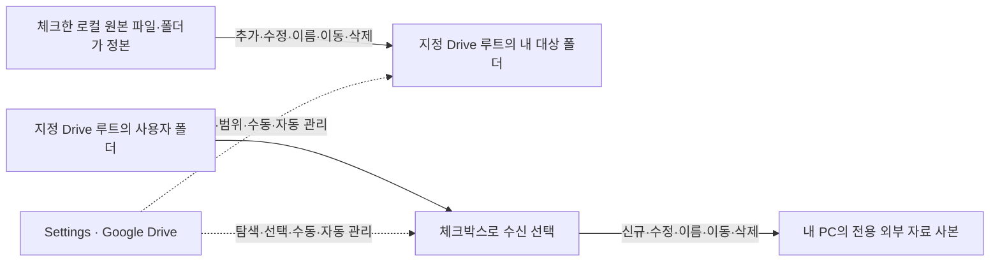

# PRD-0025: Google Drive Connection And Incremental Sync

## Metadata

- ID: `prd-0025`
- Status: `approved`
- Owner role: `human`
- Created: `2026-10-28`
- Updated: `2026-10-28`
- Planning role: `PRD Normalizer`
- Approval boundary: `2026-10-28` 사용자가 PRD 확정을 선언하고 Feature 생성부터 개발 완료까지 진행하도록 지시했다. 이 범위의 분해·Spec·구현·평가를 위임받았다. OAuth 권한 확대의 별도 확인과 실제 제공자 설정·실계정 검증은 구별하며, 최종 사람 검수·외부 배포 승인을 대신하지 않는다.

## Request Summary

**Settings의 별도 `Google Drive` 탭에서 개인 gcloud OAuth 연결, 지정 루트의 접근·동기화 권한 확인, 내 Local Context 항목의 체크 선택 업로드, 다른 사용자 폴더의 체크 선택 다운로드를 관리한다. 체크한 항목이 폴더면 vault를 포함한 폴더 안의 파일·하위 폴더·구조 전체를, 파일이면 그 파일을 대상으로 한다. 업로드·다운로드 공통으로 LocalBrain의 파일당 100MB 제한을 적용한다. 이는 Google Drive 자체의 제한이 아니다. 수동·자동 실행을 모두 지원하며, 업로드는 내 로컬 원본을 정본으로 삼아 추가·수정·이름 변경·이동·삭제를 Drive의 대응 게시 영역에 증분 반영한다. 수신은 선택 중인 원격 폴더를 정본으로 로컬 사본을 갱신한다. 동기화를 중단하거나 체크를 해제해도 기존 사본은 남긴다.**

Drive 자동 실행은 앱에서 설정한 시간대의 정해진 시각에 맞춘다. 내 업로드와 각 수신 폴더의 주기는 독립이며 15분부터 24시간까지의 7개 선택값을 제공한다. **기본 주기는 내 업로드 6시간, 각 수신 폴더 24시간이고 자동 실행은 초기 꺼짐**이다. 사용자가 대상을 선택한 뒤 자동 실행을 켜거나 수동 실행한다. 앱 시작·작업 종료 시각부터 간격을 다시 세지 않고 놓친 시각은 다음 정해진 시각까지 기다린다.

이번 완료 범위는 서로의 자료를 동기화할 수 있는 상태까지다. 모델 연결·검색·색인·자료 활용은 후속 범위다. 기존 Local Contexts 화면에 Drive 관리 기능을 합치지 않는다.

루트는 **전체 Google Drive 폴더 URL**을 입력해 지정하고 그 아래의 내 대상 폴더명과 구별한다. 별도의 ID 단독 입력 방식은 두지 않으며, 앱이 URL에서 폴더 ID와 포함된 추가 접근 정보를 읽는다. OAuth 인증·재인증 가이드를 제공하며, 연결·권한·동기화 상태를 확인할 수 있어야 한다. 실제 사용자 URL·ID나 인증정보는 개발 문서·가이드·마무리 기록에 넣지 않는다.

인증의 현재 기준은 `gcloud auth login --enable-gdrive-access --force`와 SDK가 요청하는 전체 `https://www.googleapis.com/auth/drive` 권한이다. 각 PC의 SDK를 재사용하며 앱용 프로젝트·Client JSON 준비를 선행 조건으로 두지 않는다. 앱의 실제 접근은 설정한 루트와 선택 대상으로 제한한다.

## Source Set

아래 과거 앱 제공 Client·좁은 scope 결정은 이후 사용자가 승인한 gcloud/full-Drive 인증으로 대체됐다. 다른 동기화 요구와 개인정보 경계는 유지한다.

| Source | Adopted scope and limits |
| --- | --- |
| 사용자의 최초 구상, `2026-10-27` | 설치자별 개인 OAuth, 지정 폴더, 게시자 폴더명, 선택한 Local Context 업로드, 다른 사람 자료의 로컬 수신, 공개 배포의 개인정보 경계. 비공개 대화의 실제 URL·계정·조직·작업 저장소 식별자는 복사하지 않는다. |
| 사전 구조 검토, `2026-10-27` | 최소 권한, 게시·수신 분리, 선택·출처·보존·실패 경계에 대한 **미승인 권고**. 당시의 수동 게시 우선·검토 버전 고정과 검색 포함 제안은 최신 사용자 방향에 맞춰 대체하거나 후속으로 보류한다. |
| 이번 요청과 초기 후속 답변, `2026-10-28` | PRD와 open point 논의. 모델 활용을 제외하고 API 통신·uploadable 권한 확인, 내 폴더 게시·루트 탐색·선택 수신, 수동·자동 실행을 설정에서 관리한다. 당시 두 방향의 삭제 반영을 함께 검토했으나 최신 답변이 업로드와 수신의 의미를 구별했다. |
| 초기 게시·수신 결정, `2026-10-28` | 루트 아래 사용자가 입력한 대상 폴더에 체크한 Local Context 항목을 게시한다. 당시의 업로드 upsert 한정은 아래 로컬 정본 결정으로 대체한다. 다른 설치자가 같은 루트에 게시한 폴더는 폴더별 체크로 수신하며, 선택 중에는 원격 추가·수정·삭제를 로컬에도 반영한다. 중단·체크 해제 시 기존 사본은 보존한다. 동일 대상 폴더명 중복으로 타인이 덮어쓰는 상황은 제외한다. 사용자 입력 식별 예시는 개발 문서·마무리 기록에 복사하지 않는다. |
| 자동 일정 추가 결정, `2026-10-28` | 내 업로드 주기와 다른 사용자 폴더의 로컬 동기화 주기를 분리하고, 수신 폴더마다 주기를 각각 조정한다. 최초 2일 옵션은 이후 사용자 지시로 제거했다. 현재 주기 선택값은 아래 정시 일정의 7개이며, 후속 답변에서 기본 주기를 업로드 6시간·수신 24시간으로 정했다. |
| 정시 일정과 후속 답변, `2026-10-28` | Drive는 작업 종료 시각 기준 간격이 아닌 정해진 시각에 실행한다. 15분은 매시 00·15·30·45분이고, 긴 시간 주기는 앱에 설정한 시간대의 자정 기준이다. 2일을 제거해 최대 24시간으로 제한했다. 앱 종료·수면으로 놓친 시각은 보완 실행하지 않고 다음 경계까지 기다린다. |
| 루트 입력·인증 안내·상태 확인 요청, `2026-10-28` | 사용자가 제공한 폴더를 공통 루트로 사용하는 의미를 확인했다. URL과 ID 입력을 함께 지원하던 초기안은 아래 전체 URL 입력 결정으로 대체한다. 개인 OAuth 인증 가이드와 연결·동기화 상태 진단을 포함한다. 제공된 실제 URL·ID는 복사하거나 조회하지 않는다. 남은 제품 선택과 기술 검증은 아래 open point에서 구별한다. |
| OAuth 운영 후속 답변, `2026-10-28` | 앱 제공 OAuth Client와 개인 로그인 방식을 선택했다. 앱이 인증 필요 상태에서 공식 인증 흐름을 시작하고, 사용자는 Google 화면에서 계정 선택·동의를 마친다. 직접 명령을 실행하는 보조 안내도 검토하되 아직 구현되지 않은 CLI나 명령 이름을 현재 기능으로 제시하지 않는다. |
| 인증·권한 알림 요청, `2026-10-28` | 미완료·유효하지 않은 인증, 인증된 계정의 대상 폴더 접근 불가, 보기·댓글 수준 권한으로 생성·수정을 못 하는 상황을 구별해 알린다. 실제 주어진 인증·접근·동기화 작업에 필요한 경우만 다루고 추측성 원인이나 가상의 예외 목록을 늘리지 않는다. 초대 여부는 Google 응답으로 확인할 수 있는 범위만 표현한다. |
| 전체 폴더 URL 입력 결정, `2026-10-28` | 공통 루트의 기본 입력 형식은 전체 Google Drive 폴더 URL이다. ID 단독 입력을 별도로 제공하지 않고 앱이 URL에서 폴더 ID와 포함된 추가 접근 정보를 추출한다. 실제 사용자 URL을 코드·가이드·배포 설정의 기본값으로 넣는 결정은 아니다. |
| 폴더·파일 선택과 기본 주기·증분 요구, `2026-10-28` | 체크한 Local Context가 폴더면 그 안의 모든 파일·하위 폴더·구조를, 파일이면 해당 파일을 동기화한다. 기본 주기는 내 업로드 6시간·각 수신 폴더 24시간이고 변경분만 전송·반영한다. 이후 초기 자동 꺼짐과 대상 선택 후 사용자가 켜는 방식으로 확정했다. |
| 삭제·구조 변경과 정본의 명시적 확인, `2026-10-28` | 내 문서를 로컬에서 지우면 내 Drive 대상에서도 삭제한다. 문서 재배치·이름·폴더 구조 변경도 내 로컬이 정본이므로 위쪽 게시 영역에 반영한다. 앞선 업로드 upsert 한정을 대체한다. 체크 해제·동기화 중단과 활성 동기화 중 원본 삭제는 구별하며, 중단 시 기존 사본 보존은 유지한다. |
| 초기 삭제 반영 결정, `2026-10-28` | 당시에는 업로드·수신의 대응 사본을 바로 제거하고 별도 복구 보관을 두지 않기로 했다. 이후 Google 휴지통 선택에 따라 Drive 쪽은 휴지통 이동으로 대체하며 수신 로컬 사본의 즉시 제거는 유지한다. 체크 해제·중단 시 보존과 기존 정시 일정은 유지한다. |
| 수신 후 이용의 사용자 관리 결정, `2026-10-28` | 받은 자료의 이용·복사·오프라인·개인 백업은 수신자가 결정하며 앱이 통제하거나 이용을 추적하지 않는다. 이를 허용한 자료를 공유한다는 전제다. 권한 회수는 추가 수신만 멈추며 받은 사본의 이용 정책을 새로 묻지 않는다. |
| Google 휴지통 선택과 보관 기간 질문, `2026-10-28` | Drive 쪽 삭제는 Google 휴지통 이동으로 바꾼다. 앞선 Drive 직접 제거 결정을 대체하며 로컬 수신 사본 제거는 기존 결정을 유지한다. 표준 Drive 휴지통 보관 기간과 조직 Vault 규칙의 차이는 공식 문서로 확인한다. 이후 자동 실행 초기 꺼짐으로 확정했다. |
| 일반 동기화 흐름의 확정, `2026-10-28` | 자동은 초기 꺼짐·대상 선택 후 켜기다. 연결 중단 시 설정·사본·상태를 유지하고 복구되면 기존대로 동작한다. 필요한 OAuth 후 실제 동기화를 시도하며 발생한 오류에 필요한 조치만 안내한다. 앱이 이용자·조직·공유 인원을 제한하거나 공유 범위 조사·추가 승인·반복 동의를 요구하지 않는다. 별도 시험 파일은 두지 않는다. |
| 로컬 폴더 근거의 파일당 크기 제한 요청과 확정, `2026-10-28` | 큰 파일의 무분별한 업로드·다운로드를 피하도록 등록 폴더의 크기 분포를 참고해 100MB를 제안했고 사용자가 이를 확정했다. 양방향 공통 100MB(100,000,000바이트)는 Google Drive 자체 한계가 아닌 LocalBrain 동기화 정책이다. 총량 쿼타는 후속 주제다. 실제 경로·파일명·개인 측정 통계는 개발 문서에 복사하지 않는다. |
| 사용자가 지정한 기존 클라우드 게시 방식의 비공개 runbook | 방향·폴더를 고정한 변경 파일 비교·복사, 상대경로 유지, 크기/SHA·전송 중 변경·원격 metadata 확인, 충돌 시 보존을 참고한다. 그 방식은 목적지 전용 파일을 보존하고 자동 삭제 mirror·상시 전송을 하지 않는다. 이번 양방향 경로의 삭제 반영·구조 변경·자동 동기화 검증 결과를 그 구현에서 가져오지 않는다. |
| [Roadmap](../project/roadmap.md#phase-4-external-read-only-sources), [Controlled Actions](../project/roadmap.md#phase-6-handoff-and-controlled-actions) | 기존 외부 연결은 읽기 중심이며 외부 쓰기는 미리보기·귀속·명시적 승인 대상이다. 클라우드 동기화는 기존 MVP의 보류 범위다. 이 PRD는 제한된 Drive 교환과 자동화의 새 경계를 제안한다. |
| [Privacy](../../policies/project/privacy-and-data.md), [Storage](../../policies/project/installation-and-storage.md#storage-ownership-and-configuration) | 공개 코드·배포물, 비공개 데이터·파생 캐시·인증정보의 분리, 보관·정리 소유권. 다운로드가 검색·색인 동의로 승격되지 않는 규칙. |
| [Settings And Runtime](../../policies/project/desktop-app-and-settings.md), [Current Local Context Formats](../../policies/project/desktop-app-and-settings.md#supported-material-and-permissions), [Backend Lifecycle](../../../src/localbrain/main.py), [Desktop Close And Quit](../../../desktop/src-tauri/src/main.rs), [Current Local Sync Clock](../../../src/localbrain/source_sync.py) | 기존 Session·Local Context 동기화는 backend가 살아 있는 동안 직전 작업 종료 시각을 기준으로 간격을 계산한다. 앱 창 닫기와 완전 종료, 브라우저 닫기와 서버 종료를 구별한다. Drive는 backend 생존 경계만 재사용하고 주기 계산·놓친 실행 처리는 이 PRD의 정시 규칙을 따른다. 기존 로컬 동기화의 시계나 외부 접근 권한을 변경하지 않는다. |
| [Current Search Contract](../../policies/project/natural-language-search.md), [Source Admission](../../../src/localbrain/natural_search/source.py) | 검색은 현재 동기화와 별개다. 다운로드 위치가 자동 검색 대상이 되는 것은 아니며 이번에 검색 허용 규칙을 바꾸지 않는다. |
| [In-App Documentation](../../policies/project/app-documentation.md) | 설치자용 인증·연결 안내는 기존 Settings guide의 확장으로 계획하고 Google Drive 탭에서 연결한다. 앱 제공자의 OAuth 운영 안내와 사용자 이용 안내를 구별한다. 이번 PRD 작성이 실제 앱 가이드 구현을 뜻하지 않는다. |
| Google 공식 문서, `2026-10-28` 확인 | 아래 OAuth·폴더·변경·삭제 제약의 근거다. 실제 계정·폴더에 대한 통신·권한·동기화 검증을 수행했다는 뜻은 아니다. |
| [PRD Management](../../policies/harness/prd-feature-management.md), [Workflow](../../agents/flows/workflow.md) | draft를 사람과 검토한 뒤 PRD 승인, 이후 Feature 경계 검토로 진행한다. 후보 목록은 실행 허가가 아니다. |

## Product Intent

각 설치자가 자기 Google 계정으로 지정한 Drive 공간에 자기 자료를 게시하고 다른 게시자의 자료를 선택해 PC에 유지하게 한다. 회사 소속이나 지인 여부를 앱이 판정하지 않으며, 접근 가능 여부는 Google 권한과 사용자의 동기화 설정이 결정한다.

동기화는 **내 로컬 원본 → Drive의 내 대상 폴더**, **Drive의 선택한 사용자 폴더 → 내 PC의 외부 자료 사본**이라는 두 개의 단방향 경로다. 각 경로의 원본을 정본으로 삼아 추가·수정·이름 변경·이동·삭제와 폴더 구조를 대응 사본에 반영한다. 내 업로드는 로컬이 정본이며 원격 수동 편집을 내 로컬로 역수신하지 않는다. 수신은 선택한 원격 폴더가 정본이다. 체크 해제·중단 후에는 그 시점의 사본을 유지한다. 받은 사본을 타인의 원격 원본에 되쓰는 공동 편집이나 설치자 DB·Session 전체 복제는 포함하지 않는다.

선택한 게시 자료는 Google과 해당 Drive의 접근자에게 전달되고 상대가 이미 받은 사본을 앱이 회수할 수는 없다. 개인정보 목표는 **선택한 자료·저장소·동기화 범위만 전송하며 설치자의 개인정보가 공개 코드·배포물·개발자 서비스로 흘러가지 않는 것**이다. 사용자가 저장소와 대상을 설정하고 수동 실행하거나 자동 실행을 켜면 그 설정에 따라 이후 변경을 계속 동기화한다. 별도 공유 확인·반복 동의·변경별 승인은 요구하지 않는다.

## Confirmed Scope

사용자가 확정한 제품 범위다. 아래 기술 open point는 Feature별 계약과 검증으로 해소하며 제품 범위를 임의로 확대하지 않는다.

1. **설정에 한정된 관리:** Settings 안의 독립 `Google Drive` 탭을 제안된 관리 위치로 사용한다. 연결·내 게시·자료 받기·일정·상태를 그 안에서 다룬다. 기존 Local Contexts 화면을 Drive 탐색기로 바꾸거나 별도의 최상위 업무 화면을 추가하지 않는다.
2. **개인 연결과 루트 지정:** 설치자별 개인 OAuth를 사용한다. 공통 루트는 전체 Google Drive 폴더 URL을 입력하고 폴더 ID·추가 접근 정보는 앱이 읽는다. 별도의 ID 단독 입력 방식은 두지 않는다. 인증이 필요하면 먼저 Google 로그인을 진행하고 루트 조회·다운로드·업로드 등 실제 요청의 결과로 연결 상태와 오류를 확인한다. 전체 트리의 쓰기 권한을 사전 시험하는 별도 절차는 두지 않는다. URL 입력 자체가 접근 권한을 부여하지 않으며 루트와 내 하위 대상 폴더명은 별도 값이다.
3. **체크 선택 업로드:** 사용자가 지정 루트 아래 대상 폴더명을 입력하고 올릴 기존 Local Context 항목들을 체크한다. 폴더 항목이면 그 안의 파일·하위 폴더·구조 전체를, 파일 항목이면 그 파일을 대상으로 한다. LocalBrain의 파일당 100MB 제한을 업로드·다운로드에 동일하게 적용하고 초과 파일은 사유와 함께 제외한다. 내 로컬을 정본으로 대응 게시 영역을 유지하며 폴더명에 조직·신원 해석 규칙을 부여하지 않는다. 문서 예시는 `<target-folder-name>` 같은 placeholder만 사용한다.
4. **폴더별 체크 선택 수신:** 다른 설치자도 같은 루트의 자기 폴더에 자료를 게시한다. 루트에서 내 대상 폴더를 제외한 다른 사용자 폴더들을 조회하고 폴더별 체크로 받을 대상을 고른다. 다른 폴더가 5개라면 5개를 각각 독립적으로 선택할 수 있다. 선택한 폴더의 자료는 자기 PC의 `Application Support/LocalBrain` 아래 전용 외부 자료 영역에 받는다. 이번 선택 단위는 사용자 폴더 전체다.
5. **원본에 따른 증분 반영:** 두 경로 모두 최초 동기화에서 필요한 전체 사본을 만든 뒤 추가·변경된 파일과 이름·이동·삭제 차이만 반영한다. 업로드는 로컬의 파일·폴더 삭제와 구조 변경을 Drive의 내 대응 게시 영역에 반영한다. 삭제 대상은 Google Drive 휴지통으로 옮겨 활성 게시 목록에서 제외한다. 수신은 원격의 삭제·휴지통 상태가 확인된 대응 로컬 사본을 바로 제거하며 별도 로컬 복구함을 두지 않는다. 변경 없는 파일을 매번 다시 전송하지 않고 체크 해제·중단 자체로 기존 사본을 지우지 않는다.
6. **수동·자동과 독립 정시 일정:** 사용자가 지금 실행할 수 있고 자동 동기화도 가능해야 한다. 자동 실행은 초기 꺼짐이며 사용자가 대상을 선택한 뒤 켠다. 내 업로드 주기는 수신과 별도로 설정하고 선택한 다른 사용자 폴더마다 수신 주기를 각각 조정한다. 기본 주기는 업로드 6시간·각 수신 폴더 24시간이다. 아래 정시 일정의 7개 선택값을 공통으로 제공하며 최대 24시간이다. 앱에 설정한 시간대의 경계를 사용하고 앱 시작·작업 종료·수동 실행은 이후 경계를 밀지 않는다. 한 주기를 바꿔도 나머지 일정은 바뀌지 않는다. 앱/backend 종료 경계는 유지하며 오류 재시도 등의 기술 계약만 OP-06에 남긴다.
7. **중단 시 보존:** 업로드·수신 체크 해제나 동기화 중단은 향후 전송·갱신을 멈춘다. 이미 올린 Drive 자료와 이미 받은 로컬 사본은 그대로 남으며, 원래 로컬 Context도 삭제하지 않는다.
8. **이용자 제한과 기록 경계:** 각 설치자가 자기 Google 계정과 동기화할 저장소를 정한다. 앱은 회사·조직·공유 인원에 따른 이용 제한이나 별도 사용자 허용 목록을 두지 않는다. 접근 여부는 설정한 저장소의 Google Drive 권한을 따른다. 코드·합성 예제와 각 설치자의 계정·대상·자료·토큰·선택·실행 상태를 분리하고 실제 식별 예시·설정값을 개발 문서·실행 기록·평가·wrap-up에 복사하지 않는다.
9. **개인별 gcloud 인증과 가이드:** 각 PC에 설치한 Google Cloud CLI로 본인 계정에 로그인하고 전체 Drive 접근에 동의한다. 기존 로그인 재사용 또는 명시적인 Google 로그인 행동을 제공하며 연결 계정을 고정한다. 사용자 안내는 SDK 설치·승인 명령·루트/대상 설정·수동/자동 실행·실제 오류 조치·중단/복구를 설명한다. 앱용 프로젝트·Client 생성은 사용 조건이 아니며 안내 읽기만으로 인증·Drive·모델 호출을 실행하지 않는다.
10. **연결·동기화 상태와 실제 오류 안내:** OAuth 인증, 실제 루트 조회·업로드·다운로드 결과와 마지막 성공·다음 예정·오류를 구별한다. 실제 요청에서 인증·접근·작업 권한 오류가 발생하면 해당 문제와 필요한 다음 행동을 알린다. 별도 시험 파일·공유 인원 조사·공개 링크 경고·반복 동의 알림은 두지 않는다. 연결 정상과 자료 최신 상태를 동일하게 표시하거나 확인하지 못한 초대·권한 원인을 단정하지 않는다.
11. **수신 후 이용은 사용자 관리:** 공유는 받은 자료를 이용·복사·오프라인 사용·개인 백업할 수 있도록 허용한다는 전제다. 앱은 이를 관리하거나 이용을 추적하지 않는다. 원격 권한 회수는 추가 수신만 멈추고 기존 사본을 제거하지 않는다. 활성 동기화 관리 사본의 원격 변경·삭제 반영은 유지하며 사용자가 별도로 만든 사본·백업에는 관여하지 않는다.

12. **연결 중단과 복구:** 연결이 끊기면 대상·주기·활성 상태·사본·마지막 성공 상태를 유지하며 갱신을 멈춘다. 다시 연결되면 기존 설정과 정시 일정대로 재개한다. 연결 손실만으로 토큰을 지우거나 Google 동의를 회수하지 않으며 실제 재인증 필요 시에만 로그인 조치를 안내한다.
13. **설정대로 계속 동기화:** 저장한 계정·저장소·체크 대상과 수동 실행/자동 켜기가 지속 동기화 지시다. 공개 링크·그룹 인원 확인·추가 공유 승인·변경별 재동의·반복 알림은 두지 않는다. Google OAuth와 실제 오류 안내는 유지한다.

## Excluded Scope

- 이번 연결·탐색·동기화 경로에서 모델 설치·연결·추론, Qwen 검색, 색인 생성·자료 분석·답변 생성.
- 받은 자료의 Local Context 자동 등록, 기존 Local Contexts 화면 개편, 검색 결과·자료 활용 화면 추가. 업로드 선택은 기존 등록 자료를 참조하되 원래 등록·본문·이력은 변경하지 않는다.
- 서비스 계정, 회사 공용 자격증명, 특정 회사·실제 폴더·계정을 코드에 고정하는 배포.
- Session·DB·개인 실행 상태 전체의 동기화, 공동 편집, 받은 타인 자료의 자동 재게시, 타인 게시 영역으로의 쓰기.
- 업로드·수신 체크 해제나 동기화 중단 자체에 따른 기존 Drive/로컬 사본 삭제. 활성 동기화 중 확인된 원본 삭제의 대응 반영은 포함한다.
- 동일한 대상 폴더명을 여러 사용자가 사용해 서로 덮어쓰는 중복 상황과 그 충돌 해결 기능. 이번 범위는 사용자별 대상 폴더명이 구별된다는 전제다. 수신 선택을 하위 폴더·개별 파일로 세분화하는 기능도 포함하지 않는다.
- 선택하지 않은 개인 자료·인증정보·실제 설정의 공개 Git·fixture·스크린샷·오류 보고·배포물 포함, 개발자 중계 서버나 외부 AI로의 전달.
- 공유 ACL의 자동 변경, 선택·관리 범위 밖의 삭제, 공개 웹훅 서버, 앱/backend 완전 종료 후에도 동기화하는 별도 daemon·자동 시작 기능은 이번 범위에 포함하지 않는다.

- 앱 자체의 별도 휴지통·복구함·삭제 보관 기간·자동 복원, Google 휴지통의 자동 비우기·영구 삭제, 조직 Vault 보존 규칙의 조회·변경. Google Drive 휴지통 이동 자체는 포함한다.
- 받은 자료의 복사·오프라인 이용·개인 백업을 제한하거나 추적하는 기능, 수신자가 별도로 만든 사본·백업의 통제·회수.

- 별도 진단용 시험 파일·시험 정리 절차, 전체 하위 파일의 쓰기 권한 일괄 사전검사, 사용자·회사·공유 인원 허용 목록, 공개 링크 자체 차단, 그룹 구성원 조사와 추가 공유 승인·반복 동의 알림.

## Pre-Implementation Baseline And Evidence Limits

- 사전 검토에서 개인 OAuth Drive 커넥터는 미구현으로 보고됐다. 이번 `src/localbrain`·테스트·의존성 검색에서도 관련 구현을 확인하지 못했다. 아직 코드·계정·Drive 설정은 바꾸지 않았다.
- 기존 AI 검색은 `Qwen3-Embedding-0.6B`를 쓰는 로컬 검색이며 4B/8B 생성 실험과는 별개다. 현재 검색은 data·private cache·development·public Hub cache의 **루트 자체와 모든 하위경로**를 제외한다(`candidate == root or root in candidate.parents`). 일반 Context에도 연결된 Source와 활성·읽기 가능한 root, 비어 있지 않은 본문 조건이 있다. 이번 다운로드는 이 조건을 바꾸거나 검색을 시작하지 않는다. 향후 자료 활용은 별도 PRD에서 외부 자료의 검색 허용과 출처를 검토해야 한다.
- 사전 검토에는 당시 연결 계정의 시험 대상 메타데이터 조회가 `404`였다고 기록돼 있다. 폴더 유형·공유 범위·접근 불가 원인은 미확인이고 이번에는 재조회하지 않았다. 이를 폴더 부재나 모두의 접근 불가로 확정하지 않는다.
- 이전 저장소 개인정보 검사 통과는 파일 공개 경계에 한정된다. OAuth, 실제 업로드 가능, 실행 중 비승인 전송 방지, 수정·삭제 동기화, 배포 앱 OAuth는 아직 검증하지 않았다.

## Settings Surface And User Flows

이번 작업의 예상 제품 프로필은 **Fullstack Product**다. 표면 lane은 **Settings·OAuth·인증 가이드·연결 진단 / 내 게시 범위·상태 / 루트 탐색·선택 수신 / 수동·자동 실행·복구**다. 작성 초기에는 실제 UI를 만들지 않았으며, 아래는 그때 정리한 표면 계약이다. 이후 구현·검증은 Delivery Record와 후속 Run이 소유한다. 기존 설정의 디자인·포커스·저장·오류 처리 규칙을 따른다.

| Google Drive 탭 안의 영역 | 사용자가 할 일과 알아야 할 상태 |
| --- | --- |
| 계정·루트 연결 | 인증 가이드 진입, 필요한 Google 로그인·동의, 전체 루트 폴더 URL 입력과 실제 루트 조회. 인증 후 실제 동기화 요청의 결과·오류를 확인하며 별도 시험 파일은 만들지 않는다. |
| 내 자료 보내기 | 루트 아래 대상 폴더명 입력, Local Context 항목별 체크, 기본 6시간인 내 업로드 주기와 수동·자동 실행. 폴더 전체·개별 파일을 선택한 설정대로 동기화한다. 체크 해제와 중단은 이미 게시한 자료를 지우지 않는다. |
| 다른 사용자 자료 받기 | 내 폴더를 제외한 다른 게시 폴더 목록을 조회하고 폴더별 체크 선택·수신 주기를 각각 설정. 받을 폴더·로컬 상태와 선택 중의 추가·수정·삭제 반영을 확인한다. 체크를 해제하면 현재 사본을 남기고 이후 동기화를 멈춘다. |
| 동기화 설정·실행 | 초기 꺼짐인 자동 실행을 사용자가 켜거나 수동 실행한다. 내 업로드 및 각 수신 폴더의 주기·마지막 성공·진행·다음 예정·오류를 구별한다. 설정한 대상의 이후 변경을 계속 반영하며 추가 공유 동의 화면은 두지 않는다. |
| 연결·상태 진단 | 실제 OAuth·루트 조회·동기화 결과와 저장된 상태를 보여준다. 문제가 발생한 대상과 확인 시점·오류·다음 행동을 구별한다. 별도의 쓰기 시험이나 전체 공유 구성원 확인 절차는 두지 않는다. |

### 루트 폴더 입력

설정의 공통 루트는 **전체 Google Drive 폴더 URL을 기본 입력 형식**으로 받는다. 사용자는 브라우저에서 폴더 URL을 복사해 붙여넣고 앱이 폴더 ID를 추출한다. 별도의 ID 단독 입력 방식은 제공하지 않으며, ID만 입력하면 전체 폴더 URL 입력을 안내한다. 예시는 `https://drive.google.com/drive/folders/<folder-id>`이며 실제 값이 아니다. 실제 사용자 URL을 코드·가이드·배포 설정의 기본값으로 넣지 않는다.

이 루트 아래의 **`<target-folder-name>`은 내 업로드 영역의 이름**이다. 수신은 같은 루트 아래 다른 사용자 폴더를 조회·체크하는 흐름이다. 앱이 정한 루트를 계정의 전체 My Drive 루트와 혼동하거나, 입력 오류 시 다른 기본 루트로 대체해 쓰지 않는다. ID의 모양만으로 My Drive·Shared Drive 유형이나 공유 범위를 판정하지 않는다.

Google API는 폴더도 ID로 조회하며 폴더의 MIME type은 `application/vnd.google-apps.folder`다. 필요한 접근은 OAuth scope와 Google 공유 권한을 함께 만족해야 한다. 현재 승인된 인증은 전체 `drive` scope이며, 폴더 URL 입력은 해당 계정에 없는 공유 권한을 부여하지 않는다. 앱의 실제 접근은 설정한 루트와 선택 대상에 제한한다. [Folder lookup](https://developers.google.com/workspace/drive/api/reference/rest/v3/files/get), [Folder type](https://developers.google.com/workspace/drive/api/guides/folder), [Drive authorization](https://developers.google.com/workspace/drive/api/guides/api-specific-auth)

일부 링크 공유 항목에는 `resourceKey` 같은 추가 접근 정보가 필요할 수 있다. URL에 포함돼 있으면 앱이 함께 추출·보존해 필요한 API 요청에 사용하며, 사용자가 기본 설정에서 별도 필드로 입력하게 하지 않는다. URL 입력 자체가 OAuth·공유 권한을 대체하지 않으므로 연결 확인은 별도로 수행한다. 임의 URL을 그대로 요청하지 않고 허용된 Drive API만 사용하며 추가 접근 정보도 비공개로 관리한다. [Link-shared access](https://developers.google.com/workspace/drive/api/guides/resource-keys)

### Google CLI OAuth 인증 안내

확정된 인증은 각 PC의 Google Cloud CLI가 처리한다. `gcloud auth login --enable-gdrive-access --force`는 기본 SDK 권한에 전체 `https://www.googleapis.com/auth/drive` 읽기·쓰기를 추가하며 사용자가 이 범위를 명시적으로 승인했다. 앱 전용 Desktop Client·좁은 readonly+drive.file 설계를 대체한다. Google의 동의 범위와 앱의 선택 루트 접근 범위를 구별한다.

- **설치자 안내:** SDK 설치 → Drive 접근을 포함한 개인 로그인 → 기존 로그인 연결 또는 앱의 Google 로그인 → 전체 루트 URL·내 폴더와 대상 선택 → 수동/자동 실행. 실제 인증·폴더 권한 오류만 조치한다. 명령을 이미 실행했다면 브라우저를 다시 열지 않고 연결할 수 있다.
- **계정과 자격증명:** 처음 연결할 계정을 지정하거나 SDK의 현재/단일 계정을 확인한다. 연결 뒤에는 그 계정을 고정하고, gcloud 활성 계정 변경으로 다른 사람 자료를 전송하지 않는다. Google 응답의 사용자 ID가 이전과 다르면 기존 설정과 사본을 보존하고 연결을 거절한다. SDK가 자격증명·갱신을 관리하며 앱 DB·문서·로그·백업에는 토큰이 없고 액세스 토큰은 메모리에만 잠시 둔다.
- **로그인과 복구:** 앱의 명시적 로그인은 승인 명령에 `--no-activate`를 사용하고 ADC를 갱신하지 않는다. 최초 Google 브라우저 선택·동의는 사용자 몫이며 예약 작업은 로그인 창을 자동 반복하지 않는다. 정상 갱신은 SDK를 통해 처리하고 실제 재인증 필요만 안내한다. 통신 실패는 자격증명 삭제·동의 회수·상태 초기화를 유발하지 않는다.
- **안내 소유권:** 기존 여섯 영어 Docs 구조 안의 Settings guide가 SDK 설치·연결·실행·오류를 소유한다. 내부 개발 문서는 실행 경로 override·프로세스/토큰 소유권·패키징 검증을 소유한다. 실제 사용자 값은 예시·로그·마무리 기록에 넣지 않는다. 앱 읽기·탭 열기는 캐시만 사용하며 별도 모델/Drive/CLI 인증 작업을 시작하지 않는다.

Google은 [gcloud의 Drive 인증 경로](https://docs.cloud.google.com/sdk/docs/authenticate#add_google_drive_to_your_scope)를 문서화했다. 이 경로에서 새 프로젝트·앱 Client를 만들 것을 선행 요구하지 않는다. 실제 SDK·계정·폴더에 대한 성공 증거는 합성 테스트와 별도로 기록한다.

### 연결과 실제 동기화

1. 인증이 필요하면 사용자가 앱에서 Google 연결을 시작하고 기본 브라우저에서 개인 OAuth 로그인·동의를 마친다. Google이 요구하는 인증 절차는 생략하지 않는다.
2. 전체 루트 폴더 URL과 내 대상 폴더를 설정한다. 실제 루트 조회로 폴더를 확인하고 받을 사용자 폴더를 고른다.
3. 보낼 Local Context와 받을 폴더를 체크한 뒤 수동 실행하거나 초기 꺼짐인 자동 실행을 켠다. 실제 선택한 파일·폴더만 전송하며 합성 시험 파일은 만들지 않는다.
4. 실제 요청에서 인증·접근·작업 권한 오류가 나면 해당 대상과 필요한 조치를 안내한다. 별도 공유 확인·구성원 조사·추가 동의·권한 시험 화면은 거치지 않는다.

### 연결 중단과 복구

연결이 끊기거나 해당 Drive에 접근할 수 없으면 갱신을 멈추고 대상 선택·주기·자동 활성 상태·기존 사본·마지막 성공 상태를 보존한다. 실패나 불완전한 조회를 원본 삭제 또는 새 동기화 성공으로 기록하지 않는다.

연결이 복구되면 저장된 설정과 기존 정시 일정대로 다시 동작한다. 자동이 켜져 있던 대상은 켜진 상태를 유지하고 꺼져 있던 대상은 자동으로 켜지지 않는다. 놓친 회차는 다음 정시 경계까지 기다리는 기존 규칙을 따르며 수동 실행은 요청할 수 있다.

네트워크 단절만으로 기기 토큰을 지우거나 Google 앱 동의를 회수하지 않는다. 정상 토큰 갱신은 앱이 처리하고 실제 재인증이 필요한 경우만 로그인 행동을 안내한다. 인증정보와 토큰 갱신은 Google Cloud CLI가 소유하며 앱은 이를 복사·삭제하지 않는다.

탭과 상태 표시는 저장된 연결·동기화 결과를 사용하며 화면 열기 자체로 별도 원격 검사·전송·인증 브라우저를 실행하지 않는다. 실제 루트 조회·수동 실행과 사용자가 켜 둔 자동 일정에서 결과를 관찰한다.

### 연결·동기화 상태

다음은 사용자에게 구별해 보여줄 상태 영역이다. 가이드·진단·상태 표시는 확정 범위이며, 실제 상태 값·저장 구조·유효 기간은 후속 계약에서 고정한다.

| 상태 영역 | 확인할 것 | 사용자에게 보여줄 결과 |
| --- | --- | --- |
| 인증 | 선택 계정의 동의·토큰 갱신 가능 여부 | 미연결, 연결됨, 갱신·재인증 필요, 동의 회수·조직 정책 차단과 다음 행동. |
| API 통신 | 허용된 Google API 요청 결과 | 통신 가능·네트워크/서비스 오류·호출 제한 등을 구별하고 재시도 가능 여부를 설명한다. |
| 루트·수신 접근 | 실제 폴더 확인·하위 목록 조회·선택 파일 다운로드 요청 | 실제 요청의 확인·접근 불가·목록 조회 실패·일부 다운로드 실패와 필요한 조치를 구별한다. 전체 공유 인원 조사나 공유 범위 경고를 추가하지 않는다. |
| 내 대상의 게시 동기화 | 실제 생성·갱신·이름 변경·이동·휴지통 이동 결과 | 성공한 작업과 실패한 대상·작업을 구별한다. 아직 수행하지 않은 작업까지 가능하다고 추정하지 않는다. |
| 내 업로드 실행 | 진행·최근 결과·마지막 성공·다음 정시 | 중지·대기·실행·완료·부분 실패를 구별하고 실패 범위·복구 행동을 안내한다. |
| 사용자 폴더별 수신 | 각 폴더의 선택·주기·접근·진행·최근 결과 | 폴더마다 마지막 성공·다음 정시·오류를 독립 표시한다. 한 폴더 실패를 다른 폴더 성공으로 가리지 않는다. |

실제 요청의 Google 응답·오류 사유를 근거로 상태를 표시하고 필요하면 대상 metadata·`capabilities`를 원인 확인에 활용한다. 별도 시험 파일이나 모든 하위 항목의 쓰기 권한 일괄 사전검사를 동기화 조건으로 두지 않는다. 실제 게시 삭제는 휴지통 이동이므로 해당 권한을 영구 삭제 가능 여부와 혼동하거나 영구 삭제로 대체하지 않는다. [Capabilities](https://developers.google.com/workspace/drive/api/guides/manage-sharing), [File capabilities](https://developers.google.com/workspace/drive/api/reference/rest/v3/files), [Shared Drive support](https://developers.google.com/workspace/drive/api/guides/enable-shareddrives)

실제 OAuth·루트 조회·동기화에서 관찰한 결과를 저장해 화면에 보여준다. 검사 계정·루트·확인 시점을 함께 다루고, 계정·루트·권한 변경 시 이전 정상 관찰을 새 대상에 재사용하지 않는다. **연결 정상은 동기화 완료나 자료 최신 상태를 뜻하지 않는다.** 마지막 검사와 마지막 동기화 성공을 구별하고, 검사하지 않았거나 오래된 상태를 현재 정상처럼 표시하지 않는다.

연결은 필요한 OAuth 인증부터 시작하고 실제 루트 조회·동기화 요청의 결과로 확인한다. 진단용 합성 파일의 생성·수정·이동·삭제와 시험 정리 흐름은 두지 않는다. 자동 끄기·미선택·다음 정시 대기는 정상 제어 상태이며 오류 알림 대상이 아니다.

권한·접근 오류, 토큰 문제, 호출 제한·네트워크 문제를 가능한 근거 안에서 구별하고 원시 응답·토큰·인증코드·전체 콜백 URL을 로그나 기록에 복사하지 않는다. `404`는 부재 또는 접근 불가일 수 있으므로 원본 삭제로 단정하지 않으며 진단 실패가 기존 자료 삭제·ACL 변경을 유발하지 않는다. [Drive error handling](https://developers.google.com/workspace/drive/api/guides/handle-errors)

### 인증·권한 상황별 알림

이번 알림 범위는 **현재의 계정 인증·선택 폴더 접근·실제 업로드 동기화 작업에서 확인되는 문제**다. 아래 문구는 검토용 초안이며 판단은 실제 연결 상태·Google 오류 사유·대상별 capability에 근거한다. 근거가 없는 원인별 상태나 예외 조합을 새로 만들지 않는다.

| 확인된 상황 | 알림 문구의 초안 | 다음 행동·영향 범위 |
| --- | --- | --- |
| Google 연결이 없거나 인증을 마치지 않음 | “Google 인증이 필요합니다.” | 연결 행동과 인증 가이드를 제공한다. 사용자 취소는 연결 미완료 상태로 다루고 실패 팝업을 반복하지 않는다. |
| Google 응답으로 토큰 갱신 불가·필요 scope 동의 누락 등 사용자 재인증·재동의가 필요함이 확인됨 | “Google 연결을 다시 확인해 주세요.” | 근거에 맞춰 재연결·필요 권한 재동의를 안내한다. 정상 갱신으로 복구되는 access token 만료에는 불필요한 재인증을 요구하지 않고, 일시적인 갱신 통신 실패도 인증 무효로 단정하지 않는다. 폴더 권한은 확인 전까지 미확인으로 둔다. |
| 인증은 유효하지만 Google이 루트 또는 선택 폴더의 부재/접근 불가·접근 거절을 반환함 | “현재 Google 계정으로 이 폴더를 확인할 수 없습니다.” | 현재 계정·입력한 폴더 URL을 확인하고 소유자에게 해당 계정의 공유 초대·접근 권한을 확인하도록 안내한다. 초대 누락이나 폴더 삭제가 원인이라고 단정하지 않는다. |
| 폴더 접근은 가능하지만 필요한 생성 작업의 실제 부모 폴더에서 생성 불가가 확인됨 | “이 위치에 새 폴더·파일을 추가할 수 없습니다.” | 실제 대상의 편집 가능한 권한을 확인·요청하도록 안내하고 필요한 생성 작업만 제한한다. 읽기·다운로드가 별도로 허용되면 수신은 계속할 수 있다. |
| 기존 파일·폴더에 접근할 수 있으나 필요한 갱신·이름 변경·이동·삭제 작업의 불가가 확인됨 | 실제 실패한 작업에 맞춰 “이 파일을 수정할 수 없습니다.” 또는 이동·삭제 등 해당 작업 불가를 표시한다. | 해당 작업의 대상·부모 폴더와 필요한 권한을 확인하도록 안내한다. 보기·댓글 전용 역할이 실제 확인된 경우 그 제한을 설명한다. 실패한 작업·대상을 표시하고 허용된 다른 작업·수신까지 일괄 차단하지 않는다. |

생성 권한은 **실제 생성이 필요한 부모 폴더**, 내용 갱신은 **실제 갱신할 파일**을 기준으로 확인한다. 이름 변경·이동·삭제도 실제 대상과 필요한 부모에 대한 해당 작업 권한을 확인한다. 상위 루트의 역할 이름만으로 모든 하위 작업을 판정하지 않는다. capability가 명확히 불가이거나 해당 작업의 권한 오류가 확인된 경우만 권한 부족으로 분류하고, 필드가 없거나 조회하지 못했다면 미확인으로 둔다. 권한 이름은 실제 반환값이 확인될 때만 표시하며 사용자 표현을 새로운 API 역할로 만들지 않는다. [Drive capabilities](https://developers.google.com/workspace/drive/api/guides/manage-sharing), [Drive roles](https://developers.google.com/workspace/drive/api/guides/ref-roles)

Google의 `401 authError`는 만료·무효 인증정보나 요청 scope 권한 문제를 포함할 수 있다. `403` 전체를 폴더 권한 부족으로 해석하지 않고 오류 사유를 확인한다. 파일 갱신의 `insufficientFilePermissions`는 해당 쓰기 권한 부족 근거이며, `404 notFound`만으로 초대되지 않은 것과 대상이 없는 것을 구별할 수는 없다. 원인을 확인하지 못한 통신·조회 실패는 확인 실패와 재시도 안내로 표시하고 초대·역할·인증 실패를 추측하지 않는다. [Google error semantics](https://developers.google.com/workspace/drive/api/guides/handle-errors)

알림은 해당 계정 연결·루트·업로드 또는 수신 폴더의 상태 옆에 표시하고, 실패한 대상과 가능한 다음 행동을 함께 제시한다. 수동 연결 확인·동기화에서는 해당 영역에 결과를 알리고 입력·선택을 유지한다. 자동 실행의 같은 미해결 문제는 현재 상태로 유지하며 매번 팝업·브라우저·알림 항목을 누적 생성하지 않는 안을 적용한다. 정상 관찰로 문제가 해소되면 해당 경고를 해제하고, 계정·루트 변경 시 이전 경고·정상 상태를 새 대상의 진단으로 재사용하지 않는다.

이 알림은 공유 초대·ACL·역할을 자동 변경하거나 계정을 몰래 전환하지 않는다. 접근 실패는 기존 원격/로컬 사본 삭제의 근거가 아니며, 일부 수신 폴더나 파일의 권한 문제를 전체 연결 실패로 확대하지 않는다. 아직 시각이 되지 않은 대기·자동 끄기·체크 해제는 오류 알림 대상이 아니다.

### 체크한 파일·폴더의 동기화

Local Context 항목의 체크는 동기화할 파일 또는 폴더를 선택하는 동작이다.

- 폴더를 체크하면 **그 폴더 안의 파일·하위 폴더·구조 전체**를 대상으로 한다. vault도 같은 규칙이며 첨부·이미지·PDF·설정 파일·숨김 항목을 포함한다. 파일당 크기 제한을 넘는 파일은 전송에서 제외하고 그 사실을 표시한다. 확장자나 기존 수집 형식으로 추가 필터를 두지 않는다.
- 파일을 체크하면 **그 파일을 그대로** 동기화하며 폴더 안의 파일과 같은 크기 제한을 적용한다.
- 최초에는 선택한 범위 중 파일당 크기 제한을 만족하는 파일의 사본을 만들고 이후에는 추가·변경된 파일과 이름·경로·삭제 차이를 반영한다. 매번 폴더 전체를 재전송하지 않는다. 증분은 파일 단위이며 파일 내부의 바이트 차이 전송까지 보장한다는 뜻은 아니다.
- 읽을 수 없는 항목·용량 제한·선택 밖으로 이어지는 링크 등 실제 전송 제약은 표시하고 누락을 전체 성공으로 처리하지 않는다. 실제 한계와 실패 처리 계약만 OP-02에 남긴다.

### 파일당 전송 크기 제한

**확정된 LocalBrain 동기화 제한은 업로드·다운로드 모두 파일당 100MB(100,000,000바이트)**다. 정확히 이 크기까지 허용하고 1바이트라도 초과하면 전송에서 제외한다. Google Drive 서비스나 API 자체의 파일 크기 제한을 뜻하지 않는다. 로컬 폴더의 크기 분포를 참고한 제안을 사용자가 확정한 앱 정책이며 개인 폴더·파일명·경로와 측정 통계는 Git 문서에 복사하지 않는다. 구현과 검증 결과는 아래 Feature·Run·Evaluation이 소유한다. 실제 Google 서비스의 권한·전송 결과와 합성 검증을 구별한다.

이번에는 파일당 상한만 둔다. 앱 자체의 총저장량·일일 전송량·파일 수·폴더 깊이 쿼타는 추가하지 않으며 필요하면 후속으로 검토한다. 실제 운영체제·Google API의 제한과 오류는 그대로 처리한다. 파일 확장자로 차단하지 않으므로 큰 디스크 이미지도 크기를 기준으로 제외한다.

- 업로드는 내용 읽기·해시 계산·전송 전에 로컬 파일 크기를 확인한다. 전송 중 원본 변경이나 크기 초과가 발견되면 중단하고 최신 상태를 다시 비교한다.
- 다운로드는 원격 파일의 크기 metadata를 먼저 확인해 초과 파일의 본문을 요청하지 않는다. 크기가 없거나 실제 수신량이 metadata와 다른 경우에도 수신 바이트 상한을 적용한다. 초과를 확인하면 중단·임시 파일 정리 후 기존 정상 사본을 유지하며 대형 파일을 끝까지 받아 놓고 판정하지 않는다.
- 초과 파일은 건너뛰고 허용된 다른 파일은 계속 처리한다. 파일별 제외 사유·건수와 미갱신 상태를 알 수 있어야 하며 전체 폴더가 모두 최신이라고 표시하지 않는다. 별도 승인 팝업·반복 알림은 추가하지 않는다.
- 기존 파일이 커져 상한을 넘더라도 이를 원본 삭제로 취급하지 않는다. 이미 전송된 사본은 보존하고 해당 파일의 최신 변경을 반영하지 못했음을 표시한다. 이후 정상 원본 삭제가 확인되면 기존 Drive 휴지통/로컬 제거 규칙을 적용한다.

이 100MB는 LocalBrain이 업로드·다운로드할 대상을 정하는 앱 정책이다. Google Drive 자체의 파일 크기 제한이나 업로드 방식 선택 기준과 구별하며 실제 전송·중단 재개는 공식 API를 바탕으로 구현·검증한다. [Upload data](https://developers.google.com/workspace/drive/api/guides/manage-uploads), [Download data](https://developers.google.com/workspace/drive/api/guides/manage-downloads)

### 내 자료의 게시 동기화

1. 루트 아래 대상 폴더명을 입력하고 보낼 기존 Local Context 항목들을 체크한다. 폴더는 전체 원본과 구조, 파일은 해당 원본을 그 안의 대응 게시 영역에 올린다. 선택한 폴더 구조·상대경로를 보존하며 다른 사용자와 대상 폴더명이 중복되지 않는 상황을 전제로 한다.
2. 원하는 항목과 주기를 저장하고 수동 실행하거나 자동 실행을 켠다. 이후 파일 추가·수정·이름 변경·이동·삭제는 같은 설정에 따라 계속 반영한다. 파일 내용·이름·상대경로·동기화에 필요한 최소 메타데이터가 함께 전달되며 별도 공유 범위 확인·미리보기·재승인 화면은 요구하지 않는다.
3. 수동 실행 또는 사용자가 켜 둔 자동 실행은 내 로컬 정본에 맞춰 대응 Drive 파일·폴더의 생성·갱신·이름·배치·삭제를 반영한다. 체크 해제·동기화 중단 자체는 기존 Drive 자료를 지우지 않는다. 선택 밖의 타인 자료·Session·DB·토큰·로그·LocalBrain 설정·절대경로를 자동 첨부하지 않는다.

### 루트 탐색과 선택 수신

1. 사용자가 연결한 루트에서 다른 설치자가 올린 폴더들을 조회하고 내 대상 폴더는 수신 후보에서 제외한다. 목록은 실제 접근 가능한 일부일 수 있고 폴더명이 검증된 신원이나 회사 소속을 뜻하지 않는다.
2. 폴더별 체크박스로 받을 대상을 선택하고 선택한 폴더 전체를 전용 외부 자료 저장소에 받는다. 다른 사용자 폴더 5개가 있으면 각각 체크·해제할 수 있다. 체크하지 않은 폴더의 본문은 받지 않으며, 이후 새 게시자가 생겼다는 이유로 자동 선택하지 않는 안을 권고한다.
3. 선택이 유지된 동안 수동·자동 실행이 원격 폴더의 추가·수정·이름 변경·이동·삭제와 구조를 로컬 사본에도 반영한다. 체크 해제나 동기화 중단 후에는 현재 사본을 남기고 이후 변경을 반영하지 않는다. 다운로드는 자기 원본이나 기존 Local Context 등록에 영향을 주지 않고 검색·모델을 시작하지 않는다.

### 수동·자동 일정

자동 실행 주기는 다음 단위로 독립 설정한다. 다른 사용자 자료 전체를 하나의 공통 수신 주기에 묶지 않는다.

| 일정 단위 | 설정 범위 |
| --- | --- |
| 내 업로드 | 내 대상 폴더에 올릴 체크된 Local Context 항목들의 업로드 주기. 수신 일정과 별도다. |
| 다른 사용자 폴더별 수신 | 선택한 각 사용자 폴더에 서로 다른 주기를 지정할 수 있다. 한 폴더의 주기 변경은 내 업로드나 다른 폴더의 주기를 바꾸지 않는다. |

업로드와 각 수신 폴더의 공통 선택값은 **15분, 30분, 1시간, 3시간, 6시간, 12시간, 24시간**의 7개다. **2일 옵션은 제공하지 않는다. 기본 주기는 내 업로드 6시간, 각 수신 폴더 24시간**이다. 기본 시각은 업로드가 매일 `00:00·06:00·12:00·18:00`, 수신이 매일 `00:00`이다. 각 수신 폴더의 값을 별도로 바꿀 수 있다. 자동 실행은 초기 꺼짐이며 사용자가 대상을 선택한 뒤 켠다. 주기 저장이나 계정 연결만으로 자동 전송을 켜지 않고 재연결 시 기존 활성 상태를 유지한다.

자동 실행은 **앱에 설정한 시간대**의 다음 경계에 맞춘다. 3·6·12·24시간 주기는 그 시간대의 자정을 기준으로 한다.

| 주기 | 정해진 실행 대상 시각 |
| --- | --- |
| 15분 | 매시 `:00`, `:15`, `:30`, `:45` |
| 30분 | 매시 `:00`, `:30` |
| 1시간 | 매시 `:00` |
| 3시간 | 매일 `00:00`, `03:00`, `06:00`, `09:00`, `12:00`, `15:00`, `18:00`, `21:00` |
| 6시간 | 매일 `00:00`, `06:00`, `12:00`, `18:00` |
| 12시간 | 매일 `00:00`, `12:00` |
| 24시간 | 매일 `00:00` |

예를 들어 15분 주기를 사용해 10:07에 앱을 켜면 다음 자동 실행 대상 시각은 10:15다. 작업이 10:17에 끝나도 다음 경계는 10:30이며 10:32로 밀리지 않는다. 10:22에 수동 실행해도 다음 자동 경계는 10:30이다. 수동 실행은 자동 경계를 기다리지 않고 요청할 수 있으며, 자동 일정의 기준 시각을 재설정하지 않는다.

앱 종료·시스템 수면 등으로 정해진 시각을 놓친 경우 **재개 즉시 보완 실행하지 않고 다음 경계까지 기다린다.** 10:15를 놓치고 10:20에 재개했다면 다음은 10:30이다. 놓친 과거 회차를 연속 실행하지 않는다. 시각은 실행 대상으로 예약되는 경계이며 실제 전송 시작은 다른 작업·네트워크 상태에 따라 늦어질 수 있다. 지연이나 종료 시각이 이후 정시 경계를 바꾸지는 않는다.

기존 Session·Local Context의 종료 시각 기준 주기 계산은 이번 변경 대상이 아니다. Drive는 앱에서 설정한 시간대를 정시 계산에도 사용하므로, 향후 구현 시 그 영향과 다음 예정 시각의 재계산을 해당 설정 소유 문서에 반영해야 한다. 오류 재시도·시간대 변경 및 실행 중 경계 도달의 중복 방지는 OP-06에서 고정한다. 자동 끄기·폴더 체크 해제 시 중단·사본 보존 규칙은 유지한다.

앱/backend의 생존 경계는 기존 [공통 계약](../../policies/project/desktop-app-and-settings.md#runtime-and-product-boundary)을 재사용하되, 놓친 시각의 처리에는 위 Drive 정시 규칙을 적용한다. 아래의 계속 실행은 자동 동기화가 켜져 있고 대상이 선택돼 있다는 전제다.

| 상황 | Drive 초안에서 재사용할 동작 |
| --- | --- |
| Mac 앱 창만 닫음 | 앱과 backend는 살아 있으므로 설정된 자동 동기화를 계속할 수 있다. 창 닫기를 동기화 중단 설정으로 취급하지 않는다. |
| Mac 앱 완전 종료 또는 backend 종료 | 스케줄러와 전송 작업도 종료한다. 별도 상주 프로세스로 다음 예정 시각에 실행하지 않는다. 기존 설정·사본은 보존한다. |
| 로컬 웹의 브라우저·탭만 닫음 | 별도로 실행 중인 backend가 살아 있으면 자동 동기화는 계속한다. 서버를 멈추면 동기화도 멈춘다. |
| 시스템 수면·앱/backend 재시작 | 수면·종료 중에는 실행하지 않는다. 재개 후 활성·선택된 각 일정의 다음 정시 경계까지 기다린다. 즉시 보완 동기화나 놓친 과거 회차의 재생을 하지 않는다. |

## Incremental Sync Contract Seeds

업로드는 로컬, 수신은 원격 폴더가 정본이며 추가·수정·이름 변경·이동·삭제를 증분 반영한다. 업로드 삭제는 대응 Drive 항목의 휴지통 이동, 수신 삭제는 대응 로컬 사본의 즉시 제거다. 별도 앱 복구함·삭제 보관 기간은 두지 않는다. 중단·체크 해제 시 사본 보존도 사용자 결정이다. 삭제 반영은 수동·자동 동기화가 원본 상태를 확인·적용하는 시점이며 기존 정시 일정을 실시간 감시로 바꾸지 않는다. 변경 판정·전송 중 재확인은 **계약 후보**지만 정본·삭제 방식·증분 실행 자체는 미결이 아니다. 파일별 성공을 폴더 전체의 단일 트랜잭션·자동 rollback으로 표현하지 않는다.

| 관측한 상황 | 제안하는 결과와 경계 |
| --- | --- |
| 파일당 크기 제한 초과 | 본문 전송에서 제외하고 사유·미갱신 상태를 표시한다. 다른 허용 파일은 계속 처리하며 이전 정상 사본을 삭제하지 않는다. 크기 거절은 원본 삭제가 아니다. |
| 처음 선택한 항목·폴더의 원본 파일 또는 그 안에 새로 생긴 파일 | 업로드 항목·수신 사용자 폴더의 선택 범위 안에서 대응 목적지에 추가한다. 체크한 폴더 안의 모든 파일과 하위 폴더를 포함한다. 새 Local Context 항목이나 루트의 새 사용자 폴더 자체를 자동 선택하지 않는다. |
| 원본 내용이 변경된 파일 | 마지막 성공 상태와 현재 원본 버전·내용 해시를 비교해 변경 파일만 갱신한다. 파일 단위 증분이며 파일 내부 block delta는 요구하지 않는다. |
| 내용·적용 메타데이터가 동일 | 본문 재전송·불필요한 덮어쓰기 생략. 확인에 필요한 최소 목록·metadata 통신과 본문 전송을 구별한다. |
| 활성 업로드 범위의 로컬 원본 파일·폴더가 삭제된 것으로 확인됨 | 내 대상 폴더의 대응 게시 항목을 Google Drive 휴지통으로 옮긴다. 영구 삭제·전체 휴지통 비우기·앱 별도 복구함은 실행하지 않는다. 확인된 관리 범위·대응에만 적용하며 다른 게시자·선택 밖 영역은 건드리지 않는다. |
| 선택해 수신 중인 원격 원본의 삭제 또는 휴지통 이동이 확인됨 | 해당 수신 폴더에서 관리해 온 대응 로컬 파일·폴더를 바로 제거한다. 원격 `trashed` 상태도 원본의 활성 영역에서 제거된 것으로 취급하되 접근 실패와 혼동하지 않는다. 별도 로컬 휴지통·복구함·삭제 보관 기간은 두지 않는다. 체크 해제·중단한 폴더에는 이후 원격 삭제를 반영하지 않는다. |
| 목록 조회·로컬 스캔 실패, 부분 목록, 토큰 만료·권한 회수, 소스 경로 일시 미접근 | 정상적인 원본 삭제로 해석하지 않는다. 파괴적 반영을 보류하고 기존 사본·상태를 보존하며 원인을 표시한다. |
| 관리 경계·대응이 확인되지 않은 목적지 파일 | 루트의 타인 영역이나 관리 밖 파일을 단순 누락 비교로 지우지 않는다. 내 관리 영역의 정본 대응은 로컬 기준으로 유지하며 경계 불명확을 전체 삭제 허가로 취급하지 않는다. |
| 이름·경로·하위 폴더 구조 변경 또는 범위 밖 이동 | 업로드는 로컬 구조, 수신은 원격 구조에 맞춰 대응 영역을 재배치한다. 내용이 그대로인 이름·경로 변경은 구조 정보 갱신으로 처리해 파일 본문의 불필요한 재전송을 피한다. 선택 범위 밖으로 옮겨진 원본은 이전 관리 위치에서 제거할 대상으로 판정하되 범위 밖 새 위치는 자동 전송하지 않는다. 원격 ID·상대경로·기존 대응을 이용하는 구체적 rename/move 검출·재시도 방식은 후속 계약이다. |
| 전송 중 원본 변경 또는 사본의 독립 수정 | 업로드는 로컬, 수신은 원격이 정본이라는 우선순위를 유지한다. 원격에서 내 게시 사본을 수정해도 로컬로 역반영하지 않으며 다음 동기화는 로컬 상태를 반영한다. 진행 중 변경은 재확인하고 오래된 전송 결과를 최신 정본의 성공 상태로 기록하지 않는다. |
| 중간 실패·취소·앱 종료 | 불완전한 다운로드를 완성본에 설치하지 않고, 완료 파일·실패 파일·남은 파일을 구별한다. 다음 실행은 재비교하고 이미 완료된 불변 파일의 불필요한 재전송을 피한다. 자동 복구 가능 범위와 재시도 정책은 미결이다. |
| 체크 해제·동기화 중단 | 해당 방향·대상의 향후 동기화를 멈추고 기존 Drive 게시물·로컬 수신 사본은 보존한다. 별도 삭제 행동과 원래 로컬 Context 삭제 권한을 만들지 않는다. 자동 기능만 끄면 예약 실행이 중단되며, 선택이 유지된 대상의 수동 실행은 가능하다. |

Drive의 `changes`는 변경 추적의 후보지만 실제 권한 범위·선택 영역에 맞는지 확인해야 한다. 특히 `removed`는 삭제뿐 아니라 접근 상실도 뜻할 수 있어 곧바로 원본 삭제로 판단하면 안 된다. `404`나 부분 조회만으로 수신 사본 삭제를 만들지 않는다. 업로드도 정상적인 로컬 스캔·관리 대응으로 확인한 삭제만 반영하며 접근 실패·중단·체크 해제를 삭제로 취급하지 않는다. [Change resource](https://developers.google.com/workspace/drive/api/reference/rest/v3/changes), [Retrieve changes](https://developers.google.com/workspace/drive/api/guides/manage-changes), [Errors](https://developers.google.com/workspace/drive/api/guides/handle-errors)

## Constraints

### Privacy, Storage And Input Boundaries

- 공개 Git·배포 앱에는 일반 코드·구조·합성 예제·테스트만 둔다. DB·저널, Session·노트·문서 원문, 개인 프롬프트·입출력·기록, 내보내기·로그, 인증정보, 기기별 경로·설정·작업 목록과 실제 Drive URL·게시자 정보는 개인 데이터다. 프로그램 ZIP과 개인 백업은 별개다.
- 사용자 입력의 실제 조직·개인 식별 예시, 실제 대상 폴더명·계정·루트 URL은 PRD·Feature·Spec·Run·평가·개발 문서·wrap-up에 복사하지 않는다. 비공개 대화를 근거로 정리할 때도 placeholder나 합성 이름만 사용한다. 실제 연결 설정과 동기화 대응값은 설치자의 비공개 런타임 저장소에서만 관리한다.
- 연결 계정·목적지·선택·동기화 대응·출처·받은 자료는 비공개 앱 데이터다. 인증정보와 갱신은 Google Cloud CLI가 소유하고 앱은 짧게 캐시한 접근 토큰을 메모리에서만 사용한다. SDK 자격증명·갱신 토큰을 앱 DB·Run 증거·일반 설정·로그·백업에 복사하지 않는다. 모델·외부 AI·개발자 중계에 자료·질의·벡터를 전달하지 않는다.
- 수신 파일 위치는 `<data>/external-sources/google-drive/<connection-id>/<publisher-id>/`이며 활성 수신 작업에서 생성·관리한다. 최초 문서 작성 당시에는 아직 생성하지 않았다. `<data>`는 기존 저장 경로 설정을 따르고 기본값은 `~/Library/Application Support/LocalBrain`이다. 일반 수신 사본을 기간이 지나면 자동 만료하는 캐시로 취급하지 않는다. 활성 동기화에서 원격 삭제·휴지통 이동이 확인된 대응 사본은 바로 제거하며 별도 복구함에 보관하지 않는다. 중단 후 사본 보존은 확정됐다. 받은 자료의 복사·오프라인 이용·개인 백업은 사용자 관리 범위이며 앱이 통제하거나 이용을 추적하지 않는다. 전송 실패의 임시 상태는 실행 계약에서 다룬다. 새 비공개 디렉터리·파일에는 기존 `0700 / 0600` 기준을 적용하며 공개 모델 cache에 개인 자료·파생물을 넣지 않는다.
- 게시자 표시명·원격 폴더/파일 ID·원격 버전·내용 해시·받은 시점·권한 확인 시점·이용 가능 상태를 구별해 보존하는 안을 권고한다. 표시명은 인증된 신원이나 소속이 아니다. 같은 이름의 폴더나 같은 본문이 출처·소유권·권한을 합칠 근거가 되지 않는다.
- 권한 회수가 확인되면 해당 대상의 추가 수신을 중단하고 접근 불가 상태를 표시한다. 이미 받은 사본은 그대로 두며 그 이용·복사·개인 백업을 제한하거나 삭제하지 않는다. 원격 접근 권한 회수를 원본 삭제로 간주하지 않는다. 이때의 사본 보존은 활성 동기화에서 확인된 원본 삭제를 반영하는 것과 구별한다.
- 연결·탐색·수신·검색은 별개의 동의다. 기존 `reference / cache / index`의 보관 차이와 묵시적 승격 금지를 유지하며, 이번 수신을 모델·검색 활성화로 취급하지 않는다. 검색은 이번 완료 조건이 아니다.
- 수신 파일은 신뢰하지 않는 입력이다. 파일 전송이 HTML·스크립트·원격 이미지·명령 실행을 뜻하지 않으며 문서·모델 지시로 업로드하지 않는다. 향후 표시 시 기존 Markdown의 HTML 차단·이미지 처리 경계를 유지한다. 체크한 파일·폴더 전체를 전송하며 실제 크기·경로·읽기 제약은 표시한다. 임의 입력 URL을 요청하지 않고 허용한 Drive API와 선택 영역만 접근한다. 범위 밖 shortcut·심볼릭 링크·임베드·문서 링크를 자동 추적·재게시하지 않는 안이다.
- 연결 확인·탐색·동기화에 모델을 사용하지 않는다. 전송은 현재 저장한 계정·루트·내 게시 영역과 체크한 업로드/수신 대상만 사용한다. 권한은 실제 API 요청의 결과로 처리하며 선택 밖 소스·다른 목적지를 임의로 추가하지 않는다. 기존 로컬 모델 설정이 OS 네트워크 격리를 입증한다고 해석하지 않는다.

### Google CLI And Google Permission Facts

사용자가 승인한 SDK 인증은 전체 `drive` scope다. 앱 전용 Client·Client JSON·프로젝트 생성·자체 OAuth 동의 화면은 현재 인증의 필수 조건이 아니다. 각 PC의 gcloud 설치 및 Google 개인 로그인은 필요하다. 실제 API 작업에는 계정의 OAuth 동의와 공유 폴더·파일의 해당 작업 권한이 함께 필요하며 URL 입력만으로 Google 권한이 생기지는 않는다. SDK 인증은 프로젝트·계정·조직 정책을 자동 변경하거나 권한을 부여하지 않는다. [Google CLI Drive flow](https://docs.cloud.google.com/sdk/docs/authenticate#add_google_drive_to_your_scope), [Drive permissions](https://developers.google.com/workspace/drive/api/guides/manage-sharing).

### Google Drive 휴지통과 보관 기간

Drive 쪽 삭제는 `files.update`의 `trashed=true`로 대응 항목을 휴지통으로 옮기는 방식이다. 앱은 `files.delete`나 전체 `emptyTrash`로 대체하지 않는다. 휴지통 항목도 ID로는 접근 가능할 수 있으므로 수신은 원격 `trashed` 상태를 확인해 활성 대상에서 제외하고 대응 로컬 사본을 제거한다. [Drive trash API](https://developers.google.com/workspace/drive/api/guides/delete)

일반 Drive 휴지통은 옮긴 시점부터 기본 30일 후 자동 영구 삭제된다. 사용자가 먼저 휴지통을 비우면 더 일찍 영구 삭제되며 그전까지는 저장 용량을 사용한다. 표준 Drive 휴지통 이동 요청에는 보관 일수 옵션이 없으므로 앱에서 임의 보관 기간을 설정하는 기능은 두지 않는다. [Drive trash lifecycle](https://support.google.com/drive/answer/14933051?hl=en), [Update request](https://developers.google.com/workspace/drive/api/reference/rest/v3/files/update)

Google Workspace에서 Vault를 사용하는 조직은 관리자가 별도 보존 규칙을 설정할 수 있다. 이는 일반 사용자의 휴지통 설정·표준 Drive API와 구별하며 앱은 조직 규칙을 설정하거나 특정 계정에 적용돼 있다고 가정하지 않는다. 기본 30일을 수동 비우기·조직 규칙과 무관한 최소 보장으로 표시하지 않는다. [Vault retention](https://knowledge.workspace.google.com/vault/retention/retain-drive-files-with-vault)

### 사용자 설정과 지속 동기화

사용자가 계정·루트·내 대상 폴더·업로드 항목·수신 폴더·주기를 정하고 수동 실행하거나 자동 실행을 켜면 그 설정대로 계속 동기화한다. 선택한 폴더 안의 이후 파일 추가·수정·이름 변경·이동·삭제도 같은 지시에 포함한다. 설정을 바꾸면 저장한 새 설정을 사용하며 별도 공유 미리보기·변경별 승인·범위 변경 재동의·반복 알림을 요구하지 않는다.

앱은 공개 링크를 이유로 게시를 차단하거나 그룹 구성원 전체를 조사하지 않는다. 이용자·회사·조직·공유 인원에 대한 자체 허용 목록을 두지 않고 Google Drive의 실제 접근 권한을 따른다. Google OAuth에서 요구하는 동의·재인증과 실제 동기화 오류 안내는 유지한다.

선택 밖 소스·새 게시자·새 목적지를 임의로 추가하거나 공유 ACL을 바꾸지는 않는다. 이름·상대경로·동기화에 필요한 메타데이터는 파일·폴더 전송의 일부이며 추가 승인 단계의 근거가 아니다.

기존 [외부 쓰기 정책](../../policies/project/privacy-and-data.md#external-access)과 [Controlled Actions](../project/roadmap.md#phase-6-handoff-and-controlled-actions)는 보이는 미리보기·귀속·명시적 확인을 요구한다. 이 PRD에서 사용자가 선택한 Drive 계약은 **보이는 저장소·대상 설정과 수동 실행/자동 켜기를 지속 동기화 지시로 사용하는 것**이다. 구현할 때 해당 Drive 계약에 맞게 정책 소유 문서의 적용 문구를 함께 맞추며 다른 통합의 규칙은 바꾸지 않는다. 이미 정한 동작을 추가 제품 승인 UX나 미결 항목으로 되돌리지 않는다.

PRD 승인 전에는 Feature·Spec·구현·제품 평가를 시작하지 않는다. 이 PRD는 이후 명시적으로 승인됐으며 승인 범위의 실행·평가는 Delivery Record와 후속 Run이 소유한다. 화면 구현 시 [Design Constitution](../../policies/design/design-constitution.md), [Design Evaluation](../../policies/design/design-evaluation.md), 기능 평가와 [Interaction Evaluation](../../policies/experience/interaction-evaluation.md)을 적용한다. 키보드·320px, 설정 저장·취소, 계정 전환·재인증, 실행 중 설정 변경, 실패·취소·재개·진행 갱신에서 선택·포커스·상태가 유지돼야 한다.

## Uncertainty And Open Points

주요 제품 동작과 LocalBrain의 양방향 파일당 100MB 제한은 확정됐다. 현재 추가로 고를 주요 제품 항목은 없다. 자동은 초기 꺼짐·선택 후 사용자가 켜기, 연결 중단 시 상태 보존·복구 후 기존 일정 재개, OAuth 후 실제 요청의 오류 안내, 앱 자체 인원·조직 제한 없음, 추가 공유 승인·반복 동의·시험 파일 없음이 현재 계약이다. 아래는 구현 전 기술 확인과 실행 계약이며 기술 결과가 확정된 사용자 동작을 바꿔야 할 때만 그 영향을 다시 검토한다.

기존 OP-01·03·04·10·12는 사용자 설정에 따른 지속 동기화, 실제 요청 기반 진단, Drive 휴지통/로컬 제거, 중단·복구 시 상태 보존, 추가 공유 통제 없음으로 해결해 미결 목록에서 제외했다. 받은 자료의 이용·복사·오프라인·개인 백업도 수신자에게 맡기는 확정 범위다.

| ID | 결정·확인할 사항 | 권고 또는 선택지 | 영향·확인 주체 |
| --- | --- | --- | --- |
| OP-02 | 파일 크기 검사·전송 실패 처리 | 업로드/다운로드 공통 파일당 100MB(100,000,000바이트)는 확정된 LocalBrain 정책이며 Google Drive 자체 한계가 아니다. 총저장량·일일 전송량·파일 수·폴더 깊이에 별도 앱 쿼타는 이번에 두지 않는다. 남은 기술 계약은 크기 사전 확인·수신량 제한·전송 중 초과·읽기/경로/특수 파일 실패와 기존 사본 보존이다. 경로가 없는 소스의 내보내기나 앱 외 일반 게시 폴더 지원을 임의로 추가하지 않는다. | 기술 구현·검증. 초과 파일은 사유를 표시하고 나머지는 계속 처리하며 누락을 전체 성공으로 보고하지 않는다. 크기 거절을 원본 삭제로 간주하지 않는다. 하위 폴더·파일별 수신 체크는 제외한다. |
| OP-05 | 전송 중 변경·재시도의 정본 유지 | 업로드 로컬 정본·수신 원격 정본이라는 우선순위는 확정됐다. 남은 것은 원격 ID·상대경로 대응과 전송 중 원본 변경 재확인, 사본 직접 수정 감지, 오래된 작업 결과 배제·재시도 계약이다. 내 게시 사본의 원격 수동 편집을 로컬로 역반영하거나 수정 시각으로 정본을 다시 고르지 않는다. | 후속 foundation 계약. 누가 정본인지 사용자에게 다시 묻지 않는다. 동일 대상 폴더명 중복 상황·해결 기능은 제외한다. |
| OP-06 | 오류 재시도·일정 재계산·동시 실행 | 초기 자동 꺼짐·선택 후 켜기, 기본 업로드 6시간·각 수신 24시간, 독립 7개 주기와 정시/자정 기준·놓친 회차의 다음 경계 대기는 확정됐다. 연결 복구는 기존 대상·주기·활성 상태로 재개한다. 남은 것은 오류 재시도 간격, 시간대·시계 변경 시 재계산과 실행 중 다음 경계 도달의 중복 방지다. | 기술 실행 계약. 연결 중단으로 사본·선택·주기를 초기화하거나 별도 daemon을 추가하지 않는다. |
| OP-07 | 실제 연결·작업 권한·접근 정보 | 전체 루트 URL과 내부 ID/추가 접근 정보 추출은 확정됐다. 실제 My Drive/Shared Drive 유형, 루트 조회·다운로드·생성·갱신·이름 변경·이동·휴지통 이동을 실제 연결·동기화 결과로 확인한다. 작업 대상·부모·상속·limited access·Workspace 정책을 기술적으로 처리한다. | 승인된 구현·검증 단계의 기술 확인. 별도 시험 파일·전체 권한 사전검사 흐름은 추가하지 않는다. ID나 이름으로 유형·역할을 추정하지 않고 `404`로 초대 누락·부재를 단정하지 않으며 실제 사용자 값은 개발 기록에 복사하지 않는다. |
| OP-08 | 인증 권한·루트 제한 | 사용자가 gcloud Drive 로그인과 전체 `drive` scope를 승인했다. 좁은 scope·Picker·앱 제공 Client 요구는 대체됐다. SDK 토큰의 실제 Google 권한과 앱의 선택 루트 제한을 구별하며 연결 계정을 고정한다. | SDK/계정/폴더의 실제 연동·권한 검증은 남지만 인증 방식·scope는 확정됐다. 자동 범위 확대나 다른 계정 전환은 없다. |
| OP-09 | 전송·증분 검증과 중단 재개 | 파일 ID·원격 버전·로컬 hash·최종 성공 대응으로 변경분을 비교하는 안이다. 원격 checksum·필요 시 본문 재검증, 중단 업로드의 이어받기/안전한 재시작, 이름·이동의 ID/경로 대응과 checkpoint 기준을 정한다. 파일·폴더 구조와 삭제를 원본대로 반영한다는 결과는 확정됐다. | 기술 확인·실행 계약. HTTP 성공·크기 일치·manifest만으로 원격 본문 hash 검증이나 전체 묶음 atomic 성공을 주장하지 않는다. 파일 단위 증분이며 변경 파일 내부 block delta를 요구하지 않는다. |
| OP-11 | SDK 배포·실환경 검증 | 사용자 PC의 gcloud 설치·승인 명령·GUI 환경 실행 경로 탐색·토큰/프로세스 수명·실제 로그인·재인증을 검증한다. 앱 프로젝트·Client 발급을 선행 조건으로 두지 않는다. | 로컬 웹·frozen backend 검증과 실제 Google 두 계정의 My Drive/Shared Drive 작업 증거를 구별한다. 앱 자체 이용자·조직 수 제한은 추가하지 않는다. |

남은 OP-02·05·06·07·08·09·11은 전송 한계·정합성·재시도·실제 API 권한·최소 OAuth scope·제공자의 공개 운영 준비다. 사용자가 방금 정한 초기 자동 상태·연결 복구·실제 오류 진단·이용자 제한 없음·추가 공유 승인 없음은 더 이상 선택을 요청할 항목이 아니다. 이후 사용자가 PRD를 확정하고 Feature 생성·개발을 위임했다. 구현·평가의 현재 결과는 아래 실행 기록에서 관리하며 실제 Google 검증은 별도 증거가 필요하다.

전체 폴더 URL·내 폴더명과 체크 대상, 개인별 gcloud OAuth·전체 Drive scope, 초기 자동 꺼짐·선택 후 켜기, 독립 6시간/24시간 기본 주기, 각 정본의 구조 변경·삭제 증분, Drive 휴지통·로컬 제거, 중단 시 보존·연결 복구, 앱 자체 이용자 제한과 추가 공유 승인 없음은 확정됐다. 받은 자료 이용은 수신자에게 맡기고 같은 폴더명 중복은 제외한다.

## Acceptance Envelope

사용자가 승인한 후속 Feature의 수용 조건이다. 항목별 구현·자동 검증·화면 검증 결과와 실제 Google 증거의 공백은 Feature·Evaluation에서 구별한다.

1. Settings의 별도 Google Drive 탭에서 연결·내 게시·선택 수신·수동/자동·상태를 관리할 수 있다. 기존 Local Contexts·검색 화면을 개편하거나 받은 자료를 자동 등록·색인하지 않는다. 기능의 연결·탐색·동기화에 모델을 사용하지 않는다.
2. 필요한 개인 OAuth를 먼저 마친 뒤 실제 루트 조회·선택한 자료의 업로드/다운로드를 시도한다. 실제 작업의 인증·접근·권한 오류에 맞는 조치를 알리고 허용된 다른 작업·수신까지 막지 않는다. 별도 시험 파일·전체 쓰기 권한 사전검사·정리 흐름은 없다. 읽기 전용 계정, 접근 불가, 취소·토큰 만료·계정 전환과 실제 성공·실패가 일치하고 확인하지 않은 작업까지 가능하다고 표시하지 않는다.
3. 지정 루트 아래 대상 폴더명을 입력하고 업로드할 Local Context 항목을 각각 체크한다. 폴더는 파일·첨부·이미지·설정 파일·하위 폴더와 구조 전체, 파일은 그 파일을 대상으로 한다. 공통 파일당 제한을 적용해 초과 파일만 제외하고 사유를 표시한다. 로컬 정본의 추가·수정·이름 변경·이동·삭제를 대응 영역에 반영하며 중단은 사본을 보존한다. 저장한 선택과 수동 실행/자동 켜기에 따라 계속 반영하고 다른 게시자·선택 밖 자료를 수정·전송·삭제하지 않는다. 동일 대상 폴더명 중복은 전제하지 않는다.
4. 다른 설치자가 루트에 올린 폴더들을 조회하고 내 대상 폴더를 제외해 폴더별 체크로 수신한다. 합성 자료에서 내 폴더 외 5개 사용자 폴더가 있으면 5개를 각각 체크·해제할 수 있고 체크한 폴더 전체만 자기 비공개 외부 자료에 받는다. 선택 밖 본문·새 게시자를 자동 수신하지 않으며 원격 ID·출처·버전·내용 hash·수신/확인 시점·상태를 구별한다.
5. 수동·자동 모두 업로드 로컬 정본·수신 원격 정본의 추가·수정·이름 변경·이동·삭제와 구조를 파일 단위 증분으로 반영한다. 최초 사본 생성 뒤 변경 없는 파일을 재전송하지 않는다. 합성 vault에서 파일 수정·삭제·이름 변경·하위 폴더 이동·재배치 결과가 대응 사본과 일치하고 전송 중 변경·중단·재시도·동시 실행 후에도 정본이 바뀌지 않아야 한다. 관리 대응이 확인된 영역에만 삭제를 적용하고 실패·부분 조회·권한 상실을 삭제로 오인하지 않는다.
6. 두 방향의 체크 해제·중단은 향후 동기화를 멈추고 Drive 게시물·받은 로컬 사본·기존 Local Context를 보존한다. 활성 업로드의 원본 삭제는 대응 Drive 항목을 휴지통으로 옮기고 수신의 원격 삭제·휴지통 상태는 대응 로컬 사본을 바로 제거한다. 앱 복구함·보관 기간·휴지통 비우기·영구 삭제는 두지 않는다. 사용자가 자동 실행을 켠 뒤에는 추가 공유 승인·변경별 재동의·반복 알림 없이 설정대로 동기화한다.
7. 실패 시 이전 완성본과 진행 상태를 구별하고 불완전한 파일을 설치하지 않는다. 완료·실패·보존·충돌과 실제 검증 수준을 보고하며 전체 폴더 atomic 교체나 미검증 자동 재개를 주장하지 않는다. 소유권 있는 임시 전송 파일은 완료 후 정리하고 실패 진단·재시도에 필요한 임시 잔여물은 목적·정리 조건을 보존한다. 이는 삭제 파일의 복구함이나 보관 기능을 뜻하지 않는다.
8. 비공개 자료·토큰·실제 URL·경로·설정이 공개 Git·로그·fixture·스크린샷·오류 보고·배포물에 들어가지 않는다. 실제 개인·조직 식별 예시와 실제 설정값을 개발 문서·계획·실행·평가·wrap-up에 복사하지 않는다. 원문·상태·OS 자격증명·private cache·public model cache의 소유권을 지키고 개발자 서버·외부 AI로 자료를 전달하지 않는다. 문서·모델·임의 URL·shortcut이 전송 범위나 실행 권한을 만들지 않는다.
9. 합성 자료·두 계정으로 승인한 My Drive/Shared Drive 유형, 기존·타인·신규 파일, 역할 차이, 계정 전환·원본 변경·권한 회수·오프라인·중단·악성 링크·선택 밖 자료를 확인한다. 실제 요청·파일 접근과 전송·미전송·삭제/보존 결과로 입증하며 저장소 검사, 런타임 검증, 공개 OAuth 배포 증거를 구별한다.
10. 자동 실행은 처음에 꺼져 있고 사용자가 대상을 선택한 뒤 켠다. 내 업로드와 각 수신 폴더의 일정을 독립 저장·적용하고 기본 주기는 각각 6시간·24시간이다. 15분부터 24시간까지의 7개 선택값을 제공하며 2일은 제공하지 않는다. 기본 업로드는 00·06·12·18시, 기본 수신은 매일 00시다. 업로드 30분·수신 `folder-a` 1시간·수신 `folder-b` 24시간으로 바꾼 사례에서도 한 값 변경이 나머지 값에 영향을 주지 않는다. 재연결 시 저장한 선택·주기·활성 상태를 유지한다.
11. 앱 창만 닫거나 브라우저만 닫았을 때 살아 있는 backend의 활성 일정은 유지하고, 앱 완전 종료·서버 종료 뒤에는 전송·예약 실행이 남지 않는다. 수면·재시작 뒤에는 각 활성·선택 일정의 다음 정시 경계까지 대기하며 즉시 보완 실행하거나 놓친 횟수만큼 반복하지 않는다. 별도 daemon·자동 시작을 추가하지 않는다.
12. 앱 설정 시간대에서 정시 표의 각 경계를 지킨다. 15분 주기는 `:00·:15·:30·:45`이고, 3·6·12·24시간은 자정 기준이다. 앱 시작·작업 지연·종료·수동 실행으로 경계를 옮기지 않는다. 10:07 시작→10:15, 10:17 종료→10:30, 10:22 수동 실행 후에도→10:30, 10:15를 놓치고 10:20 재개→10:30의 사례를 검증한다. 기존 Session·Local Context의 종료 시각 기준 주기 계산을 변경하지 않는다.
13. 합성 루트의 전체 폴더 URL에서 ID와 포함된 추가 링크 접근 정보를 추출·보존하고 내 하위 대상 폴더명과 구별한다. ID만 입력하면 전체 URL 입력을 안내하며 별도의 ID 단독 입력 방식은 제공하지 않는다. 유효하지 않은 값·폴더 아닌 대상·접근 불가를 구별하며 다른 기본 루트로 대체해 업로드하지 않는다. 파일별 grant·공유 권한을 확인하지 않고 URL 입력만으로 접근 가능하다고 표시하지 않으며 실제 사용자 URL을 배포 기본값으로 넣지 않는다.
14. 각 PC의 Google Cloud CLI에서 설치자가 개인 로그인·전체 Drive 동의를 마치고 필요 시 재인증할 수 있다. 기존 로그인 연결과 사용자가 직접 시작하는 Google 로그인을 제공하며 연결 계정을 고정한다. 앱 전용 OAuth Client·Client JSON·설치자별 Cloud 프로젝트 설정을 필수 조건으로 요구하지 않는다. 인증 필요 상태에서 연결 행동·설치자 가이드로 이어진다. Settings guide와 운영자 안내는 독자·책임을 구별하고, 실제 값 대신 합성 예시를 사용하며 앱/패키지에서 필요한 안내를 읽을 수 있다. 가이드 읽기나 예약 실패만으로 브라우저 인증·자료 전송을 반복 실행하지 않는다.
15. 인증·실제 API 요청·루트 접근·업로드/수신 결과를 구별해 보여준다. 마지막 확인과 동기화 성공·다음 정시가 분리되고 계정/루트 변경이나 오래된 관찰을 새 정상 상태로 재사용하지 않는다. 실제 인증·접근·작업 권한·통신 오류와 부분 실패·중지를 해당 대상에서 설명한다. 아직 수행하지 않은 작업을 별도 쓰기 시험으로 증명하는 절차는 추가하지 않는다.
16. 현재 알림 표의 미인증·복구되지 않는 인증 문제·인증 후 폴더 접근 불가·필요한 생성 불가·기존 대상 작업 불가를 합성 입력과 공식 오류 의미에 맞춰 구별한다. 같은 HTTP 코드만으로 원인을 단정하지 않으며 `404`를 초대 누락/삭제로, 없는 capability를 권한 거부로 판정하지 않는다. 생성·갱신·이름 변경·이동·삭제의 대상과 단계가 정확하고 허용된 읽기·다운로드·다른 수신 대상은 일괄 차단하지 않는다.
17. 알림은 관련 영역에서 입력·선택을 보존하고 문제·다음 행동을 보여준다. 자동 실행의 동일 오류를 팝업·브라우저·새 알림으로 반복하지 않으며 정상 확인 시 경고를 해제한다. 자동 끄기·미선택·정시 대기는 오류로 표시하지 않는다. 알림 대응만으로 계정·공유 권한·원격/로컬 사본이 바뀌지 않고 실제 개인 값·원시 인증 응답이 개발 문서·기록에 노출되지 않는다.

18. 받은 파일의 복사·오프라인 이용·개인 백업을 제어하거나 추적하지 않는다. 권한 회수 시 해당 대상의 추가 수신과 접근 오류만 처리하고 받은 사본이나 별도 복사본을 삭제하지 않는다. 활성 동기화에서 확인된 원격 삭제·휴지통 상태는 관리 사본에만 반영한다.

19. 연결이 끊기면 파일·선택·주기·자동 활성 상태·마지막 성공 상태를 유지하고 갱신을 멈춘다. 연결 복구 시 설정을 초기화하거나 처음부터 전체 재전송하지 않고 기존 정시 일정과 변경분 처리로 돌아간다. 자동이 꺼져 있던 대상은 켜지지 않으며 실제 재인증이 필요할 때만 로그인 조치를 안내한다.

20. 앱 자체의 사용자·회사·조직·공유 인원 제한이나 공개 링크 차단·그룹 구성원 조사·추가 공유 승인 화면을 두지 않는다. 설정 저장·대상 체크·수동 실행/자동 켜기에 따른 동기화를 계속하며 Google 자체의 OAuth 동의와 실제 접근 오류 처리는 유지한다.

21. 확정된 앱 동기화 제한은 업로드·다운로드 모두 100,000,000바이트까지 허용하고 100,000,001바이트부터 제외한다. 합성 5GB 디스크 이미지와 작은 파일이 함께 있어도 큰 파일의 본문은 전송하지 않고 작은 파일은 처리한다. 원격 크기 누락·허위/변경된 크기·전송 중 상한 초과에도 수신량을 제한하고 불완전한 파일을 설치하지 않는다. 기존 파일이 커져 제외된 경우 이전 사본을 삭제하지 않으며 제외·미갱신 결과를 표시한다. 총량·파일 수·깊이에 별도 앱 쿼타를 추가하지 않는다.

## Approved Feature Breakdown

사용자의 PRD 확정·개발 위임으로 아래 분해를 Features0145–0150으로 고정했다. 원래 C01은 FEAT-0146, C02는 FEAT-0145, C03–C06은 FEAT-0147–0150에 대응한다. 실행 경계·결과는 아래 Delivery Record가 가리키는 Feature·Spec·Run·Evaluation이 소유한다.

| Planning origin | Approved type / profile | Single outcome and boundary |
| --- | --- | --- |
| C01 · OAuth·계정·목적지 권한 계약 | foundation / foundation-contract | 개인별 gcloud 로그인·고정 계정·SDK 자격증명 소유권, 폴더/게시자 식별과 실제 요청의 오류 처리를 고정한다. 인증부터 실제 동기화로 이어지고 별도 시험 파일은 두지 않는다. OP-07·08·11에 의존한다. |
| C02 · 증분·연결 상태·소유권 계약 | foundation / foundation-contract | 업로드 로컬 정본·수신 원격 정본, 전체 파일/폴더 구조·삭제·중단 시 보존, 변경 대응·재시도·연결 복구·실행 상태를 고정한다. 초기 자동 꺼짐·선택 후 켜기와 저장한 설정에 따른 지속 실행을 사용한다. 일정은 독립 7개 정시 주기·6시간/24시간 기본값·다음 경계 대기다. 동일 폴더명 중복은 제외한다. OP-02·05·06·09의 기술 계약에 의존한다. |
| C03 · Google Drive 설정·인증·상태 | product / fullstack-product | 별도 탭에서 Google OAuth·전체 루트 URL·내 폴더명·체크 대상·수동/자동·주기와 실제 작업 결과를 다룬다. OAuth 후 실제 동기화를 시도하고 발생한 오류만 필요한 조치와 함께 알린다. 별도 시험·공유 인원 조사·추가 동의·반복 알림은 없고 모델 활용을 숨겨 실행하지 않는다. |
| C04 · 로컬 정본의 Context 게시 동기화 | product / fullstack-product | 지정 루트 아래 내 대상 폴더에 체크한 파일·폴더 전체를 수동 또는 독립 자동 주기로 반영한다. 공통 파일당 크기 제한을 적용해 초과 파일은 표시·제외하고 나머지는 계속 처리한다. 로컬 수정·이름 변경·이동·구조·삭제를 따르며 중단과 크기 거절은 기존 사본을 보존한다. 저장한 선택과 증분·연결 상태 계약을 사용하고 추가 게시 승인 단계는 두지 않는다. |
| C05 · 루트 탐색과 폴더별 선택 수신 | product / fullstack-product | 다른 설치자의 폴더를 각각 체크하고 원격 정본의 추가·수정·이름 변경·이동·삭제·구조를 독립 수동/자동 실행으로 받는다. 업로드와 같은 파일당 제한을 적용하고 원격 크기 사전 확인·수신량 제한으로 대형 파일을 건너뛰며 제외 상태를 표시한다. 기본 수신은 폴더별 24시간이고 중단 시 사본은 보존한다. 기존 Local Context 등록·검색·모델 연결은 포함하지 않는다. |
| C06 · 인증·연결 사용자/운영 안내 | product / docs-content | Google Drive 탭과 기존 Settings guide에서 연결·대상 선택·수동/자동·주기·중단/복구·실제 오류 조치를 설명한다. SDK 설치·승인 로그인 명령·기존 로그인 연결과 경로 탐색은 사용/개발 안내에서 구별한다. 별도 자체 CLI나 추가 공유 승인 가이드는 만들지 않는다. |

## Continuity Notes

- `2026-10-28`: 최초 비공개 구상과 구조 검토에서 PRD 초안을 시작했다. 후속 답변으로 **모델·검색·자료 활용은 이후**, **이번은 설정의 독립 Google Drive 탭에서 연결·권한 확인·내 폴더 게시·사용자 폴더 선택 수신**, **수동·자동 및 신규·수정·삭제의 증분 동기화**로 방향을 명확히 했다. 검색 우선·수동 게시만의 제안은 이 방향으로 대체했다. 참고한 기존 게시 방식은 자동 삭제 mirror가 아니므로 삭제·자동화의 검증 근거로 사용하지 않았다. 지속 동의·삭제·일정·범위·OAuth·저장·배포 미결 사항을 남겼고 상태는 `draft`다. Feature·Spec·Run·제품 평가·코드·실제 Drive 작업은 시작하지 않았다.
- `2026-10-28` 추가 결정: 업로드는 **대상 폴더명 입력 + Local Context 항목별 체크 + upsert**, 수신은 **다른 사용자 폴더별 체크 + 선택 중 원격 추가·수정·삭제 반영**으로 구별했다. 다른 사용자 폴더 5개는 각각 독립 선택할 수 있다. 두 방향의 중단·체크 해제는 기존 사본을 남긴다. 업로드 삭제 전파 제안과 중단 시 사본 삭제 선택지는 이 결정으로 대체했다. 동일 대상 폴더명 중복·타인 덮어쓰기 상황은 제외하고 실제 사용자 식별 예시를 개발 문서·wrap-up에 넣지 않는 규칙을 명시했다. 남은 미결은 형식·일정·동의 표시·수신 삭제 복구·연결 점검·OAuth·저장 계약이며 PRD는 계속 `draft`다.
- `2026-10-28` 일정 결정: **내 업로드 주기와 다른 사용자 폴더별 수신 주기를 각각 독립 설정**한다. 두 방향에 **15분·30분·1시간·3시간·6시간·12시간·24시간·2일**의 8개 선택값을 제공한다. 주기 선택지·설정 단위는 확정했고 기본값·앱 종료/수면/재시작·재시도와 수동 실행의 일정 영향은 OP-06에 남겼다. 다른 기능 범위·개인정보 경계·draft 승인 상태는 바뀌지 않았다.
- `2026-10-28` 생명주기 정리: 기존 동기화도 앱 완전 종료 시 멈추는지 묻는 후속 질문에 따라 현재 공통 계약과 시작·종료 코드를 확인했다. 기존 동작은 backend 생존 중 실행, 창/브라우저 닫기와 완전 종료 구별, 수면·재시작 후 기한 경과 작업의 최신 상태 1회 반영이다. Drive 초안도 이를 재사용하도록 좁히고 완전 종료 후 실행을 별도 미결로 둔 문구를 대체했다. 새 daemon·자동 시작은 제외했으며 기본값·재시도 등의 세부 정책과 PRD 전체 승인은 여전히 미결이다. 실제 앱/backend를 새로 실행하거나 종료해 시험한 것은 아니다.
- `2026-10-28` 정시 일정 결정: Drive는 **앱에 설정한 시간대의 정해진 시각**에 실행한다. 15분은 매시 00·15·30·45분이며 긴 시간 주기는 자정 기준이다. **2일 옵션을 제거해 15분·30분·1·3·6·12·24시간의 7개로 제한**했다. 앱 시작·작업 종료·수동 실행은 경계를 밀지 않는다. 종료·수면으로 놓친 시각은 **다음 경계까지 기다리며 즉시 보완하지 않는다.** 이는 앞선 Drive 생명주기 초안의 재개 후 보완 실행을 대체한다. backend 생존 경계, 독립 업로드·폴더별 수신, upsert·수신 삭제·중단 시 보존은 유지하고 기존 Session·Local Context 구현의 종료 시각 기준 계산은 바꾸지 않는다. PRD는 계속 `draft`다.
- `2026-10-28` 루트·인증·진단 구체화: 공유 루트는 전체 폴더 URL 또는 Folder ID로 지정하고 내 하위 대상 폴더명과 구별한다. 앱 제공 OAuth Client·설치자 개인 로그인, 인증 가이드와 인증/API/권한/동기화별 health 확인을 범위에 넣었다. 실제 사용자 URL·ID는 기록하거나 조회하지 않았고, ID가 권한 부여를 대체하지 않는 점과 일부 링크 접근 정보 조건을 남겼다. 수동 명령 안내는 보조안이며 아직 명령·CLI 구현을 확정하지 않았다. 남은 제품 선택과 기술 검증을 재분류했고 실제 인증·Drive 작업이나 구현은 시작하지 않았다.
- `2026-10-28` 알림 범위 결정: 실제 주어진 인증·접근·upsert 문제에 한정해 미인증·재연결 필요·폴더 확인 불가·생성 불가·파일 갱신 불가를 구별하는 알림 초안을 추가했다. 초대 누락이나 역할을 추측하지 않고 Google 오류 사유와 실제 대상의 capability를 근거로 삼는다. 권한이 부족한 작업만 제한하고 허용된 수신은 유지하며, 같은 자동 오류의 반복 팝업·브라우저 실행과 가상 예외 목록 확장은 피한다. 문구·표시 방식은 검토용이며 실제 사용자 계정·폴더에서 해당 문제가 발생했다고 보고하는 것이 아니다. PRD는 계속 `draft`이고 코드·실제 인증/Drive 작업은 시작하지 않았다.
- `2026-10-28` 전체 URL 입력 결정: 공통 루트는 전체 Google Drive 폴더 URL을 기본 입력 형식으로 받는다. 앞선 URL/Folder ID 병행 입력안을 대체하고 ID 단독 입력 방식은 두지 않는다. 폴더 ID와 URL에 포함된 추가 접근 정보는 앱이 추출·보존하며 OAuth·공유 권한은 연결 확인에서 별도로 검사한다. 내 하위 대상 폴더명 입력은 구별하고 실제 사용자 URL을 배포 기본값이나 문서 예시로 넣지 않는다. PRD는 계속 `draft`이고 구현·실제 OAuth/Drive 작업은 시작하지 않았다.
- `2026-10-28` 원본·기본 주기·정본 결정: 폴더형 Local Context는 vault 전체의 실제 파일과 하위 구조, 파일형 항목은 원본 파일을 전송한다. 기존 본문 수집·형식 필터로 축소하지 않는다. 기본 주기는 내 업로드 6시간·각 수신 폴더 24시간이며 초기 자동 켜짐 여부는 별도 미결이다. 삭제 확인 답변과 문서 재배치·폴더 구조 변경 지시에 따라 앞선 업로드 upsert 한정을 대체해 로컬을 정본으로 이름 변경·이동·삭제까지 내 대응 게시 영역에 반영한다. 수신은 원격을 정본으로 유지하고 두 경로 모두 변경분만 처리한다. 체크 해제·중단 시 사본 보존은 유지한다. OP-02의 원본/추출문 선택, OP-06의 주기 기본값, OP-05의 정본 선택은 해결됐고 실제 한계·전송 중 변경·복구·자동 활성화·진단 시험·공유/배포 계약은 남는다. PRD는 계속 `draft`이며 코드·Feature·실제 OAuth/Drive 작업은 시작하지 않았다.
- `2026-10-28` 폴더 선택 설명 정정: 사용자는 체크한 폴더가 통째로 올라가는 규칙을 재확인했다. 전송 대상을 불필요하게 분류하던 설명을 현재 요구·흐름·수용 조건에서 제거하고 체크한 폴더의 모든 파일·하위 폴더·구조 또는 체크한 파일의 동기화로 정리했다. 전송 동작·로컬 정본·이동/삭제 증분·6시간/24시간 기본 주기·중단 시 보존과 남은 제품 결정은 바뀌지 않았다. 실제 사용자 폴더 경로는 문서에 복사하지 않았다.
- `2026-10-28` 삭제 보관 결정: 사용자는 별도 휴지통·복구함·삭제 보관 기간 없이 동기화에서 확인된 삭제를 대응 사본에 바로 반영하도록 정했다. 앞선 삭제 복구 선택지와 Drive 휴지통 우선 제안을 대체하고 OP-04를 미결 목록에서 제외했다. 업로드·수신의 관리 대상에 동일하게 적용하며 중단·체크 해제 시 기존 사본 보존은 유지한다. 즉시 제거는 동기화 적용 시점의 동작이며 기존 6시간/24시간 기본 정시 일정을 바꾸지 않는다. 오프라인·개인 백업·토큰 정리와 실패 전송의 재시도 상태는 별개 계약으로 남는다. PRD는 계속 `draft`이고 실제 파일·Drive 작업은 하지 않았다.
- `2026-10-28` 수신 후 이용·Google 휴지통 결정: 받은 자료의 이용·복사·오프라인·개인 백업은 수신자에게 맡기고 관련 앱 통제·정책 선택을 제거했다. 권한 회수는 추가 수신만 멈추며 사본 회수·삭제의 근거가 아니다. OP-10은 연결 해제 시 인증 정리로 좁혔다. 최신 Google 휴지통 선택에 따라 Drive 직접 제거를 휴지통 이동으로 대체했다. 수신 로컬 관리 사본은 기존대로 원격 삭제·휴지통 상태 확인 시 바로 제거하고 앱 별도 복구함은 두지 않는다. 일반 Drive 기본 30일·수동 비우기·저장 용량과 표준 API의 보관 일수 옵션 부재, 조직 Vault 관리 규칙의 별도 경계를 공식 문서로 확인했다. 초기 자동 켜짐 여부·기존 일정·중단 시 보존·draft 상태는 바뀌지 않았고 실제 Drive 작업은 하지 않았다.
- `2026-10-28` 일반 동기화 흐름 확정: 자동은 초기 꺼짐·대상 선택 후 사용자가 켜기로 정했다. 연결이 끊기면 사본·선택·주기·활성 상태·마지막 성공 상태를 유지하고 복구 후 기존 정시 일정대로 재개한다. 인증이 필요하면 먼저 OAuth를 진행하고 실제 동기화 오류에 필요한 조치만 알린다. 별도 시험 파일·전체 권한 사전검사·연결 단절 시 토큰 파기/동의 회수 절차는 두지 않는다. 각 설치자가 저장소를 정하며 앱 자체의 이용자·조직 제한은 없다. Google 권한을 따르고 공개 링크 차단·그룹 조사·추가 공유 승인·반복 동의를 요구하지 않는다. OP-01·03·10·12를 해결해 제외했고 OP-06의 초기 상태·OP-11의 인원/초기 규모 질문도 정리했다. 남은 7개는 실제 API·OAuth·전송·일정·운영 기술 계약이다. 설정에 따른 지속 동기화 계약과 기존 정책 적용 문구는 구현 시 함께 맞춘다. 전체 PRD는 계속 `draft`이며 Feature·구현·실제 Drive 작업은 시작하지 않았다.
- `2026-10-28` 파일당 크기 제한 제안: 사용자는 등록된 Local Context 폴더의 크기 분포를 토대로 업로드·다운로드의 한 개 파일 상한을 정하도록 요청했다. 파일 내용 없이 filesystem metadata만 조사했고 개인 경로·파일명·측정 통계는 Git 문서에 넣지 않았다. 현재 자료를 포함하면서 여유를 두는 초기 설계값으로 양방향 100MB(100,000,000바이트)를 제안했다. 초과 파일은 제외·상태 표시 후 나머지를 계속 처리하며 기존 사본을 크기 거절만으로 삭제하지 않는다. 전체 폴더 대상이라는 기존 규칙에 명시적 파일당 예외를 추가한 것이며 확장자 필터는 두지 않는다. 총량 쿼타는 후속으로 남긴다. 값은 이 PRD의 제안이며 실제 전송·제한 코드는 구현하지 않았다.
- `2026-10-28` 파일당 상한 확정·남은 작업 정리: 사용자가 100MB 제안을 수락하고 Google Drive 서비스 자체의 한계가 아닌 앱 동기화 제약임을 명시했다. 업로드·다운로드에 공통으로 100,000,000바이트까지 허용하는 확정 정책으로 바꿨다. 기존 초과 제외·수신량 제한·사본 보존·총량 쿼타 후속 원칙은 유지한다. 남은 7개 OP는 크기/경로/특수 파일 실패 처리, 변경·정합성·중단 재개, 재시도·동시 실행·시계 변경, 실제 Google 작업 권한·최소 OAuth scope와 제공자의 공개 OAuth 운영 준비다. 현재 추가 제품 선택 질문은 없으며 기술 결과가 필요한 권한이나 사용자 동작을 바꾸는 경우에만 그 영향으로 돌아와 논의한다. 전체 PRD는 계속 `draft`이고 구현·실제 Drive 작업은 시작하지 않았다.

## Execution Decisions

아래 readonly+drive.file 승인은 당시 결정이다. 이후 사용자가 승인한 gcloud/full-Drive 변경이 현재 인증 기준이다.

- `2026-10-28`: Owner confirmed `drive.readonly` plus `drive.file` after the broader account-readable scope was explained. Actual operations remain limited to the configured root and selected targets. No automatic escalation to full Drive write scope. Existing-parent write eligibility remains an actual-provider validation boundary.

## Delivery Record

- [FEAT-0145: Sync contract](../feature/feat-0145-drive-sync-contract.md) — [Run209](../run/run-20261028-209-drive-sync-contract.md).
- [FEAT-0146: OAuth/API adapter](../feature/feat-0146-drive-oauth-adapter.md) — [Run210](../run/run-20261028-210-drive-oauth-adapter.md).
- [FEAT-0147: Settings connection](../feature/feat-0147-drive-settings-connection.md) — [Run211](../run/run-20261028-211-drive-settings-connection.md).
- [FEAT-0148: Local publishing](../feature/feat-0148-drive-local-publishing.md) — [Run212](../run/run-20261028-212-drive-local-publishing.md).
- [FEAT-0149: Folder receiving](../feature/feat-0149-drive-folder-receiving.md) — [Run213](../run/run-20261028-213-drive-folder-receiving.md).
- [FEAT-0150: Operation guides](../feature/feat-0150-drive-operation-guides.md) — [Run214](../run/run-20261028-214-drive-operation-guides.md).

Initial delivery, before the approved authentication revision below: OP-02/05/06/09 had implementation contracts and synthetic verification. The then-approved readonly+drive.file design left provider Client preparation and existing-parent write feasibility unresolved. These Client and narrow-scope prerequisites are superseded by the approved gcloud/full-Drive revision. No actual user Drive destination, personal source bytes or account credentials were used in development verification. Actual two-account My Drive/Shared Drive operations and recipient behavior remain separate evidence gates.

## Approved gcloud Revision

- `2026-10-28`: 사용자가 gcloud Drive 로그인 명령과 전체 Drive 읽기·쓰기 scope를 명시적으로 승인하고 수정을 지시했다. 앱 제공 Client·프로젝트 생성·JSON·Keychain prerequisite를 대체한다. 앱은 선택 루트/대상만 조작하고 자격증명·갱신은 SDK에 남긴다. 기존 계정 고정과 SDK 활성 계정/ADC 보존을 적용한다.
- 현재 실행: [Run215](../run/run-20261028-215-drive-oauth-adapter.md), [Run216](../run/run-20261028-216-drive-settings-connection.md), [Run217](../run/run-20261028-217-drive-operation-guides.md). 과거 Run210/211/214의 Client 준비 차단과 자체 OAuth 증거는 역사적 상태이며 현재 차단 사유가 아니다. 실제 Google 계정·폴더의 권한 검증은 여전히 별도다.

## Settings Repair Delivery

- `2026-10-28`: 사용자 설정 화면 피드백에 따라 [Run218](../run/run-20261028-218-drive-settings-connection.md)에서 저장·기존 인증 확인·루트 조회를 명시적인 한 동작으로 이어주고 계정 옵션/진단과 선택 전 주기 설정을 접었다. 초기 미연결과 이후 접근 실패를 구별하고 저장된 선택·사본은 보존한다. macOS 시스템 신뢰 저장소로 HTTPS 검증을 유지하며 TLS 오류를 인증 오류와 구별한다. 합성 화면·55Drive 테스트·인증정보 없는 공개 API 통신은 검증했으며 실제 계정/루트 권한·전송은 실행하지 않았다.

## Upload Throughput And Progress Delivery

- `2026-10-28`: 진행이 멈춘 것처럼 보인다는 후속 피드백을 [Run219](../run/run-20261028-219-drive-local-publishing.md)에서 다뤘다. 실제 비공개 기록은 조회 사이에 전진했으며, 소용량 파일의 다중 왕복 요청을 줄이고 단계·처리 항목·현재 파일·수신 확인 바이트·최근 진행을 표시한다. 임의 ETA나 시간 기반 완료는 만들지 않는다. 정본·크기 제한·삭제·중단 보존·주기는 유지한다.71Drive 테스트와 합성 화면/패키지를 검증했으며 실제 작업은 중단하거나 재실행하지 않았다. 새 실행에 반영하려면 backend 재시작이 필요하며 실제 Google 성능·권한과 native/recipient 검증은 별도다.

## Full-Run Request-Overhead Repair

- `2026-10-28`: 소용량 자료의 긴 실행 시간에 대한 후속 피드백을 [Run220](../run/run-20261028-220-drive-local-publishing.md)에서 다뤘다. 원본 외 분석/추출/색인을 추가한 것이 아니라 개별 네트워크 왕복이 병목이었다. 선택한 자료의 알려진 원격 ID 메타데이터를 최대100개씩 조회하고 독립 항목은 최대4개씩 처리한다. 부모 확인·체크포인트 사본·실패 보존·취소 후 작업 정리·삭제 경계를 유지한다.87Drive 테스트와 합성 UI/패키지를 검증했고, 별도 승인 범위 내 읽기 전용 메타데이터 표본에서 실제 응답/지연을 확인했다. 전체 업로드 시간·새 runtime 적용·native/recipient 수락은 이 표본과 구별한다. 실제 사용자 작업/프로세스는 중단하거나 재실행하지 않았다.

- `2026-10-29` 후속 실행 경로: [Run221](../run/run-20261028-221-drive-local-publishing.md)은 원격 삭제 후 복구와 불필요한 staging/checkpoint 생략, [Run222](../run/run-20261028-222-drive-local-publishing.md)은 연결 재사용·8개 동시 I/O를 검증했다. 이전4개 동시 처리 표본은 당시 증거로 유지한다. [Run226](../run/run-20261029-226-publication-and-native-integration.md)이 두 증분과 Context Search를 포함한 native 빌드/공개 후보 검증을 소유하며, 실제 두 계정·수신자·광범위 품질 수락은 구별한다.
