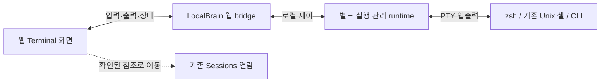

# PRD-0028: Web Terminal Work Area

## Metadata

- ID: `prd-0028`
- Status: `approved`
- Owner role: `human`
- Created: `2026-11-08`
- Updated: `2026-11-12`

## Request Summary

LocalBrain 웹 안에서 로컬 셸을 열고 탭·화면 분할로 다루는 작업 영역을 제공한다. 왼쪽 사이드바에 독립 메뉴를 추가하고 실행 제어·복구·성능·기존 Sessions와의 관계를 정한다. 초기 요청은 PRD 작성이었으며, 후속 제품 결정과 `2026-11-10` 진행 지시를 근거로 합의한 첫 전달을 실행한다. **데스크톱 앱 버전은 대상에서 제외한다.**

앞선 탐사에서 사용자는 기존 터미널을 감싸는 방식의 무게와 Herdr의 백그라운드 제어 구조에 관심을 보였다. **herdr-core를 직접 사용하지 않고 설계를 참고·벤치마킹한다**는 방향을 유지한다. 후속 답변으로 메뉴·플랫폼·분할·내부 터미널·닫기·백그라운드 유지·업데이트 방식을 결정했다. 아래의 사용자 결정과 기술 선택 기록을 보존하고, 첫 전달은 [FEAT-0166](../feature/feat-0166-web-terminal-work-area.md)이 소유한다.

## Source Set

아래 초기 요청의 한계는 당시 planning 단계의 기록이다. 이후 `2026-11-10`
진행 지시로 합의된 첫 전달을 구현했다. 초기 구현·검증은
[RUN-242](../run/run-20261110-242-web-terminal-work-area.md)와
[EVAL-0158](../evaluation/eval-0158-web-terminal-work-area.md)에 보존한다.
현재 전달 상태와 남은 증거는 [FEAT-0166](../feature/feat-0166-web-terminal-work-area.md)의
최신 [RUN-246](../run/run-20261112-246-terminal-final-audit.md)과
[EVAL-0162](../evaluation/eval-0162-terminal-final-audit.md)가 소유한다.

| 출처 | 이 PRD에서의 역할 | 한계 |
| --- | --- | --- |
| 초기 사용자 요청 | PRD 우선, open point 나열, 웹 전용, 새 사이드바 메뉴, 이름과 화면 구성 검토 | 초기 작성 요청 자체는 구현·세부 제품 선택 승인이 아님 |
| 앞선 사용자 요청 | 가벼움과 속도, 내부 탭·제어, Windows/PowerShell 가능성, Herdr 구조 벤치마킹 | Windows 첫 전달, 특정 엔진·언어·복구 수준을 확정하지 않음 |
| 사용자 후속 결정 | Terminal은 Sessions 위, macOS 웹 우선, 탭당 최대 4분할, 독립 관리 프로세스, 업데이트 시 일괄 종료 후 재시작, 나머지 추천 방향 수용 | 비교할 엔진·수치가 결정된 것은 아니며 구현 착수 지시는 아님 |
| 사용자 추가 답변 | Herdr처럼 pane/탭의 ×는 종료, 별도 백그라운드 보내기는 유지. 외부 iTerm2 창 열기는 제외하고 LocalBrain 안의 내부 터미널만 포함 | 기존 iTerm2 창·세션을 embed/attach하거나 외부 launcher를 만들지 않음 |
| CLI/UI 후속 지시 | CLI 사용명은 **lb**, 일반적인 명령 구조와 일관된 사용법. UI는 직관적이고 상시 설명문을 쌓지 않음 | 실제 executable 추가·화면 구현을 이번 PRD 수정에서 시작하지 않음 |
| [Product](../../policies/project/product.md), [Architecture](../../policies/project/architecture.md), [Sessions](../../policies/project/sessions.md), [Data Model](../../policies/project/data-model.md) | 기존 제품 용어, 수집된 대화와 실행 중 프로세스의 구별, 현재 웹 구조 | 새 실행 기능의 구현 근거가 아님 |
| [Feature Availability](../project/feature-availability.md), [Desktop App And Settings](../../policies/project/desktop-app-and-settings.md) | 현재 조립·배포 경계와 데스크톱 제외 조건 | 이 PRD가 중단 기능을 재개하지 않음 |
| [현재 사이드바](../../../src/localbrain/templates/base.html), [edition boundary](../../../src/localbrain/app/edition.py), [application assembly](../../../src/localbrain/app/features.py) | 메뉴의 실제 위치와 웹/앱 경계, 로컬 HTTP 접근 보호 | HTTP middleware의 존재가 향후 WebSocket 보호를 입증하지 않음 |
| [Navigation And History](../../policies/project/navigation-and-history.md), [Design Constitution](../../policies/design/design-constitution.md), [Design Evaluation](../../policies/design/design-evaluation.md), [Interaction Evaluation](../../policies/experience/interaction-evaluation.md) | 기존 shell·탐색·단축키·접근성, 향후 화면 검증의 기준 | 완성된 터미널 화면이나 승인된 mockup은 없음 |
| [Privacy And Data](../../policies/project/privacy-and-data.md), [Installation And Storage](../../policies/project/installation-and-storage.md) | 로컬 실행·저장·색인·패키지 경계 | 새 transcript 저장소를 승인하지 않음 |
| [Herdr 고정 소스](https://github.com/herdrdev/herdr-core/tree/cd12ddd88bc11490228343291dc1096c9ed3bf77), [README](https://github.com/herdrdev/herdr-core/blob/cd12ddd88bc11490228343291dc1096c9ed3bf77/README.md), [API](https://github.com/herdrdev/herdr-core/blob/cd12ddd88bc11490228343291dc1096c9ed3bf77/schema/README.md), [security](https://github.com/herdrdev/herdr-core/blob/cd12ddd88bc11490228343291dc1096c9ed3bf77/docs/security.md) | 화면과 프로세스 수명 분리, 재연결·출력 흐름 제어를 검토한 설계 참고 | 의존성 채택·동일 구현 요구가 아님. 앞선 출시 바이너리 관찰과 이 소스 revision은 같은 빌드라고 가정하지 않음 |
| [Herdr app 명령](https://github.com/herdrdev/herdr-app/blob/7fe7ac34fef8a3ee76cb5d2f17bc8d6331e50bd8/src/commands.rs), [닫기 처리](https://github.com/herdrdev/herdr-app/blob/7fe7ac34fef8a3ee76cb5d2f17bc8d6331e50bd8/src/window.rs), [core CLI](https://github.com/herdrdev/herdr-core/blob/cd12ddd88bc11490228343291dc1096c9ed3bf77/crates/herdr-core/src/cli.rs), [종료 수명](https://github.com/herdrdev/herdr-core/blob/cd12ddd88bc11490228343291dc1096c9ed3bf77/crates/herdr-core/src/runtime.rs) | 창 닫기와 pane/탭 종료의 차이, 별도 park/settle, 상태·중지·시작의 실제 경로 | 소스 확인이며 Herdr GUI를 새로 실행해 시험한 것은 아님 |
| [Orca 셸/터미널](https://github.com/stablyai/orca/blob/0da741a22f8ea2d6e20ec727371d4ac6d18fb1a0/docs/site/content/docs/terminal.mdx), [복원/완전 종료](https://github.com/stablyai/orca/blob/0da741a22f8ea2d6e20ec727371d4ac6d18fb1a0/docs/site/content/docs/model/session-restore.mdx), [완전 종료 검사](https://github.com/stablyai/orca/blob/0da741a22f8ea2d6e20ec727371d4ac6d18fb1a0/src/main/startup/main-window-actions.ts) | 시스템 셸과 표시 엔진의 구별, 일반 종료의 실행 유지, Quit Completely의 세션 종료·실패 확인 | 고정 소스가 웹 문서의 일부 캐시보다 상세하다. 세션 전부 종료와 daemon 자체 종료를 같은 뜻으로 사용하지 않음 |
| [iTerm2 공식 scripting 문서](https://iterm2.com/documentation-scripting.html) | 외부 앱·창·탭 자동화와 내부 웹 표시 컴포넌트 재사용이 다른 범위임을 확인 | AppleScript 문서는 deprecated 표기. 외부 창 열기를 사용자가 제외했으므로 이 API 채택도 하지 않음 |

`2026-11-08` planning 당시의 제한된 headless 실험은 설계 가능성을 보는 참고였다. LocalBrain과 브라우저를 합친 성능, 장시간 안정성, 실제 한글 입력, Windows 동작은 검증되지 않았다. 그 단계의 후속 조사는 고정한 공개 소스와 공식 문서 확인이며 GUI·daemon·업데이트·iTerm2 자동화를 실행하지 않았다. 기기별 수치나 private 실험 산출물을 이 PRD의 합격 근거로 사용하지 않는다.

## Product Intent

과거 작업을 읽다가 필요한 로컬 실행으로 이어 가고, 여러 작업을 같은 LocalBrain 웹에서 다룰 수 있게 한다. 사용자는 프로젝트별 셸이나 CLI를 띄우고, 다른 화면을 읽은 뒤 돌아왔을 때 현재 작업의 상태를 알아볼 수 있어야 한다. 기존 iTerm2를 계속 사용하는 선택도 유지하며 LocalBrain의 열람 기능이 터미널 사용을 전제로 바뀌지 않는다.

주 사용자는 자신의 컴퓨터에서 LocalBrain 웹을 여는 개발자다. 대표 상황은 프로젝트의 개발 서버와 테스트를 나란히 보거나, CLI 작업을 유지한 채 수집된 Session·문서를 참고하는 경우다. AI CLI도 일반 로컬 프로그램의 한 예이며, 특정 에이전트나 외부 AI 서비스가 필수는 아니다.

## Current Baseline And Terminology

| 용어/영역 | 현재 의미와 새 영역의 관계 |
| --- | --- |
| Sessions | Claude·Codex에서 수집한 대화 기록. 현재 목록·핀·제목·읽기는 실행 중인 셸을 뜻하지 않음 |
| Shell | zsh, bash, PowerShell처럼 명령을 실행하는 프로그램. 사용자의 기존 셸 설정·도구 설치를 활용할 대상 |
| Terminal | 키 입력을 셸에 전달하고 제어 시퀀스를 해석해 화면을 보여주는 상호작용 단위. PTY는 셸과 이 입출력을 잇는 OS의 가상 터미널 통로 |
| Runtime terminal | 실행 수명과 고유 ID를 가진 관리 대상. 대화 Session ID, 화면 탭 ID, OS PID와 구별하는 제안 |
| Tab / pane | 한 탭에 최대 4개 pane. pane 하나는 runtime terminal 하나를 표시한다. 탭 개수를 3개로 제한한다는 뜻은 아니며 전체 실행 수 한도는 별도로 정함 |
| Workspace / Project | 기존 source·작업 폴더·Git 기반 그룹 및 탐색 용어가 있음. 새 메뉴나 탭을 같은 이름의 새 데이터 객체로 암묵적으로 추가하지 않음 |
| 현재 웹/앱 | Python/FastAPI, Jinja2와 작은 API, SQLite를 공유하지만 배포 경계가 다름. 웹이라는 이유만으로 Windows backend가 지원되는 것은 아님 |

## Confirmed Scope

`2026-11-11` 후속 지시: Settings에 **Terminal** 탭을 두고 기본 작업 폴더·셸을
저장한다. 새 터미널은 그 기본값으로 즉시 생성하며 매번 입력 창을 열지 않는다.
분할은 선택한 pane의 작업 폴더·셸을 이어받는다. 실행 중 목록에서도 실행을
유지하는 백그라운드 보내기/복귀와 실제 종료를 구분해 직접 조작할 수 있게 한다.
기존 ×=종료, 화면 이동=유지, 별도 관리 프로세스의 수명 계약은 유지한다.
이 지시는 해당 동작 수정의 승인이고 기존 물리 IME·성능 수락 증거를 대체하지 않는다.

- 먼저 PRD를 작성하고 제품·기술 open point를 명시한다. 구현 착수는 별도 승인 경계다.
- 새 기능의 대상은 **로컬 웹 버전**이다. 데스크톱 앱에 포함하지 않는다.
- 기존 Workspace 그룹에 **Terminal** 메뉴를 **Sessions 바로 위**에 추가한다.
- **macOS 웹 우선**, 여러 탭과 **탭마다 최대 4개 pane의 가로/세로 분할**을 제공한다. Windows/PowerShell은 첫 전달에서 제외한다.
- **LocalBrain 안에서 렌더링하는 내부 터미널만** 제공한다. 기존 zsh·OMZ 등 사용자 셸 설정을 활용하며 iTerm2 외부 창 열기·기존 창 삽입·기존 세션 attach는 포함하지 않는다.
- 브라우저/창 종료, 다른 메뉴 이동, 탭 전환은 실행을 유지한다. **pane의 ×는 해당 터미널 종료, 탭의 ×는 그 탭의 터미널 전부 종료**다. 별도 `백그라운드로 보내기`는 실행을 유지하고 관리 목록에서 다시 연다.
- 실행은 웹 backend와 분리한 **별도 관리 프로세스**가 소유한다. 웹 화면과 별도의 CLI 경로에서 실행 목록·개별 종료·전체 종료·관리 프로세스 상태/시작/중지/재시작을 다루는 설계로 구체화한다.
- 웹/Python CLI의 기본 사용명은 **`lb`**로 정한다. 기존 `localbrain` 호출의 호환성을 유지하고, 터미널 실행과 백그라운드 서비스 제어의 명령 대상을 구별한다. UI는 짧은 상태·명확한 제어를 중심으로 구성한다.
- **업데이트는 관리 중 실행을 전부 종료한 뒤 관리 프로세스를 재시작**한다. 첫 전달은 runtime 무중단 업데이트·자동 작업 재실행을 보장하지 않는다.
- 미사용 시 부담과 사용 중 응답성을 포함해 가볍고 빠른 동작을 중요한 수락 조건으로 다룬다.
- Herdr의 백그라운드 관리 설계를 참고하되 herdr-core 직접 사용을 제품 의존성으로 채택하지 않는다.
- OP-08~16의 추천 방향은 수용되었다. 종료 범위, 단일 입력 소유자, bounded 이력, 지연 실행, Session 참조 우선, 엔진 비교, 성능 검증, 입력/접근성·로컬 접근 보호를 유지한다. 실제 엔진·합격 수치·지원 버전·세부 보관 정책은 아래 기술 후속으로 남는다.

## Excluded Scope

**사용자 지시로 제외:** 데스크톱 앱 메뉴·화면·실행 경로·터미널 의존성 추가, herdr-core의 직접 연동·설치·자동 실행, 첫 전달의 Windows 지원, iTerm2 등 외부 앱 창 열기·내장·기존 세션 attach, 무중단 runtime 업데이트.

**이 초안이 첫 전달에서 제외하도록 제안하는 항목:** 원격 SSH 호스트 관리, 클라우드 실행·다중 사용자 협업, 에이전트 자동 위임·명령 생성/자동 실행, 자체 셸·자체 VT 엔진 개발, 완전한 IDE·파일 편집기·브라우저 패널, 임의의 기존 iTerm2 프로세스에 대한 attach, 무제한 transcript 보관·자동 색인·분석, 기존 중단 기능 재개. 이 제외안은 PRD 경계 검토 대상이다.

터미널을 통해 사용자가 실행한 프로그램은 해당 사용자 권한으로 파일·네트워크를 사용할 수 있다. 이 기능의 로컬 실행을 OS sandbox나 외부 전송 차단으로 표현하지 않는다. LocalBrain 자체의 자동 외부 전송·수집 권한은 확대하지 않는다.

## Navigation And Screen

### Menu Name And Placement

| 후보 | 장점 | 고려할 점 | 추천 |
| --- | --- | --- | --- |
| **Terminal / 터미널** | 무엇을 여는지 바로 이해함. 기록을 읽는 Sessions와 구별됨 | 향후 편집기 등으로 넓어지면 명칭을 다시 검토할 수 있음 | **사용자 선택** |
| Workbench / 작업실 | 여러 실행 도구를 담기 쉬움 | 첫 기능이 터미널뿐일 때 의미가 넓고 모호함 | 실제 범위가 넓어질 때 재검토 |
| Workspace | 작업 묶음의 의미가 친숙함 | 기존 사이드바 그룹과 Workspace/Project 의미에 겹침 | 현재는 피하는 제안 |
| Console | 실행·출력이 연상됨 | 읽기전용 로그·개발자 콘솔·maintenance Run과 혼동 가능 | 대안으로만 유지 |

위치는 기존 **Workspace 그룹의 Sessions 바로 위**로 결정했다. 수집 기록을 읽는 위치와 실제 실행 위치를 가깝게 두되 메뉴를 합치지 않는다. `2026-11-08` 기획 당시 `/terminal`은 미확정 경로 후보였으며, 이후 [SPEC-0166](../spec/spec-0166-web-terminal-work-area.md)에서 고정해 구현했다. 데스크톱의 메뉴와 직접 URL 접근 모두 제외되어야 한다.

### Screen Composition — Review Proposal

기존 전역 사이드바·Back/Forward·검색은 유지한다. 본문은 작업에 집중하고, 두 번째 상시 사이드바나 별도의 대시보드를 추가하지 않는 구성을 추천한다.

```text
기존 사이드바 │ 기존 공통 Back / Forward / Search
             │ Terminal        [실행 중 3] [새 터미널] [관리]
  Terminal   │ [demo-web ×] [scripts ×] [+]
  Sessions   │ ┌ demo-web · zsh ─────────┬ tests · zsh ──────────┐
  Local      │ │                        │                       │
  Contexts   │ │    터미널 pane A       │    터미널 pane B      │
             │ │                        │                       │
             │ └────────────────────────┴───────────────────────┘
             │ 선택 pane의 경로 · 연결 상태 · 필요 시 종료/복구 안내
```

- **본문 헤더:** 제목, 새 터미널, 실행 중인 대상 목록과 백그라운드 관리 진입. 관리 프로세스의 실행/중지/연결 실패 상태를 확인한다. 전체 종료·관리 프로세스 중지는 주 동작과 분리한다. 실행 수는 셸이 살아 있다는 의미이며 작업 성공이나 에이전트의 작업 중 상태를 뜻하지 않는다.
- **탭:** 이름과 활성 상태, 연결·종료·주의 상태를 필요한 수준으로 표시한다. 긴 이름은 잘라 보여도 전체 값과 대상을 확인할 수 있어야 한다. 탭 overflow는 별도 목록으로 접근 가능하게 한다.
- **작업 영역:** 첫 터미널은 단일 pane. 탭 안에서 가로/세로로 최대 4개 pane을 다룬다. 깊은 중첩·자유 배치 확장은 보류한다.
- **pane/탭 제어:** 분할·이름 변경·`닫기 및 종료`·`백그라운드로 보내기`를 구별한다. ×의 accessible name과 도움말도 종료 의미를 보존한다. 탭 닫기는 그 안의 모든 pane에 적용되며, 단순 선택 전환은 종료하지 않는다. 드래그·단축키 없이도 필수 동작에 도달한다.
- **실행 중 목록:** 보이는 대상과 백그라운드 대상을 함께 찾아 재표시·개별 종료한다. 첫 화면 설계안은 탭 단위 `백그라운드로 보내기`로 탭/분할 구성을 보존하고, 다시 열 때 기존 실행에 연결한다. 반환 중 종료된 pane은 종료 상태로 보이며 자동 새 셸로 대체하지 않는다. 탭/터미널 개수와 실제 실행 상태를 구별한다.
- **부가 정보:** 선택 pane의 전체 경로, 셸, 연결 상태, 실제로 확인된 경우 관련 Session 링크를 펼쳐 본다. 상시 정보 rail·시스템 지표·출력 텍스트 기반 진행률은 기본 화면에 추가하지 않는 제안이다.
- **빈 화면:** 자동 셸을 생성하지 않고 `새 터미널`을 안내한다. 첫 사용에 외부 모델·에이전트 설치나 Session 수집을 요구하지 않는다.

좁은 화면에서는 분할을 억지로 압축하지 않고 선택 pane 하나와 pane 전환 목록으로 표현하는 안을 추천한다. 다른 pane의 프로세스 종료를 의미하지 않는다. 320px에서 탐색·새 터미널·선택·닫기·종료·오류 복구에 접근할 수 있어야 하며, 터미널의 행/열 크기와 재배치 규칙은 OP-15에서 정한다. OS 가상 키보드까지 포함한 모바일 터미널 품질은 별도 수락 범위다.

### Concise UI And Action Vocabulary

기본 화면은 **제목·새 터미널·실행 중 목록·관리, 탭, 터미널 pane**을 중심으로 한다. 긴 소개문·상시 사용법·중복 상태 카드·core/PTY 구조 설명을 본문에 쌓지 않는다. 명령 예제와 설치/운영 안내는 도움말이 소유하며, 터미널을 쓸 때 계속 읽어야 하는 전제가 되지 않는다.

- 상태는 `연결 중`, `실행 중`, `백그라운드`, `종료됨`, `연결 끊김`처럼 짧게 표시한다. 색에만 의존하지 않고 연결/실행의 다른 의미를 보존한다. 미확인 상태를 실행 0개나 성공으로 바꾸지 않는다.
- 자주 쓰는 생성·탭 선택·분할·×는 가까운 위치에서 조작한다. `백그라운드로 보내기`, 전체 종료, 서비스 제어는 대상의 메뉴/관리 영역에 둔다. icon-only 제어는 접근 가능한 이름과 짧은 tooltip을 유지한다.
- 관리 영역은 **터미널 목록**과 **백그라운드 서비스**를 구별한다. 실행에는 `다시 열기`/`종료`, 서비스에는 `시작`/`중지`/`재시작`을 쓴다. 버전·PID·경로·진단은 필요한 때 펼쳐 보고, 주 화면에 기술 메타데이터 rail을 상시 추가하지 않는다.
- 빈 화면은 `새 터미널`로 시작하게 한다. 오류는 짧은 원인과 실행 가능한 재시도/설정 동작을 해당 위치에서 제공한다. 상세 오류는 펼칠 수 있게 하되 빈 공간을 긴 안내문으로 채우지 않는다.
- 종료 영향 확인이 필요한 시점에만 대상 이름/개수와 결과를 짧게 보여 준다. 예: `터미널 3개를 종료하고 서비스를 중지할까요?` 평소에는 같은 경고를 배너나 도움말로 반복하지 않는다. 설명을 줄여도 종료 범위·실패 복구·키보드 focus·접근성 정보는 유지한다.

### Input And Shell Continuity

한글/영문 IME, 조합 중 Enter, Unicode 폭·emoji, 복사·붙여넣기, 선택, 스크롤백, 대체 화면을 쓰는 TUI, Ctrl+C·Ctrl+D 등 셸 입력을 실제 사용 조건으로 검증해야 한다. 브라우저가 일부 OS 단축키를 전달하지 않는 한계도 명시한다. 폰트의 한글·아이콘 glyph가 기존 iTerm2와 같다고 가정하지 않는다.

현재 전역 단축키는 capture 단계에서 동작한다. 터미널 focus에서 브라우저/LocalBrain 동작과 셸 입력 중 무엇이 우선인지 명시해야 한다. 입력을 가로채는 범위는 focus된 pane으로 한정하고, 터미널 밖으로 나가는 키보드 경로와 보이는 focus를 제공하는 방향이다. 구체적 매핑은 OP-15이며 기존 단축키를 조용히 바꾸지 않는다.

셸은 기존 설치를 활용한다. macOS에서는 기존 zsh와 설정을 사용할 수 있어야 하며, 로그인/대화형 시작과 환경 변수 전달은 검증 대상이다. Oh My Zsh를 LocalBrain이 별도로 설치하거나 설정을 수정하지 않는다. 웹 페이지가 클립보드·로컬 폴더에 접근할 수 있는 범위와 OS 기본 터미널의 권한은 구별한다.

### Internal Terminal And Shell Startup

`새 터미널`은 관리 프로세스가 새 PTY와 셸을 만들고 그 출력을 LocalBrain 본문에 표시하는 동작이다. iTerm2를 실행 파일로 선택해 그 창을 pane 안에 넣는 동작이 아니다. 사용자는 내부 표시 엔진을 사용하는 방향을 선택했으며, `이 폴더에서 iTerm2 열기` 같은 외부 창 launcher도 첫 전달에서 제외했다.

기본 생성은 **작업 폴더 + 기존 시스템 기본 셸**이며, 셸 변경은 필요할 때 펼친다. macOS 기본 셸을 로그인·대화형으로 여는 방향으로 기존 zsh/OMZ 설정을 읽는다. Herdr core도 macOS 기본 셸에 로그인 인자를 붙이고, Orca도 시스템 로그인 셸을 기본으로 한다. 사용자 설정 파일을 복사하거나 수정하지 않으며 설정 변경은 다음 새 셸부터 적용한다. 이미 실행 중인 셸과 iTerm2 창의 현재 환경 변수를 그대로 가져오는 것은 아니다. iTerm2 전용 환경 조건·폰트·단축키·기능은 별도 호환성 확인 대상이다.

새 탭/분할의 기본 폴더는 선택한 터미널의 현재 폴더를 확인할 수 있으면 그 위치, 확인할 수 없으면 그 터미널의 시작 폴더를 우선 제시하는 안이다. 첫 생성에는 마지막으로 선택한 유효 폴더 또는 home을 제시하고, 생성 전에 실제 적용 폴더를 확인·변경할 수 있게 한다. 사용자가 명시한 경로가 없거나 접근 불가하면 입력을 유지한 오류로 처리하며 조용히 다른 폴더에서 실행하지 않는다. 폴더 선택은 Local Context/Source 등록·색인을 시작하지 않는다. 셸 탐지 우선순위와 환경 전달의 정확한 계약은 TF-02에서 정한다.

## User Flows And State

아래는 사용자 결정을 반영한 제품 흐름과 구체화한 설계안이다. 세부 API·엔진·수치·저장 형식은 구현 전 기술 후속으로 정한다.

| 상황 | 기대하는 흐름/제안 | 실패·복구와 확인할 점 |
| --- | --- | --- |
| 처음 열기 | Terminal 진입 → 빈 화면 또는 관리 중 대상 목록 → 새 터미널 | 페이지 열기·뒤로 가기만으로 프로그램을 생성하지 않음 |
| 새 터미널 | 작업 폴더·셸의 유효한 기본값 확인 → 명시적 생성 → 연결 | 경로 없음·실행 파일 없음·권한 문제는 입력을 보존한 오류. 시간 초과는 생성 실패와 구별하고 중복 생성 전에 실제 결과를 조회 |
| 여러 작업 | 탭 전환, 선택한 pane 분할, 크기 조정 | 새 pane이 새 셸을 만드는지 기존 대상을 여는지 보이는 동작명으로 구별. 여러 대상에 키 입력을 동시에 전송하는 기능은 기본안에 없음 |
| 다른 메뉴로 이동 | 현재 화면 연결을 해제하고 Sessions·문서 열람 → Terminal 재진입 | 유지하기로 한 셸에 다시 연결하며 같은 명령을 재실행하지 않음. 종료된 대상은 종료 결과로 표시 |
| 화면 탭/pane의 × | pane은 해당 터미널, 탭은 그 안의 터미널 전부 종료 | 전경 작업·여러 대상의 종료 영향과 범위를 보여 준다. 실패/미확인 대상을 닫힌 성공 상태로 감추지 않음 |
| 백그라운드로 보내기 | 별도 동작으로 탭을 보이는 탭 목록에서 치우되 실행과 분할 관계 유지 | 실행 중 목록에서 다시 열고 기존 실행에 연결. 숨김·최소화·탭 전환은 프로세스 종료가 아님 |
| 브라우저 reload/연결 단절 | 연결 상태 표시 → 실제 runtime 상태 조회 → 현재 화면과 허용된 이력 복구 | 끊긴 동안 입력 전송을 막고 입력을 큐에 숨겨 저장하지 않는 추천. 이전 입력 재전송·과거 화면을 현재로 표시하지 않음 |
| 종료 | 대상 이름과 범위 확인 → 정상 종료 요청 → 필요 시 강제 종료 경로 | Ctrl+C를 입력으로 전달하는 동작과 터미널 실행 종료·관리 프로세스 중지를 구별. 강제 종료·전체 종료는 영향을 설명하고 중복 요청의 결과가 일관되어야 함 |
| 프로세스/서비스 장애 | 연결 상태와 실행 상태를 별도로 확인 | 연결 끊김을 작업 실패로 단정하지 않음. 프로세스가 사라졌다면 같은 작업을 자동 재실행하지 않는 추천 |
| 기존 Session 참고 | 실제 연관을 확인한 경우 Terminal과 수집된 Session 사이 이동 | 새 셸을 과거 대화의 계속 실행으로 표시하지 않음. provider별 CLI resume는 첫 전달 제외 |
| 백그라운드 종료/중지 | 관리 목록에서 개별/전체 실행을 종료하거나 관리 프로세스까지 중지 | 웹이 꺼졌으면 CLI로 같은 관리 범위에 접근. 상태 조회만으로 새 프로세스를 만들지 않음 |
| 업데이트 | 영향 대상 확인 → 전체 실행 종료 및 관리 프로세스 중지 → 종료 확인 후 업데이트 → 새 관리 프로세스 시작 | 무중단 갱신이 아님. 종료 확인 실패 시 업데이트/중복 시작을 진행하지 않고, 이전 명령을 자동 재실행하지 않음 |

상태는 한 badge로 합치지 않고 적어도 **화면 연결**과 **프로세스 실행**을 나눈다. 예를 들어 `연결 끊김 + 실행 상태 미확인`, `연결됨 + 셸 실행 중`, `종료 확인 + 종료 코드`, `실행 실패`를 구별한다. 셸이 살아 있거나 출력이 멈췄다는 사실만으로 내부 명령의 성공·입력 대기·에이전트의 완료를 추론하지 않는다. 프로그램이 명시적으로 보고한 상태를 향후 도입하면 그 출처를 별도로 표시한다.

## Lifetime And Recovery Boundary

Herdr에서 참고할 핵심은 창의 수명과 PTY 소유 프로세스의 수명을 나누는 구조다. LocalBrain에 필요한 지속 수준을 먼저 정하고 그에 맞는 구조를 고르는 것을 추천한다. `백그라운드`라는 표현만으로 무중단·자동 복구·낮은 비용을 보장하지 않는다.

| 사건 | 사용자 결정에 따른 목표 | 보장하지 않는 것 / 기술 후속 |
| --- | --- | --- |
| 화면 탭 전환·다른 메뉴 이동·백그라운드 보내기 | 실제 셸 유지, 보이지 않는 view의 렌더링/구독 축소 | 숨긴 화면도 계속 GPU로 그리기, 무제한 출력 보관 |
| pane/탭의 × | 해당 pane 또는 탭 안의 모든 터미널 종료 | 창 닫기와 같은 의미로 사용하지 않음 |
| 브라우저 탭·창 종료 | 관리 프로세스와 실행 유지, 새 브라우저에서 재연결 | browser unload를 확실한 종료/보관 신호로 쓰지 않음 |
| 업데이트가 아닌 웹 backend의 정상 재시작 | 독립 관리 프로세스가 원래 셸/PID를 유지하고 웹이 재연결 | backend가 PTY를 직접 소유하는 구조는 채택하지 않음 |
| 관리 프로세스 명시적 중지/재시작 | 관리 중 실행을 모두 종료하고 프로세스 중지. 재시작이면 새 관리 프로세스만 시작 | 같은 작업/셸을 자동 재실행하지 않음 |
| 웹/관리 프로세스 배포물 업데이트 | 실행 전부 종료·관리 프로세스 중지를 확인한 뒤 갱신, 새 버전으로 시작 | Herdr의 무중단 holder handoff는 첫 전달에서 채택하지 않음 |
| PTY 소유 관리 프로세스 장애 | 원래 PTY 제어·정확한 화면 복구를 보장하지 않음. 남은 프로세스는 확인 후 정리 | 연결 손실만으로 모든 자식의 종료를 단정하지 않음. 소유권을 확인한 복구·정리는 TF-03 |
| OS 재부팅 | 이전 로컬 실행은 지속되지 않으며 자동 작업 재실행 없음 | 새 셸·레이아웃 복원과 원래 프로그램 유지가 다름 |
| 명시적 터미널/전체 종료 | 정한 범위의 실행을 종료하고 결과를 표시 | 자식이 독립적으로 분리한 모든 OS 프로세스까지 항상 제거한다는 보장. 실제 process-tree 계약은 OP-08 |

일반 재연결의 화면 복원과 장애 후 복원은 구별한다. 스냅샷/버퍼에서 잃은 출력이 있으면 `이전 출력 일부 없음`처럼 알리고, 정확한 전체 transcript나 장애 직전 마지막 문자까지 복구했다고 표시하지 않는다. 첫 전달은 OS 로그인 자동 시작을 추가하지 않고 명시적 `새 터미널`/`관리 프로세스 시작`에서만 필요 시 시작한다. 관리 프로세스 장애·OS 재부팅 후 원래 작업을 자동 재실행하지 않는다. 기동 때 발견한 기존 관리 프로세스에 연결할 수는 있지만 상태 조회나 화면 복원이 새 작업을 생성해서는 안 된다.

### Background Management And Update Design

**실행을 유지하는 것과 관리 프로세스를 계속 켜 두는 것은 별도 제어다.** 웹의 `관리` 영역은 관리 프로세스 상태/버전과 보이는 실행·백그라운드 실행을 함께 보여 준다. 각 대상의 이름·폴더·연결/실행 상태, 다시 열기·종료에 접근한다. 프로세스가 응답하지 않으면 `미확인/연결 실패`로 표시하며 `실행 0개`나 `중지 완료`로 바꾸지 않는다.

| 사용자 동작 | 실행 중 터미널 | 관리 프로세스 | 이후 동작 |
| --- | --- | --- | --- |
| 새 터미널 | 명시적으로 새 셸 생성 | 없으면 시작 | 적용 폴더·셸을 확인하고 연결 |
| 상태/목록 조회 | 변화 없음 | 중지 상태면 그대로 유지 | 조회/자동 polling이 관리 프로세스를 다시 켜지 않음 |
| 백그라운드로 보내기 / 다시 열기 | 같은 실행 유지 | 유지 | 화면만 숨김/재연결하며 새 실행을 만들지 않음 |
| 터미널 종료 | 선택한 관리 대상과 소유한 자식 종료 | 다른 실행 유지 | 종료 결과와 미확인 대상을 구별 |
| 전체 터미널 종료 | 현재 LocalBrain 관리 범위의 보이는 실행과 백그라운드 실행 전부 종료 | 즉시 중지를 뜻하지 않음 | 다음 새 터미널은 사용자 동작으로 생성. 대상 0개·연결 view 없음의 idle 종료는 별도 정책 |
| 관리 프로세스 중지 | 전체 관리 대상 종료 후 확인 | 중지 | 새 터미널/명시적 시작 전까지 꺼진 상태 유지 |
| 관리 프로세스 재시작 | 전체 관리 대상 종료 후 확인 | 중지 후 새 프로세스 시작 | 이전 명령 재실행 없음. 새 셸 생성은 별도 동작 |

웹 backend가 꺼져 있어도 별도 관리 프로세스는 남을 수 있으므로, **직접 관리 endpoint에 접근하는 CLI**를 같은 범위의 필수 제어 경로로 설계한다. 사용명은 `lb`이며 아래처럼 실행과 서비스의 명령 대상을 구별한다. 웹과 CLI가 다른 실행 목록·종료 정의를 갖지 않게 한다. macOS 메뉴바 앱/트레이 앱을 이 제어를 위해 새로 만들지 않는다.

명시적 중지·업데이트 중에는 새 생성과 자동 재기동을 막고, 이전 프로세스의 종료를 확인한 뒤 새 것을 시작한다. 종료 실패/접촉 불가/소유권 미확인 상태에서는 성공이나 업데이트 진행으로 취급하지 않는다. UI/CLI는 실패 대상과 다음 복구 동작을 보여 줘야 한다. 정상 종료 요청 후 제한 시간을 넘긴 소유 프로세스를 강제 종료하는 경로와 정확한 시간·확인 기준은 TF-03이다. 단순 PID 파일이나 이름으로 `killall`하는 방식은 다른 iTerm2·셸·사용자 작업을 건드릴 수 있으므로 소유권을 확인한 현재 LocalBrain runtime 범위만 다룬다. 분리된 자식까지 항상 제거한다는 보장은 하지 않는다.

**업데이트 흐름은 웹/실행 runtime 배포물에 적용**하며 이번 범위에서 제외한 데스크톱 앱 updater를 새로 만들지 않는다. 영향을 받는 실행 목록/개수를 확인한 뒤 `전체 종료 및 관리 프로세스 중지`를 수행하고, 종료 완료를 확인한 상태에서 갱신한다. 갱신 실패 시 이전 작업을 자동 재시작하지 않으며, 새 버전 시작 실패도 분명하게 보고한다. 수동 Python/web 설치 갱신도 같은 사전 중지·확인 경로를 사용하도록 안내한다. 일반 브라우저 reload나 단순 웹 연결 복구는 업데이트나 전체 종료를 뜻하지 않는다.

### CLI Naming And Command Contract

**`lb`를 권장 진입점으로 사용하고 기존 `localbrain`은 같은 기능의 호환 진입점으로 유지한다.** `2026-11-08` 기획 당시 `pyproject.toml`에는 `localbrain`만 등록되어 있었고 `lb` 및 아래 terminal 명령은 미구현이었다. 이후 두 진입점과 terminal 명령을 구현했으며 현재 동작은 [Terminal 계약](../../policies/project/terminal.md#cli)이 소유한다. 새 예제/도움말은 `lb`를 기준으로 한다. 기존 `serve`, `doctor`, `storage`, `models` 등의 명령/옵션을 임의로 바꾸거나 터미널 명령으로 재해석하지 않는다. 웹/Python CLI의 이름 변경 때문에 데스크톱 패키지에 터미널 의존성을 넣지 않는다.

관리 명령은 **`lb <영역> <동작> [대상] [옵션]`**의 일관된 구조를 사용한다. 터미널 프로세스와 백그라운드 서비스는 수명과 종료 범위가 달라 `terminal`과 그 아래 `service`로 구별한다. 짧게 쓰기 위해 다른 대상을 같은 bare `stop`에 섞지 않는다.

| 계획한 명령 | 대상과 동작 | 웹에서 대응하는 제어 |
| --- | --- | --- |
| `lb terminal list` | 현재 관리 범위의 보이는/백그라운드 터미널 조회 | 실행 중 목록 |
| `lb terminal stop <id>` | 명시한 터미널과 소유 자식 종료 | 해당 터미널 종료 |
| `lb terminal stop --all` | 현재 관리 범위의 모든 터미널 종료. 서비스 중지와 구별 | 전체 터미널 종료 |
| `lb terminal service status` | 백그라운드 서비스의 실행/중지/미확인 상태 조회 | 관리 → 서비스 상태 |
| `lb terminal service start` | 서비스만 시작. 새 셸/이전 명령을 만들지 않음 | 관리 → 시작 |
| `lb terminal service stop` | 관리 중 터미널 전부 종료 확인 후 서비스 중지 | 관리 → 중지 |
| `lb terminal service restart` | 위 중지 확인 후 새 서비스 시작. 이전 명령 자동 재실행 없음 | 관리 → 재시작 |

- 기존 초안의 `end`/`stop-all` 가칭은 `stop <id>`/`stop --all`로 통합한다. `lb stop`처럼 실행 범위가 드러나지 않는 새 단축 명령이나 여러 별칭을 추가하지 않는다. 터미널 생성은 기존에 정한 웹 흐름을 사용하며 CLI run/attach 등 새 기능을 이 명명 정리로 추가하지 않는다.
- `<id>`와 `--all`은 동시에 쓰지 않는다. 대상을 생략한 `lb terminal stop`은 사용법 오류이며 현재 탭이나 전체 실행을 암묵적으로 종료하지 않는다. ID는 runtime terminal의 식별자이며 OS PID나 대화 Session ID를 대신 받지 않는다.
- 각 단계의 `--help`는 명령·대상·옵션과 짧은 예제로 설명한다. 도움말·목록·상태 조회는 관리 프로세스 기동이나 명령 실행을 유발하지 않는다. 서비스가 중지됨, 목록이 비어 있음, 상태 확인에 실패함을 구별한다.
- 자동화용 `--json`, 성공/실패 exit code, stdout 결과/stderr 오류의 의미를 일관되게 정한다. 오류·부분 종료·미확인 상태를 성공으로 내보내거나 JSON에 진행 로그를 섞지 않는다. 실제 형식과 오류 코드는 Spec에서 고정한다.
- 전체 종료·서비스 중지/재시작에 영향 확인이 필요하면 대상 범위를 한 번 확인한다. 비대화형 사용에는 명시적 `--yes`를 사용하고 입력을 무한히 기다리지 않는다. 강제 종료 경로의 `--force`는 소유한 대상에만 적용하며 `--yes`/`--force`가 소유권·종료 확인을 우회하지 않는다. 정확한 정상/강제 종료 계약은 TF-03에서 정한다.
- 설치 시 `lb` 진입점 제공과 기존 executable 충돌 처리를 명확히 한다. 사용자 shell alias/설정이나 다른 프로그램의 `lb`를 조용히 덮어쓰지 않는다. 실제 등록·호환 검증은 해당 구현 단계의 책임이다.

### Herdr And Orca Reference Boundaries

Herdr는 창을 닫아도 core가 실행을 유지하지만 pane/탭 닫기는 해당 터미널을 종료한다. 별도 park/settle 동작이 실행을 남긴다. `hc ls`, `hc kill <대상>`, `hc server status/start/stop`처럼 실행과 core의 관리가 분리되어 있다. `hc server stop`은 core 종료 API로 전체 프로그램을 종료하고 holder 정리를 요청하며 CLI는 core 연결이 닫힐 때까지 기다린다. 반면 core PID를 임의로 죽이는 것은 장애로 해석되어 holder가 재기동할 수 있어 명시적 stop의 대체가 아니다. 근거는 고정한 [app 명령](https://github.com/herdrdev/herdr-app/blob/7fe7ac34fef8a3ee76cb5d2f17bc8d6331e50bd8/src/commands.rs), [core CLI](https://github.com/herdrdev/herdr-core/blob/cd12ddd88bc11490228343291dc1096c9ed3bf77/crates/herdr-core/src/cli.rs), [종료 처리](https://github.com/herdrdev/herdr-core/blob/cd12ddd88bc11490228343291dc1096c9ed3bf77/crates/herdr-core/src/runtime.rs), [holder 감독](https://github.com/herdrdev/herdr-core/blob/cd12ddd88bc11490228343291dc1096c9ed3bf77/crates/herdr-core/src/holder.rs)다.

Orca는 기본적으로 앱을 종료/업데이트해도 별도 daemon의 실행을 유지한다. 고정 소스의 `Quit Completely`는 Settings의 `Manage Sessions → Kill all sessions`와 같은 세션 종료를 수행하고, 세션이 남으면 정상 종료 완료로 넘기지 않는다. 이는 세션 전부 종료 경로의 참고이며 daemon 자체의 즉시 종료를 뜻한다고 가정하지 않는다. 근거는 [복원/완전 종료 문서](https://github.com/stablyai/orca/blob/0da741a22f8ea2d6e20ec727371d4ac6d18fb1a0/docs/site/content/docs/model/session-restore.mdx)와 [종료 확인 코드](https://github.com/stablyai/orca/blob/0da741a22f8ea2d6e20ec727371d4ac6d18fb1a0/src/main/startup/main-window-actions.ts)다. LocalBrain도 세션 종료와 관리 프로세스 중지를 구별하되, **업데이트 시 전체 종료 후 재시작**은 사용자가 선택한 더 단순한 정책이다. Herdr의 holder 분리나 Orca의 전체 제품 기능을 그대로 복제하지 않는다.

## Technical Constraints And Alternatives

### Reuse Boundary — Independent Runtime And Engine Selected

**브라우저용 터미널 표시 컴포넌트와 로컬 PTY 관리 기능을 연결한다.** 첫 전달은 xterm.js 브라우저·headless와 node-pty 관리자를 선택했다. 정확한 버전·설치·수명 계약은 SPEC-0166이 고정한다. 키 입력·출력 바이트와 화면 상태를 교환하는 구조이며 별도 GUI 앱 창 삽입·영상 스트리밍은 첫 전달에서 제외한다.



독립 runtime은 **사용자 결정**이다. backend 재시작과 브라우저 단절 중에도 같은 실행을 유지하기 위해 PTY의 수명 소유자를 분리한다. backend 내부 PTY 소유안은 이 요구를 충족하지 못하므로 첫 전달 대안에서 제외한다. 첫 전달의 runtime 재시작/업데이트는 전체 실행을 종료하므로 Herdr처럼 제어와 PTY holder까지 더 분리하는 구조는 요구하지 않는다. PTY 하나마다 독립 관리 daemon이 필요한 것은 아니지만, 실제 셸·명령과 필요한 thread·버퍼 비용은 남는다. 관리 프로세스의 실제 OS 수명 분리·단일 인스턴스·접근 제어는 TF-03에서 고정한다.

- **초기 표시 엔진 비교 기록:** xterm.js 같은 웹용 컴포넌트가 첫 비교 후보였다. Ghostty 계열 엔진은 웹에서 쓸 수 있는 인터페이스·배포 형태·의존성·정확성을 확인하는 비교 대상으로 둔다. 네이티브 Ghostty 앱을 설치하는 것과 브라우저 표시 엔진을 재사용하는 것은 다르다. 당시 선택이나 성능 우위를 확정하지 않았으며, 현재 선택도 Ghostty 대비 성능 우위를 입증한다는 뜻은 아니다.
- **초기 실행 관리 비교 기록:** 별도 프로세스라는 수명 경계는 결정되었다. 그 안에서 기존 Python 구조 활용과 작은 별도 helper를 비교하되 언어를 선결하지 않는다. PTY 소유, 화면 상태, 이력, 프로세스 종료를 누가 책임질지와 설치 부담으로 판단한다.
- **운영체제:** 첫 전달은 macOS의 PTY 경계다. 후속으로 Windows를 포함하면 별도 ConPTY, PowerShell 탐지·기본값, 인용/경로/encoding·resize·process tree·설치 검증이 필요하다. 웹 UI 재사용이 이 작업을 대신하지 않는다.
- **프로토콜:** 브라우저가 다시 열려도 같은 대상을 식별하고, 생성 요청의 응답 손실·중복 재시도·늦은 상태 이벤트를 안전하게 구별해야 한다. 통신 방식과 상세 스키마는 승인 후 별도 계약 대상이다.

**재연결할 화면 상태의 소유자도 엔진 선택의 일부다.** 브라우저에서만 출력 바이트를 해석하면 브라우저가 사라진 뒤의 현재 화면을 어디서 복원할지 별도 답이 필요하다. 중간부터 잘린 raw 출력만 재생해서는 그 전에 설정된 모드·커서·화면 상태까지 정확하다고 보장할 수 없다. 반대로 runtime이 headless VT 상태를 유지하면 보이는 화면을 그리지 않아도 출력 해석·화면/이력 메모리 비용이 남는다. 이 비용과 복원 정확도를 OP-13/14에서 함께 비교하며, 출력 보관량을 무제한 늘리는 방식으로 해결하지 않는 제안이다.

Herdr의 채택 범위는 기능 전체 복제가 아니라 설계 원칙 비교다. 일반 화면과 raw stream, 재연결 시 snapshot, 느린 소비자의 bounded queue·흐름 제어, missed event 후 재조회가 참고 대상이다. 이 기능이 필요할 때 비용을 측정하며, Herdr의 특정 버퍼 크기나 polling 주기를 그대로 제품 요구로 옮기지 않는다.

### Performance And Resource Envelope

가벼움은 기존 Sessions·검색 화면의 응답성을 유지하면서 실제 입력과 출력이 매끄러운 것으로 정의한다. 화면 엔진 이름이나 headless 메모리만으로 판정하지 않는다.

| 조건 | 요구/추천 방향 | 승인 전 정할 예산과 향후 관찰 |
| --- | --- | --- |
| 기능 미사용 | 터미널 셸/관리 runtime을 시작하지 않음. 다른 화면에 터미널 표시 자산·상시 polling을 추가하지 않는 방향 | 기존 웹 시작·Sessions 열기·검색의 기준선 대비 지연/자산/메모리 변화 |
| 빈 Terminal 화면 | 셸 생성은 명시적 사용자 동작. 메타데이터 조회와 실행 시작을 구별 | 첫 화면의 cold/warm 진입 비용 |
| 1개 및 8개 idle 셸 | 불필요한 주기 작업을 줄이고 상태 조회 비용을 제한 | browser·backend·runtime별 CPU/메모리, 실제 child program 비용 별도 |
| 보이는 1개 TUI / 여러 TUI | 키 입력 반영과 resize를 우선하고, 새 출력이 있을 때만 필요한 렌더링 | 입력→다음 화면 반영 p50/p95, frame 지연, viewport/font/출력 조건 |
| 숨겨진 tab/pane·브라우저 | 화면 렌더링·불필요한 출력 구독은 중지/축소. 선택한 보관 정책의 상태 관리는 유지 | hidden CPU, queue·이력 메모리, 복귀 시 snapshot 비용. 숨겨도 프로그램 자체 출력 비용은 남음 |
| 빠른 대량 출력·느린 view | queue/history 상한과 흐름 제어. 한 view 때문에 전체 웹·다른 터미널이 멎지 않음 | producer 실행 중 제어 지연, 최신 상태 복구, 누락 표시, bounded memory |
| 재연결·긴 실행 | 오래된 이벤트나 중복 연결을 회수하고 같은 명령을 중복 실행하지 않음 | 반복 attach/detach, resize, idle·busy 장시간 실행에서 누수/고아 프로세스 |
| 한도 도달 | 명시적 제한 상태와 복구 경로 | 동시 실행 수·pane 수·보관량과 종료된 대상 정리 정책 |

초기 비교 workload는 `0/1/8`개 터미널, 단일/분할 화면, idle/TUI/출력 flood, visible/hidden/reconnect를 추천한다. 단말 수는 지원 한도가 아니다. 상대 회귀 기준, 입력 지연·메모리·CPU 수치, 최소 시험 환경, 장시간 관찰 시간은 **OP-14에서 정할 수락 예산**이다. 지금 임의 수치를 확정하거나 무제한 환경에서 항상 빠르다고 보장하지 않는다. 측정은 browser·backend·runtime·셸/실제 프로그램을 포함한 총량과 각 구성 비용을 함께 보고해야 한다.

### Data, Identity And Local Execution

- 대화 Session, runtime terminal, 화면 탭/pane, PID는 각각의 수명·주체를 유지한다. 명확한 근거 없는 자동 연결이나 Workspace/Project 새 객체 도입은 하지 않는 제안이다.
- 터미널 출력은 기존 Session ingestion·Usage·검색·Local Context에 자동 편입하지 않는다. provider CLI가 자체 기록을 남기면 기존 source 수집 계약이 별도로 적용되며, 터미널 바이트를 대화의 정본으로 만들지 않는다.
- 출력 조각마다 DB 기록·색인을 추가하지 않는 안을 추천한다. 표시용 scrollback, 재연결용 상태, 장기 transcript, 탭 레이아웃/실행 메타데이터의 보관 목적·상한·삭제를 구분해 OP-10에서 정한다. 브라우저 저장소에 출력이나 입력을 묵시적으로 저장하지 않는다.
- 영속화가 선택되면 기존 private data/cache 소유자 아래 목적에 맞게 두며 저장소와 공용 모델 캐시에 넣지 않는다. 소스·기존 Session·작업 폴더를 새 기능 정리 대상으로 취급하지 않는다. 일반 설정 열람이나 화면 이동이 transcript 삭제·명령 실행을 일으키지 않는다.
- 시작 시 작업 폴더·실행 파일·arguments를 명확히 식별한다. 일반 셸 열기와 임의 문자열 명령 실행을 혼동하지 않는다. 기본 추천은 명시적 새 셸이며 저장된 시작 명령 자동 실행은 첫 전달 제안에 없다.
- 터미널 제어는 실제 로컬 명령 실행 권한을 제공한다. 기존 loopback·edition·요청 출처 보호를 유지하고, 출력 스트림/입력 연결에도 검증을 적용해야 한다. HTTP middleware만으로 WebSocket이 보호된다고 가정하지 않는다. endpoint를 외부에 공개하거나 새 권한 승인 제품을 추가하는 범위는 아니다.
- renderer 선택 시 terminal control sequence를 통한 URL 열기·clipboard(OSC 52 등)·기타 외부 효과를 확인한다. 출력 수신만으로 파일 실행·클립보드 변경·외부 요청을 일으키는 기능은 명시적 정책 없이 활성화하지 않는 제안이다.
- 이력/화면 지우기, 연결 해제, 실행 종료, 관리 목록 삭제는 같은 작업이 아니다. 삭제가 실행을 종료하는지와 종료된 출력의 보존 시간은 결정 후 같은 문구·범위로 적용한다.

## Uncertainty — Decision Register And Technical Follow-ups

사용자는 아래 제품 방향을 선택했고, 추가 답변으로 닫기·외부 iTerm2 범위도 정했다. **OP-01~16 전체를 미결정으로 취급하지 않는다.** 운영 UI/CLI와 실패 처리는 아래 실행 계약으로 구체화한다. TF-01~06은 조사 항목의 식별자를 보존하며, 첫 전달의 선택·제한·수치는 [SPEC-0166](../spec/spec-0166-web-terminal-work-area.md)이 고정한다. 향후 상위 범위 변경은 이 PRD로 되돌린다.

| 원래 ID | 결정/수용된 방향 | 남은 기술 후속 또는 범위 한계 |
| --- | --- | --- |
| OP-01 | **Terminal**, Workspace 그룹의 **Sessions 바로 위** | 초기의 아래 배치 제안을 대체. 메뉴명은 더 이상 open이 아님 |
| OP-02 | **macOS 웹 우선**. Windows/PowerShell은 첫 전달 제외 | 실제 Safari/Chromium 시험 버전·환경은 TF-05 |
| OP-03 | **여러 탭, 탭마다 최대 4 pane**, 가로/세로 기본 분할. pane 하나는 runtime terminal 하나를 표시 | 총 탭 3개라는 제한은 아님. 전체 실행 수는 TF-05. 깊은 중첩·자유 배치는 첫 범위 아님 |
| OP-04 | **내부 터미널만**, 작업 폴더 + 기존 기본 셸. 기존 zsh/OMZ 설정 활용 | 외부 iTerm2 창 열기·embed·기존 세션 attach 제외. 기본 폴더/셸 환경 세부는 TF-02 |
| OP-05 | **브라우저/창 종료와 메뉴·탭 전환은 유지. pane ×는 해당 실행 종료, 탭 ×는 그 안의 실행 전부 종료. 별도 백그라운드 보내기는 유지** | 기본 설계안은 탭 단위 백그라운드 보내기/목록 복귀. 종료 실패는 성공으로 감추지 않음 |
| OP-06 | **웹과 별도 관리 프로세스**, 일반 웹 backend 재시작 후 원래 실행 재연결 | 웹 관리와 직접 `lb terminal`/`lb terminal service` 제어를 같은 범위로 설계. 단일 인스턴스·idle 종료·수동 강제 복구는 TF-03 |
| OP-07 | **업데이트/관리 프로세스 재시작은 전체 종료 후 재시작**, 무중단 보장 제외 | 단순 웹 연결 복구는 전체 종료가 아님. 업데이트 종료 확인 실패 시 진행·중복 시작 금지. OS 로그인 자동 기동 추가 안 함 |
| OP-08 | 관리 중 셸과 소유 자식의 **정상 종료/강제 종료 범위 명시**, 사라진 명령 자동 재실행 없음 | 독립적으로 분리된 자식의 한계를 포함해 TF-03에서 확인. 새 셸 복구와 원래 작업 유지 구별 |
| OP-09 | 대상당 **입력 가능한 view 하나**, 명시적 제어권 인계 | 동시 입력·resize 경합·오래된 연결 정리 계약 필요. 별도의 read-only 다중 관찰 제품은 필수 범위 아님 |
| OP-10 | **bounded 재연결 상태/scrollback**, 자동 장기 transcript·색인 없음 | 실행 중 탭/분할은 browser 재접속 시 복구. 이름·폴더·레이아웃의 runtime 종료/재부팅 후 보관 여부·상한·삭제는 TF-04. 자동 명령 재실행과 별개 |
| OP-11 | **명시적 첫 사용 때 실행 시작**, 표시 자산 로컬 제공. CLI 사용명은 **lb**, 기존 localbrain 호환 | 단순 페이지/상태 조회는 기동 안 함. 진입점·추가 설치/선택 extra/helper 전달·업데이트는 TF-01. 데스크톱 패키지 제외 유지 |
| OP-12 | **독립 Terminal + 확인된 Session 참조/수동 이동 우선** | 첫 전달은 provider별 CLI resume·과거 대화 자동 실행 복구 제외. Session 열람이 명령 실행이 되지 않음 |
| OP-13 | **웹용 표시 컴포넌트부터 비교**, Python 활용/작은 helper 비교. Ghostty 계열은 웹 재사용 가능성을 먼저 확인 | xterm 브라우저/headless·serialize와 독립 Node/node-pty 관리자 선택. 버전·로컬 자산·MIT 라이선스·선택 설치는 SPEC TF-01 |
| OP-14 | **0/1/8 idle·TUI·flood, visible/hidden/reconnect와 기존 화면 회귀 비교**, 전체 프로세스 비용 확인 | 단기 목표·최대 32개 retained terminal·탭당 4 pane은 SPEC TF-04/05가 고정. 실제 측정과 장시간·물리 입력·전체 브라우저 비용 한계는 EVAL-0158 |
| OP-15 | **focus된 pane의 셸 입력 우선**, 전역 충돌은 명시적 예외; 좁은 화면은 선택 pane 전환 | 한글 IME·browser 예약키·다중 행 paste 확인 여부·숨긴 pane 크기/resize·접근성의 정확한 계약은 TF-06. 모바일 완전 지원 아님 |
| OP-16 | **명시적 사용자 동작 없는 URL/파일 실행·clipboard 변경 비활성**, HTTP/stream의 로컬 실행 접근 보호 일치 | endpoint·입력 연결·escape sequence 정책의 검증 조건은 TF-06. 새 외부 연동 권한 추가 아님 |

아래 TF는 초기 조사 항목과 그 확인 범위를 보존한다. 첫 전달의 선택은 모두 SPEC-0166에 고정했고, 남은 것은 검증 범위와 관찰 한계다. 제품 범위가 바뀌는 새 질문이 생기면 여전히 PRD로 되돌린다. 원래의 기술 항목은 아래와 같다. 제품 방향의 재선택을 반복해서 묻는 목록이 아니며, 조사·비교로 결정 가능한 항목은 승인된 경계 안에서 해결한다. **각 항목은 해당 Spec 확정 전에 해결**하고, 결과가 OS·수명·보관·사용자 동작 같은 상위 경계를 바꾸면 PRD로 되돌린다. 특히 runtime 종료 후 레이아웃 보관은 제안되지 않은 의무로 승격하지 않는다.

| ID | SPEC에서 고정한 계약 영역 | 보존한 확인 범위와 한계 |
| --- | --- | --- |
| TF-01 | 표시/화면 상태 엔진, runtime 기술과 설치·배포 | 브라우저 표시와 headless snapshot의 소유자, IME/TUI·정확도·총 비용, dependency/라이선스, 로컬 번들·helper 버전 매칭·교체, lb 진입점·localbrain 호환·기존 명령 보존, 기존 웹 설치·오프라인 사용과 데스크톱 제외 |
| TF-02 | 셸·작업 폴더·환경 시작 | 사용자 override/시스템 기본 셸 탐지, login/interactive 인자, PATH/ZDOTDIR·기존 OMZ·도구 가용성, 환경 갱신 시점, 새 탭/분할의 cwd 기본값과 명시 경로 실패, 기존 셸은 변경하지 않음 |
| TF-03 | 관리 프로세스 기동·중지·재시작·실패 복구 | 범위/단일 인스턴스/실행 identity, lb 명령의 대상·옵션·JSON/exit code와 직접 endpoint, 관찰은 기동하지 않음, 생성 차단과 중지 의도, 정상/강제 종료 및 확인 기준·시간, 응답 불가 때 소유권 확인 복구, 업데이트 실패·중복 시작 방지, 세션 0개/연결 없음의 idle 유예 시간 |
| TF-04 | 이력·화면·메타데이터 보관 | buffer/queue/scrollback 상한·누락 표시, 이름/폴더/탭/레이아웃의 메모리·private data/cache 소유와 runtime 종료 후 retention, 종료된 대상 정리·화면 지우기/기록 삭제/프로그램 종료의 차이, browser 묵시적 출력·입력 저장과 색인 금지 |
| TF-05 | 지원 환경·규모·성능 합격 수치 | macOS/browser 버전·최소 장비, 전체 동시 실행·탭·pane 한도, CPU/메모리/p50·p95 입력 반영·frame 지연, cold/warm·hidden·flood 중 제어·재연결·장시간 누수, 브라우저/backend/runtime/child 비용과 기존 열람·검색 기준선 회귀 |
| TF-06 | 입력·view 소유·접근성·실행 접근 | 단일 입력권·resize 인계와 재취득, Ctrl/예약키·IME·copy/paste·다중 행 확인·Unicode/font, 숨긴 pane 크기·좁은 화면·screen reader와 실패 fallback, HTTP/stream origin·접근 검증, URL/clipboard 등 출력 부작용 |

## Constraints

- **진행 경계:** [PRD/Feature 규칙](../../policies/harness/prd-feature-management.md#planning-gate-summary)에 따라 원래 draft 자체는 구현 승인이 아니었다. 후속 진행 지시로 승인한 첫 전달의 구현·평가는 FEAT-0166과 연결된 Spec/Run/Evaluation이 소유한다. 이 PRD가 코드 작업·평가 보고를 대체하지 않는다.
- **기존 소비자 보존:** Sessions 수집·읽기·Usage·검색·Context와 기능 suspension을 유지한다. 새 터미널을 쓰지 않는 사용자의 startup·수집·탐색에 부수 실행을 추가하지 않는다.
- **웹/앱 분리:** 메뉴 숨김만으로 끝내지 않는다. 데스크톱에서 새 page/API/stream·runtime 시작에 접근할 수 없어야 하고, 터미널 실행 의존성을 데스크톱 build에 추가하지 않는다. 현재 설정으로 이 경계를 해제하지 않는다.
- **디자인:** 기존 shell·tokens·icon·focus·반응형 규칙을 사용한다. Terminal의 새 상태/컴포넌트/화면 family 변경이 필요하면 승인된 기능 단계에서 해당 디자인 owner에 반영하고 검증한다. 콘솔 색상을 쓴다는 이유만으로 maintenance Run과 실행 의미를 합치지 않는다.
- **검증 경계:** 첫 전달은 **Fullstack Product**이며 `contract`, `frontend`, `backend`, `integration`, `infra`, `docs` lane을 SPEC-0166이 확정했다. 별도 관리 프로세스의 전달·업데이트도 해당 계약에 포함한다. 이후 새 영속화를 선택한다면 `data` lane과 보관 계약을 검토해야 한다.
- **수락:** cross-surface 계약 검증, design·functional·interaction 검증이 필요하다. 합성 stream 테스트만으로 실제 browser 렌더링·IME·OS 종료·장시간 안정성을 통과했다고 판정하지 않는다. 현재 관찰과 남은 증거는 EVAL-0158에 기록하며 미검증 항목을 합격으로 바꾸지 않는다.

## Acceptance Envelope

아래는 초기 수락 틀을 보존한 FEAT-0166의 조건이다. 첫 전달의 수치·플랫폼·엔진은 SPEC-0166이 고정했다. 선택되지 않은 후보를 조건에 끼워 넣지 않으며, 미검증 조건은 passed로 판정하지 않는다.

| ID | 수락 관찰 |
| --- | --- |
| A-01 | 승인한 웹 메뉴에서 Terminal에 도달한다. 앱에서는 메뉴·직접 page/API/stream·runtime 시작·추가 터미널 배포 의존성이 제외된다. |
| A-02 | 미사용/빈 화면/첫 생성이 구별된다. 명시적으로 유효한 셸·폴더를 선택해 생성하고 입력·출력·resize가 동작한다. 잘못된 경로/셸은 의미 있는 오류와 재시도 경로를 남기고 응답 손실 재시도는 중복 실행을 만들지 않는다. |
| A-03 | 여러 탭과 탭마다 최대 4개 pane에서 선택·전환·분할·백그라운드 보내기·회수가 된다. pane ×는 그 실행, 탭 ×는 그 탭의 모든 실행을 종료한다. 긴 이름·탭 overflow·좁은 화면에도 선택 대상과 종료 범위가 명확하다. |
| A-04 | 수명 표에 따라 화면 이동·브라우저 종료·일반 backend 재시작·관리 프로세스 중지/재시작/손실을 각각 검증한다. 원래 프로세스 유지, 새 셸 생성, 전체 화면/일부 출력 복구를 구별하고 사라진 명령을 자동 중복 실행하지 않는다. |
| A-05 | 정상 종료·강제 종료·전체 종료가 승인된 process-tree 범위와 일치한다. 종료 중/실패/종료 확인을 구별하고 독립적으로 분리된 자식의 한계를 설명한다. 관리 대상을 다시 찾고 명시적으로 정리할 수 있다. |
| A-06 | 지원 OS/browser에서 실제 한글 IME·Unicode·copy/paste·Ctrl 키·TUI/대체 화면·focus 이동·resize를 확인한다. 브라우저 예약키 한계와 승인한 접근성 범위를 명시한다. |
| A-07 | 연결과 실행 상태를 구별한다. 다중 view 입력/resize 인계, 끊긴 연결·늦은 이벤트·재연결의 대상 식별이 일관된다. 오래된 view가 입력 권한을 유지하지 않는다. |
| A-08 | OP-14의 고정 workload와 수치에서 총 자원·입력 지연·다른 화면 회귀가 예산 안에 든다. flood **진행 중**에도 제어 응답과 다른 대상의 사용성을 확인하며, queue/이력 상한과 출력 누락 표시가 동작한다. |
| A-09 | 선택한 보관·삭제·자동 기동 정책을 저장 owner와 함께 확인한다. 출력/입력의 묵시적 영속화·검색 편입·자동 외부 전송이 없고, 기존 Session 원문·Usage·작업 폴더를 보존한다. 로컬 실행을 sandbox로 오인시키지 않는다. |
| A-10 | 기존 shell·Back/Forward·검색·320px 필수 조작, 로딩/empty/연결 실패/복구/종료 상태를 실제 browser로 검증한다. 기능 미사용의 기존 Sessions·검색·수집과 데스크톱 경계 회귀도 확인한다. |
| A-11 | local HTTP/stream 입력과 출력 접근, 선택한 renderer의 URL·clipboard 등 출력 부작용이 승인한 정책과 일치한다. HTTP 보호의 존재만으로 stream 검증을 대체하지 않는다. |
| A-12 | 사용자가 브라우저 닫기·pane/탭 ×·백그라운드 보내기·프로그램 종료·관리 프로세스 중지의 차이, 남은 실행 조회/종료, 보관 한도와 장애 복구 한계를 웹 안내에서 이해할 수 있다. 실제 검증 범위와 미검증 OS·장시간/물리 입력 한계를 전달한다. |
| A-13 | 웹 backend가 꺼져 있어도 lb CLI로 같은 관리 프로세스·실행 목록을 조회·개별/전체 종료·중지/시작/재시작할 수 있다. 상태/목록 조회·페이지 진입·polling은 꺼진 관리 프로세스를 시작하지 않는다. 웹/CLI의 종료 범위·실패 의미가 일치하고 다른 iTerm2·사용자 셸은 건드리지 않는다. |
| A-14 | 업데이트는 영향을 받는 실행 확인 → 전체 실행 종료와 관리 프로세스 중지 확인 → 배포물 갱신 → 새 관리 프로세스 시작의 결과를 갖는다. 종료/소유권 확인 실패·연결 단절·중복 요청·다른 view의 생성 경합·갱신/기동 실패를 별도로 확인하고 실패를 성공으로 보고하지 않는다. 중지 후 자동 재기동·이전 명령 재실행이 없다. |
| A-15 | 웹/Python 설치에서 lb를 제공하며 기존 localbrain 명령/옵션의 동작을 보존한다. terminal stop의 ID/--all과 service start/stop/restart 범위가 구별되고, 대상 누락/중복 지정은 동작 전 오류다. 단계별 도움말과 JSON/stdout/stderr/exit code, 대화형 확인과 --yes/--force의 계약을 확인한다. 사용자 shell 설정이나 기존 lb 실행 파일을 조용히 덮어쓰지 않는다. |
| A-16 | 기본 Terminal 화면에서 긴 사용 설명이나 중복 상태 카드를 읽지 않고 새 터미널·탭 전환·분할·종료에 도달한다. 백그라운드 보내기/복귀와 서비스 제어는 해당 메뉴/관리 영역에서 찾을 수 있고, 기술 진단은 필요 시 펼친다. 짧은 label/tooltip과 문맥별 오류·종료 범위 확인이 키보드/접근성/좁은 화면에서도 유지된다. |

## Candidate Features

초기 분해 후보를 보존한다. 현재 첫 전달은 이 경계를 결합한 FEAT-0166 한 개가 소유하며 별도 후보들을 자동 승인하거나 병렬 실행하지 않는다.

아래는 초기 인간 경계 검토를 위한 **후보 결과**였다. 당시 표 자체는 Feature ID·파일·Spec·Run을 생성하거나 승인하지 않았다. 이후 승인한 첫 전달을 FEAT-0166으로 구체화했으며, 이 표 순서를 별도 구현 일정으로 취급하지 않는다.

| 후보 | 성격 | 사용자/계약 결과 | 관련 결정 / 기술 후속 |
| --- | --- | --- | --- |
| C-01: 실행 식별·수명·상태 경계 | Foundation | 화면·대화·프로세스가 구별되고 닫기·재연결·복구의 의미가 일정함 | OP-05~10/12의 결정; TF-03/04 |
| C-02: 로컬 실행·출력 전달 경계 | Foundation | 웹 bridge, 실행·화면 상태 소유자, 입력/resize 소유, bounded 출력과 접근 권한이 일치함 | OP-02/06~09/13~16의 방향; TF-01/03/06 |
| C-03: 웹 Terminal 진입과 첫 셸 | Product | 웹 메뉴·빈 화면·폴더/셸 선택·입출력·실행 오류의 전체 첫 사용 흐름 | OP-01/02/04/11/13/15/16의 방향; TF-01/02/06 |
| C-04: 탭·분할과 실행 중 대상 회수 | Product | 승인한 한도에서 여러 작업을 보고 선택·숨김·재표시함 | OP-03/05/09/10/15의 방향; TF-04/06 |
| C-05: 백그라운드 관리·재연결·종료/재시작 | Product | 간결한 웹 관리와 lb CLI에서 같은 실행을 조회·회수·종료하고, 별도 service 제어와 전체 종료를 거치는 업데이트를 다룸. 기존 localbrain 진입점/명령 호환 유지 | OP-05~10/11/14; TF-01/03~05 |
| C-06: 기존 Session 참조 | Product | 실제 확인한 관계로 Terminal과 기존 대화 열람 사이 이동함 | OP-12 방향 확정. provider별 CLI resume는 첫 전달 제외 |

설치/웹 안내·성능 예산·회귀 검증은 선택한 각 결과의 전달 조건이다. 별도 작업을 더 만들기 위해 문서·테스트만을 독립 제품 기능으로 나누지 않는다.

## Continuity Notes

- `2026-11-08`: 터미널과 Herdr 구조 탐사 후 웹 전용 상위 경계를 새 draft로 작성했다. Terminal 메뉴·기본 탭/분할·독립 runtime은 추천안이며 승인되지 않았다. 앱 제외와 herdr-core 직접 미사용은 사용자 지시다. OP-01~16을 열어 두고 Feature/Spec/구현/제품 평가를 시작하지 않았다.
- `2026-11-08` 후속 결정: 사용자가 Terminal을 Sessions 위로, macOS 웹 우선, 탭당 최대 4 pane, 별도 관리 프로세스와 실행 유지, 업데이트 시 전체 종료 후 재시작을 선택하고 다른 추천 방향을 수용했다. 추가 답변으로 pane/탭 ×는 종료·별도 백그라운드 보내기는 유지로 확정했으며, LocalBrain 내부 화면만 원해 iTerm2 외부 창 열기는 제외했다. 초기의 아래 배치와 닫기=유지 추천은 이 결정으로 대체되었다. 기존 OP는 결정 기록으로 전환하고 엔진·셸 환경·운영/보관·수치·입력/접근 세부를 TF-01~06으로 구별했다. 구체 운영 UI/CLI를 포함해 planning draft를 갱신했으며 Feature/Spec/구현/새 runtime 평가는 시작하지 않았다.
- `2026-11-08` 명명/UI 결정: 사용자가 CLI root를 lb로 지정하고 일반적인 명령 구조와 설명문을 쌓지 않는 직관적인 UI를 요청했다. lb terminal의 실행 제어와 lb terminal service의 서비스 제어를 구별하고 기존 localbrain 호환, 대상/옵션/help/출력의 일관성을 명시했다. 기본 UI의 긴 소개·중복 상태·구현 설명을 제외하고 필요한 오류·종료 확인·접근성 정보는 문맥에 유지했다. 가칭 명령을 위 구조로 대체했으며 실제 executable·terminal 명령·화면 구현은 아직 시작하지 않았다.
- `2026-11-10`: 합의한 제품·CLI·UI 범위에 대한 사용자의 진행 지시를 실행 승인으로 기록했다. 첫 전달은 FEAT-0166의 한 통합 작업 영역으로 구현·검증한다. 이후의 구현/시험 상태는 해당 Feature·Spec·Run·평가가 소유한다. 원래의 planning-only 서술은 각 날짜의 과거 기록이다.

- `2026-11-11`: macOS 웹 내부 Terminal, 선택 엔진·독립 관리자·lb CLI·탭/분할·백그라운드/종료를 구현했다. ×/서비스 종료, 재연결, 세대·대상 확인, 실제 PTY와 브라우저 검증을 Run/Evaluation에 기록한다. 물리 한글 IME·Safari·장시간 안정성과 전체 브라우저 RSS는 합격으로 주장하지 않는다.
- `2026-11-11` 검증 경계: 수행한 검사는 PASS이며 이후 브라우저·웹 서버·관리자·셸의 RSS/CPU와 빈 Sessions 응답도 분리 측정했다. A-06 물리 IME와 A-08 실제 숨긴 화면·대표 corpus의 통제된 기존 화면 성능 비교가 남아 FEAT-0166/Run242의 정식 통과는 보류한다. 합의한 제품 방향이나 A-01~16을 완화하지 않았다. 코드 사용·실사용 확인은 가능하며, 새 구현·배포 승인을 반복해서 요구하는 상태는 아니다.
