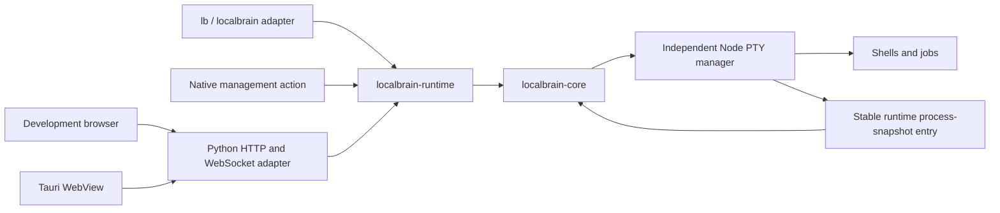

# Rust Core And Host Contract

## Status And Ownership

Accepted target contract for [FEAT-0167](../feature/feat-0167-rust-core-and-host-contract.md),
[SPEC-0167](../spec/spec-0167-rust-core-and-host-contract.md), parent [PRD-0029](../prd/prd-0029-rust-core-and-responsive-gui.md).
It fixes implementation decisions for the first Rust slice. **Run247 planning
baseline:** the backend was Python and native Terminal was excluded; the contract
Run itself did not establish implementation parity. The selected Terminal slice
later passed [FEAT-0170/Eval0167](../evaluation/eval-0167-rust-terminal-runtime.md)
and native admission was delivered by FEAT-0171. The [current Terminal policy](../../policies/project/terminal.md)
owns implemented behavior; whole-backend migration remains incomplete under the
refactor plan and each product implementation retains its own acceptance gates.

This document owns target code/host/writer/protocol/compatibility decisions.
[Refactor0006](../refactoring/refactor-0006-rust-core-transition.md) owns phase gates;
[FEAT-0168 runtime contract](../feature/feat-0168-app-independent-terminal-runtime-contract.md) owns bundled payload
and independent process lifetime. Current product/data definitions remain with their
policy owners. No DB/schema/identity change is authorized by this contract.

## Current And Target Ownership

| Product family / current owner | Current delivery | First slice | Later obligation / boundary |
| --- | --- | --- | --- |
| Terminal: terminal runtime/settings/web/CLI | macOS development web only, Node manager and Python bridge | Rust terminal value validation, setup/service control, manager client/stream coordination and process inspection; thin existing host adapters | Native delivery requires separate access and actual app integration. Group/command-status foundation and terminal-purpose UI remain separate |
| Sessions, Dashboard, titles/reading/references, Usage | Current admitted web/app entrypoints; no promise of a CLI for every GUI action | Existing Python/SQLite/renderer untouched | Port approved common functions while preserving IDs/source revisions, read/pin/title state and immutable Usage/cost attribution |
| Local Context, documents/resources, keyword/optional semantic search | Current web/app, optional model dependencies | Existing Python owners and FTS/index/model formats untouched | Port ingestion/store/query/rendering with transactions, source eligibility, links/filters and model compatibility separately accepted |
| Settings/onboarding, Docs, navigation/history, storage/backup/recovery | Current web/app/common writer | Existing Python generic settings parser/writer and recovery stay; terminal rules consume it as below | Future common settings/storage migration is a separate shared-writer cutover, not a second concurrent writer |
| Workstreams/organization, learning/insights, workflow/maintenance/auto-work, Atlassian adapters and experiments | Current owner/admission differs by edition; app excludes optional packages | Preserve code/data and current explicit admission, no activation | Inventory each admitted web function and app gap before later product port; original provider/read/write approvals and parked experiment budgets remain |
| Learning reader/import routes; Insights runs; Sources/scan, Schema and local-resource reader | Development-web-only registrations in app/application.py and app/routes.py; root CLI learning remains its existing explicit path | Existing web/CLI code retained, no automatic native routes | These app gaps remain on the later common-function inventory; do not describe them as already shipped in app |
| Root CLI dispatch | Existing init/serve/scan/doctor/models/storage/simulate/search and learning dispatch; terminal is conditionally admitted | Only existing terminal control adapter changes in the first product slice; every unrelated command stays with its current owner | Preserve current arguments/JSON/exit/errors and source/storage/model/simulation responsibilities; no new CLI commands inferred from UI parity |
| Context Search/answer models and Google Drive | Suspended in default web/app | Retain source/tests/registrations/assets; no worker/job activation or deletion | Return only under the existing explicit availability decision, not as a migration side effect |
| Windows/Intel/Linux products | Separate proposed/unverified delivery | No support claim | Not cancelled or satisfied by this macOS first slice |

First slice is terminal control; it is not completion of the repository-wide Rust
transition or permission to leave the remaining admitted app/web functions divergent.
No source data, personal cache, corpus or installed service is used to establish this contract.

## Package And Call Ownership

Future source layout is `rust/` with an independent workspace/lock, two packages:
`localbrain-core` library and `localbrain-runtime` executable. Core owns terminal
rules, typed errors, private paths, manager protocol/compatibility, process inspection
and launch/stop orchestration. It has no Tauri/WebView/HTTP framework dependency.
The executable owns serialization/stdio and delegates all rules to the library.



- Both GUI editions keep the same HTML/CSS/JavaScript/xterm and terminal HTTP/WS
  contract. Python continues serving other Jinja/feature routes during transition.
- Python adapters authenticate/parse host requests, invoke the binary with absolute
  path and private pipes, map results to existing HTTP/CLI output, and perform the
  generic file commit below. They do not duplicate terminal validation/ownership logic.
- Tauri remains window/file-picker/application host. Native management calls the
  same executable; normal WebView terminal calls follow the same HTTP adapter as web.
  Embedding the core directly or adding Tauri-only business IPC is not this slice.
- One-shot control spawns a short-lived child per request. A view owns one persistent
  stream child; never spawn a child per output chunk/key. Child death detaches only
  that view. The manager owns shells independently of the host/bridge children.
- No Rust application server/daemon, SQLite library, TOML parser, GUI framework or
  new model engine is needed for this first package boundary.

## Host Protocol

### One-shot control

`localbrain-runtime control` consumes exactly one UTF-8 JSON object plus newline
on stdin and emits exactly one JSON object plus newline on stdout. No logs/banner
on stdout. Envelope version is **host protocol1**, distinct from manager protocol.

```json
{"wire":1,"id":"request-00000001","context":{"dataDir":"/tmp/example-data","cacheDir":"/tmp/example-cache","homeDir":"/tmp/example-home"},"operation":"service.status","arguments":{}}
```

`wire` is integer1, `id` is a nonempty string of at most128 UTF-8 bytes; `context`
contains exactly three absolute resolved path strings above. Host derives these
from its configured scope, not an HTTP body; CLI uses its explicit configuration.
Core repeats private-location/owner/type checks. Any symlink/invalid ownership
refusal from the current storage owner remains a refusal; do not create on inspection.
`operation` is one of the closed table below; `arguments` is an object with only
the listed fields. Unknown top-level/context/argument fields and JSON bool used
as an integer are rejected. Control request JSON is capped at128KiB, reply JSON at
2MiB+4KiB so the host envelope cannot reject a currently valid2MiB manager reply;
the manager/public stream limit remains2MiB. The newline delimiter is separate.
Launch strings retain the current4096-Unicode-code-point limit and NUL rejection
on launch/save. Settings reads retain raw string values for repair; they do not
start rejecting a saved bad path merely because launch validation would fail.

Success is `{"wire":1,"id":"request-00000001","ok":true,"result":{}}` with the
operation's current public result shape. Failure is
`{"wire":1,"id":"request-00000001","ok":false,"error":{"kind":"terminal","code":"busy","message":"…"}}`.
Error kind is exactly terminal or preferences. Settings value/path/section
validation errors use preferences, so the host preserves PreferencesError409
and its current detail shape; terminal errors preserve the existing code/status
mapping. Malformed outer requests/unknown fields remain the existing admission/
transport error, not a preferences success. Public HTTP/CLI output does not expose
this internal kind or raw stack traces.
Valid structured control responses exit0, including domain errors; malformed envelope,
oversize/serialization/abnormal child failure exits nonzero and is never a successful
operation. The adapter validates matching wire/id and exactly one result or error.
The existing human CLI still exits1 for domain/runtime error,2 for parser usage,
with JSON errors on stderr; structured transport exit0 does not redefine CLI success.

| Operation | Arguments and producer/consumer contract |
| --- | --- |
| `service.status` / `terminal.list` | Empty object; read-only. Current stopped/unsupported empty list is valid; unknown is an error, unclean remains visible, incompatible may be inspected |
| `service.dependencies` | Empty object; internal bundle/installed readiness for existing host UI, no PATH Node/npm requirement or service start |
| `manager.rpc` | Internal closed method/params/generation envelope for retained low-level consumers, never an HTTP raw-RPC route. Known methods only; incompatible known managers permit status/list/validated stop/tab-stop/shutdown only |
| `service.install` / `service.start` | Empty object; explicit mutation. Desktop install prepares bundled payload offline; development install retains its explicit optional setup. Start never creates a shell |
| `service.stop` / `service.restart` | `force`: strict boolean, default false; `expected`: exact generation and complete unique terminal-ID set. Host confirmation binds that set; changed state returns conflict. Restart starts no shells |
| `terminal.create` | `key,cwd,shell,cols,rows` and optional `tabId,direction`; preserve current field requirements/dimensions and split rules. A key matches `[a-zA-Z0-9-]{16,128}`. Same key+same launch returns same result, changed parameters conflict. A failed creation does not permanently consume its key |
| `terminal.stop` | Exactly one nonempty `id`, or `all:true` with `expected`; optional strict-boolean `force`. A single ID never becomes all. Full-set confirmations include retained exited records |
| `tab.action` | `id,action` with hide/show/rename/stop; `name` only for rename, ECMAScript-trimmed nonempty and pre-trim length≤120 UTF-16 units as current JS; `expected` for stop is exactly that tab's terminal set, plus optional strict-boolean `force` |
| `settings.read` / `settings.launch` | `revision` plus typed section snapshot below. Read validates types/length but leaves deleted paths readable for repair; launch also validates accessible cwd/executable shell and returns fixed launch values. Optional `cwdOverride` string selects the actual group/explicit folder without saving it; validate section types and shell, but do not require the unused saved cwd to exist |
| `settings.prepare` | `revision,section,cwd,shell`; only under host's common settings lock. Returns validated terminal patch bound to revision and scope; does not write TOML or start a service |
| `runtime.retire` | Internal existing-storage adapter only. `preview:true` has no other arguments and makes no files/service; returns exact scoped manifest/tree candidates. `preview:false` requires that complete `expectedReceipt` and selected `payloadIds`. Recheck clean stopped/unchanged scope and hold control+exclusive payload-use locks through deletion; only from an executable outside the retired trees. Actual rules belong to FEAT-0168. No new HTTP route/user terminal command is added |

`expected` is `{generation: string|null, terminals: string[]}`, at most32 entries,
unique and set-equal to the target snapshot. Structural/type/length failure is
invalid; duplicate IDs or a differing set/generation is conflict, preserving the
current manager's409 outcome. Null generation is valid only for an
actually stopped empty scope; unclean/unknown is not empty confirmation. Generation
and PID/birth validation remain separate. Core never invents an `expected` value
after the human confirmed a different set. Incompatible known managers get only
the explicitly supported management subset; new work is rejected.

Typed section snapshot is `{kind:"missing"|"table"|"invalid",cwd:atom,shell:atom}`;
each atom is `{kind:"missing"}`, `{kind:"string",value:string}` or `{kind:"invalid"}`.
Host marks any non-string known TOML value invalid instead of coercing dates/bools
to strings. Unknown TOML fields never leave their existing writer. Missing cwd uses
home; empty cwd launches as `~`; missing/empty shell uses current environment SHELL,
then account login shell, then `/bin/zsh`. Read preserves empty/invalid-path strings;
launch/save validate them, do not silently replace an explicitly inaccessible path.
Host forwards only the existing launch-environment allowlist; no app launch secret.
The Rust control/stream helper receives the eight launch keys plus trusted
terminal bundle/runtime/launcher and HF/XDG public-cache configuration paths.
Those extra paths are needed for executable selection and protected-cache overlap
validation; they are not forwarded to Node/shells. Desktop credentials and
unrelated host environment values remain only in the parent host.
Settings operations require their existing data/settings/snapshot validation,
not a healthy terminal cache/manager/payload. A broken or absent optional engine
must not prevent reading or repairing launch defaults before setup.

### Stream and process modes

`localbrain-runtime stream` receives a single attach envelope with context, terminal
ID and exact browser `unicode`/`checkpoint` values, followed by browser messages as
newline-delimited JSON. Its stdout emits the existing `control`, `output`, `error`
objects without an extra user-visible envelope. JSON strings escape embedded newlines.
HTTP/WS authentication and exact-origin checks happen before the child is spawned.

- Preserve current claim/read/input/binary/resize/release semantics. New managers
  require Unicode11 and `xterm6-v3` before granting input. The Rust adapter does not
  translate private checkpoint fields, repaint them, or synthesize success for old clients.
- At most one output frame is awaiting its exact rendered-sequence ack. Ack uses
  a JSON integer with `seq == sent.seq`; wrong/late/bool acknowledgements do not
  advance. Changing lease must not apply the old read's writable flag.
- Retain128KiB incoming-message/2MiB frame bounds,15s read/ack timeout, manager64KiB
  event and240×80 dimension bounds,20s renewable lease and existing frontend512KiB
  pending queue. Inputs/binary are byte-preserving; no reconnect/input replay.
- On input_busy/input_failed, emit error and close1013 before processing another
  paste fragment. Cancel pending work, release only this view's lease in finally,
  drain/reap the child on detach; do not stop the manager. Use concurrent pipe
  draining, not write-all-before-read for an unbounded duplex stream.
- RPC deadlines remain status1s/default8s, shutdown12s then up to5s exit confirmation;
  process read2s with outer3s/8MiB bound. Timeouts are unavailable/unconfirmed,
  never clean stopped. Host deadline must allow these stages and cancellation.

`process-snapshot` is a separate fixed entry with no shell-command argument. Its
records/permission/unknown contract is fixed in FEAT-0168. It never opens a database,
starts a service or needs a Python interpreter.

## Shared Settings Writer

Python remains the sole **file commit owner** for `settings.toml` in the first slice;
Rust owns known terminal value/path validation. This is an explicit transitional
ownership boundary, not two writers or a claim that all settings are already Rust.

1. Read: current generic preferences parser validates TOML/schema/common values,
   supplies byte-SHA256 revision and typed terminal snapshot. No write or service start.
2. Save: Python acquires the current data directory's `operations.lock` using the
   same owner-private O_NOFOLLOW file and nonblocking POSIX flock as every current
   settings/recovery writer; it rereads and checks the requested revision.
3. While that lock is held, invoke `settings.prepare` without acquiring another
   operations/control lock. An existing immutable-payload use lease is independent
   and does not reopen the writer lock. Core validates paths/known values and returns only
   cwd/shell patch with matching revision/scope. Failure/cancellation writes nothing.
4. Host verifies the response, merges only that patch into current raw `[terminal]`,
   preserves unknown/common values and schema1/onboarding ordering, writes the
   existing private same-directory temp/fsync/replace/directory-fsync transaction.
   Re-read result returns current common preference fields and their same revision.

No cross-process reentrant flock: the host owns the lock and Core does not reopen
it for prepare. No manager `control.lock` is held across a settings transaction.
Broken symlink/type, unsupported schema, invalid existing common values, revision
conflict or unsupported legacy TOML value remains an error preserving original bytes.
If the response is lost after commit, reread revision/values; never blindly replay
a stale patch. Settings do not change existing jobs. Future Rust generic writer
requires a separate common-writer cutover and full unknown-value/format parity.

## Source To Target Map

Public routes remain registered at their existing paths:

| Current entry | Target operation / unchanged public result |
| --- | --- |
| `GET /terminal` | Existing HTML; no manager/engine start |
| `GET /api/terminal` | terminal.list plus dependencies/defaultCwd metadata, same service/tabs/terminals shape |
| `POST /api/terminal/install` | service.install, explicit setup only |
| `GET /api/terminal/settings` | settings.read; with launch=true, settings.launch. Optional cwd query maps to cwdOverride only on launch; current preference/revision fields retained |
| `POST /api/terminal/settings` | settings.prepare plus the Python common writer transaction |
| `POST /api/terminal/service/{action}` | service.start/stop/restart; strict action/force/expected handling |
| `POST /api/terminal/terminals` | terminal.create, no unknown launch options |
| `POST /api/terminal/stop` | terminal.stop all with exact expected scope |
| `POST /api/terminal/terminals/{terminal_id}/stop` | terminal.stop single ID only |
| `POST /api/terminal/tabs/{tab_id}/{action}` | tab.action hide/show/rename/stop |
| `WS /api/terminal/terminals/{terminal_id}/stream` | Persistent stream child; same control/output/error objects and detach behavior |

The supported public JSON/Unicode/null and error cases require differential
coverage before product parity. A Rust codec's narrower malformed-Unicode or
numeric handling is not permission to silently normalize data or claim equivalence;
apply the existing defect-versus-intentional-change routing to any such discrepancy.

| Current source / consumer | First target owner / preserved effects |
| --- | --- |
| terminal/web.py → TerminalService status/list/create/start/stop and error mapping | Thin HTTP adapter → control binary → Rust core → same manager. Preserve request/result/status code: conflict/busy/stopping/not_owner409; unavailable/setup_required/start_failed503; other terminal errors400, PreferencesError409 and OS failure503 |
| terminal/web.py WS coroutine pair → manager claim/read/ack/input/release | Thin authenticated WS/pipe transport → stream child/core state machine → manager; unchanged output shape/lease/ack/backpressure/cancellation |
| terminal/cli.py, root cli.py aliases | Same help/options/confirmation/JSON/stdout/stderr/exit semantics; thin adapter calls control; app-only management uses the same binary grammar |
| terminal/settings.py + foundation/preferences.py/operations.py | Generic parser/file transaction stays Python, terminal interpretation/path validation becomes Core; no concurrent second writer |
| runtime.py launchd/private paths/control.lock/install/identity | Rust scope/setup/lifecycle module; explicit mutation only; no global login agent/registry |
| processes.py and manager.cjs processTable/ownership.cjs | Rust fixed process-snapshot; keep Node ownership/descendant/signal logic, birth/session and bounded shared async inspection |
| app/storage/layout.py/recovery.py/web.py and existing storage CLI | Internal runtime.retire adapter preserves existing storage confirmation/error output and holds runtime guards through actual deletion; no new public route/command or generic recursive terminal-root removal |
| manager.cjs, checkpoint.cjs, pty-input.cjs, colors.cjs, status.cjs + runtime lock | Keep Node/headless/PTY engine and explicit OSC133 status; only explicit later helper/payload protocol adaptation, no hidden VT rewrite |
| app/features.py/routes/lifecycle, desktop host/build/backend.spec | Later selective registration/bundle of the chosen runtime. Keep every other feature's current admission; native access contract must pass before enabling Terminal |

## Compatibility And Rollback

- DB/schema, source/Session/resource IDs, Usage snapshots, settings/model/index
  versions and original files remain unchanged. Core does not parse/migrate the DB.
- The first helper/payload manager adapter is manager protocol2; host protocol1 and
  checkpoint `xterm6-v3` remain separate. Protocol1 legacy manager retains known
  read/manage support only when its identity and operation shape are verified.
- Build/payload mismatch rejects create/start/claim against the wrong version;
  never silently replace it. Keep inspection and validated stop available through
  the compatible management entry. Unknown protocol/identity is protected, not guessed.
- Before transition/revert: explicitly end affected terminal work and confirm old
  manager stopped, then switch package/adapter and refresh web/backend. No warm
  cross-engine migration, PID resurrection, automatic shell recreation or replay.
- Rollback is to a recorded source/package version with the same unchanged data
  contracts. It does not promise arbitrary downgrade or restore memory-only VT.

## Build And Dependencies

Actual environment read2026-11-12: Rust/cargo1.99.1, aarch64-apple-darwin installed;
Tauri lock2.12.4, host edition2021 and declared rust-version1.77.2. Pinned cached
Tauri2.12.4 package declares Rust1.90, uuid1.28.0 declares1.89.0. **The host declaration
does not establish its locked dependency MSRV.** Do not downgrade or auto-upgrade
the toolchain/host as part of a docs pass.

Target workspace uses edition2021, declared Rust1.90 and build toolchain1.99.1;
macOS deployment target14.0, aarch64 only in the first product gate. Pin these
existing-lock versions rather than selecting new libraries:

| Direct dependency | Selected version / declared Rust / license | Responsibility |
| --- | --- | --- |
| serde, derive | 1.0.229 /1.56 / MIT OR Apache-2.0 | Typed bounded host/manager envelopes |
| serde_json | 1.0.154 /1.71 / MIT OR Apache-2.0 | JSON framing, strict booleans/integers and preserved null |
| uuid, v4 | 1.28.0 /1.89.0 / Apache-2.0 OR MIT | Request/temp identifiers, not provider Session identity |
| libc | 0.2.191 /1.65 / MIT OR Apache-2.0 | POSIX identity/flock/session access, not shell evaluation |
| sha2 | 0.10.9 / no rust-version declared / MIT OR Apache-2.0 | Existing SHA256 revision/build/payload rules |

Versions/checksums come from current host lock; declared requirements/licenses and
source revisions were read in cached upstream package manifests. `.cargo-checksum.json`
was absent in this observation, so this is **not** a full source-integrity or build
pass. Official [serde manifest](https://github.com/serde-rs/serde/blob/v1.0.229/serde/Cargo.toml),
[libc manifest](https://github.com/rust-lang/libc/blob/0.2.191/Cargo.toml),
[sha2 manifest](https://github.com/RustCrypto/hashes/blob/sha2-v0.10.9/sha2/Cargo.toml),
[Rust1.99.1 Command](https://doc.rust-lang.org/1.99.1/std/process/struct.Command.html)
and [Tauri sidecar](https://v2.tauri.app/develop/sidecar/) supply API/distribution references.
API principles: absolute executable + argv, explicit allowed environment, piped
stdio with concurrent drain/reap, Unix owner checks and same-filesystem atomic replace.

First implementation must generate its own locked dependency graph, verify source
checksums/license set and `cargo check/test --locked` on build/declared-MSRV targets,
plus actual packaged arm64/native helper/ABI tests. No Cargo/workspace or host
manifest is changed here; no unsupported library compatibility is inferred.

## Measurement Contract

Record exact old/new source/build/payload/assets, OS/architecture, synthetic corpus,
cold/warm and 0/1/8-shell·4-pane/hidden/flood/reconnect conditions. Separate request
wait/core/pipe transport/parse/DOM/layout/paint and total app/backend/WebView/manager/
shell/optional-model costs; do not add shared memory twice.

Inherit existing web terminal gates: manager normal workload96MiB and representative
upper160MiB, idle CPU<1%, input p95<150ms, flood control<250ms, with their original
workload/coverage limits. Native total RSS/startup and route/input baselines must be
measured and the product Feature's numeric non-regression budget locked **before
that product's approval**; these contract Features do not claim an app-wide number
or measured speedup. If process-per-control overhead breaks that gate, return the
transport decision to Spec rather than quietly adding an always-on daemon.

## Contract Cases And Stop Conditions

| Case | Required result / distinguishing predicate |
| --- | --- |
| Read/list with no engine/manager | Stopped/unsupported metadata or setup-needed; no install/launch/shell side effect |
| JSON `true` for cols/seq/wire or unknown operation/field | Invalid; never bool-to-int coercion or arbitrary RPC forwarding |
| Missing vs empty cwd/shell; inaccessible explicit folder | Preserve read values; resolve current defaults only where allowed; explicit invalid launch fails before manager creation |
| Invalid TOML/common schema or unknown date/large numeric fields | Existing parser/writer refusal/preservation; Core never serializes unrelated values |
| Stale settings revision or two writers | Existing operations.lock/revision guard rejects; no partial patch, second lock acquisition or lost unknown fields |
| Same create key/same values; same key/different values | Same execution/result; conflict respectively, no second shell after an ambiguous response |
| New generation/changed retained-ID set after confirmation | Conflict, even when running-count is unchanged; no stale whole/tab stop |
| Helper timeout/EPERM/birth mismatch/invalid framing | Unknown/unavailable/unclean as appropriate; no clean empty list or signal to a reused PID |
| Lease changes during read, stale ack, lost bridge | Do not grant old writable state or acknowledge unseen output; release this lease/cancel unsent data, manager/jobs survive |
| Old manager/build and newer app | Known management only; no automatic replacement/start or replay; unsupported protocol stays protected |
| App Quit/sleep vs update/shutdown | Independent runtime contract applies; normal detach is not stop, update requires confirmed stop, reboot restores no process/VT |

Contract completion requires every case/owner/shape above to be explicit. Actual
runtime parity, native input/performance, engine integrity and product acceptance
remain unproven until their separately scoped implementation witnesses exist.

At Run249 closure, the common web workspace added immutable tab creation cwd,
optional reported `activity` metadata and the launch cwd override above. Its
handoff required the future Rust typed bridge to preserve these additive fields
and unknown fallback without regressing group/status. The then-current manager
was protocol1; the selected Rust helper/payload transition required protocol2.
Run251 implements that transition as described below. The Run249 amendment and
archived Run247/248 receipts themselves remain contract/web historical evidence.

## Implemented Host Details

Run251 implements the first terminal slice. The manager holds one fixed Rust
`payload-lease` helper pipe for its lifetime; EOF releases only that use lease.
It reports `leaseHeld` in protocol2 status. Control/stream processes also hold
shared payload leases; retirement runs outside target images with exclusive
leases. The cached management launcher clears stale app bundle/runtime overrides
before executing its own cached helper, so app removal cannot redirect management.
Read-only polling checks manifest/body identity and exact file tree/size/mode; full
byte hashes are verified before prepare/execution and retirement. Detailed parity
and actual host limits remain Run251/252 evidence, not a whole-repository port claim.

Mandatory stream input-failure warnings use a separate bounded priority slot;
a full regular output queue cannot discard them. Stream exit75 is a private
transport fallback for input_busy/input_failed: the host emits a partial-input
warning and closes1013 even if stdout delivery failed. Detach aborts unsent pipe
bytes and reaps the child; it never flushes a queued paste into a disconnected
view. Initial stream setup failure also reaps its own child. Cold create repeats
launch/key/dimension validation before preparing or bootstrapping a manager;
live-key idempotency/conflict remains manager-owned. Retained low-level stop calls
share the canonical exclusive-target validator before any RPC reaches an old manager.
