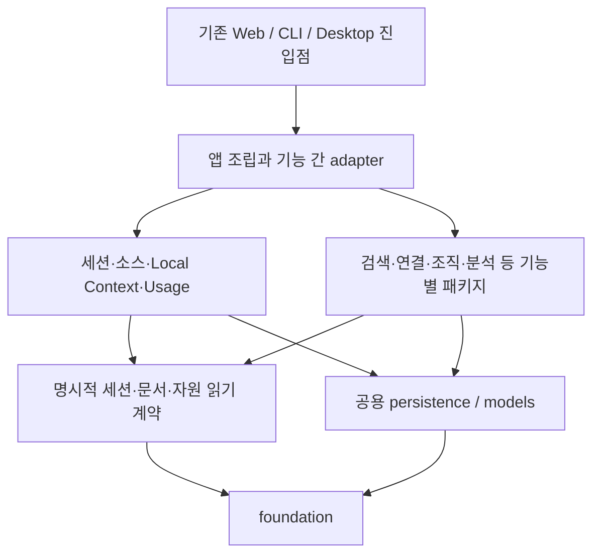
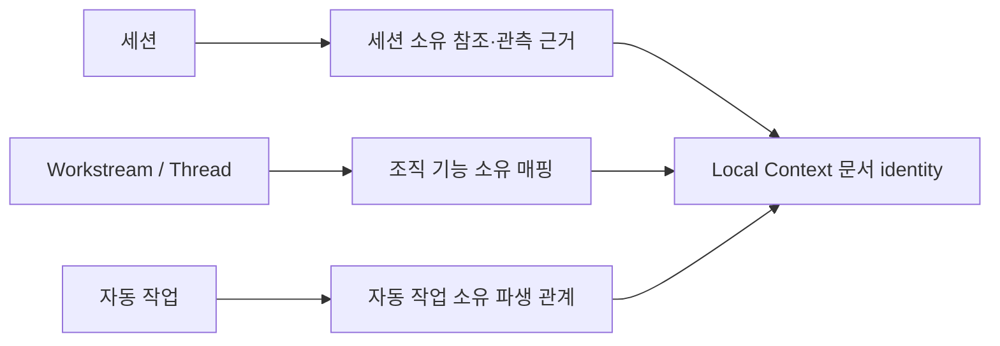

# REFACTOR-0003: Session-Centered Package Boundaries

## Purpose

세션 수집·열람·재탐색을 중심으로 앱을 확장하면서, 기능별 코드의 소유권과
의존 방향을 분명하게 만든다. 최상위 파일을 폴더에 옮기는 데서 끝내지 않고,
여러 기능이 실험 코드나 특정 제품 기능에서 빌려 쓰는 기반 코드를 분리한다.
Workstreams, Auto Work, 작업 흐름, Context Search, Atlassian은 현재 동작을
보존하면서도 이후 유지·교체·제거를 각각 검토할 수 있는 경계로 묶는다.

이 문서는 **구조 정리 계획과 진행 상태**를 소유한다. 첫 실행에서 기반·모델만
분리한 것은 요청한 기능별 폴더·계층 정리를 충분히 수행하지 못한 범위 판단이었다.
2026-10-30 사용자의 후속 지적에 따라 기능 패키지와 전달/조회/저장 계층까지
재배치했다. 아래 상태표는 구현된 패키지 경계와 아직 남은 완전한 의존 분리를
구별한다. 어떤 기능을 최종 제품으로 확정하거나
미완성 기능을 완성·중단·삭제하는 결정은 포함하지 않는다. 현재 배포 여부,
구현 상태, 제품 방향의 확정 여부는 서로 다르다.

## Refactor Type

- Status: `completed` (2026-10-31 R1 수정과 subagent 재리뷰 완료). 기반/모델,
  기능별 패키지·HTTP/query/resource, persistence 내부 책임과 선택 기능의 앱 조립을
  분리했다. 최상위 Python 파일은 최초 100개 → 첫 배치 89개 → 현재 진입점 4개다.
  [재점검](logs/2026-10-31_refactor-0003_completion-review.md)에서 Auto Work 잔존 캐시의
  공통 정리 실패를 발견해 Step 9/11을 재개했고,
  [캐시 경계 수정·재리뷰](logs/2026-10-31_refactor-0003_feature-cache-boundary.md)에서 닫았다.
  다섯 선택 기능 각각 또는 전부의 import를 차단한 web/desktop 조립은 기존
  캐시가 있는 Settings/CLI 작업까지 검증했다. 실제 기능·테이블 삭제, 설치된
  native 앱 교체, 전체 strict parity 판정은 포함하지 않는다.
  [기반/모델 기록](logs/2026-10-30_refactor-0003_foundation-models.md),
  [기능 패키지 기록](logs/2026-10-30_refactor-0003_feature-packages.md),
  [앱 조립 기록](logs/2026-10-31_refactor-0003_feature-assembly.md)은 각 배치의 증거와 한계를 유지한다.
- Primary type: `Structural`. Supporting type: `Interface` for internal imports,
  route/service registration, worker entrypoints and packaged resources.
- Parity target: `Behavior-preserving`; 현재 개발 웹과 배포 앱의 서로 다른
  동작을 각각 보존한다. 최종 parity status는 현재 `Unknown / Provisional`이다.
- Compare baseline: 계획 조사 시점의 `master`.
- Baseline pin: `df1d61e526b769fc4d708f8d980419427aae8472`.
  이 값은 최초 계획 조사 기준으로 보존한다. Step 1–3 실행 기준은
  `6c03265701d0d8b552fc8bb60e346ba1971f4bb3`이며 그 사이 source/test/build 변경은 없다.
  첫 실행 시작 시 미커밋 파일은 이 계획과 plans index였고 별도 사용자 코드 변경은 없었다.
  기능 패키지 배치는 같은 HEAD 위의 미커밋 기반/모델 결과를 기준으로 삼았다.
  그 기준의 150개 Python 파일 inventory SHA-256은
  `f11fccdd23717d84ddce22e860aa4a85c9621e2896d2a4b2e94b6020a5f6dcd1`이다.
- Evidence: 현재 소스·정적 import·SQL·라우트/lifespan·테스트·빌드 설정을 조사했다.
  최초 계획 작업에서는 앱 테스트, 모델 실행, DB 초기화, 실서비스 검증을 하지 않았다.
  이후 두 배치에서 synthetic source/wheel/runtime와 frozen worker를 검증했다.
  기능 패키지 배치는 1,443개 테스트, 기존 114개 ordered route/OpenAPI,
  양 edition의 HTTP 응답 비교와 실제 backend 빌드를 통과했다. 상세 비교와
  Drive/native 한계는 기능 패키지 기록을 따른다. 최종 앱 조립 배치는 1,473개 테스트,
  선택 기능 없는 조립 12개 경우, 양 edition의 기본 조립 응답 비교, 설치 wheel,
  실제 frozen backend 시작·종료·재시작과 브라우저 검사를 통과했다. 정규화·한계는
  최종 앱 조립 기록을 따른다.
  초기 harness manifest/history 변경은 이 트랙의 코드 범위에서 제외한다.
- Continuity: [REFACTOR-0002](refactor-0002-ingestion-layers-and-session-revisions.md)는
  ingestion 계층·Session revision 및 후속 DDL 보정까지 완료했다.
  그 검증은 해당 변경의 증거이며 새 패키지 구조의 parity 증거는 아니다.
  이번에는 앱 전체 결합과 제거 영향이 중심이므로 새 번호를 사용한다.
- Execution routing: 이 계획은 기존 refactoring 트랙을 사용한다. 기반·모델·
  persistence는 Foundation Contract / Backend Product 범위로 실행한다.
  라우트·렌더링·브라우저 상호작용을 옮기는 배치는 Fullstack Product와 해당
  surface lane을 선언하고 [Agent Workflow](../../agents/README.md)의 관련
  실행·평가 규칙을 적용한다. 기능 변경이 필요하면 별도의 승인된 경계로 돌린다.

### Current Review After REFACTOR-0005

2026-10-30 사용자의 subagent 점검 요청으로 현행 코드·계약과 targeted 검사
72개를 대조했다. 당시 남은 세 항목은 후속 사용자 실행 지시에 따라 아래와 같이
완료했다. 2026-10-31 재점검에서 기존 캐시가 남은 기능 제외 경로의 잔여를 확인해
전체 트랙은 `in-progress`로 되돌렸다. 같은 날 R1 수정·재리뷰로 이 잔여를 닫아
현재는 `completed`다. strict parity는 `Provisional`이다. 당시 조사 증거는
[세션 의도 점검 기록](logs/2026-10-30_refactor-0003_session-intent-review.md)이 소유하며,
후속 범위와 exit gate는 이 계획의 기존 Step 8–11 및 아래 우선순위를 따른다.

| 현재 범위 | 최신 판정 |
| --- | --- |
| 기능 패키지·기반/모델·query/web 귀속 | 완료. 최상위 Python 100개 → 진입점 4개. |
| Session 직접 자료와 공용 URL/path identity·문서/북마크/외부 링크 매핑 | REFACTOR-0004/0005에서 완료. 기존 Atlassian 직접 FK와 등록 resolver는 남은 작업이 아니다. |
| 선택 연동 없는 core 수집·Local Context·Session 참조 읽기 | scoped observer와 SQL 경계 분리 및 한정 검증 완료. observer 계약을 호출하는 것은 미해결 Atlassian 직접 의존이 아니다. |
| 검색 HTTP·Maintenance·기본 앱 조립 | 해당 범위 완료. 공용 HTTP 폼, 기능별 실행기와 공통 Run 상태, 명시적 route/lifecycle 조립을 분리했다. 다섯 기능 각각 및 전부를 제외한 양 edition의 12개 fixture가 수집·조회·시작/종료를 통과했다. [실행 기록](logs/2026-10-31_refactor-0003_feature-assembly.md) 참조. |
| 선택 기능의 기존 캐시와 공통 저장소 작업 | 완료. Auto Work가 캐시 형식·만료 정책을 소유하고 앱/CLI가 포함된 처리기만 연결한다. 기존 simulation/preview가 남은 제외 조립에서 Settings 정리·CLI 이관/정리와 파일 보존을 검증했다. [수정·재리뷰](logs/2026-10-31_refactor-0003_feature-cache-boundary.md) 참조. |
| persistence 내부와 복구 HTTP 책임 분리 | 점검 당시 잔여였으며 후속 사용자 지시에 따른 Step 10 배치에서 완료. [실행 기록](logs/2026-10-30_refactor-0003_persistence-layers.md) 참조. |

점검 시 아래 우선순위를 제안했다. 이후 사용자가 3번과 1/2번 실행을 순서대로
지시했고 모두 완료했다. 기존 Step의 Guardrails와 다음 경계를 유지했다.
후속 재점검에서 확인한 4번은 앞선 작업의 보존된 성공 범위와 구별한다.

2026-10-31 후속 `진행` 지시로 1/2번을 실행했다. Structural / Internal Interface
배치이며, 기준은 Step 10 이후 작업 트리 488개 src/tests/scripts/build 파일의
manifest `c4efd0167969ac2b3212f40159d0c835d32672d4797f6c48232075dce79ae12f`다.
검색 폼 처리는 공용 HTTP 소유자로, Maintenance의 조직/외부 실행은 각 기능
소유자로 옮겼다. 공통 실행 상태 복구·취소는 실행 기능의 책임이며 앱은 해당
기능의 시작/종료 처리를 조립한다. 기존 복구 호출은 개발 웹에만 있고 desktop에는
없다는 조건을 보존한다. form 한도/오류, route·startup/stop 순서, terminal write의
transaction, 외부 실행 승인 조건을 유지한다. 선택 기능 없는 조립은 synthetic
검증용 내부 조립 경계이며 제품 설정/toggle이나 DB 변경을 추가하지 않는다.
HTTP 경로 검증은 Fullstack Product의 검색·앱 shell·Run/Atlassian 전달 surface에
한정하며 화면 디자인·업무 규칙 변경은 없다.

1. **Step 8/9 — 검색 HTTP의 Atlassian 역의존 제거: 완료.** 공통 폼 해석과 오류를
   `app/forms.py`로 옮겼다. 기존 입력 한도·encoding·빈 값/중복 값·HTTP 오류
   응답 의미를 유지했고, Atlassian import를 차단한 keyword/AI 검색 HTTP와
   폼 정상·실패 검사를 통과했다.
2. **Step 5/8/9/11 — 작업 adapter와 앱 조립 연결부 분리: 완료.** Maintenance의
   조직/외부 작업을 `workstreams/runner.py`, `atlassian/runner.py`로 옮기고
   각 기능의 route/lifecycle 연결을 명시적으로 나눴다.
   제품 toggle이나 plugin framework 없이 기존 schema·transaction·start/stop
   계약을 유지한다. 선택 기능별 import 차단 상태에서 기본 Session/Context/Usage/
   keyword 요청·수집·lifespan 시작/종료를 함께 검증하는 기존 Step 11 gate를 닫았다.
   기존 Run 표시용 Workstream join/FK와 이력 schema는 보존했다. 코드 미탑재 검증은
   해당 테이블 삭제 허가나 데이터 마이그레이션의 대체 증거가 아니다.
3. **Step 10 — Persistence 내부와 복구 HTTP 분리: 완료.** 도메인별 migration 구현과
   bootstrap/connection 책임을 나누되 순서·backup/rollback·공개 API를 유지한다.
   fresh/legacy/실패/retry 초기화, backup 및 storage route 검사를 exit gate로 삼고
   기능 테이블 삭제·DB 재설계를 이 배치에 섞지 않는다.
4. **Step 9/11 — 선택 기능의 기존 캐시 정리 경계: 완료.**
   - Goal / Why this grouping: 시작 시 선택 기능을 제외해도 공통 Settings/CLI의
     저장소 작업이 그 기능을 다시 요구하지 않도록 feature 캐시 정책과 앱 연결을 함께 정리한다.
   - Guardrails: 기본 앱의 만료·소유권·lock·알 수 없는 파일 보존 계약을 유지한다.
     기능 미탑재를 이유로 남은 파일을 임의 삭제하거나 ImportError를 포괄적으로 무시하지 않는다.
     제품 toggle, 새 plugin framework, DB migration은 추가하지 않는다.
   - Targets: `app/storage/layout.py`, `recovery.py`, `web.py`, `app/application.py`,
     `cli.py`의 storage 연결과 `auto_work/`의 cache 소유 책임 및 관련 테스트.
   - Validation / Exit gate: Auto Work import를 차단하고 기존 simulation/preview
     캐시를 남긴 web/desktop 앱에서 공통 캐시 정리가 동작하며, 미탑재 기능의 자료는
     명시된 보존 정책을 따른다. 기본 앱의 만료 정리, busy/unowned/symlink 거부,
     검색 서비스 재시작과 Settings/CLI 연결을 함께 검증한다.

2026-10-31 사용자가 4번 수정과 수정 후 subagent 재리뷰를 지시했다. 기준은
재점검 당시 495개 source/tests/scripts/build 파일 manifest
`a2df266bd8ba286c0ef7b63d75ab71a0d41a683fde7921722bf914223dbaf188`이며
비교본을 고정했다. 기본 기능 집합의 cache owner/만료/안전성 동작은 보존하고,
미탑재 기능의 잔존 캐시는 삭제·이동·해석하지 않은 채 공통 정리만 완료한다.
이 내부 조립의 기존 실패를 고치는 것과 파일 위치/인터페이스 변경을 구별한다.
Fullstack Product의 Settings 캐시 정리·앱 시작/종료·CLI storage 경로 범위이며
새 UI, 사용자용 toggle, 운영 DB 변경이나 설치 앱 교체는 포함하지 않는다.
실행 결과와 재리뷰는 [캐시 경계 기록](logs/2026-10-31_refactor-0003_feature-cache-boundary.md)이
소유한다. 회귀 대상 1,478개를 검사하고 생성 ledger 최신성 실패는 재생성과 관련
6개 재검사로 해소했다. default CLI 비교, 12개 제외 조립, 설치 wheel, 실제 frozen
backend 시작·종료·재시작, 브라우저 Settings 정리를 검증해 4번을 닫았다.

아래 원본 책임 지도·배치 진행표·당시 잔여 및 intentional delta는 구조 배치의
기준과 이력이다. REFACTOR-0004/0005의 승인된 의미 변경을 구조 배치의
parity 증거로 소급하지 않는다. 실제 현재 구조는 Architecture가 소유한다.

## Scope

### 현재 구조에서 확인한 문제

수치는 위 SHA의 소스 기준이다. Python 모듈은 142개, `src/localbrain/` 바로 아래
Python 파일은 `__init__.py`를 포함해 100개다. 정적 import 조사는 함수 내부
import까지 포함하지만 동적 문자열·SQL·템플릿 의존성을 모두 증명하지는 않는다.

| 관찰 근거 | 정리해야 할 책임과 영향 |
| --- | --- |
| `main.py` 4,166줄; 내부 모듈 56개 import | 여러 기능의 라우트, 입력 모델, 응답 조립, 공용 템플릿, lifecycle이 한 파일에 모여 있다. 기능을 묶으면서 해당 web adapter도 함께 옮긴다. |
| `queries.py` 821줄 | 세션 목록/차트/상세, 문서, 소스, 대시보드, deprecated 통합 검색이 섞여 있다. 조회를 실제 소비 기능별로 나눈다. |
| `workstreams.py`를 15개 내부 모듈이 import; 핀·차트 설정 등은 `utc_now`만 사용 | 시간 함수 사용 때문에 세션 기능이 Workstreams에 의존하지 않게 한다. 자원 생성과 Workstream 소속 관계도 별도 책임이다. |
| `work_reconstruction.py`를 25개 내부 모듈이 import | 실험 알고리즘 파일에 오류 타입·검증·해시 같은 재사용 기반이 있다. 실험의 유지 여부가 앱 기반에 영향을 주는 역방향 의존이다. |
| `natural_search`와 모델 설치가 `session_simulation.py`의 JSON I/O 및 `session_simulation_model.py`의 encoder/자산 검증을 사용; Context Search worker가 `work_context_model.LocalGenerator` 사용 | 실험/시뮬레이션 이름 아래 있는 실제 공용 모델·파일 기반을 먼저 꺼내야 한다. 단순히 전부 `experiments/`로 이동하면 같은 결합이 남는다. |
| `ingest/sync/{sessions,contexts,storage}.py`, `session_references.py`, `contexts.py`가 Atlassian 처리에 연결 | 수집 결과·참조·검색 투영·삭제 시 정리가 같은 트랜잭션에 묶여 있다. 호출 위치와 실패 의미를 보존하는 명시적 연결부가 필요하다. |
| `session_context.py`는 Workstream/Thread/Atlassian 테이블을 직접 조회; legacy `queries.search`는 Atlassian 결과를 합침 | Python import만 없애도 SQL 의존은 남는다. 세션 기본 조회와 부가 관계/외부 자료 공급자를 나눠야 한다. |
| `db.py` 1,989줄; `runtime_storage`와 상호 참조, `storage_recovery`에 HTTP 라우트 포함 | 연결·마이그레이션·파일 안전성·백업/복구 작업·웹 전달을 다른 책임으로 분리한다. 마이그레이션 재설계는 하지 않는다. |
| `edition.py`는 배포 앱의 route admission을 제한하지만 `main.py`의 개발 기능 import는 남음 | 화면 노출 제한이 코드 분리를 뜻하지 않는다. 현재 접근 제한과 실행 조건은 보존하고 조립 지점을 명확히 한다. |

### 제품 상태와 구조상 취급

| 영역 | 현재 사실과 이 계획의 취급 |
| --- | --- |
| Sessions / Sessions Dashboard / Local Context / 소스 설정·동기화 | 현재 세션 중심 사용 경로의 기반이다. 읽기·수집·Usage·소스 수명주기를 응집화한다. 이 분류는 기능 전체의 완성도 인증이 아니다. |
| Keyword / Natural Search | 현재 모델 없는 기본 검색과 명시적 AI 검색은 별도 계약이다. 현재 corpus·정렬·fallback을 유지한다. |
| Context Search | 이미 별도로 승인·구현되어 배포 경로에 포함된 기능이다. 이번 사용자 방향에 따라 미래 유지 여부는 열어 두되, 지금 제거하거나 미승인 기능으로 재분류하지 않는다. 기존 품질·native 검증 한계도 그대로다. |
| Google Drive | 선택된 동기화 계약과 독립 저장소·스케줄을 가진 기존 패키지다. 2026-10-30 사용자는 이 연동도 보류 수준이며 현재 동작 검증의 우선순위를 낮추도록 지정했다. 이번 배치에서 로컬 HTTP 서버가 필요한 전송 테스트 11개는 필수 완료 조건에서 제외했다. Context Search의 수신본 읽기와 동기화 책임은 구별하며, 보류가 기존 구현·데이터 삭제나 과거 승인 취소를 뜻하지 않는다. |
| Workstreams / Threads / Suggestions | 개발 웹의 기존 조직·검토 동작을 보존한다. 미래 필수 계층으로 고정하지 않는다. |
| Workflow / Auto Work | [중단된 개발·계산 경계](../project/roadmap.md#current-direction)를 유지한다. 기존 Focus/교정, affinity 읽기, 명시적 simulation, 이전 preview를 구조상 구별한다. 계산이나 기능 개발을 재개하지 않는다. |
| Atlassian | 사용자는 2026-10-30 후속 논의에서 개발 중 멈춘 파일럿이며 정본으로 취급할 필요가 없다고 명시했다. 완료한 구조 배치는 기존 동작을 비교 기준으로 삼았지만, 현행 테이블·등록 흐름·화면 분류가 앞으로의 설계 기준으로 고정되는 것은 아니다. 후속 설계는 세션 참조와 공용 자원의 독립성을 우선한다. |
| Insights / Learning / 명시적 실험 | 저장·검토·분석·실험의 서로 다른 실행 조건과 데이터 소유권을 유지한다. 코드 패키지 정리가 제품 채택이나 평가 완료를 뜻하지 않는다. |

### 패키지 책임 지도

**기능을 먼저 묶고, 필요한 기능 내부에서만 전달·처리·저장 계층을 나눈다.**
전역 `services/`, `repositories/`, `utils/`에 모든 기능을 다시 섞지 않는다.
이미 나뉜 `ingest/`, `natural_search/`, `context_search/`, `google_drive/`는
유지하고 경계 밖으로 새는 책임부터 정리한다. 아래는 최초 기준에서의 전체 목표 map이다.
`foundation/`과 `models/`의 실제 이동은 배치 실행 기록에 고정했고, 나머지 목표 경로는
아직 현재 구조를 나타내지 않는다. 현재 소유권은 Architecture가 소유한다. 표의 원본은
`src/localbrain/` 상대 경로다.

| 현재 소유 코드 | 목표 소유자 | 분리 기준 |
| --- | --- | --- |
| `__init__.py`, `main.py`, `cli.py`, `desktop.py` | 기존 entrypoint 유지 | 버전, `localbrain.main:app`, CLI와 frozen backend 진입점. 내부 구현은 각 소유자에 위임한다. |
| `main.py`의 조립/lifespan/공용 템플릿, `edition.py`, `settings_web.py`, `app_docs.py`, `local_picker.py` | `app/` | 앱 조립, 경계 middleware, Settings/Docs/네이티브 선택기 adapter. 기능 business logic을 넣지 않는다. |
| `config.py`, `preferences.py`, `local_operations.py`, `path_display.py`; 공용 시간·진단·해시·private file 함수 | `foundation/`의 목적별 모듈 | 설정 값, 잠금, 시계, 경로, 직렬화/파일 안전성. DB·기능·모델 실행·FastAPI를 import하지 않는 기반. |
| `runtime_storage.py`, `storage_layout.py`, `storage_recovery.py` | `foundation/` 파일 안전성 + `persistence/` DB 복구 보조 + `app/storage/` 작업/HTTP 조립 | 저수준 안전성, DB migration backup, 소유 캐시/복구 작업을 구별한다. 모델·실험별 보관 규칙을 공용 파일 함수로 끌어올리지 않는다. |
| `db.py`, `source_identity_migration.py`, `source_revision_migration.py`, `schema_presentation.py`, `value_registry.py`, `schema_explorer.py` | `persistence/` | 연결/transaction, 초기화, 마이그레이션, 값/스키마 해석. Explorer HTTP 전달은 `persistence/web.py`에 둔다. |
| `session_sources.py`, `source_profiles.py`, `source_settings.py`, `source_sync.py`, `session_sync.py`, `context_sync.py`; `queries.source_inventory` | `sources/` | 소스 registry·설정·reconnect·상태, 기존 completion 기반 sync. 실제 parsing은 `ingest/`가 계속 소유한다. |
| `activity.py`, `session_pins.py`, `session_chart_preferences.py`, `session_reading.py`, `subagents.py`; 세션 관련 `queries` | `sessions/` | 세션 조회·대화 읽기·차트·핀·activity. 조회 모델과 HTTP adapter를 구별한다. |
| `session_references.py`, `session_context.py`, `skill_observations.py` | `sessions/`의 근거/기본 읽기 + 관련 기능 adapter | 참조 원본·관측 저장은 `sessions/`, 순수 URL 해석은 `references/`, 등록 항목 매칭은 `atlassian/session_references.py`, 관계 조합 조회는 `resources/related_context.py`, Insights 랭킹은 `insights/skills.py`다. 저장 FK와 나머지 수집 연결은 잔여다. |
| `contexts.py`, `markdown_references.py`; 문서 관련 `queries` | `local_context/` | 등록된 문서 소스/읽기/로컬 링크 해석. 소스 설정, ingestion, 화면 전달과의 인터페이스를 유지한다. |
| `usage.py`, `usage_queries.py`, `official_pricing.py` | `usage/` | 기록·가격 snapshot·집계. Sessions Dashboard에서 재사용하되 Insights 실행과 결합하지 않는다. |
| `markdown.py` | `rendering/markdown.py` | 현재 안전한 Markdown 렌더링 계약. Context Search·문서·Learning·Docs가 공유한다. |
| `model_cache.py`, `model_catalog.py`, `model_installation.py`, `model_setup.py`, `session_simulation_model.py`, `work_context_model.py`, `work_context_choices.py` | `models/` | pinned 자산·검증·embedding/generation runtime·설치. Hub root의 환경변수/경로 계산만 `foundation/`으로 분리해 파일 안전성이 모델에 역의존하지 않게 한다. |
| `keyword_search.py`, `queries.search` 및 관련 FTS 보조 | `search/` | 현재 keyword와 legacy 검색 계약을 구별한다. legacy 다기능 결과 조립은 명시적 adapter로 연결한다. |
| `ingest/`, `natural_search/`, `context_search/`, `google_drive/` | 기존 패키지 유지 | import·명시적 연결부만 조정. `google_drive_web.py`는 `google_drive/web.py`로 귀속한다. |
| `workstreams.py`의 조직·링크·검토, `retrieval.py` | `workstreams/` | Threads/checkpoints/Suggestions와 조직 기반 candidate retrieval. 일반 검색으로 오인해 `search/`에 합치지 않는다. |
| `workstreams.py`의 일반 외부/로컬 자원 identity·CRUD·읽기 | `resources/` | 세션 참조와 Atlassian도 사용하는 자원. Workstream membership·Suggestion 수락은 `workstreams/`에 남긴다. |
| `runner.py` | `maintenance/` | maintenance Run·subprocess·결과 적용. 공유하는 실행 파일 탐색만 작은 기반 함수로 추출하고 Insights와 Run 모델을 합치지 않는다. |
| `workflow_*.py`, `workstream_candidates.py` | `workflow/` | source-supplied projection/candidate 계약, Focus, assertion/undo, 교정, map presentation을 각각 소유한다. 세션 기본 읽기는 이에 의존하지 않는다. |
| `auto_work.py`, `session_affinity.py`, `session_simulation.py`, `session_simulation_cli.py`, `session_simulation_graph.py` | `auto_work/` | preview·affinity 소비·명시적 simulation의 기존 연결을 응집화한다. 공용 파일/모델 기반은 먼저 분리한다. |
| `work_context*.py` 중 모델 기반 제외, `work_reconstruction*.py` 중 공용 기반 제외, `work_claim*.py`, `work_role_comparison.py`, `work_state.py` | `experiments/`의 context/reconstruction/claims 하위 영역 | 명시적 평가·실험 및 순수 공급 입력 계약. Auto Work가 사용하는 기존 실험 경로는 명시적 개발용 의존으로 기록한다. 파일 이동으로 품질 승인이나 제품화를 하지 않는다. |
| `personal_insight_{evidence,guidance,runs,usage}.py`, skill ranking | `insights/` | 분석 전용 근거·가이드·Run·accounting과 화면. durable skill 관측 저장은 `sessions/`에 남긴다. |
| `learning.py`, `learning_cli.py`, `learning_web.py` | `learning/` | reviewed packet·학습 상태·CLI·화면을 한 기능으로 묶는다. 자동 생성 기능을 추가하지 않는다. |
| `atlassian.py`, `atlassian_*.py`, `external_access.py`, `external_sync.py` | `atlassian/`의 identity/evidence/browse/access/sync/refresh/web | 현재 소비자에 근거한 소유권이다. source-neutral envelope 형식과 의미는 보존하며 새 generic connector framework는 만들지 않는다. Maintenance와의 연결은 명시적 조립부로 옮긴다. |

`queries.dashboard_stats` 등 남는 개발 대시보드 조회도 실제 소비자에 귀속한다.
세션 기본 조회와 개발용 조합 조회를 같은 `queries.py`에 남겨 이름만 바꾸지 않는다.
목표는 폴더 개수 최소화나 특정 줄 수가 아니라, 변경할 책임과 관련 파일을
예측할 수 있는 구조다.

`templates/`, `static/`, `content/docs/`, versioned insight guides와 root의
schema/JSON package data는 이번에 일괄 이동하지 않는다. 기능별 소유 파일과
shared shell 참조를 함께 기록해 후속 제거 범위를 찾을 수 있게 한다. Python
위치가 바뀌어도 이 resource 경로와 공개 URL은 유지한다.

### 계층과 의존 방향



이 그림은 목표 의존 방향이다. 모든 기능이 모델이나 DB에 의존해야 한다는
뜻은 아니다. 구체적으로 다음 규칙을 적용한다.

- 기능 내부의 `web.py`/`cli.py`는 전달 adapter, `service.py`는 여러 동작의 순서·
  transaction 조정, `queries.py`/`store.py`는 해당 기능의 조회·저장 책임이다.
  순수 projection/contract가 있으면 별도 모듈로 둔다. 단순한 기능에 이 파일을
  모두 강제로 만들거나 모든 SQL에 repository class를 씌우지 않는다.
- DB schema·초기화·마이그레이션은 공용 persistence가 계속 소유한다. 기능은
  자기 query/write를 소유한다. 소스/세션의 명시적 계약을 다른 기능이 읽을 수
  있지만 세션 기본 처리에서 Workstreams·Workflow·Auto Work를 import하지 않는다.
- `foundation/`은 표준 라이브러리, 기존 Python 3.9 호환용 `tomli` 및 자기 기반
  모듈만 사용한다. `models/`는 실험 알고리즘을 import하지 않는다.
  embedding과 generation의 내부 경계도 유지한다.
- 동시 실행을 조정하거나 기능을 결합하는 곳은 `app/`과 지정된 CLI/공개 scan
  facade다. `ingest/scanner.py`의 기존 public composition 역할을 허용하되,
  내부 `ingest/sync/`가 Atlassian 구현을 직접 import하는 상태는 해소한다.
- 필요한 seam에는 작은 함수/인자/명시적 adapter를 쓴다. DI container, event bus,
  plugin discovery, 범용 job framework, 사용자용 feature toggle은 도입하지 않는다.
- 교차 기능의 SQL도 의존으로 센다. 세션 부가 자료·legacy 검색·ingestion evidence
  공급자의 순서, transaction, 오류 전파를 호출부에서 명시한다. 임의의 callback
  목록이나 `ImportError` 무시로 기존 작업을 건너뛰지 않는다.
- 실험의 기존 개발용 소비자(Auto Work 등)는 별도로 표시한다. 세션 중심 기본
  앱은 그 의존을 필요로 하지 않아야 하지만 모든 개발 기능이 실험과 무관하다고
  주장하지 않는다. 얇은 `__init__`에서 무거운 모델·web 전체를 다시 import하지 않는다.

### 제거 용이성의 범위

이번 목표는 **제거 시 고칠 연결부를 한정하는 것**이다. 폴더 하나를 삭제하면
기존 데이터까지 안전하게 지워진다는 약속이 아니다. 각 유동 기능은 구현,
web/CLI 진입점, 조립/종료 hook, 템플릿·asset 소유, 테스트, SQL/FK, 설정·캐시
소유를 함께 추적한다. 제거 검토에는 이 목록이 필요하다.

최초 계획 시점에는 `sessions.maintenance_run_id`, `session_reference_evidence`의 Atlassian FK,
`atlassian_items → external_resources`, `maintenance_runs → workstreams` 관계가
있었다. 이후 REFACTOR-0005에서 Session evidence의 Atlassian FK를 공용 자원 FK로
교체했다. Run 관련 FK와 Atlassian 확장→외부 자원 관계는 보존한다. 기본 schema를
유지한 상태에서 기능 없는 **테스트용 조립**을 검증하되,
실제 제품에서는 현재 등록·노출·background behavior를 유지한다. 기능 제거,
데이터 보존/정리/마이그레이션은 후속 Semantic 트랙의 별도 결정이다.

## Non-Goals

- 미완성 기능 보완, Workflow/Auto Work 계산 재개, 기능 제거·숨김·노출 확대,
  새 navigation·화면 디자인·권한·사용자 설정 추가.
- parser 규칙, Session/Usage/reference revision, 검색 corpus/ranking, 모델/prompt,
  task 결과 의미, 조직 자동 수락·관계 추론 변경.
- DB-per-feature, ORM·마이그레이션 프레임워크 도입, schema/table/column 삭제,
  ID 재발급, 데이터 재수집·전체 재색인·캐시 폐기를 패키지 이동의 기본 절차로 삼기.
- Python/FastAPI/모델 라이브러리 업그레이드, 대규모 formatting/명명 변경,
  모든 테스트 폴더의 일괄 재배치, 기존 문서 트리나 과거 계획 전면 정리.
- 로컬 실행 중인 앱 재시작, 사용자 DB/설정/원본 파일 조작, 모델 다운로드,
  live 외부 연결 또는 공개 배포. 별도로 승인된 실행 단계의 작업만 수행한다.

## Invariants

1. **제품 경계:** 개발 웹과 desktop edition의 현재 route admission, same-origin/
   loopback/token, 노출·redirect·기본값을 각각 보존한다. Context Search의 현행
   승인을 취소하지 않으며 중단된 workflow 개발·계산도 재개하지 않는다.
2. **세션·수집:** source-scoped identity, provider revision의 forward-only admission,
   입력 원본 read-only, provenance·event order·부모 관계·핀/사용자 링크를 보존한다.
   현재 Session revision은 Codex 12 / Claude 7이며 provider 간 비교하지 않는다.
   null Session revision은 backfill, 미래 revision은 force에서도 source mutation
   전에 거부한다. Session/Usage/reference freshness와 가격 snapshot은 독립이다.
3. **수집 transaction:** Session source별 outer transaction, 통상 Context 수집의
   그룹 transaction과 직접 `scan_context_root`의 caller transaction, repair savepoint,
   per-file 실패와 source 격리, reference finalization/rollback, cancellation/progress
   계약을 그대로 둔다. 완전한 세부 조건은 완료된 REFACTOR-0002의 Invariants를 따른다.
4. **데이터·SQL:** 테이블/컬럼/키/FK/CHECK/FTS, query의 join·조건·null/default·
   order/limit, write selection·fields·timestamp·source, 출력 dedupe/정렬을 보존한다.
   초기화/repair 순서, 기존 DDL refusal, backup 및 recovery 조건을 약화하지 않는다.
5. **작업 수명주기:** 앱의 초기화·start/stop 순서와 예외, 단일 writer/lock·취소·
   shutdown 대기, subprocess 회수, 실패 후 기존 결과 유지와 Run terminal-state
   transaction을 보존한다. Session/Context 완료 시각 기반 주기와 Drive의 wall-clock
   주기를 합치지 않는다. Auto Work와 maintenance/insight Run도 별도 실행 모델이다.
6. **부가 연결:** Atlassian 근거/정리/검색 투영과 조직 관련 자료가 현재 수행되는
   지점에서 동일 connection·순서·실패 의미로 동작한다. 부가 기능이라는 이유로
   기존 성공 경로의 write를 생략하거나 실패를 성공으로 바꾸지 않는다.
7. **모델·파일:** pinned model ID/revision/hash, manifest/owner/cache identity, encoding·
   windows·generation budget, offline scope, 공개 weight와 private data 분리를 보존한다.
   JSON/hash 알고리즘, 파일 권한·symlink/hardlink·atomic replace·오류 타입/코드와
   private data 경로 검증도 유지한다. 패키지 이동 때문에 저장 형식을 새 버전으로 올리지 않는다.
8. **검색·대화:** 모델 없는 검색과 명시적 AI 검색, Context Search의 Local Context+
   수신 Drive copy 경계와 read-only tools를 유지한다. Context Search의 질문은
   다운로드를 시작하지 않으며 대화는 page/request memory에만 남는다. 한 번에
   한 요청, 취소/모델 전환/화면 이탈/종료 시 해제와 worker-local network 차단을 보존한다.
9. **전달:** URL/method/name, status/header/response shape, 입력 검증, template context,
   asset URL·DOM interaction, CLI options/exit code, worker flags, 공용 entrypoint를 보존한다.
   import 경로 변경이 예외 처리, monkeypatch, serialization, package resource를 바꾸는지 확인한다.
10. **외부·검토:** 로컬 읽기/미리보기에서 외부·모델 호출을 새로 만들지 않는다.
    명시적 외부 read와 승인된 Drive write 계약, Suggestion 수락·교정/undo·학습 검토
    상태, Insights 분석 전용 실행을 보존한다. 현재 한계는 정리 완료로 해소되지 않는다.

## Planned Work

각 Step은 검토 가능한 목적별 경계다. 내부 배치는 각각 통과·기록한 뒤 다음으로
이동하며 여러 기능을 한 커밋에 함께 이동할 필요는 없다. 권장 순서는
**1 → 2 → 3 → 4 → 5/6/7 → 8 → 9 → 10 → 11**이다.
5/6/7의 독립성은 코드 의존 조사로 확인하며 병렬 agent 실행을 뜻하지 않는다.

아래 표와 직후 의존 설명은 기능 패키지/URL 경계 배치 직후의 스냅샷이다.
REFACTOR-0005 이후의 완료 상태는 위 Current Review를 따른다. 당시 남아 있던
Step 5/8/9/11은 2026-10-31 앱 조립 배치로, Step 10은 persistence 배치로 닫았다.
설치된 native 앱 검증과 기능·테이블 삭제는 아래 기록의 한계로 남으며 구조 완료에 포함하지 않는다.

| 당시 단계 | 배치 직후 상태 |
| --- | --- |
| Step 1 | 실행 기준·old→new map·baseline 검증 기록 완료 |
| Step 2 | 기반 추출 구현 완료; 경계·기존 동작의 한정 검증 통과 |
| Step 3 | 모델 분리 구현 완료; source/wheel 기동과 frozen worker 검증 통과 |
| Step 4 | `sources/`, `sessions/`, `local_context/`, `usage/`, `rendering/`과 기능별 query/web 귀속 완료; 참조/수집의 Atlassian 연결은 Step 8 잔여 |
| Step 5 | `resources/store.py`와 `workstreams/`, `maintenance/` 분리 완료; Maintenance↔조직/외부 작업 연결의 adapter 추출은 잔여 |
| Step 6 | `workflow/`, `auto_work/`, `experiments/{context,reconstruction,claims}/` 귀속 완료; 공개 Auto Work module 명령 유지 |
| Step 7 | `insights/`, `learning/` 귀속과 durable skill 관측/Insights ranking 분리 완료 |
| Step 8 | Atlassian 패키지 귀속, 공용 URL 해석과 선택적 세션 등록 항목 resolver 분리 완료; 나머지 ingestion·Local Context·legacy search의 transaction 보존 adapter와 저장 FK 분리는 잔여 |
| Step 9 | `main.py` 진입점, `app/` 조립/lifespan/ordered route와 기능별 handler 분리 완료 |
| Step 10 | `persistence/`, `app/storage/`와 자원 lookup 경계 완료; `persistence/db.py` 내부 bootstrap/migration 세분화와 recovery 작업/HTTP 추가 분리는 잔여 |
| Step 11 | 최상위 진입점만 유지, owner 문서/빌드/회귀 검사와 핵심 Session/resource의 선택 기능 없는 import 검증 완료; 선택 기능 없는 전체 수집/lifecycle 조립과 native 브라우저 검증은 잔여 |

위 완료는 해당 배치의 구현·기록 범위다. 전체 독립성, strict parity, 최종 병합 또는
설치된 native 앱 검증 완료를 뜻하지 않는다. Drive 검증 유예와 native 한계는 아래 gate와 실행 log를 따른다.
특히 `resources/related_context.py`의 Atlassian SQL(조직 조회는 후속 REFACTOR-0004에서 제거), `ingest/sync/`,
`local_context/service.py`의 Atlassian 호출은 현재 동작을 보존한다.
`sessions/references.py`의 Atlassian import/등록 조회는 제거했으며, 기본 URL 해석은
등록과 무관하다. 수집이 명시적으로 붙이는 resolver와 기존 저장 FK/internal destination은 남아 있다.
`natural_search/web.py`의 Atlassian form/error 공유도 남아 있다. 이들을 단순
optional import나 오류 무시로 가리지 않았으며, 패키지 삭제만으로 제거 가능하다고 주장하지 않는다.

### Step 1 - Freeze Baseline And Responsibility Map

Goal:
- 실행 기준과 각 파일/호출/데이터의 소유자를 고정해 이동과 의도적 동작 변경을 구별한다.

Why this grouping:
- 과거 제품 방향과 현재 실행 경로가 다르므로 이름만으로 코드를 분류하면 현재 소비자를 놓친다.

Guardrails:
- 실행 승인은 위에 기록한 배치에 한정하며 기존 기능 삭제 결정으로 확대하지 않는다. 기준 테스트의 실패는
  별도 기록하며 패키지 정리에 숨겨 수정하지 않는다.

Targets:
- 이 계획의 mapping, 모든 142 Python 모듈과 관련 scripts/tests/build/resource 참조.
- `main.py` route/lifespan, `schema.sql` 교차 FK, source/worker CLI, runtime/cache owner.

Validation:
- 실행 SHA·dirty scope를 기록하고 baseline full suite를 실행한다. route 목록·HTTP 계약,
  설정/서비스 등록·start/stop, source→처리→query/write→출력의 old→new map을 고정한다.
- literal import뿐 아니라 `-m` 문자열, `__file__`, template/include, JS fetch/asset,
  test patch, schema 생성/문서 스크립트와 owner-doc 참조를 조사한다.

Exit gate:
- 각 이동 파일/논리 단위에 목표 owner와 관련 검증이 있고, 현재 구현·held 실험·공용 기반이
  구별되어 있다. 이후 merge/parity 판단에 사용할 baseline과 미검증 경로가 명시되어 있다.

### Step 2 - Extract Shared Foundation Without Changing Semantics

Goal:
- 시간·파일·진단·hash·설정·잠금 기반을 제품/실험에서 분리한다.

Why this grouping:
- 핀/세션과 검색/모델이 Workstreams 또는 reconstruction을 import하는 가장 작은
  역방향 의존부터 없애면 이후 기능 이동의 영향 범위가 줄어든다.

Guardrails:
- `utc_now`와 datetime 반환 `now`, JSON bytes/hash 옵션, 허용 파일 조건이 다른 함수를
  이름만 보고 합치지 않는다. `ExperimentError`는 이동하더라도 동일 타입 identity와
  code/catch 동작을 유지한다. 예외 명칭 현대화는 하지 않는다.

Targets:
- `workstreams.utc_now`, `work_reconstruction`의 공용 검증/hash, `session_simulation`의
  private JSON I/O, `runtime_storage`의 순수 파일 안전성, `model_cache.hub_cache_root`.
- `config`, `preferences`, `local_operations`, `path_display`; 실제 두 Run 소비자가
  공유하는 실행 파일 탐색. DB migration retirement와 기능별 cache owner는 제외한다.

Validation:
- 기존 pin/chart/preferences/storage/experiment/model 테스트를 해당 이동별로 실행한다.
  시간·JSON/hash 출력, symlink/hardlink·소유권·pending 파일·중단/실패의 기존 조건을 비교한다.
- 기반 import가 FastAPI, DB, 기능, 모델 runtime/실험을 로드하지 않는지 검사한다.

Exit gate:
- 세션 핀/설정과 공용 파일 처리가 Workstreams/실험 알고리즘을 import하지 않는다.
  기반의 각 공유 함수는 실제 소비자와 보존할 의미가 확인되어 있다.

### Step 3 - Separate Model Runtime From Experiments

Goal:
- public asset 설치/검증과 embedding/generation 실행을 `models/`로 귀속한다.

Why this grouping:
- Natural Search, Context Search, model setup은 이미 이 기반을 사용한다.
  실험 파일을 격리하기 전에 공용 모델 책임을 독립시켜야 한다.

Guardrails:
- 모델·revision·자산 hash·prompt·수치·manifest owner·모델 cache key 변경과 다운로드/재색인을
  포함하지 않는다. embedding과 generation에 하나의 새 inference API를 강제하지 않는다.
- `__file__.parents[2]` 기반 거부 경계는 source/wheel/frozen에서 같은 의미를 유지하도록
  검증한다. 단순한 디렉터리 깊이 치환으로 안전성이 보존됐다고 판단하지 않는다.

Targets:
- `session_simulation_model`, `work_context_model`, `work_context_choices`,
  `model_{cache,catalog,installation,setup}`. 선택지 문법 decoder도 generation이 직접 쓰는 공용 기반으로 확인했다.
- `natural_search/{model,index,service}`, `context_search/{worker,service}`, 실험 소비자,
  `desktop.py` worker flags, 모델 설치 subprocess, `desktop/backend.spec`.

Validation:
- `test_context_search_models`, `test_context_search_engine`, `test_context_search_service`, `test_natural_search`,
  `test_work_context_models`, `test_session_simulation`, `test_installation_and_storage`.
- source 및 설치 wheel에서 모델 없는 keyword 기동, 캐시 manifest 호환·verify 실패·
  취소/종료, worker module/flag 전달을 검증한다. 필요 runtime은 synthetic/fake 경계로
  검증하며 실제 모델·native 성능 증거는 별도다.

Exit gate:
- 검색/설치 실행에 experimental reconstruction/simulation 모듈이 필요하지 않다.
  모델 identity와 기존 사용자 cache/manifest를 변경 없이 재사용한다.

### Step 4 - Cohere Session And Local Source Flows

Goal:
- 소스 관리, 세션 읽기·근거, Local Context, Usage를 실제 데이터 흐름에 맞게 묶는다.

Why this grouping:
- 가장 많이 유지·확장하는 흐름의 기본 경계를 먼저 만든다. 소스 registry → 수집 →
  세션/문서 조회 → Dashboard로 이어지는 한 경로에서 책임을 검증할 수 있다.

Guardrails:
- source lifecycle/reconnect와 최근 ingestion algorithms/revision을 바꾸지 않는다.
  Atlassian 부가 자료는 명시적 임시 adapter로 보존하고 Step 8에서 정리한다.
  조직 자료의 세션 상세 조회는 후속 REFACTOR-0004에서 제거했으므로 재도입하지 않는다.
- 배치는 소스 registry/sync, 세션 조회/근거, 문서, Usage 순으로 각각 분리한다.

Targets:
- mapping의 `sources/`, `sessions/`, `local_context/`, `usage/`와 관련 `queries` 조각.
- `ingest` 소비 import, pin/chart/subsession route, `rendering/markdown.py`와 로컬 문서 링크.

Validation:
- source settings/sync/ingest/parsers, session inventory/details/chart/pins/references,
  context roots/sync, Usage dashboard/contract, Markdown 기존 테스트를 배치별로 실행한다.
- synthetic source의 첫 수집·변경 없음·수정·missing/reconnect·취소·오류·revision 거부를
  baseline과 비교한다. 세션/문서/대시보드 HTTP 결과와 브라우저 읽기·핀·차트도 확인한다.

Exit gate:
- 세션/소스/문서/Usage의 주 소유자가 분리되고 수집·저장·읽기 경계가 설명 가능하다.
  남은 feature adapter 의존은 위치·이유·해소 Step이 지정되어 있다.

### Step 5 - Separate Organization, Resources And Maintenance

Status: `completed`; 자원/조직 분리에 이어 공통 Run 상태와 기능별 실행기 분리를
2026-10-31 [앱 조립 배치](logs/2026-10-31_refactor-0003_feature-assembly.md)에서 완료했다.

Goal:
- Workstream 조직, 일반 자원, maintenance 실행을 각자 유지·제거할 수 있는 단위로 만든다.

Why this grouping:
- `workstreams.py`는 자원 identity와 관계/검토를 함께 소유하고 `runner.py`는 조직 및
  외부 작업을 함께 실행한다. 분리하지 않으면 조직 제거가 세션 참조·Atlassian에 전파된다.

Guardrails:
- 먼저 자원 identity/CRUD, 다음 조직/검토/retrieval, 다음 maintenance 전달·실행을
  별도 배치로 옮긴다. schema/FK와 승인·수락·취소·terminal transaction 의미는 유지한다.
- `retrieval.py`는 조직용 candidate evidence다. 이를 keyword/semantic search와 합치지 않는다.

Targets:
- `workstreams`, `retrieval`, `runner`와 관련 main payload/route/template 소유권.
- `resources/`, 조직 부가 자료 adapter, Maintenance↔Atlassian 결과 적용 연결부,
  Insights가 가져다 쓰는 실행 파일 탐색.

Validation:
- `test_workstreams`, `test_retrieval`, `test_runner`, `test_session_related_context`,
  `test_atlassian_refresh`, `test_personal_insight_run_guidance` 및 관련 route tests.
- 자원 생성/조회/중복 규칙, link·Suggestion 수락/거절, Run 실패·취소·복구와
  기존 review queue 보존을 SQL/write/output까지 baseline 비교한다.

Exit gate:
- 일반 자원과 세션 기본 조회가 Workstream 조직 service를 import하지 않는다.
  maintenance의 조직/외부 task 연결은 지정된 adapter에 있고 공용 scheduler로 일반화되지 않는다.

### Step 6 - Bound Workflow, Auto Work And Experimental Analysis

Goal:
- 세션 관측과 작업 의미 해석을 분리하고, 미확정 분석 흐름의 코드·명령·결과 소유를 응집화한다.

Why this grouping:
- Workflow Focus/교정, affinity inspection, explicit simulation, reconstruction 실험은
  일부 입력을 공유하지만 같은 권위의 결과가 아니다. 현재 의존을 보존하면서 경계를 드러낸다.

Guardrails:
- Workflow, Auto Work, experiments를 별도 배치로 옮긴다. 중단된 계산을 실행하거나
  의미 추론·관계 자동 확정·품질 검증 완료를 새로 주장하지 않는다.
- Auto Work의 명시적 실험 의존은 기록하고 함께 제거할 필요가 있는 범위를 표시한다.
  순수 candidate/claim 계약을 확정된 사용자 Workstream 상태로 바꾸지 않는다.

Targets:
- `workflow_*`, `workstream_candidates`, `auto_work`, `session_affinity`, simulation CLI/graph.
- 모델/공용 기반을 뺀 `work_context*`, `work_reconstruction*`, `work_claim*`,
  `work_role_comparison`, `work_state`와 대응 `scripts/` 진입점.

Validation:
- workflow projection/focus/assertion/correction/map, Auto Work/affinity/simulation,
  reconstruction/context/claims/state의 기존 synthetic tests를 배치별로 실행한다.
- 명령 help/import와 이미 준비된 synthetic 결과 읽기, stale/invalid/expired 상태,
  assertion/undo를 검증한다. 실제 전체 이력 계산·모델 비교를 기본 gate로 추가하지 않는다.

Exit gate:
- 세션 기본 앱과 모델 기반에 실험 알고리즘 import가 없다. 개발용 소비자·실험 산출물
  owner·CLI가 추적되며 기존 결과의 authority/coverage/품질 한계가 그대로다.

### Step 7 - Cohere Insights And Reviewed Learning

Goal:
- 분석 전용 Insights와 reviewed Learning을 각각 독립된 기능 패키지로 만든다.

Why this grouping:
- 두 기능은 세션 기반 위에 있지만 소스 수집이나 자동 조직화가 아니다. 각 기능의
  근거·상태·입력·화면을 한 owner에 두고 서로의 실행 모델은 공유하지 않는다.

Guardrails:
- Insights와 Learning은 별도 검토/병합 배치다. durable skill observation을 Insights
  삭제 단위에 넣지 않는다. Learning 자동 발견·생성·외부 조회를 추가하지 않는다.

Targets:
- `personal_insight_*`, guides resource와 main Insights routes, `skill_observations`의 ranking.
- `learning.py`, `learning_cli.py`, `learning_web.py`, 해당 template/static.

Validation:
- personal insight evidence/guidance/run/usage/UI, automatic skill loads/observations,
  learning contract 테스트. 분석 CLI no-tools·취소·retained usage와 학습 snapshot/
  attempt/review 상태, reader route를 확인한다.
- wheel/frozen에서 versioned guide와 Learning template 누락을 검사한다.

Exit gate:
- Insights가 없어도 ingestion의 skill 근거 저장이 유지된다. Learning과 Insights의
  진입점·데이터·resource 소유가 각자 완결되고 기존 미검증 사용자 가치/승인 경계가 보존된다.

### Step 8 - Isolate Atlassian With Transaction-Preserving Adapters

Status: `completed`; 참조·저장 소유권은 REFACTOR-0005, 일반 검색의 폼 역의존과
외부 실행기·조립 경계는 2026-10-31 앱 조립 배치에서 닫았다. 기존 저장된 실행 이력의
schema를 삭제하거나 Atlassian 파일럿을 제품 정본으로 확정한 것은 아니다.

후속 URL 경계 배치: 세션의 Jira/Confluence URL 분류는 탭 설정과 무관한 공용
`references/`로 옮겼다. 등록된 항목과의 DB 매칭은 `atlassian/session_references.py`
연결부로 분리하고 수집 조립에서 명시적으로 주입한다. 앱의 기존 연결 결과,
URL identity·안전성·중복 묶기·transaction은 유지한다. Slack 분류 추가나 전체
Atlassian 제거는 이 배치 범위가 아니다. 기준은 직전 패키지 배치의 202개 모듈,
inventory `4a45727e605f06c90da6ad2df3aa706fc7006172fd576b6dbb49b35689eeac0a`다.
배치 결과와 검증 한계는 [URL 경계 실행 기록](logs/2026-10-30_refactor-0003_reference-url-boundary.md)에 둔다.

Goal:
- Atlassian 구현을 한 패키지에 묶고 세션/문서/검색/maintenance와의 연결을 제한한다.

Why this grouping:
- 이 영역은 폴더 이동보다 transaction과 교차 SQL이 주요 위험이다. 단독 배치로
  local identity/evidence와 외부 read authority를 확인해야 한다.

Guardrails:
- 순서는 identity/locators/evidence → browse/registration/refresh/access/sync → web →
  ingestion/related-context/legacy-search 연결이다. 각 묶음을 별도로 검증한다.
- adapter는 같은 caller connection에서 같은 시점에 동기 실행한다. 새 commit,
  background event, swallow-error, optional-import fallback을 넣지 않는다.
- 현행 source-neutral sync envelope·approved dispatch와 terminal Run 동시 적용을 보존한다.

Targets:
- `atlassian*`, `external_access`, `external_sync`; main Atlassian helper/payload/routes.
- `ingest/sync` 근거 갱신/정리/FTS, `session_references`, `session_context`, `contexts`,
  legacy search, maintenance task/result 및 app composition adapter.

Validation:
- `test_atlassian*`, `test_external_access`, `test_external_sync`, session reference/
  related-context, context sync, ingest 및 runner 관련 tests.
- 동일 source fixture로 identity/evidence/FTS·순서/limit·dedupe, 실패 rollback·later-source
  cache publication·취소·receipt를 비교한다. browse/local sync가 외부 호출하지 않음도 확인한다.

Exit gate:
- 내부 ingestion·세션 기본 읽기에 Atlassian 구현 import/직접 join이 없다. 필요한
  local/external projection은 지정된 연결부에 있고 baseline의 write/failure 의미를 보존한다.
  기존 FK/data 의존은 남아 있다는 사실과 후속 제거 절차가 명시되어 있다.

### Step 9 - Finish Application Composition And Delivery Boundaries

Status: `completed`; 기능별 등록·lifecycle·기본 조립 비교에 이어 Settings와 CLI도
같은 포함 경계의 캐시 처리기를 사용한다. 재점검 R1은 기존 캐시를 남긴 제외 조립과
기본 구성 비교로 닫았다. 내부 조립 인자를 제품 설정으로 노출하지 않는다.

Goal:
- `main.py`를 앱을 노출하는 얇은 진입점으로 만들고 lifecycle·Settings·기능 조립을 명시한다.

Why this grouping:
- Step 4–8에서 각 기능과 web adapter를 같이 옮긴 뒤 남은 앱 수준 연결을 검토한다.
  모든 라우트를 마지막에 한 번에 재작성하는 단계가 아니다.

Guardrails:
- 기존 `install_routes` 패턴을 우선 사용한다. router 방식으로 바꾸면 path/name/order/
  schema operation identity와 exception handler 등록을 비교한다. 앱 factory는 fixture
  격리에 필요할 때만 두며 module singleton/app.state 계약을 임의로 바꾸지 않는다.
- 현재 startup 순서, Drive 실패 시 local sources 유지, non-desktop reconciliation,
  stop/join·worker 종료를 보존한다. 제품 feature toggle은 추가하지 않는다.

Targets:
- `main.py`, `app/`, 기존 `cli.py`/`desktop.py`; Settings/Docs/model/storage adapter.
- 기존 `natural_search` web 전달, `context_search`/`google_drive` 등록,
  shared template context·base navigation·feature assets.

Validation:
- desktop boundary/settings/onboarding/startup, app docs, natural/context search web,
  Google Drive routes, UI contract tests와 영향 route browser smoke.
- 전체 route snapshot, middleware·handler·서비스 start/stop을 양 edition에서 비교한다.
  test monkeypatch는 실제 소비 위치로 옮기고 기존 behavior assertion을 삭제해 통과시키지 않는다.

Exit gate:
- `main.py`에 기능 SQL·입력 모델·응답 가공·feature route 본문이 남지 않는다.
  기능별 등록/종료/Settings 기여가 명시적이고 source/CLI/desktop이 같은 소유 구현을 사용한다.

### Step 10 - Separate Persistence Bootstrap And Recovery Responsibilities

Status: `completed` (2026-10-30 후속 실행, [실행·검증 기록](logs/2026-10-30_refactor-0003_persistence-layers.md)). 사용자는 점검 결과 3번의 주제별
소유권·책임 분리를 이번 정리 정책에 따라 진행하도록 지시했다. 1/2번에 대해서는
앱의 정상 조립과 검색 폼 helper의 우연한 역의존을 구별해 설명했으며, 이 배치에서
기능 노출·검색 처리·작업 실행 계약은 변경하지 않는다.

Execution baseline: HEAD `6c03265701d0d8b552fc8bb60e346ba1971f4bb3` 위의
REFACTOR-0005 이후 작업 트리. src/tests/scripts/build 설정 475개 파일의
SHA-256 manifest digest는
`1d3efabf6dac2774bceabbf373ee732dca1d391dd468428ee8fe2aaf9868ff51`이다.

실행 경계: `persistence/db.py`의 공개 connect/init/transaction은 유지하고,
초기화 조정은 `bootstrap.py`, migration 구현·검사는 `migrations/`의 주제별
모듈로 옮긴다. DB 이력은 선택 기능 package가 아닌 persistence가 계속 소유한다.
동일한 legacy backup 절차만 공통화하고 서로 다른 복구 계약은 합치지 않는다.
`app/storage/recovery.py`의 작업과 HTTP route 등록도 분리한다. SQL/schema bytes,
이행 순서·조건·오류·transaction/backup 의미를 기준 코드와 대조한다. 이번 배치는
운영 DB 적용·재수집·서버 재시작을 필요로 하지 않는다.

Goal:
- `db.py`의 connection/transaction, 순서 있는 bootstrap, 영역별 migration, inspection을 분리한다.

Why this grouping:
- 다른 모듈 이동과 DDL/backup 경계 검토를 한 diff에 섞지 않는다. 앞 단계에서 정의한
  owner를 사용하되 전체 DB 계약은 계속 한 곳에서 초기화한다.

Guardrails:
- SQL/schema bytes와 migration 실행 순서·입력 shape refusal·backup 조건은 유지한다.
  일반적인 migration registry/framework나 도메인별 DB를 새로 만들지 않는다.
- `runtime_storage → db` 검증 호출과 `db → 파일 안전성`을 별도 책임으로 나누고,
  복구 HTTP 처리와 저장 작업을 분리한다. 관측된 다른 순환도 import 지연으로 숨기지 않는다.

Targets:
- `db.py`, `source_*_migration.py`, `runtime_storage`, `storage_recovery`, `storage_layout`.
- schema/value/inspection modules, `schema.sql`, `value-registry.json`,
  `schema-presentation.json`을 읽는 loader 및 생성/검사 scripts.

Validation:
- 모든 schema/source revision/identity/Atlassian migration tests, installation/storage/
  recovery tests; 새 DB와 지원하는 기존 schema fixture에서 integrity/FK·DDL 거부·
  backup 보존·transaction 실패를 검증한다.
- schema/data-model/value dictionary/cleanup-audit/presentation 생성물의 계약 및
  변경 없음, relocated wheel과 frozen schema lookup을 검사한다.

Exit gate:
- persistence가 feature web/service를 import하지 않으며 migration 순서와 public
  connect/init/transaction 소비 계약이 유지된다. 데이터 재작성 없이 구조 변경만 설명된다.

### Step 11 - Verify Detachability And Close The Track

Status: `completed` (2026-10-31 R1 수정 후 재리뷰). 기존 12개 제외 조립에
잔존 캐시·Settings/CLI 경로를 추가했다. 회귀 대상 1,478개, 기본 CLI 비교,
설치 wheel, 실제 frozen backend와 브라우저 검증으로 재개 항목을 닫았다.
검사 과정과 native/Drive·strict parity 한계는
[캐시 경계 기록](logs/2026-10-31_refactor-0003_feature-cache-boundary.md)을 따른다.
앞선 [앱 조립 기록](logs/2026-10-31_refactor-0003_feature-assembly.md)의 증거도 유지한다.

Goal:
- 기능별 응집화가 실제 제거 영향 축소로 이어졌는지 검증하고 최종 패키지 소유를 문서화한다.

Why this grouping:
- 폴더 생성·테스트 성공만으로 독립성을 입증할 수 없다. import·조립·SQL·package
  resource까지 확인해야 후속 제품 판단에 사용할 수 있다.

Guardrails:
- 기능 없는 조립은 synthetic fixture에서만 수행한다. 실제 기능 제거·schema 삭제와
  구버전 실행 파일의 호환성 보장을 이 gate로 대체하지 않는다.
- 모든 옛 경로를 facade로 남기지 않는다. 명시적 진입점과 확인된 소비자에 필요한
  shim만 임시 유지하고 owner·이유·제거 조건을 기록한다.

Targets:
- 전체 old→new map, feature-owned template/static/guide 목록, entrypoint/worker/build,
  영향 tests/scripts와 [Architecture](../../policies/project/architecture.md) package ownership.
- [Developer Guide](../../policies/project/developer-guide.md), 관련 data/storage/search/runner
  owner docs와 이 계획의 상태; 이전 refactor 이력은 유지한다.

Validation:
- Workstreams, Workflow, Auto Work, Atlassian, Context Search를 각각 제외한 fixture에서
  해당 구현의 import를 금지하고 기본 Session/Context/Usage/keyword 읽기,
  synthetic 수집과 lifecycle이 동작하는지 검증한다.
  기존 schema·기본 기능 계약을 유지하고 누락 기능을 제공한다고 위장하지 않는다.
- 양 edition의 full assembly도 baseline과 비교한다. AST 금지 의존 검사와 동적
  module/worker/template/SQL/resource 목록 검사를 병행한다. full suite와 설치 wheel,
  필요한 frozen/backend·브라우저 smoke 및 privacy 검사를 완료한다.

Exit gate:
- 최상위에는 의도한 진입점과 공용 package data가 남고 구현은 명시적 owner에 있다.
  각 유동 기능의 제거 영향이 패키지·지정 adapter/등록·해당 assets/tests·데이터 후속
  조치로 설명된다. 모든 영향 경로를 audit하기 전에는 parity 완료나 merge-safe를 선언하지 않는다.

## Validation Gates

### 실행 배치별 공통 gate

1. **기준·정적 검증:** 기준 SHA, 변경 파일, old→new 논리 단위 map을 기록한다.
   Python 3.11 개발 환경과 metadata의 Python 3.9+ 문법 경계를 유지한다.
   현재 lock의 FastAPI 0.128.8 / Uvicorn 0.39.0과 Hatch/PyInstaller 설정을 기준으로
   import/compile·패키지 데이터·CLI를 확인하며 신규 의존성/도구를 기본 전제로 하지 않는다.
2. **동작 검증:** 위 Step의 기존 focused tests를 실행한다. 신규 테스트는 transaction,
   부가 기능 경계, 실패/취소, 누락 등록처럼 실제 계약을 입증할 때 추가한다.
   파일명 존재나 옮긴 함수를 그대로 복제하는 assertion은 검증으로 삼지 않는다.
3. **wiring/runtime:** 등록 코드 이동마다 실제 lifespan/startup/shutdown과 대표 요청을
   synthetic private runtime에서 검증한다. HTTP 전달이 바뀌면 영향을 받는 브라우저
   경로·상태도 검증한다. 웹 성공을 frozen 성공으로 간주하지 않는다.
4. **parity audit:** 영향을 받은 entrypoint → orchestration → query/write → output
   전체를 immutable baseline과 비교한다. query의 join/filter/group/order/limit/null,
   write의 대상/필드/default/time/source, output 필드/fallback/dedupe/순서,
   side effect의 FTS/history/cache/security와 exception/retry/rollback/partial commit을
   별도로 기록한다. AST 동일성만으로 migration·runtime parity를 판정하지 않는다.
5. **배치 완료:** merge-ready checkpoint의 정확한 SHA/검토 상태에서 full suite를 실행한다.
   schema·packaging이 바뀌면 해당 생성물/설치 검증을 추가한다. 의도하지 않은 변경,
   다음 Step의 미완성 코드, 임시 산출물이 섞여 있으면 완료하지 않는다.

2026-10-30 첫 배치에서는 실행된 1,440개 테스트가 통과했고, sandbox의 loopback bind
제한으로 `test_google_drive_transport.PoolTests` 11개가 실행되지 않았다. 사용자의 Drive
보류 지시에 따라 이 11개는 현재 배치의 필수 gate에서 제외한다. 테스트를 삭제하거나
제품의 연결·오류 처리를 완화하지 않으며, Drive 작업을 재개할 때 다시 실행한다.

저장소의 기본 명령은 다음과 같다. focused suite 이름은 위 Step의 테스트 파일을
선택해 `unittest discover -s tests -p '<test_file>.py'`로 실행한다.

```bash
./scripts/check-repo-privacy.sh
uv run python -m unittest discover -s tests -v
git diff --check
```

현재 테스트의 원본 경로 검사·`localbrain.main.*` patch를 새 owner로 옮길 때 원래
검증 의미를 유지한다. source tree import 외에 installed wheel에서 CLI/help·resource
lookup을 확인하고, worker/모델/DB/app 조립 변경의 최종 checkpoint에서는 frozen
backend의 시작·대표 요청·종료를 확인한다. 전체 앱 재빌드/설치/실제 사용자 데이터
전환은 실행 시 승인된 범위에서만 수행한다.

화면이나 상호작용을 다루는 배치는 [Design Constitution](../../policies/design/design-constitution.md),
[Design Evaluation](../../policies/design/design-evaluation.md), functional evaluation과
[Interaction Evaluation](../../policies/experience/interaction-evaluation.md)을 적용한다.
구조 정리에는 시각 변경 의도가 없으며 검증에서 발견한 별도 제품 개선은 별도 작업이다.

### 기록과 증거의 한계

- 실행·blocker·runtime 확인은 기존 `refactoring/logs/`의 refactor log에 기록한다.
  실제 parity/merge 판단 시에만 별도 merge-check를 만든다. 계획 단계에서 빈 실행
  log나 통과 판정 문서를 미리 만들지 않는다.
- raw runtime/DB/model 결과는 private owner에 둔다. 추적 문서에는 synthetic 조건,
  검증 범위·결과·미검증 부분만 남기며 임시 경로에 의존하지 않는다.
- 첫 배치의 실제 구조와 한정 검증은 실행 log에 기록했다. 전체 strict parity는
  여전히 `Provisional`이며 관련 경로가 미검증이면 그 상태를 유지한다. native recipient, live provider,
  모델 품질·성능, 사용자 가치 검증은 구조 검사나 기존 테스트 통과로 닫지 않는다.

## Intentional Deltas

- 허용하려는 변화: 내부 Python import/파일 위치, 기능 소유권, 명시적인 조립 경계,
  책임에 따른 query/service/web 분리, 소비 tests/scripts/docs 경로 수정.
- URL 경계 배치의 내부 API: 공용 locator 결과 타입은 `references.contracts.UrlLocator`다.
  세션 reconciler의 `external_resolver` 기본값은 `None`이며 이때 URL은 순수 URL
  근거로 남고 bare Jira/Page hint는 등록 항목으로 연결하지 않는다. 기존 앱 수집은
  `atlassian.session_references.resolve_session_reference`를 명시적으로 전달해 기존
  등록 항목 연결 결과를 유지한다. 저장 kind/key/버전과 사용자 동작 변경은 아니다.
- Step 1–3의 부수 산출물: 내부 예외 타입의 `__module__`, source worker의 `-m` 경로와
  소스 바이트에 결합된 검증 지문은 새 위치를 따른다. `work_claim_trial`은 이동한
  `models/generation.py`를 지문에 포함한다. 기존 변경 감지 계약에 따라 이전 trial의
  configuration은 일치하지 않을 수 있으며, 이전 관측을 새 구현의 평가로 재사용하지 않는다.
  모델 자산 identity·사용자 모델 cache/manifest를 변경하는 것은 아니다.
- 사용자 동작·schema·설정·저장 형식·가격/모델 identity·외부 실행의 의도적 변화는 **없다**.
  내부 경로를 외부 계약으로 사용하는 실제 소비자가 발견되면 compatibility 범위를
  결정하기 전 해당 배치를 멈춘다.
- 최종 조립 배치의 내부 인터페이스: 공용 폼 오류는 `app.forms.FormError`이며
  Atlassian HTTP adapter는 기존 `AtlassianRegistrationError`로 번역한다. 공통
  `maintenance.service.start_run`은 기능이 선택한 coroutine을 받고 실행 종류를
  판단하지 않는다. `create_app(feature_packages=...)`는 명시적 내부 조립 경계이고
  제품 entrypoint의 기본 기능 집합은 유지한다. 미탑재 fixture의 관련 route/nav 부재는
  이 검증 조립에만 해당하며 기존 기본 앱의 노출 변경이 아니다.
- 의미 변경이 꼭 필요하면 원인과 old/new 동작을 별도로 기록하고 승인된 Behavioral/
  Semantic 변경 및 별도 기준으로 진행한다. structural parity에 포함해 숨기지 않는다.

## Risks / Open Questions

| 위험 또는 결정 지점 | 현재 제안 / 다시 판단할 조건 |
| --- | --- |
| 기능별 유지 여부가 유동적 | 이번에는 전부 현재 동작을 보존한다. 실제 제거/노출 변경 때 데이터·설정·URL·사용자 상태·배포 영향과 함께 별도 결정한다. 계획 작성을 막는 미결정은 아니다. |
| 패키지 분류를 제품 확정으로 오해 | 폴더는 코드 owner다. Context Search의 현재 승인과 미래 변경 가능성, Workflow의 중단 상태, Google Drive의 이번 보류 지시를 함께 유지한다. |
| 모델/실험의 공유 기반과 오류 identity | Step 2/3을 먼저 한다. `__module__`, serialized type, worker 문자열·cache identity가 실제 계약이면 shim 또는 별도 migration 경계를 실행 전에 결정한다. |
| cross-feature transaction과 FK | 같은 connection·호출 순서로 adapter를 적용한다. source의 all-or-nothing/부분 실패 의미가 바뀌면 구조 배치를 멈춘다. schema 정리는 후속 Semantic 트랙이다. |
| `external_sync`의 장기 소유 | 현재 소비자와 Atlassian read policy를 근거로 Atlassian에 응집한다. 다른 실제 connector가 같은 envelope를 쓰게 되면 그때 중립 계약만 추출한다. Drive를 같은 추상화에 억지로 맞추지 않는다. |
| 거대 파일을 거대 폴더 facade로 대체 | `__init__` 일괄 re-export, 거대 `common/service`, 불필요한 DTO 변환을 금지한다. 파일별 단일 책임과 실제 호출 방향으로 검토한다. |
| 기존 tests가 import 위치/원문에 결합 | patch target을 실제 lookup 위치로 옮긴다. 삭제한 source-string assertion의 원래 동작 검증은 필요한 경계 테스트로 유지한다. |
| package-relative 경로와 runtime 보호 경계 | schema/guide/template/static 및 `__file__` 깊이를 source/wheel/frozen에서 검증한다. 파일 이동을 이유로 private directory 허용 범위를 넓히지 않는다. |
| 작업 중 다른 변경·오래된 실행 프로세스 | 배치 기준과 변경 scope를 다시 확인한다. 실행 중 프로세스·app 설치 상태는 별도 rollout 문제이며 계획 조사나 새 코드 import만으로 교체됐다고 주장하지 않는다. |
| 기존 기능 상태가 남은 제외 조립 | 새 runtime의 시작·기본 읽기 성공만으로 기존 캐시를 다루는 Settings/CLI까지 입증할 수 없다. Auto Work 잔존 캐시의 공통 정리 실패를 확인해 Step 9/11을 재개했고, 포함된 feature 처리기만 연결하는 수정과 기존 상태 검사로 닫았다. |
| 계획 전체의 규모 | 기반/모델 배치만으로 원래의 폴더·계층 정리 목표가 충족되지 않아 기능 패키지·자원 소유권·persistence·앱 조립을 후속 배치로 수행했다. 기존 상태를 다루는 캐시 정리 경계도 재점검·수정·재리뷰로 닫았다. strict parity, 실제 기능/테이블 제거와 설치된 native 앱 전환은 구조 판정에 포함하지 않는다. |

## Exit Goal

- 세션 중심 개발에서 소스/수집/조회/Usage/모델 기반의 위치와 의존 방향이 명확하다.
- Workstreams, Auto Work, Workflow, Context Search, Atlassian의 변경·제거 영향이
  지정된 구현/조립/asset/test/data owner로 한정되어 설명 가능하다. 공용 기반이
  특정 미확정 기능이나 실험 알고리즘에 역의존하지 않는다.
- `main.py`는 진입점이고 기능 전달·SQL·lifecycle 소유가 분리된다. `queries.py`와
  `db.py`의 혼합 책임을 작은 이름 변경으로 남기지 않는다.
- 현재 기능·원본·사용자 상태·검토 계약을 보존한 증거, 남은 예외와 compatibility
  shim의 제거 조건, source/wheel/frozen/browser 검증 범위가 기록되어 있다.
- 배치 실행 후 실제 구조만 canonical owner docs에 반영한다. 최초 Step 1–3의
  구현·한정 검증 완료 이후 기능 패키지와 후속 의미 변경 배치를 진행했다. 최신
  완료/잔여는 위 Current Review를 따르며 제품 수용·기능 삭제 완료로 확대하지 않는다.

## Handoff to Next Track

아래는 후속 트랙 실행 전의 설계·인계 기록이다. “아직”, “현재 구현” 및 기존 FK
설명은 당시 상태를 보존한다. 직접 자료 표시는 REFACTOR-0004, 공용 identity/FK와
운영 DB 이행은 [REFACTOR-0005](refactor-0005-shared-resource-ownership.md)에서 완료했고,
앱 조립·잔존 캐시 경계는 위 Current Review에서 완료를 확인할 수 있다.

- 2026-10-30 후속 설계 논의의 확인된 방향: 사용자는 세션을 중심으로 자원을
  참조하는 구조와 그에 대한 설계 의견을 요청했다. Atlassian 파일럿의 기존
  모델은 변경 가능한 대상이며, 보존할 세션 원문·참조 근거와 구별한다.
- 확인된 관계 모델(아직 코드/DDL에 적용하지 않음): 사용자는 공용 링크와
  세션별 발견 매핑에 동의했고, 로컬 Markdown에도 같은 관계가 적용되는지 물었다.
  `세션 → 세션 소유 참조 근거 → 공용 자원`을 기본 관계로 삼는다. 다른 세션도
  같은 공용 자원을 참조할 수 있지만 언급·읽기·출처 근거는 세션별로 소유한다.
- 세션 상세의 관련 자료는 이 관계를 현재 세션을 중심으로 펼친 읽기 화면이다.
  URL과 로컬 Markdown 모두 포함하되, 세션별로 파일이나 자료 본문을 복제하지 않는다.
  이 설계 논의 당시 구현은 직접 참조와 Workstream/Thread를 통한 간접 자료를 함께
  조합했다. 이후 사용자는 세션 상세의 ‘연결된 작업’을 제거하도록 지시했고,
  [REFACTOR-0004](refactor-0004-direct-session-materials.md)에서 이 작은 의도적
  동작 변경을 별도로 완료했다. 간접 자료를 재도입하는 일은 후속 재정의 대상이다.
  방사형이라는 표현은 관계의 관점을 뜻하며 그래프 UI 신설을 확정한 것은 아니다.
- 로컬 문서는 경로/문서 identity를, 외부 링크는 URL/제품 identity를 사용한다.
  관계 모델을 공통화하는 것이 모든 종류의 본문을 한 테이블로 합치는 것을 뜻하지는
  않는다. 기존 `context_documents`는 Local Context에 등록·색인된 문서 목록이며,
  별도의 범용 자원 카탈로그를 이미 구현했다는 뜻은 아니다. 파일 경로·상대 경로와
  본문을 저장하고 폴더 트리는 상대 경로에서 구성한다. 이 저장·인덱싱 책임을
  재사용할 수 있다.
  별도의 `local_resources`는 파일·폴더·저장소 경로와 메타데이터를 등록하는 기능이며,
  Markdown 전용 본문 색인·폴더 목록이 아니다. 같은 파일 경로를 등록할 수 있어도
  두 테이블의 identity가 자동으로 통합되는 현재 계약은 없다.
  현재 Markdown 연결은 enabled/readable/ready Context Root의 문서 중 경로 또는
  같은 workspace의 파일명으로 정확히 하나가 결정될 때만 만들어진다. 이 한계와
  미등록·이동·삭제·모호한 경로의 참조 보존/열람 규칙은 후속 범위에서 명시하며,
  세션에서 경로가 발견됐다는 이유만으로 파일 본문 읽기나 인덱싱을 확대하지 않는다.
- 공용 URL 해석과 자원 identity가 제품 종류·주소·URL에서 추출한 식별자를
  소유한다. 제품별 화면 분류는 등록 항목 연결 성공 여부와 독립시킨다.
  URL에서 추출한 사실과 원격 조회로 확인한 사실은 구별한다. 공통 활용할
  제목·본문 등의 조회 결과는 출처와 함께 공용 자원에 보관하고, 접근 설정·갱신
  상태·공급자 전용 필드는 선택 연동이 소유하는 방향을 권한다. URL 형식 인식만으로
  원격 존재나 접근 가능성을 확정하지 않는다. 연동 제거와 이미 보관한 자료의 삭제는
  별개이며, 등록/연동 상태가 바뀌어도 기본 참조 identity·분류·근거는 유지한다.
- 저장 의존의 권장 방향은 `세션 참조 → 공용 자원 ← Atlassian 부가정보`다.
  Atlassian 기능/확장 행 제거가 세션의 URL·분류·참조 근거를 삭제하지 않아야 한다.
  기존 `external_resources`의 재사용 가능성을 검토하되 현재 필드와 외래키를
  정답으로 고정하지 않는다. 세션 기본 조회는 Atlassian import/직접 join 없이
  완결하고, 선택적 정보는 조립 경계에서 덧붙인다.
- 같은 도메인 안의 제목 유무·허용 URL 변형은 공용 identity로 묶는다.
  서로 다른 도메인의 같은 숫자 ID는 동일 자원의 증거가 아니므로, 레거시→클라우드
  별칭 병합은 별도 확인 근거가 필요하다. 실제 redirect 조회나 Slack 분류 구현을
  이 설계 논의만으로 시작하지 않는다.
- 이 방향으로 화면 분류와 FK/저장 소유권을 바꾸는 작업은 의도적 Behavioral/
  Semantic 변경이다. 기존 구조 배치의 parity 주장에 포함하지 않으며, 후속 구현
  경계를 정할 때 마이그레이션·세션 근거 보존·선택 기능 없는 조회를 검증한다.
- 제품별 유지/교체/제거와 미완성 기능 보완은 별도의 후속 계획으로 넘긴다.
  공용 자원 identity/FK 마이그레이션은 아직 시작하지 않았다. 연결된 작업 표시·조회
  제거만 REFACTOR-0004로 분리했다. 이번 계획은 이전 refactor의 완료 이력을 바꾸지 않는다.
- 제거 트랙을 시작할 때 해당 패키지의 public entrypoints, 지정 adapter와 소비자,
  route/assets, schema/FK 및 보존할 개인 데이터, settings/cache/migration owner,
  마지막 검증 SHA·증거 한계를 snapshot으로 인계한다.
- 중간에 작업이 종료되면 완료 Step·실제 기준·잔여 역의존·보존 중인 shim과 다음
  검증을 실행 log에 남긴다. 파일 이동만 끝난 상태를 전체 독립성 달성으로 기록하지 않는다.

### Local Context Ownership And Feature-Owned Mappings

2026-10-30 사용자는 Local Context의 문서 기준과 기능별 연결을 분리하여
Workstream·자동 작업 등 선택 기능을 끊어내기 쉬운 방향을 제시했다. 아래는 그에
따른 후속 설계 기준이다. 이 기록에서 코드·DDL·운영 데이터를 변경하지 않았다.

현재 구현에서 이미 있는 것:

- `context_documents`는 등록 소스에서 색인한 문서 identity·경로·본문·내용 해시를
  소유하며 Workstream/Thread FK를 갖지 않는다. 원본 내용의 권위는 로컬 파일 등
  등록 소스에 있고, 이 테이블은 앱의 색인 문서 목록이다.
- `workstream_links`와 `thread_links`는 이미 기능별 매핑이다. `document` 또는
  `local` 등의 `entity_type`과 문자열 `entity_id`로 대상을 지정한다. 소유 작업에는
  FK가 있지만 대상 identity에는 물리 FK가 없어 앱 검증에 의존한다.
- `session_reference_evidence`는 세션별 관측 근거와 문서 FK를 소유한다.
  `local_resources` 자체는 매핑이 아니라 경로 자원이다. 문서 등록과의 중복 identity
  문제와 자원→작업 연결을 분리하는 문제는 구별한다.
- 테이블 분리만으로 기능 탈부착이 끝난 것은 아니다. `local_context/web.py`의
  문서 상세가 Workstream `entity_memberships`를 직접 호출하고,
  `local_context/service.py`의 소스 해제 경로가 Atlassian evidence 정리를 직접
  호출한다. `auto_work/preview.py`는 문서 ID를 읽어 결과의 목적지를 구성한다.
  이 preview 조회를 이미 완성된 자동 작업 매핑 테이블로 표현하지 않는다.

목표 관계(명칭은 개념이며 새 테이블 확정안이 아님):



후속 구현 경계:

1. 문서의 공통 identity·경로·본문·출처와 기능별 관계·상태를 분리한다.
   같은 문서는 기존 문서 ID 또는 후속 공용 자원 ID를 참조하고 기능별로 복제하지
   않는다. 폴더·저장소·미색인 파일을 Markdown 문서 행으로 위장하지 않는다.
   이 경로 자원의 소유권 및 기존 `local_resources`와 문서 사이의 통합은 별도
   마이그레이션에서 결정하며 기존 수동 제목·설명·등록 출처를 유실하지 않는다.
2. 연결의 역할·근거·사용자 확인·기능별 상태는 소비 기능이 소유한다. 예를 들어
   Workstream 매핑에는 작업에서의 관계, 세션에는 발견·읽기 근거, 자동 작업에는
   추론 결과와 그 출처가 남는다. 자동 작업 결과가 재생성 가능한 조회라면 DB
   매핑을 의무적으로 신설하지 않으며, 보존이 필요할 때 기능 소유 저장을 둔다.
3. 참조/의존 방향은 `소비 기능 → 자기 매핑 → 문서·자원 기준`이다.
   Local Context 기본 저장·색인·읽기는 선택 기능의 import, 필수 SQL join 또는
   존재 확인 없이 완결되어야 한다. 문서에서 ‘어디에 쓰이는가’를 보여줄 필요가
   생기면 앱 조립 경계의 선택 조회로 덧붙이며 기본 문서 서비스의 필수 의존으로
   되돌리지 않는다. 기존 소스 해제 트랜잭션의 일관성은 해당 adapter 분리 시 보존한다.
4. 작업·기능 제거는 그 기능의 매핑과 부가 상태를 정리하고 문서 본문·목록·다른
   기능의 참조를 삭제하지 않는다. 반대로 원본 파일의 이동·삭제·재색인은 별개
   수명주기다. 안정적인 자원 identity, 참조 근거 보존, unavailable/tombstone 및
   고아 연결 처리 규칙을 정한 뒤 현재 cascade 동작을 변경한다.
5. 검증 gate는 ‘매핑 테이블 존재’가 아니라 선택 기능 없이 문서 수집·목록·읽기가
   정상 동작하는지, 선택 기능만 제거해도 문서와 나머지 참조가 유지되는지다.
   기능별 매핑의 FK/대상 검증, 중복 문서 참조 재사용, 기존 수동 메타데이터 보존을
   synthetic migration·import 경계·기본 읽기 테스트로 확인한다.

기능마다 문서를 향한 자기 매핑을 소유하는 것이 핵심이며, 모든 관계를 하나의
거대한 범용 연결 테이블에 몰아넣거나 지금 모든 선택 기능을 유지할 필요는 없다.
이 후속 변경은 기존 structural parity 배치와 분리해서 실행한다.


### Shared-Resource Handoff Implemented

2026-10-30 사용자가 합의한 방향의 실행을 요청한 뒤
[REFACTOR-0005](refactor-0005-shared-resource-ownership.md)에서 공용 자원 identity,
기존 문서·경로 북마크·외부 링크 매핑, Session evidence FK, 외부 본문·메모의
보존 소유권과 선택 ingestion/read adapter를 구현했다. 위의 “아직 시작하지
않았다”, 기존 Atlassian FK 및 강제 import 설명은 이 인계 이전 상태다.
기본 수집·읽기에서 선택 패키지/테이블을 제외한 검증은 통과했다. 전체 앱의
파일럿 route/lifecycle/template 등록 제거는 수행하지 않았으며, 이 semantic
배치의 결과를 앞선 structural parity 증거로 소급하지 않는다.

## Documentation Index Reconciliation — 2026-10-31

The following preserves the detailed navigation snapshot relocated from the
Plans Index. Its dated execution/approval facts and evidence limits remain with
this owning record and its linked artifacts; it is not a new execution grant or
an update to unrelated acceptance. Current definitions remain in policy owners.

### Completion And Validation Limits

- [REFACTOR-0003: Session-Centered Package Boundaries](refactor-0003-session-centered-package-boundaries.md)
  is complete after the 2026-10-31 cache-boundary correction and subagent re-review.
  Foundation/model, feature packages, HTTP/query/resource ownership, persistence
  internals and optional-feature assembly are separated; the package root contains
  four Python entry files. REFACTOR-0004/0005 own the intervening approved
  Session-material and shared-resource semantic changes.
  The [completion review](logs/2026-10-31_refactor-0003_completion-review.md)
  reopened a Settings cache-clear failure when Auto Work was omitted but its old
  cache remained. The [fix and re-review](logs/2026-10-31_refactor-0003_feature-cache-boundary.md)
  close it with feature-owned cache handlers, retained-state omission checks,
  default CLI comparison, installed-wheel checks, actual frozen-backend
  start/restart and browser validation. Its [session closeout](logs/2026-10-31_refactor-0003_feature-cache-boundary.md#follow-up--session-closeout)
  reconciles the three tracks after independent ownership/meaning reviews and
  records a final 1,478-test pass after generated metadata corrections. Earlier
  [assembly evidence](logs/2026-10-31_refactor-0003_feature-assembly.md)
  retains the baseline response comparisons. Google Drive transport checks remain
  deferred by the user and strict parity stays provisional. Actual feature/table
  removal, native app installation and a merge decision remain separate.
