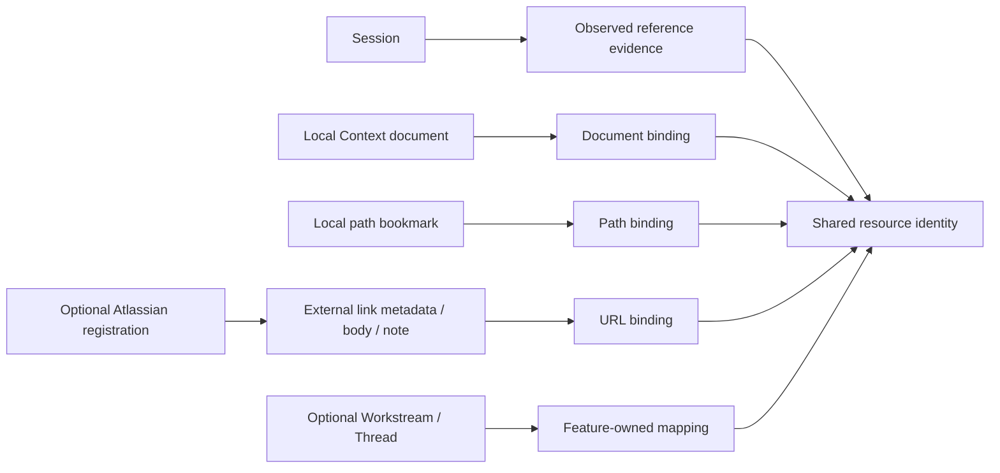

# Project Architecture

## Purpose

This document owns LocalBrain's durable implementation shape: runtime layers, package responsibilities, shared resource and persistence boundaries, and the map to current feature contracts.

Product terminology and organization rules are defined in [Product Model](product.md). In-app maintenance execution is defined in [Maintenance Task Runner](../operations/claude-task-runner.md).

## Runtime Shape

- Runtime: local Rust web server with browser UI, or a Tauri window with a bundled Rust backend
- Backend: Axum HTTP/WebSocket adapters over shared native domain services
- Database: bundled SQLite, accessed through `rusqlite`
- Search: SQLite FTS5 plus optional local Qwen semantic ordering and lexical exact-identifier admission
- Frontend: server-rendered MiniJinja templates with small JSON API interactions and locally packaged browser assets
- Models: pinned original safetensors, Candle inference and Rust tokenizers; no interpreter or Python execution library
- External integrations: optional feature adapters and approved authorization contracts
- Common settings: native TOML syntax, OS time-zone lookup, rules, ordered merge, revisions and private atomic commits under the shared operations lease
- Optional macOS app/web Terminal: Rust control/helper, independent Node/node-pty manager and xterm; native HTTP/WebSocket/CLI transports. [Terminal](terminal.md) owns lifecycle and memory limits
- Desktop packaging: Tauri 2 and a native Apple Silicon backend; Python standard-library scripts orchestrate current build/check tools without a Python application or research runtime

The native desktop test edition admits Sessions, Sessions Dashboard, Local Context,
search, settings, onboarding, Terminal and bundled Korean/English Docs. The
standalone native web bundle retains the broader development-web edition; a
standalone binary does not select desktop restrictions. Optional feature packages
are selected during application assembly before their routes, controls or services
exist. Insights is a development-web service, admitted only outside the desktop
edition; it is not a separate optional feature-package name. The
[delivery availability record](../../plans/project/feature-availability.md) owns
current suspension decisions. [Desktop App And Settings](desktop-app-and-settings.md)
owns edition admission, lifecycle, local authentication and source/settings rules.

The native `localbrain` command exposes `serve`, `doctor`, `models`, `simulate`,
`search`, `learning` and `storage`, using the same configured paths and services
as HTTP. `lb` provides the same CLI entrypoint. Optional commands retain their
assembly admission. The [installation/storage contract](installation-and-storage.md)
owns source builds, native web bundles and optional public-model assets. Finished
web bundles and apps need no Python environment, checkout or compiler. The
application owns model registrations; public weights remain separately shared
within the local user account. Runtime state is rejected inside repositories,
uses owner-only permissions, and retains bounded migration-copy retirement after
successful committed initialization. Ordinary startup creates no permanent
server diagnostic log.

`backend/config.rs` separates durable data and private rebuildable cache.
`backend/storage/layout.rs` owns explicit recognized-directory moves and
conflict refusal, taking cache ownership checks only from included features.
`backend/auto_work/cache.rs` owns simulation/preview recognition and expired-result
retirement under the existing writer locks; shared `storage/files.rs` owns
ownership, activity and unchanged-tree checks. Packaged readers and simulation
use the configured cache root. Saved Run reports remain durable data. Public
weights and the primary DB are outside layout migration.

The core development-web collection flow is:

```text
Claude / Codex / user-managed local context / local project and Git metadata
                              |
                        Source adapters
                              |
                    Normalize and deduplicate
                              |
               SQLite event store + FTS5 index
                      /                 \
         Workstreams and resume        Insights
                      \                 /
                      Local web application
```

External integrations follow their own contracts. Optional
[Atlassian reads](atlassian.md#external-access-foundation) use registered provider
dispatch and an injected host-side read executor. The default application leaves
that executor unconnected; local URL registration, Browse and evidence Sync
remain available in development web without remote access.

## Package Ownership

The root Cargo workspace owns native services and hosts; the Tauri shell has its
own manifest and lockfile under `apps/desktop/src-tauri/`:

```text
crates/
├── core/
│   ├── src/backend/              # domain services, SQLite, sources and projections
│   ├── src/preferences/          # native TOML/settings transactions and OS adapters
│   ├── src/{files,payload,process,service,settings,stream}.rs
│   │                             # shared Terminal/settings primitives
│   ├── resources/                # schema, presentation, value registry and prices
│   └── tests/                    # native synthetic contract tests
├── models/                      # pinned assets, native tokenization and inference
└── runtime/                     # fixed Terminal helper/control entrypoints
apps/
├── api/src/
│   ├── main.rs, bin/             # localbrain, lb and localbrain-backend binaries
│   ├── cli/                     # native command adapters
│   ├── routes/                  # feature HTTP/WebSocket adapters
│   └── {state,host,templates,boundary,transport}.rs
├── web/{templates,static,content/docs}/
│                                # shared templates, browser assets and ko/en guides
└── desktop/                     # Tauri shell, build support and Terminal payload inputs
scripts/                         # build/check tooling; no application Python backend
```

Paths beginning `backend/` below are relative to
`crates/core/src/backend/`. `apps/api/src/host.rs` owns the loopback
server and shutdown wiring; `state.rs` explicitly constructs selected services
and injected integrations. `routes/mod.rs` registers the delivery routes and
`boundary.rs` enforces host/edition admission. Feature route modules own request
shapes, authentication/form adaptation and responses. `templates.rs` owns
MiniJinja conversion, safe HTML provenance and shared presentation helpers.
Entrypoints contain no feature queries or model work.

Workspace directory names are `core`, `models` and `runtime`. Their Cargo package
names remain `localbrain-core`, `localbrain-models` and `localbrain-runtime`;
Rust imports and executable names retain their existing identities. In particular,
the product library is not named `core`, the standard Rust library namespace.

Within a domain, `service.rs` coordinates operations and `queries.rs`/`store.rs`
own reads/writes where those boundaries exist. Pure descriptors, projections and
validators keep their own modules. Features do not need every layer file or a
repository class for each SQL query. Core feature logic must not depend on
application assembly, Axum or route handlers. HTTP and CLI adapters consume the
same core services and presentation values. Keep persistence and domain behavior
out of templates. These dependency restrictions also apply inside functions.

Read models belong to `backend/sessions/`, `contexts/`, `sources/`, `usage/` and
`search/`. Session availability SQL is shared by inventory/detail and pins and
performs no filesystem inspection. Resource identity and metadata CRUD belong
to `backend/resources/`, independently of Workstream membership and Suggestion
acceptance. Durable skill observations belong to `sessions/skills.rs`; Insights
ranking belongs to `insights/skills.rs`.

Session references point to shared resource identities, with Document and
bookmark bindings under `resources/`. Session URL classification and related
material need no Atlassian registration, table or feature call. `contexts/` owns
document bodies; optional organization/source features own outgoing mappings.
`ingest::IngestionObserver` supplies a scoped observer contract with an empty
default, and `backend/integrations.rs` composes admitted adapters for HTTP,
background and CLI scans. Observers use the caller's transaction and make no
remote call. URL identity and frozen Unicode text rules belong to the shared
`references/` and `unicode/` owners.



The arrows show dependency/reference direction. Deleting a feature mapping or
indexed Document does not delete the shared resource or Session observations.
Same-path reindexing restores the document binding. Source bodies and user notes
reference shared external metadata rather than the optional Atlassian Item.
[Work Organization And Resources](data-model/work-organization-and-resources.md)
owns migration and recovery details.

`Config::with_features` and `FeatureBindings` are internal composition boundaries,
not Settings or environment feature toggles. Production entrypoints select the
current delivery set. Omitting a package omits its routes, reference callbacks,
navigation and lifetime contribution; required missing bindings fail explicitly.
Common startup, Settings cleanup and CLI storage operations receive only included
features' cache handlers. Excluded caches, including malformed files, remain
untouched. Their presence does not construct the excluded service. CLI commands
and ingestion observers follow the same inclusion boundary. The legacy `/search`
combines Atlassian results and belongs to that assembly contribution;
`/natural-search` keyword and AI modes remain independent. Shared bounded form
transport belongs to the API host; Atlassian retains its repeated item/topic
fields and existing registration errors.

`backend/maintenance/` owns generic task/process tracking, recovery, cancellation,
stream decoding and terminal states without importing Workstream or Atlassian
implementations. `workstreams/runner.rs` owns preparation, commands and pending
Suggestions; `atlassian/runner.rs` owns approved external reads and atomic result
application. Features supply their jobs and callbacks to Maintenance. The host
installs Maintenance recovery/shutdown only when a Run-producing feature is
included, and only in development web. `insights/runs.rs` separately owns explicit
analysis Runs and observed usage, also outside desktop. Optional cache work,
service construction and route registration remain explicit contributions.
Existing schema history, Run-to-Workstream FK and display-name queries remain
database contracts; feature exclusion does not drop tables or delete artifacts.

`backend/db.rs` owns public connection/initialization helpers; the API host owns
HTTP transaction lifetime and core mutation APIs accept an explicit connection.
`backend/storage/migrations/` owns ordered preflight, recovery-copy creation,
fresh DDL, compatible structural/data migrations and post-commit cleanup. Source
identity, Session/revision/skill evidence, Context, Usage, Maintenance, Atlassian
and shared-resource history remain with those migrations, including when a
runtime feature is excluded. Compatibility order stays explicit, with shared
schema inspection and distinct legacy/resource/revision backup contracts.
`storage/contracts.rs` supplies current-contract inspection without starting DB
initialization. `crates/core/resources/schema.sql` owns fresh DDL.
No new migration registry or execution system is introduced.

`backend/storage/recovery.rs` owns backup/restore/cache operations and the storage
lease; `apps/api/src/routes/settings.rs` owns their HTTP uploads, exports and
responses. Recovery services have no Axum dependency.

Shared schema/JSON resources live in `crates/core/resources/`. Templates,
static assets and guide bodies live in `apps/web/` and are copied into the native
web/app bundle. `Config.web_root` selects a trusted checkout or adjacent bundled
web root; requests never supply it. Insight guides are embedded from
`backend/insights/resources/`, including historical versions. Installation-root
exclusion remains distinct from web asset lookup. Native execution never imports
a retired Python package or a source-checkout module.

Shared configuration, file safety, clocks, JSON/TOML/YAML syntax, Unicode rules,
validation errors and path labels retain focused owners. Pure helpers must not
import a feature, database, model execution or HTTP host. Common settings use the
native `preferences/` transaction engine and OS adapters, with content revisions,
ordered values and private publication. The caller retains the same operations
lease until completion; common saves read back after release, Terminal saves
inside it. Recovery and other domain files retain their own writers.

`crates/models` depends on native libraries and its own model modules,
not on core services, SQLite or an HTTP/UI host. It owns the pinned public
catalog, allowlisted installer, offline verification, lazy embedding/generation
engines and constrained answer decoding. `backend/models/` supplies app paths,
folder registration and cancellable setup. Search and explicit experiments
consume the model crate independently. Imports/status do not load weights or
download assets. Explicit setup uses native `localbrain models install`; the
bundled `--install-search-model` worker remains native. Shared public-cache
selection and private-runtime exclusion do not require model execution.

## Source Adapters

Current adapters:

- Claude local session history
- Codex local session history
- user-managed folders and individual files
- Apple Notes through local macOS Automation
- local project and Git metadata discovered during scans

Session profiles and parser revisions follow [Session Ingestion](session-ingestion.md). Optional Atlassian access follows [Atlassian](atlassian.md#external-access-foundation).

### Adapter Extension Boundary

The [Project Roadmap](../../plans/project/roadmap.md) and [Project Backlog](../../plans/project/backlog.md) own adapter sequencing and named future targets. Any new external adapter must sit behind an approved connector boundary and follow the persistence modes in [Privacy And Data Handling](privacy-and-data.md).

## Persistence Model

The complete effective-schema map, physical and application relationships, lifecycle/recovery classifications, and eleven subject catalogs are owned by [Data Model](data-model.md). This section keeps only the architectural grouping and cross-layer behavior.

The packaged consumer form is owned by [Schema Presentation](schema-presentation.md). Its generator applies fresh DDL and the compatible structural/index path only to SQLite `:memory:`, combines those facts with Data Model semantics, and emits derived JSON. Application consumers load that package data; they do not inspect a user database or repository Markdown.

Bounded database values use `crates/core/resources/value-registry.json` as their executable physical/logical/presentation authority. The generated [Value Dictionaries](data-model/value-dictionaries.md) remain the human-readable subject projection; runtime code loads the registry and never parses Markdown.

`System > Schema` serves the read-only `/schema` Explorer from that package data. Optional `area` and `table` query values select one of the eleven owner areas and one owned table; invalid state normalizes to the nearest valid overview. Server-rendered links and catalogs remain complete without JavaScript, while the route-scoped module preserves shell continuity, history, focus, strict locally packaged Mermaid rendering, and bounded presentation-only diagram zoom. The route has no SQLite connection, row preview, external asset, SQL, edit, or cleanup action.

The current schema groups data into these responsibilities:

| Responsibility | Current entities |
| --- | --- |
| Source inventory | `sources`, `source_files`, `external_source_instances`, `external_source_capabilities`, `context_roots`, `workspaces` |
| Indexed activity | `sessions`, `activity_events`, `session_reference_scans`, `session_reference_evidence`, `usage_records`, immutable usage price snapshots, `context_documents`, FTS5 search tables |
| Reviewed learning | immutable lesson/source revisions in `learning_lessons`, personal attempts in `learning_attempts`, and stable-key visibility in `learning_visibility`; [Personal Learning](data-model/personal-learning.md) owns their table contracts |
| Workflow correction | append-only `workflow_assertions` keyed by stable Episode boundaries |
| User organization | `workstreams`, `threads`, `checkpoints` |
| Linkable resources | shared `reference_resources`; Document, local-path and external-link bindings; `local_resources`, `external_resources`, `external_resource_content`, `external_resource_notes`, Workstream and Thread links; [resource ownership](data-model/work-organization-and-resources.md) defines their lifecycles |
| Atlassian source memory | domain-first `atlassian_sites`, optional `atlassian_site_bindings`, access-optional `atlassian_spaces`, strict one-to-one `atlassian_items`, Item URL/remote-state/classification/evidence owners, separate `atlassian_structure_references`, `atlassian_structure_reference_urls`, and `atlassian_structure_reference_evidence`, plus Item role rows and one bounded non-archived reference row in shared FTS |
| Review workflow | `suggestions`, checkpoint resource snapshots, Thread resource matches |
| Run execution | independent `maintenance_runs` / `external_sync_runs` and `personal_insight_runs` histories, with separate artifact roots under the runtime data directory |

Resources are canonical entities. A Session or Document is stored once and may relate to any number of Threads. Relationship-specific evidence is stored separately so the resource payload is not duplicated.

Checkpoint records are versioned, user-confirmed resume states. Confirmation captures a snapshot of resources linked to the Workstream and its Threads at that time.

## Current Capabilities And Owners

This map locates current behavior; each linked owner retains its detailed
contract, permission and admission limits.

| Current capability | Owning contract |
| --- | --- |
| Session collection, inventory, pins, Chart and direct evidence | [Session Ingestion](session-ingestion.md) and [Sessions](sessions.md) |
| Common preferences, source lifecycle, onboarding and native admission | [Desktop App And Settings](desktop-app-and-settings.md) |
| Local keyword/semantic retrieval | [Natural-Language Search](natural-language-search.md) |
| Frozen personal-improvement evidence, guide/report values and analysis accounting | [Personal Insights](personal-insights.md) |
| Deterministic Episode Focus, user corrections and passive affinity inspection | [Session Workflow](workflow.md) and [Auto Work](auto-work.md) |
| Pure provisional candidates and separately bounded experimental contracts | [Candidates](workstream-candidates.md), [Work Reconstruction](work-reconstruction.md), [Work Context Inference](work-context-inference.md), and [Source Claims](source-claims-and-work-state.md) |
| Additive SQLite startup migrations over the local index | [Persistence Model](#persistence-model) |
| User-created Workstreams and nested Threads | [Product organization](product.md#workstream-centered-organization) |
| Versioned checkpoints with linked-resource snapshots | [Product organization](product.md#workstream-centered-organization) |
| Thread-first links to Sessions, Local Contexts, projects, local paths and external references | [Product organization](product.md#workstream-centered-organization) |
| Workstream-level links for resources shared by multiple Threads | [Product organization](product.md#workstream-centered-organization) |
| Manual Jira, Wiki, Slack, Git, document and generic URL references | [Product domain](product.md#domain-boundaries) |
| Reversible keyword-based Session and Document link Suggestions | [Product Suggestions](product.md#automatic-capture-explicit-organization) |
| Reviewed work-based learning article home, library and reader from explicit reviewed imports, with separate Workstream routes and Sessions Dashboard | [Learning Home](product.md#learning-home) |
| Maintenance Session exclusion and source-neutral Claude/Codex subsession normalization | [Session Eligibility](session-ingestion.md#session-eligibility) and [Session Policies](session-ingestion.md#session-policies) |
| Source-neutral Claude/Codex Usage Records with immutable local trend-cost snapshots | [Usage Normalization And Repair](usage-and-cost.md#usage-normalization-and-repair) |
| Reproducible Sessions Dashboard usage summary, GET scope and Daily/Weekly/Monthly token/cost history | [Analytical Read Models](usage-and-cost.md#analytical-read-models) |
| All-time Session Insights use/reference Session ranking with durable source-backed evidence | [Session Insights](personal-insights.md#session-insights) |
| Durable Maintenance Task Runner history, Claude/Codex external-sync parity, streaming result handling, cancellation and reviewable structured output | [Task Runner](../operations/claude-task-runner.md) |
| Deterministic SQLite/FTS5 retrieval without hard candidate or evidence-count caps | [Search and retrieval](../operations/claude-task-runner.md#local-retrieval-first) |
| Normalized many-to-many Thread resource matches with reusable fingerprints and deduplicated evidence | [Persistence Model](#persistence-model) and [Product Suggestions](product.md#automatic-capture-explicit-organization) |
| Source browsing for folders, files and Apple Notes | [Local Context Sources](local-context.md#local-context-sources) |
| Context-aware full Document reading with an owning FOLDERS tree, bounded non-FOLDERS fallback and source-preserving Markdown presentation | [Document reading](local-context.md#local-context-sources) and [Markdown rendering](markdown-rendering.md) |
| Safe Markdown conversation reading for visible Session/Subsession user and assistant messages without Local Context source guessing | [Session Conversation And Identity Reading](sessions.md#session-conversation-and-identity-reading) |
| Atlassian stable source memory; bounded Session/Local Context URL evidence; strict zero-configuration local Site/Item admission; Site-first Explorer hierarchy with read-only canonical-URL container hints; grouped local search; Item detail, notes and Topic/Tag classification; exact Workstream/Thread links; explicit partial Space discovery and known-Item refresh previews without implicit remote ingestion or model calls | [Reference Evidence And Reconciliation](session-ingestion.md#reference-evidence-and-reconciliation) and [External Access And Synchronization Constraints](atlassian.md#external-access-and-synchronization-constraints) |

Implementation priorities and unresolved work belong in the [Project Backlog](../../plans/project/backlog.md).

## Architectural Constraints

### General Constraints

- LocalBrain remains local-first and single-user during the MVP.
- External integration starts read-only.
- Keep source-specific parsing inside adapters and keep persistence or domain
  behavior out of templates.

External source dispatch and synchronization follow [Atlassian](atlassian.md#external-access-and-synchronization-constraints) and the [Maintenance Task Runner](../operations/claude-task-runner.md).

### Persistence And Portability Constraints

- User review state and source provenance must survive rescans and suggestion refreshes.
- A failed maintenance Run must not clear the existing review queue.
- Historical source paths must remain visible when their current Project relation is missing or changes.
- The SQLite schema and runtime data must remain portable to a later desktop wrapper.
- Desktop packaging must not obscure data location, permissions, backup, or shutdown behavior.

## Shared Rust Runtime

The root Cargo workspace contains `localbrain-core`, `localbrain-models`,
`localbrain-runtime` and `apps/api`; it declares Rust 1.90 as its minimum.
Core services own native SQLite/domain behavior while remaining independent of
Axum, MiniJinja host objects and Tauri. The shared settings/Terminal primitives
retain their focused ownership. `localbrain-runtime` exposes fixed control,
stream, process-snapshot, management and payload-lease operations for the public
Terminal payload; native application preferences run in process and require no
separate common-runtime bridge, syntax callback interpreter or Python fallback.

`localbrain`, `lb` and `localbrain-backend` are native API/CLI binaries built from
`apps/api`. The last is the Tauri-owned desktop backend. The independent Terminal
service and its public Node/PTY payload retain their separate lifetime and
immutable receipts. Build scripts remap private compiler paths, inspect final
native bytes and verify that no Python runtime or Python-linked backend enters
the deliverable. Build success, browser behavior, actual native launch and
recipient support remain separate evidence. The
[transition plan](../../plans/refactoring/refactor-0006-rust-core-transition.md)
retains historical sequencing and decisions; current ownership is defined here.
