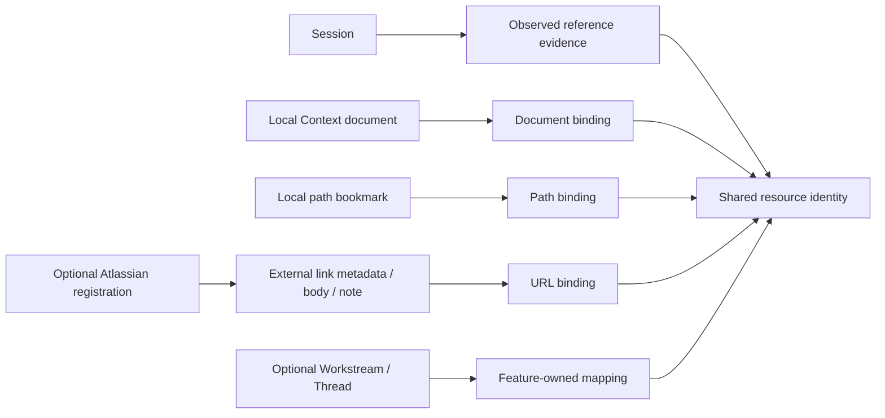

# Project Architecture

## Purpose

This document owns LocalBrain's durable implementation shape: runtime layers, package responsibilities, shared resource and persistence boundaries, and the map to current feature contracts.

Product terminology and organization rules are defined in [Product Model](product.md). In-app maintenance execution is defined in [Maintenance Task Runner](../operations/claude-task-runner.md).

## Runtime Shape

- Runtime: local web server with browser UI, or Tauri window with a bundled backend
- Backend: Python and FastAPI
- Database: SQLite
- Search: existing SQLite FTS5 plus optional local Qwen semantic ordering and lexical exact-identifier admission
- Context Search: isolated Qwen4B/8B native tool loop over admitted Local Context and received copies; request/page-memory dialogue, no embedding prerequisite or chat schema
- Frontend: server-rendered Jinja2 with small JSON API interactions
- External integration boundary: optional feature-specific adapters and approved authorization contracts
- Desktop packaging: Tauri 2 and a PyInstaller Python 3.11 bundle, Apple Silicon

The standalone test edition admits Sessions, Sessions Dashboard, Local Context,
search, Context Search, settings, onboarding and bundled English Docs. Its immutable runtime boundary excludes the
unfinished development surfaces; [Desktop App And Settings](desktop-app-and-settings.md)
owns lifecycle, local authentication and source/settings contracts.

The [installation/storage contract](installation-and-storage.md) owns independent
macOS source/tool/wheel setup and optional local-model requirements. Packaged
`serve`, `doctor`, `models`, `simulate`, `search`, `learning`, and `storage` commands use the same
configured runtime paths. Public model assets are shared within the local user
account; LocalBrain owns its model metadata and optional Python dependencies.
Runtime state is rejected inside repositories, uses owner-only permissions, and
has bounded migration-copy retirement after successful committed initialization.
Ordinary startup creates no permanent log or evaluation archive.

`foundation/config.py` separates durable data, private rebuildable cache and development
archive roots. `app/storage/layout.py` owns explicit recognized-directory moves,
destination-conflict refusal and historical development-archive recognition.
It accepts cache ownership checks from included features. `auto_work/storage.py`
owns simulation/preview cache recognition and expired-result retirement under
existing writer locks; `foundation/files.py` supplies shared ownership, activity
and unchanged-tree checks. Packaged readers and simulation use the configured cache root. Saved
Run reports remain durable data; development archives are never normal startup
outputs. Shared public weights and the primary DB are outside layout migration.

The core development-web collection flow is:

```text
Claude / Codex / user-managed local context / local project and Git metadata
                              |
                        Source adapters
                              |
                    Normalize and deduplicate
                              |
               SQLite event store + FTS5 index
                      /                 \
         Workstreams and resume        Insights
                      \                 /
                      Local web application
```

External integrations follow separate feature contracts. Optional
[Atlassian reads](atlassian.md#external-access-foundation) use registered provider
dispatch contracts and an injected host-side read executor. The default
application leaves that executor unconnected; local URL registration, Browse and
evidence Sync remain available in development web without remote access.
[Google Drive](google-drive-sync.md) uses gcloud authentication and direct API
transfers in its separate synchronization path. Those transfers do not
automatically register, collect or index received files.

## Package Ownership

The package root contains the stable `main.py`, `cli.py` and `desktop.py`
entrypoints plus `__init__.py`. Feature implementations live in packages:

```text
localbrain/
├── main.py, cli.py, desktop.py       # public entrypoints
├── app/                             # application assembly and shared HTTP support
│   └── storage/                     # backup/restore and layout operations
├── foundation/                      # configuration, files, clocks, validation
├── persistence/                     # connection API, bootstrap and schema metadata
│   └── migrations/                  # schema history grouped by data owner
├── models/                          # asset installation, embedding and generation
├── references/                      # pure URL grammar, normalization and identity
├── ingest/                          # provider parsing, evidence and source synchronization
├── sources/                         # source registry/settings and sync services
├── sessions/                        # activity, queries, reading, pins, references, web
├── local_context/                   # document sources, queries, references, web
├── usage/                           # records, pricing, aggregation, web
├── resources/                       # resource identity/store and related-resource reads
├── rendering/                       # shared Markdown rendering
├── search/, natural_search/          # keyword/legacy search and optional AI search
├── context_search/, google_drive/    # existing separate feature packages
├── workstreams/, maintenance/        # organization/review and maintenance execution
├── workflow/, auto_work/             # workflow projections/correction and explicit previews
├── experiments/                     # context, reconstruction and claims experiments
├── insights/, learning/              # analysis and reviewed learning
└── atlassian/                       # catalog, evidence, access, sync, browse and web
```

`app/application.py` builds the application; `app/lifecycle.py` owns startup and
shutdown wiring. `app/routes.py` explicitly registers the feature handlers in the
existing route order. Shared templates and request guards belong to
`app/templating.py` and `app/request_guards.py`. `main.py` is the stable ASGI entrypoint and contains no feature
queries, input models or handler bodies.
Input models and handler bodies belong to feature `web.py` modules.

Within a feature, `web.py`/`cli.py` adapt delivery, `service.py` coordinates its
operations, and `queries.py`/`store.py` own reads/writes where those boundaries
exist. Pure projections and contracts keep their own modules. Features do not
need every layer file or a repository class for each SQL query. Feature logic
must not import application assembly or web handlers. HTTP adapters can consume
the shared presentation layer. Foundation and model dependency restrictions
below apply to function-local imports as well as top-level imports.

Read models belong to `sessions/queries.py`,
`local_context/queries.py`, `sources/queries.py`, `app/dashboard_queries.py`, and
`search/legacy.py`; pagination lives in `foundation/pagination.py`. Resource
identity lives in `resources/catalog.py` and metadata CRUD in `resources/store.py`, independently of Workstream
membership and Suggestion acceptance. Durable skill observations remain in
`sessions/skills.py`; Insights ranking belongs to `insights/skills.py`.

Session references point to shared resource identities, with Document and bookmark bindings owned under `resources/`. Session URL classification and related-material reading require no Atlassian registration, table or import. Local Context owns document bodies; optional organization/source features own outgoing mappings. `ingest/extensions.py` supplies a scoped observer contract with an empty default, and `app/reference_integrations.py` installs the Atlassian adapter around app requests, background scans and CLI scans. Observers use the caller transaction and make no remote call.



The arrows show dependency/reference direction. Deleting a feature mapping or indexed Document does not delete the shared resource or Session observations. Same-path reindexing restores the document binding. Source bodies and user notes reference shared external metadata rather than the optional Atlassian Item. Migration details and recovery behavior belong to [Work Organization And Resources](data-model/work-organization-and-resources.md).

The default application explicitly composes the existing pilot routes, lifecycle
services, templates and assets. `create_app(feature_packages=...)` is an internal
composition boundary for verifying an installation without selected packages;
production entrypoints use the complete default set. It is not a settings or
environment feature toggle and does not catch missing imports. Omitting a package
also omits its routes, reference callbacks, navigation and lifecycle contribution.
`app/features.py` owns the explicit default package set shared by web and CLI
composition. Common startup, Settings cache cleanup and CLI storage operations
receive only included features' cache handlers. Excluded features' old caches
remain untouched, including malformed files; their presence does not load the
excluded implementation. CLI command registration and ingestion observers follow
the same inclusion boundary. Explicit legacy development-archive migration uses
the historical on-disk contract without importing experiment implementations.
The retained legacy `/search` combines Atlassian results and belongs to that
assembly contribution; the normal `/natural-search` keyword and AI modes remain
independent. `app/forms.py` owns bounded form decoding. Atlassian owns its repeated
item/topic fields and translates form errors into its existing registration error.

`maintenance/service.py` owns task/process tracking, ledger recovery, cancellation
and terminal state helpers; `maintenance/streams.py` owns shared runner output
decoding. Workstream preparation, commands and pending Suggestions belong to
`workstreams/runner.py`; approved external reads and atomic Atlassian result
application belong to `atlassian/runner.py`. Each feature submits its own execution
coroutine to Maintenance. Maintenance imports neither feature implementation.
The app connects Maintenance recovery/shutdown only when a Run-producing feature
is included, and calls those hooks only in the development web edition.
Auto Work cache maintenance and Context Search service construction are
also explicit contributions. Existing schema history, Run-to-Workstream FK and
Run display-name query remain database contracts; code detachment does not drop
their tables or delete private artifacts.

`persistence/db.py` retains the public connection, initialization and transaction
entrypoints. `persistence/bootstrap.py` owns the ordered preflight, recovery-copy,
schema application, data migration and post-commit cleanup sequence.
`persistence/migrations/` groups Source identity, Session/revision/skill evidence,
Local Context, Usage, Maintenance, Atlassian and common resource schema history.
`compatible.py` keeps the existing cross-domain compatibility order explicit;
`support.py` owns shared schema inspection and the identical legacy backup
procedure. The shared-resource and Session-revision backup variants retain their
distinct contracts. `contracts.py` lets backup retirement inspect current schema
without importing the DB entrypoint or bootstrap. Migrations stay with database
history even when an optional runtime feature is removed.
`schema.sql` owns the fresh database schema.

`app/storage/recovery.py` owns backup/restore/cache operations and the backend
storage lease. `app/storage/web.py` owns HTTP registration, uploads, exports and
responses. Recovery operations do not import FastAPI or the HTTP adapter.

Shared schema/JSON resources, server-rendered `templates/`, browser `static/`,
`content/docs/` and versioned insight guides live at the package root.
`foundation.paths.package_root()` resolves those assets independently of a
consumer's module depth; `package_boundary()` retains the distinct runtime-data
exclusion boundary for source, installed-wheel and frozen layouts. Package
initializers do not re-export the former flat module surface.

- `foundation/`: shared configuration/preferences, operation locks, UTC clocks,
  value/text fingerprints, validation errors, private JSON/filesystem operations,
  path labels/cache roots and local agent executable lookup. It imports no product
  feature, database, model runtime or FastAPI module. `clock.utc_now` returns an ISO
  string while `clock.now` returns a datetime; the distinct serialization/hash and
  error contracts remain separate. `persistence/storage.py` retains storage accounting
  and migration-copy retirement; generic file safety belongs to `foundation/files.py`.

- `models/`: pinned public asset catalog, Hub lookup, installation/verification,
  cancellable setup worker, shared embedding/generation runtimes and finite answer-code
  decoding. Its LocalBrain dependencies point only to `foundation/` and other model
  modules. Search and explicit experiments consume these modules independently.
  Model runtime libraries load only when the existing execution paths require them;
  package imports do not load model weights or initiate downloads. Source setup uses
  `python -m localbrain.models.setup`; the frozen `--install-search-model` flag is
  unchanged. `foundation/paths.py` owns the package-parent storage exclusion and
  public Hub root calculation, without depending on model execution.

## Source Adapters

Current adapters:

- Claude local session history
- Codex local session history
- user-managed folders and individual files
- Apple Notes through local macOS Automation
- local project and Git metadata discovered during scans

Session profiles and parser revisions follow [Session Ingestion](session-ingestion.md). Optional Atlassian access follows [Atlassian](atlassian.md#external-access-foundation).

### Adapter Extension Boundary

The [Project Roadmap](../../plans/project/roadmap.md) and [Project Backlog](../../plans/project/backlog.md) own adapter sequencing and named future targets. Any new external adapter must sit behind an approved connector boundary and follow the persistence modes in [Privacy And Data Handling](privacy-and-data.md).

## Persistence Model

The complete effective-schema map, physical and application relationships, lifecycle/recovery classifications, and eleven subject catalogs are owned by [Data Model](data-model.md). This section keeps only the architectural grouping and cross-layer behavior.

The packaged consumer form is owned by [Schema Presentation](schema-presentation.md). Its generator applies fresh DDL and the compatible structural/index path only to SQLite `:memory:`, combines those facts with Data Model semantics, and emits derived JSON. Application consumers load that package data; they do not inspect a user database or repository Markdown.

Bounded database values use `src/localbrain/value-registry.json` as their executable physical/logical/presentation authority. The generated [Value Dictionaries](data-model/value-dictionaries.md) remain the human-readable subject projection; runtime code loads the registry and never parses Markdown.

`System > Schema` serves the read-only `/schema` Explorer from that package data. Optional `area` and `table` query values select one of the eleven owner areas and one owned table; invalid state normalizes to the nearest valid overview. Server-rendered links and catalogs remain complete without JavaScript, while the route-scoped module preserves shell continuity, history, focus, strict locally packaged Mermaid rendering, and bounded presentation-only diagram zoom. The route has no SQLite connection, row preview, external asset, SQL, edit, or cleanup action.

The current schema groups data into these responsibilities:

| Responsibility | Current entities |
| --- | --- |
| Source inventory | `sources`, `source_files`, `external_source_instances`, `external_source_capabilities`, `context_roots`, `workspaces` |
| Indexed activity | `sessions`, `activity_events`, `session_reference_scans`, `session_reference_evidence`, `usage_records`, immutable usage price snapshots, `context_documents`, FTS5 search tables |
| Reviewed learning | immutable lesson/source revisions in `learning_lessons`, personal attempts in `learning_attempts`, and stable-key visibility in `learning_visibility`; [Personal Learning](data-model/personal-learning.md) owns their table contracts |
| Workflow correction | append-only `workflow_assertions` keyed by stable Episode boundaries |
| User organization | `workstreams`, `threads`, `checkpoints` |
| Linkable resources | shared `reference_resources`; Document, local-path and external-link bindings; `local_resources`, `external_resources`, `external_resource_content`, `external_resource_notes`, Workstream and Thread links; [resource ownership](data-model/work-organization-and-resources.md) defines their lifecycles |
| Atlassian source memory | domain-first `atlassian_sites`, optional `atlassian_site_bindings`, access-optional `atlassian_spaces`, strict one-to-one `atlassian_items`, Item URL/remote-state/classification/evidence owners, separate `atlassian_structure_references`, `atlassian_structure_reference_urls`, and `atlassian_structure_reference_evidence`, plus Item role rows and one bounded non-archived reference row in shared FTS |
| Review workflow | `suggestions`, checkpoint resource snapshots, Thread resource matches |
| Run execution | independent `maintenance_runs` / `external_sync_runs` and `personal_insight_runs` histories, with separate artifact roots under the runtime data directory |

Resources are canonical entities. A Session or Document is stored once and may relate to any number of Threads. Relationship-specific evidence is stored separately so the resource payload is not duplicated.

Checkpoint records are versioned, user-confirmed resume states. Confirmation captures a snapshot of resources linked to the Workstream and its Threads at that time.

## Current Capabilities And Owners

This map locates current behavior; each linked owner retains its detailed
contract, permission and admission limits.

| Current capability | Owning contract |
| --- | --- |
| Session collection, inventory, pins, Chart and direct evidence | [Session Ingestion](session-ingestion.md) and [Sessions](sessions.md) |
| Common preferences, source lifecycle, onboarding and native admission | [Desktop App And Settings](desktop-app-and-settings.md) |
| Local keyword/semantic retrieval and grounded transient folder answers | [Natural-Language Search](natural-language-search.md) and [Context Search](context-search.md) |
| Selected directional publishing/receiving | [Google Drive Synchronization](google-drive-sync.md) |
| Frozen personal-improvement evidence, guide/report values and analysis accounting | [Personal Insights](personal-insights.md) |
| Deterministic Episode Focus, user corrections and passive affinity inspection | [Session Workflow](workflow.md) and [Auto Work](auto-work.md) |
| Pure provisional candidates and separately bounded experimental contracts | [Candidates](workstream-candidates.md), [Work Reconstruction](work-reconstruction.md), [Work Context Inference](work-context-inference.md), and [Source Claims](source-claims-and-work-state.md) |
| Additive SQLite startup migrations over the local index | [Persistence Model](#persistence-model) |
| User-created Workstreams and nested Threads | [Product organization](product.md#workstream-centered-organization) |
| Versioned checkpoints with linked-resource snapshots | [Product organization](product.md#workstream-centered-organization) |
| Thread-first links to Sessions, Local Contexts, projects, local paths and external references | [Product organization](product.md#workstream-centered-organization) |
| Workstream-level links for resources shared by multiple Threads | [Product organization](product.md#workstream-centered-organization) |
| Manual Jira, Wiki, Slack, Git, document and generic URL references | [Product domain](product.md#domain-boundaries) |
| Reversible keyword-based Session and Document link Suggestions | [Product Suggestions](product.md#automatic-capture-explicit-organization) |
| Reviewed work-based learning article home, library and reader from explicit reviewed imports, with separate Workstream routes and Sessions Dashboard | [Learning Home](product.md#learning-home) |
| Maintenance Session exclusion and source-neutral Claude/Codex subsession normalization | [Session Eligibility](session-ingestion.md#session-eligibility) and [Session Policies](session-ingestion.md#session-policies) |
| Source-neutral Claude/Codex Usage Records with immutable local trend-cost snapshots | [Usage Normalization And Repair](usage-and-cost.md#usage-normalization-and-repair) |
| Reproducible Sessions Dashboard usage summary, GET scope and Daily/Weekly/Monthly token/cost history | [Analytical Read Models](usage-and-cost.md#analytical-read-models) |
| All-time Session Insights use/reference Session ranking with durable source-backed evidence | [Session Insights](personal-insights.md#session-insights) |
| Durable Maintenance Task Runner history, Claude/Codex external-sync parity, streaming result handling, cancellation and reviewable structured output | [Task Runner](../operations/claude-task-runner.md) |
| Deterministic SQLite/FTS5 retrieval without hard candidate or evidence-count caps | [Search and retrieval](../operations/claude-task-runner.md#local-retrieval-first) |
| Normalized many-to-many Thread resource matches with reusable fingerprints and deduplicated evidence | [Persistence Model](#persistence-model) and [Product Suggestions](product.md#automatic-capture-explicit-organization) |
| Source browsing for folders, files and Apple Notes | [Local Context Sources](local-context.md#local-context-sources) |
| Context-aware full Document reading with an owning FOLDERS tree, bounded non-FOLDERS fallback and source-preserving Markdown presentation | [Document reading](local-context.md#local-context-sources) and [Markdown rendering](markdown-rendering.md) |
| Safe Markdown conversation reading for visible Session/Subsession user and assistant messages without Local Context source guessing | [Session Conversation And Identity Reading](sessions.md#session-conversation-and-identity-reading) |
| Atlassian stable source memory; bounded Session/Local Context URL evidence; strict zero-configuration local Site/Item admission; Site-first Explorer hierarchy with read-only canonical-URL container hints; grouped local search; Item detail, notes and Topic/Tag classification; exact Workstream/Thread links; explicit partial Space discovery and known-Item refresh previews without implicit remote ingestion or model calls | [Reference Evidence And Reconciliation](session-ingestion.md#reference-evidence-and-reconciliation) and [External Access And Synchronization Constraints](atlassian.md#external-access-and-synchronization-constraints) |

Implementation priorities and unresolved work belong in the [Project Backlog](../../plans/project/backlog.md).

## Architectural Constraints

### General Constraints

- LocalBrain remains local-first and single-user during the MVP.
- External integration starts read-only.
- Keep source-specific parsing inside adapters and keep persistence or domain
  behavior out of templates.

External source dispatch and synchronization follow [Atlassian](atlassian.md#external-access-and-synchronization-constraints) and the [Maintenance Task Runner](../operations/claude-task-runner.md). Approved selected Drive writes follow [Google Drive Synchronization](google-drive-sync.md).

### Persistence And Portability Constraints

- User review state and source provenance must survive rescans and suggestion refreshes.
- A failed maintenance Run must not clear the existing review queue.
- Historical source paths must remain visible when their current Project relation is missing or changes.
- The SQLite schema and runtime data must remain portable to a later desktop wrapper.
- Desktop packaging must not obscure data location, permissions, backup, or shutdown behavior.

## Google Drive Synchronization Boundary

The approved [Drive sync contract](google-drive-sync.md) adds explicit selected external writes. `google_drive/` owns the gcloud authentication adapter, separate private SQLite state, directional engines and backend-lifetime scheduler; `google_drive/web.py` exposes Settings-only local routes. The existing Session/Context collectors and clocks are unchanged. Fixed wall-clock jobs use one serialized worker, per-item verified checkpoints and cancellation between operations. The Drive synchronization path does not route OAuth or received material through a model, gateway executor, search index or automatic source registration. Separately approved [Context Search](context-search.md) may read already received copies within its explicit source boundary. Opening Settings reads cached state; explicit root browse and selected manual/automatic jobs perform real API operations. Native loopback authentication and the existing local same-origin boundary still apply.
