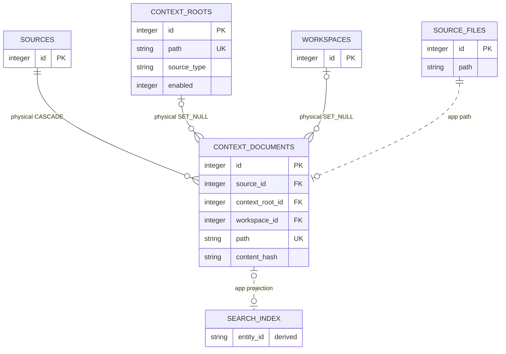

# Local Context Corpus

<!-- schema-objects: context_roots, context_documents -->

This subject owns user-managed Context source registration and the locally indexed document corpus. Generic source/scan rows remain owned by Source Registry And Scans. Atlassian URL sightings may point back to enabled Documents but remain derived rows owned by Atlassian Source Memory.

[Value Dictionary](value-dictionaries/local-context-corpus.md) owns this subject's bounded physical/logical/presentation mappings.

Local Context owns indexed document bodies and source paths. The [shared resource registry](work-organization-and-resources.md) adds `resource_documents` bindings without moving that authority. Local bookmarks remain separate metadata: a matching path shares the same resource ID, while a folder/repository bookmark has no implied Document. Index deletion removes its binding but preserves Session observations and manual bookmark notes; same-path reindexing restores navigation. Workstream/Thread links and Atlassian sightings are outgoing mappings owned by those consumers, never prerequisites for Local Context storage or reading.

Core ingestion has no optional observers by default. `app/reference_integrations.py` explicitly installs the optional Atlassian observer for the app, background scans and CLI; `ingest/extensions.py` scopes it to the caller connection/transaction. Document and local-resource pages receive optional membership readers from app assembly and can render without Workstream access. No unregistered file is read or imported to satisfy a Session reference.

## Focused ERD

## Catalog

### `context_roots`

- Purpose and authority: user-managed registry of folders, individual files, and Apple Notes sources, including readability, enablement, scan status, and error state.
- Lifecycle: user-curated and non-rebuildable as a registry. A default Context directory may be discovered compatibly only for previously indexed Documents; fresh installations require explicit registration. User additions/removals and source types require backup.
- Producers: `local_context/service.py` adds, restores, disables, and validates roots; `ingest/sync/contexts.py` updates scan outcomes; `persistence/migrations/local_context.py` compatibly seeds/migrates folder roots for previously indexed Documents.
- Consumers: Context source listing/detail in `local_context/service.py` and `local_context/queries.py`, scanner source enumeration, Workstream pickers/suggestions, and document visibility filters.
- Relations and deletion: optional physical parent of `context_documents` with `ON DELETE SET NULL`; ordinary removal disables the root and removes its FTS projections and source-file tracking. It retains the registry, Document rows, shared resource bindings and Session evidence; the disabled root makes those Documents unavailable for normal reading. Original local content remains untouched. Actual Document deletion during collection removes its binding but preserves shared identity and Session evidence.
- Recovery: restore the LocalBrain database or re-register every root manually, then scan. Original files/Notes remain external authorities.
- DDL ownership: fresh definition in `schema.sql`; `persistence/migrations/` compatibly adds `source_type`, `display_order`, `readable`, `status`, and `error` and migrates document ownership.

| Column | Contract |
| --- | --- |
| `id` | `INTEGER PRIMARY KEY`; stable Context registration identity. |
| `path` | `TEXT NOT NULL UNIQUE`; canonical local path or source locator. |
| `label` | `TEXT NOT NULL`; user-facing source label. |
| `display_order` | nullable `INTEGER`, nonnegative when set; user-owned source order. Positioned rows precede unset rows; ties/unset rows retain folder/Notes/file, label and path ordering. Reorder compares the prior ordered active IDs and saves a complete permutation atomically without changing scan timestamps. New roots are unset; re-registration retains a saved position. |
| `source_type` | `TEXT NOT NULL DEFAULT 'folder'`; folder, file, or approved adapter type. |
| `readable` | `INTEGER NOT NULL DEFAULT 1`; current source readability signal. |
| `status` | `TEXT NOT NULL DEFAULT 'ready'`; ready, scanning, error, or other bounded source state. |
| `error` | nullable `TEXT`; latest bounded source error. |
| `enabled` | `INTEGER NOT NULL DEFAULT 1`; browse/scan participation. |
| `last_scanned_at` | nullable `TEXT`; latest completed scan time. |
| `created_at` | `TEXT NOT NULL DEFAULT CURRENT_TIMESTAMP`; registration creation time. |
| `updated_at` | `TEXT NOT NULL DEFAULT CURRENT_TIMESTAMP`; latest registry/state update. |

Constraints: uniqueness of `path`. Explicit indexes: none.

### `context_documents`

- Purpose and authority: normalized text and metadata indexed from a registered local file/folder/Notes source, with source path, content fingerprint, and optional current workspace association.
- Inventory: each indexed file has an absolute `path` and source-relative `relative_path`; `local_context/service.py::context_source_tree` reconstructs folder nodes from those relative paths. There is no separate persisted folder tree or universal catalog of every local Markdown file. Multiple Session reference rows may point to the shared resource bound to the same indexed Document.
- Lifecycle: source-derived and rebuildable while the external source remains available. The stored body is local indexed content and is never copied into tracked schema evidence.
- Producers: `ingest/sync/contexts.py` upserts documents and removes disappeared rows; `persistence/migrations/local_context.py` migrates older root associations and relative paths.
- Consumers: Context browse/detail in `local_context/queries.py` and `local_context/web.py`, retrieval evidence, Runner context manifests, Workstream links/suggestions, source summaries, `search_index` projection, direct Session reference resolution, and the Session `관련 자료` read projection for directly referenced Documents. Thread/Workstream membership does not supply candidates to Session detail. Workspace identity may bound exact reference resolution but never makes a Document a visible related-material candidate by itself. The projection reads identity and metadata only and never copies the stored body into Session ownership.
- Relations and deletion: source deletion cascades. Physical Context root and workspace deletion set their keys null, retaining the Document. Ordinary root removal only disables it; collection can delete a Document whose source disappeared. Actual Document deletion removes its shared-resource binding while preserving the resource and Session evidence. Scanner and `local_context/service.py` explicitly remove matching FTS rows; when installed, the optional ingestion adapter also clears the root's derived Atlassian evidence without deleting any Item. It is an application target for Workstream, Thread, and checkpoint references.
- Recovery: rescan external sources. If the original content is gone, only a database/host backup can recover the indexed body; LocalBrain is not the authority for the original file.
- DDL ownership: fresh definition plus `idx_documents_mtime` in `schema.sql`; compatible `context_root_id` and `content_type`, migration assignment, and runtime-only `idx_documents_context_root` in `persistence/migrations/`.

| Column | Contract |
| --- | --- |
| `id` | `INTEGER PRIMARY KEY`; stable indexed-document identity. |
| `source_id` | `INTEGER NOT NULL` FK to `sources.id`, `ON DELETE CASCADE`. |
| `context_root_id` | nullable `INTEGER` FK to `context_roots.id`, `ON DELETE SET NULL`. |
| `workspace_id` | nullable `INTEGER` FK to `workspaces.id`, `ON DELETE SET NULL`. |
| `path` | `TEXT NOT NULL UNIQUE`; canonical external document path/locator. |
| `relative_path` | `TEXT NOT NULL`; root-relative browse path. |
| `title` | `TEXT NOT NULL`; normalized display title. |
| `body` | `TEXT NOT NULL`; locally indexed plaintext content. |
| `content_type` | `TEXT NOT NULL DEFAULT 'text/markdown'`; normalized media/content contract. |
| `size_bytes` | `INTEGER NOT NULL`; source size fingerprint. |
| `mtime_ns` | `INTEGER NOT NULL`; nanosecond source modification fingerprint. |
| `content_hash` | `TEXT NOT NULL`; indexed content fingerprint. |
| `imported_at` | `TEXT NOT NULL DEFAULT CURRENT_TIMESTAMP`; latest indexed write time. |

Constraints: uniqueness of `path`. Explicit indexes: `idx_documents_mtime`, `idx_documents_context_root`, `idx_documents_source`, and `idx_documents_workspace`; the workspace index orders `mtime_ns DESC` after `workspace_id`.

## Subject Recovery Boundary

Root registration is user intent and needs backup; document rows are an index and normally come from rescans. Disabling or removing a root removes LocalBrain browsing/search state but never deletes the original file or Note. Overlap rejection keeps one root owner per indexed document.
