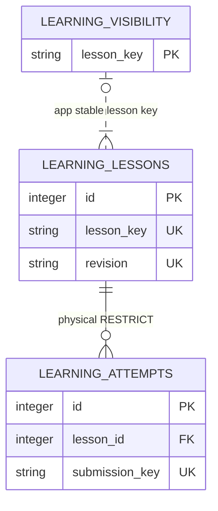

# Personal Learning

<!-- schema-objects: learning_lessons, learning_attempts, learning_visibility -->

This subject owns reviewed lesson revisions, personal attempts and reversible
visibility. [Learning policy](../work-grounded-learning.md) owns packet validation
and intervals; [scene policy](../code-command-learning.md) owns version-2 fields,
daily selection and depth. The [Value Dictionary](value-dictionaries/personal-learning.md) owns
complete bounded labels. Source snapshots are embedded immutable evidence, not
live pointers or a claim that an original document remains available.

## Focused ERD

## Catalog

### `learning_lessons`

- Purpose and authority: immutable, explicitly reviewed local learning material.
  The packet holds work rationale, official/source snapshots, version uncertainty,
  question/answer pairs, optional reviewed article and source references. Review acknowledgment is curator
  authority, not an automated truth judgment.
- Lifecycle: user-curated and non-rebuildable. Revisions append; newest inserted
  ID per key is current. Reimporting an existing revision never rolls back current.
- Producers: `learning/cli.py` through validated `learning.import_packet`.
- Consumers: learning home, library, article, source/question reader, attempts and scheduling.
- Relations and deletion: attempts reference the exact revision with RESTRICT;
  visibility joins the stable key by application. No source deletion cascades into
  snapshots. Ordinary UI/CLI exposes no lesson deletion or update.
- Recovery: restore the private DB backup. An original reviewed packet can restore
  content but cannot reconstruct IDs, attempt history or visibility choices.
- DDL ownership: `schema.sql`; ordinary additive startup creates an absent table.

| Column | Contract |
| --- | --- |
| `id` | INTEGER PRIMARY KEY; immutable local revision identity. |
| `lesson_key` | TEXT NOT NULL; curator-owned ASCII key, 1–80 characters. |
| `revision` | TEXT NOT NULL; 64-character SHA-256 of normalized canonical packet JSON. |
| `title` | TEXT NOT NULL; validated bounded title copied from the packet for listing. |
| `packet_json` | TEXT NOT NULL; complete immutable lesson, source snapshots and questions; application validates version 1 or 2. Version 2 embeds literal command or full before/after file snapshots, computed hashes, concept/depth/rubric, manual authorship and relevance metadata. No extra SQL table or migration is required for this extension. |
| `created_at` | TEXT NOT NULL; application-written UTC ISO timestamp of first import. |

Version 2 may also embed an `article`: introduction, preserved-scene code range,
2–5 sourced sections and takeaway. The [scene policy](../code-command-learning.md#reviewed-article)
owns its exact validation. It uses the existing immutable JSON and needs no SQL
migration. Absent articles do not change existing normalized payloads or hashes.
Reauthoring creates a new revision with its own attempts and review schedule;
older content and learning history remain attached to their original revision.

Constraints: UNIQUE(lesson_key, revision), 64-character revision CHECK. Application
validates lengths, enums, snapshots, source references, HTTPS/local link admission,
version statements and nonfuture checked dates before inserting an atomic batch.

### `learning_attempts`

- Purpose and authority: durable personal response and confidence, followed by
  exactly one self-assessment, or an explicit explanation-first reading record.
- Lifecycle: user-curated and non-rebuildable. Answers are immutable; only pending
  outcome transitions once to again/partial/recalled with assessed time. Reading
  is born completed. Same-token identical replay is idempotent.
- Producers: local same-origin learning POST handlers through `learning/service.py`.
- Consumers: reader/history and deterministic daily selection/review scheduling.
- Relations and deletion: non-null lesson FK uses ON DELETE RESTRICT, retaining
  question and source revision. `question_id` application-resolves inside that
  revision's packet. No relationship to source cleanup or model training.
- Recovery: restore DB backup; source reingestion cannot recreate personal answers.
- DDL ownership: `schema.sql` and `idx_learning_attempts_lesson_time`; additive startup.

| Column | Contract |
| --- | --- |
| `id` | INTEGER PRIMARY KEY; local attempt identity. |
| `lesson_id` | Non-null FK to learning_lessons.id, ON DELETE RESTRICT. |
| `question_id` | TEXT NOT NULL; stable question key inside the referenced revision. |
| `submission_key` | TEXT NOT NULL UNIQUE; bounded idempotency token; replay must match original payload. |
| `answer` | TEXT NOT NULL, at most 8,000 characters; empty exactly for reading. |
| `confidence` | Nullable TEXT; low/medium/high for answers, NULL for reading. |
| `hint_used` | Checked INTEGER 0/1, DEFAULT 0; submitted help report, including an opened hint/additional-code disclosure when JavaScript is available. Practice entered from the home explanation carries `from_note=1` and forces 1 on answer submission, including without JavaScript; always 0 for reading. |
| `outcome` | TEXT NOT NULL; pending/read/again/partial/recalled; no objective correctness claim. |
| `submitted_at` | TEXT NOT NULL; immutable UTC ISO submission timestamp. |
| `assessed_at` | Nullable UTC ISO completion time; NULL exactly while pending. |

Constraints: UNIQUE submission_key; bounded answer; checked confidence, hint and
outcome families; reading/answer/confidence correlation; pending/completion-time
correlation. Application validates lesson/question membership and one-way outcome
transition under a write transaction. Explicit index: idx_learning_attempts_lesson_time.

Version-2 scheduling derives same-day feedback assistance from preceding attempts
for the same concept. It does not rewrite `hint_used`, infer that feedback was read,
or store a mastery score. Browser-tab answer drafts are temporary sessionStorage;
they become durable attempts only through the existing explicit POST flow.

### `learning_visibility`

- Purpose and authority: reversible personal hiding/snoozing of a stable lesson.
- Lifecycle: user-curated and non-rebuildable. Upsert on explicit action; revisions
  inherit existing visibility. Restore clears hidden and snoozed state.
- Producers: local same-origin visibility POST through `learning.set_visibility`.
- Consumers: daily selection and library controls; no effect on saved answers.
- Relations and deletion: application joins lesson_key across revisions. There is
  no FK to a non-unique revision key, cascade or source ownership dependency.
- Recovery: restore DB backup or explicitly repeat visibility choices.
- DDL ownership: `schema.sql`; additive startup, no explicit secondary index.

| Column | Contract |
| --- | --- |
| `lesson_key` | TEXT PRIMARY KEY NOT NULL; stable key validated against an existing revision. |
| `hidden` | Checked INTEGER 0/1 NOT NULL DEFAULT 0; explicit hide/restore choice. |
| `snoozed_until` | Nullable configured-local ISO date; tomorrow on snooze, NULL on hide/restore. |
| `updated_at` | TEXT NOT NULL; UTC ISO timestamp of latest explicit choice. |

Constraints: primary key and hidden boolean CHECK. Application admits only snooze,
hide and restore; a missing visibility row means visible and not snoozed. No due
date, learning outcome or mastery value is persisted here.
