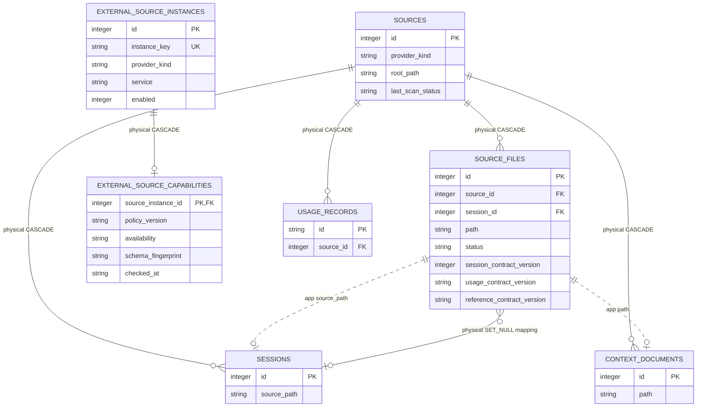

# Source Registry And Scans

<!-- schema-objects: sources, source_files, external_source_instances, external_source_capabilities -->

This subject owns local source identity, configured roots, external Source Instance registration, generic scan and capability freshness, file or schema fingerprints, parser-contract freshness, and bounded errors. It does not own the normalized Sessions, Usage Records, Context Documents, Atlassian Items, or source-specific Atlassian evidence scan rows produced from those sources.

[Value Dictionary](value-dictionaries/source-registry-and-scans.md) owns this subject's bounded physical/logical/presentation mappings.

## Focused ERD

Solid lines are physical foreign keys; dotted lines are scanner-managed correlations.

## Catalog

### `sources`

- Purpose and authority: one registry row per local source. Session profiles use
  the existing numeric `id` in version-2 `session-sources.toml`, public settings
  APIs and new filter links. `provider_kind` selects parsing and normalization;
  `name`, `profile_color` and `profile_position` project the configured label,
  palette color and TOML array order. Local Context remains separately registered.
  `id` is the only profile identity. The old `kind` column is removed; no alias
  table or replacement string identifier is created.
- Lifecycle: source-derived registry. It is reproducible from configuration and registered roots, but its IDs are physical parents, so ordinary scans update rows in place.
- Session registration enablement belongs to `session-sources.toml`, including
  explicit `enabled = false` after removal. Disabled entries retain these parent
  rows and descendants for browsing; collection and ordinary search exclude them.
  Confirmed same-source reconnection updates paths while preserving these IDs.
  [Desktop settings](../desktop-app-and-settings.md#source-lifecycle-contract)
  owns the file/DB coordination and recovery journal.
- Scan health: each registered Session source is dispatched in its own database
  transaction. A successful readable-root attempt may reconcile disappeared
  files only inside that Source ID. An unavailable root, invalid configuration,
  or unexpected source failure records bounded health separately and retains the
  source's existing descendants.
- Producers: `ingest/sync/storage.py` through the `ingest/scanner.py` coordinator; `db.py` reads provider kinds when migration changes must stale Session inputs.
- Consumers: `queries.py`, `activity.py`, `retrieval.py`, `usage_queries.py`, `workstreams.py`, `runner.py`, `main.py`, and CLI scan reporting.
- Relations and deletion: physical parent of `source_files`, `sessions`, `usage_records`, and `context_documents`, all `ON DELETE CASCADE`, and retained `skill_observations` with `NO ACTION`. The latter prevents deleting a source with historical skill evidence. Deleting another source would remove normalized descendants and can invalidate application-enforced links or search rows, so no cleanup is implied.
- Recovery: recreate registry rows through approved scans, then rescan source files. Preserve the database for user-curated links and review state that may refer to descendant IDs.
- DDL ownership: complete fresh definition in `schema.sql`; `db.py` performs a
  verified backup-backed compatible rebuild to remove `kind` and the retired
  `enabled` column, supplying `provider_kind` for older schemas. The transaction
  converts skill FKs, chart scopes, retained workflow boundaries and analysis
  usage references while retaining Source IDs and child relationships. No explicit named
  indexes exist. Compatible startup adds absent scan-health columns without
  rebuilding rows; fresh DDL additionally enforces the bounded status/error
  checks.

| Column | Contract |
| --- | --- |
| `id` | `INTEGER PRIMARY KEY`; stable local registry identity and physical parent key. |
| `provider_kind` | `TEXT NOT NULL DEFAULT 'unknown'`; bounded non-empty parser and normalization adapter identity. Application producers always supply it explicitly; `unknown` is reserved for direct legacy-style compatibility inserts. |
| `name` | `TEXT NOT NULL`; user-facing source label. |
| `root_path` | `TEXT NOT NULL`; configured local scan root or source locator; runtime values remain outside tracked docs. |
| `profile_color` | nullable `TEXT`; green, blue, orange, yellow, red or gray. Session TOML owns the choice; null uses the provider default. |
| `profile_position` | `INTEGER NOT NULL DEFAULT 2147483647`, nonnegative; projection of TOML array position. Omitted retained profiles sort last, then by ID. |
| `last_scanned_at` | nullable `TEXT`; time recorded for the latest source-level scan attempt, whether it succeeded or not. |
| `last_scan_success_at` | nullable `TEXT`; latest source-level attempt that completed or found a readable empty root. Errors do not advance it. |
| `last_scan_status` | nullable `TEXT`; latest outcome: `completed`, `empty`, `unavailable`, `configuration_error`, or `scan_failed`. Null means the source has not yet been synchronized under this contract. |
| `last_scan_error` | nullable `TEXT`; application-bounded failure consequence for the latest unsuccessful attempt, never a raw exception or source content. Successful attempts clear it. |
| `created_at` | `TEXT NOT NULL DEFAULT CURRENT_TIMESTAMP`; registry creation time. |

Constraints: `id` is the sole primary key; fresh DDL bounds `last_scan_status`
to the approved vocabulary and `last_scan_error` to at most 500 characters.
Explicit indexes: none.

### `source_files`

- Purpose and authority: per-source scan evidence for an accepted local input
  path, including its file fingerprint, latest attempt state, error, optional
  normalized Session owner, Session-projection contract version,
  Usage-normalizer contract version, and generalized Session-reference contract
  version. Provider-internal files outside the adapter's Session candidate
  contract never own rows here.
- Lifecycle: source-derived and rebuildable. Healthy unchanged rows are freshness
  inputs; failed rows retain the latest error rather than masquerading as absent.
  A successful scan removes prior evidence for paths that are no longer accepted
  provider candidates, using the same normalized-only reconciliation boundary as
  a disappeared native file while leaving the original file untouched. An accepted
  Session path whose parsed content has no Activity Event, Usage Record, or
  admitted skill observation is also omitted: any prior file row is removed, the native stub remains,
  and its lack of a freshness row makes later meaningful growth discoverable.
- Producers: `ingest/sync/storage.py` inserts and updates scan results for Session and Context services, writes the
  resolved Session mapping and all three contract versions, and replaces mappings on
  successful reparse; `contexts.py` removes Context-owned rows when a root is
  disabled; `db.py` compatibly adds the optional Session mapping and three
  contract fields.
- Consumers: `ingest/sync/sessions.py` and `ingest/sync/contexts.py` skip/retry logic, Usage version repair,
  Session projection repair, multi-file Session-reference aggregation and
  partial/error sibling repair;
  `session_references.py` uses the mapped current file set for aggregate
  fingerprints; `queries.py`, `usage_queries.py`, and `contexts.py` consume the
  existing source-status and root lifecycle state. Legacy Atlassian evidence adds
  an independent extractor/Site fingerprint check before an otherwise-current
  file is skipped.
- Relations and deletion: `source_id` physically cascades from `sources`;
  optional `session_id` points to `sessions.id` with `ON DELETE SET NULL`, so
  deleting a Session cannot delete scan evidence before the owning source
  reconciliation decides its path lifecycle. The legacy correlation from `path`
  to `sessions.source_path` and the Context correlation to
  `context_documents.path` remain application-managed. Removing a file row alone
  does not cascade a Session or Document. Scanner reconciliation explicitly
  removes disappeared normalized rows and their search/reference projections
  only after a successful scan of the same accepted, present root. Configuration
  and root-availability failures do not authorize stale reconciliation.
- Recovery: rescan the owning source. Errors and exact prior attempt times are operational history and are not reproduced exactly.
- DDL ownership: fresh table definition in `schema.sql`; `db.py` compatibly adds
  `session_id`, `session_contract_version`, `usage_contract_version`, and
  `reference_contract_version`, and creates `idx_source_files_session` after
  those columns exist. `source_revision_migration.py` rebuilds this table with a
  positive-integer-or-null Session revision constraint. Startup validates exact
  known provider-specific legacy tokens, makes a verified private recovery copy,
  and converts only their revision numbers while preserving rows, IDs, mappings,
  fingerprints, other contracts, indexes and foreign keys. Unknown tokens stop
  startup before schema writes; they are never cast to zero or stamped current.
  Rebuild accepts only the supported column, outgoing-FK and implicit-uniqueness
  shapes, with no incoming file FKs. Unknown triggers, check/collation/conflict/
  timing/storage modifiers or a pre-existing rebuild target also stop replacement.
  The rebuild savepoint restores the original table and rows on failure, including
  an interruption after DROP. This shape refusal is separate from token preflight;
  it does not promise that unrelated startup migrations made no earlier changes.
  SQL recognition separates comments, string literals and quoted identifiers;
  only an actual top-level CHECK matching the known revision predicate proves
  the numeric contract current. Comments and standalone SQLite BOM whitespace
  cannot hide unsupported modifiers; keyword text inside quotes cannot create
  constraints. Literal case is preserved. Other CHECK expressions, even if they
  might be equivalent, are refused during rebuild rather than assumed safe.
  Null Session revisions trigger actual Session/skill reprocessing, even when
  the independent Usage contract is current; that repair does not reprice Usage.
- Forward-only Session refresh: the provider revision is a positive integer in
  `ingest/contracts.py`; the DB stores the revision that produced each file's
  results, not executable parser code. Before upserting a source or reconciling
  stale files, the scanner rejects a source containing a higher revision, even
  for forced scans, reports `session_revision_unsupported`, and retains its
  existing results. Bounded source attempt/failure health still updates; file and
  normalized results stay intact. Other registered sources still run in their own transactions.
  Equal revisions permit unchanged-file skips; lower or null revisions require
  repair. Codex and Claude revision numbers are independent. This admission check
  also applies before same-source reconnection can invalidate revision markers. It
  applies to runtimes containing it; rebuild and replace older native bundles
  before using the shared database. It is not a retroactive old-binary write lock.

| Column | Contract |
| --- | --- |
| `id` | `INTEGER PRIMARY KEY`; local scan-evidence identity. |
| `source_id` | `INTEGER NOT NULL` FK to `sources.id`, `ON DELETE CASCADE`. |
| `session_id` | nullable `INTEGER` FK to `sessions.id`, `ON DELETE SET NULL`; exact normalized Session owner for an accepted Session file, including multi-file native Session sets. Context files remain null. |
| `path` | `TEXT NOT NULL`; source-local file identity used for scanner correlation. |
| `size_bytes` | `INTEGER NOT NULL`; fingerprint size captured at the latest attempt. |
| `mtime_ns` | `INTEGER NOT NULL`; nanosecond file modification fingerprint. |
| `last_scanned_at` | `TEXT NOT NULL`; latest attempt time for this input. |
| `status` | `TEXT NOT NULL DEFAULT 'ok'`; freshness state such as healthy, stale, or error. |
| `error` | nullable `TEXT`; bounded scan or parse error evidence. |
| `session_contract_version` | nullable positive `INTEGER`; provider-specific parser/classification revision used to decide whether the Session, Activity Events, and Session search projection remain current. Null means no known Session revision; Context files remain null. |
| `usage_contract_version` | nullable `TEXT`; normalizer contract used to decide whether Usage Records remain current. |
| `reference_contract_version` | nullable `TEXT`; generalized Session-reference extractor/reconciler contract used to decide whether the mapped Session evidence remains current. |

Constraints: `UNIQUE(source_id, path)` plus optional physical Session ownership; `session_contract_version` is null or has SQLite storage type `integer` and is greater than zero.
Explicit indexes: `idx_source_files_session` on `(session_id, path)` for aggregate
fingerprints, sibling repair, and Session deletion/reconciliation lookup; SQLite
also owns the composite source/path uniqueness autoindex.

### `external_source_instances`

- Purpose and authority: one stable local registration per independently configured external access boundary. The user-managed `instance_key`, provider kind, service, display name, shape-validated configuration reference, and enabled state identify the boundary without storing credentials or remote content.
- Lifecycle: user-curated and non-rebuildable. Local-only Atlassian URL registration does not create a Source Instance. Separate access setup creates or reuses one only when the user supplies a Provider and actual approved configuration reference. Idempotent registration and connection editing may update generated presentation and enabled state, but changing provider, service, or a bound configuration reference under an existing key is an identity conflict. Binding a validated reference invalidates any prior capability observation so site-scoped reads require an explicit recheck.
- Producers: `external_access.py` identity services and separate Atlassian access setup in `atlassian_registration.py`.
- Consumers: `external_access.py` resolves policy and capability state; source-neutral external synchronization and Atlassian registration, refresh, browse, and evidence services consume the stable ID.
- Relations and deletion: physical parent of at most one current `external_source_capabilities` row and any number of `atlassian_site_bindings`, both with `ON DELETE CASCADE`. Nullable compatibility/current-access references from Sites, Spaces, and Items use `ON DELETE SET NULL`, so removing an explicit access boundary does not delete local Atlassian identity or content. Deletion remains an explicit destructive local action and is not part of capability refresh.
- Recovery: restore from the LocalBrain database backup or re-register through an explicit user action. External connector configuration alone is not equivalent because local identity and later user-managed relationships depend on the stable ID.
- DDL ownership: complete fresh definition in `schema.sql`; normal startup creates the absent table on an older database through the same idempotent schema application. No explicit named index.

| Column | Contract |
| --- | --- |
| `id` | `INTEGER PRIMARY KEY`; stable local Source Instance identity. |
| `instance_key` | `TEXT NOT NULL UNIQUE`; stable user-managed local key, independent from a provider display label. |
| `provider_kind` | `TEXT NOT NULL`; versioned policy family, currently `mcp_gateway` or `atlassian_cloud`. |
| `service` | `TEXT NOT NULL`; source service, currently `jira` or `confluence`. |
| `display_name` | `TEXT NOT NULL`; local presentation label that may change without changing identity. |
| `config_ref` | nullable `TEXT`; validated Gateway configuration alias or canonical lowercase Atlassian Cloud ID. Arbitrary opaque values, site URLs, query strings, user-info URLs, and credentials are not accepted. |
| `enabled` | `INTEGER NOT NULL DEFAULT 1`; `0` disables inspection and content authorization without deleting identity or observations. |
| `created_at` | `TEXT NOT NULL DEFAULT CURRENT_TIMESTAMP`; registration time. |
| `updated_at` | `TEXT NOT NULL DEFAULT CURRENT_TIMESTAMP`; latest local registration-state update. |

Constraints: unique `instance_key`; provider kind limited to `mcp_gateway` and `atlassian_cloud`; service limited to `jira` and `confluence`; enabled limited to `0` or `1`. Explicit indexes: none; SQLite owns the uniqueness autoindex.

### `external_source_capabilities`

- Purpose and authority: the latest rebuildable capability observation for one Source Instance, including policy version, schema fingerprint, availability, canonical logical operations, check time, invalidation, and bounded failure evidence. It is operational evidence and never grants a target absent from version-controlled policy.
- Lifecycle: rebuildable operational state. An explicit successful or failed capability check replaces the prior row; invalidation retains the last observation as stale. Startup, page load, search, and ordinary preview do not poll or rewrite it.
- Producers: `external_access.py` validates and stores canonical observations supplied by an explicit approved capability inspection. Ordinary application flows perform no implicit external call.
- Consumers: `external_access.py` intersects the row with static policy before producing a read dispatch; external maintenance execution consumes that validated dispatch.
- Relations and deletion: `source_instance_id` is both the primary key and an FK to `external_source_instances.id`, `ON DELETE CASCADE`, enforcing zero-or-one current observation per registration. The row cannot change Source Instance identity.
- Recovery: discard and rebuild through an explicit capability inspection. Losing the row returns the Instance to `unknown` and authorizes no source-content operation.
- DDL ownership: complete fresh definition in `schema.sql`; normal startup creates the absent table on an older database through the same idempotent schema application. No explicit named index.

| Column | Contract |
| --- | --- |
| `source_instance_id` | `INTEGER PRIMARY KEY` and FK to `external_source_instances.id`, `ON DELETE CASCADE`; one latest observation per Instance. |
| `policy_version` | `TEXT NOT NULL`; static application policy version used to interpret the observation. A mismatch is stale. |
| `schema_fingerprint` | nullable `TEXT`; bounded fingerprint of the inspected provider schema; available observations require a validated SHA-256 value at the producer boundary. |
| `availability` | `TEXT NOT NULL`; `available`, `unavailable`, `unauthorized`, or `error`. |
| `capability_json` | `TEXT NOT NULL`; canonical minimal JSON containing only schema identity and sorted logical operation names. |
| `error_code` | nullable `TEXT`; bounded operational failure category. |
| `error_message` | nullable `TEXT`; application-generated failure explanation with a database limit of 500 characters. Raw provider errors, credentials, content, and connector payloads are never accepted by the producer. |
| `checked_at` | `TEXT NOT NULL`; time of the explicit observation supplied by the producer. |
| `invalidated_at` | nullable `TEXT`; time the observation became stale after an authorization or schema mismatch. |
| `updated_at` | `TEXT NOT NULL DEFAULT CURRENT_TIMESTAMP`; latest replacement or invalidation time. |

Constraints: one row per Source Instance; physical cascade FK; availability vocabulary; `error_message` length at most 500. Explicit indexes: none; the primary-key index owns lookup.

## Subject Recovery Boundary

A full source rescan rebuilds normalized scan state but not the exact chronology
of prior errors. The Session sync report aggregates independently committed
Source outcomes as complete, partial, or failed; the wider Sources scan appends
Local Context without weakening those Session-source transactions. An explicit
capability inspection can replace capability observations but cannot recreate
user-managed Source Instance identity. Disabling a user-managed Context root is
owned by the Context subject and intentionally removes its scan rows without
deleting original files. Source or Source Instance deletion is not an ordinary
recovery operation because physical cascades and application links cross subject
boundaries.
