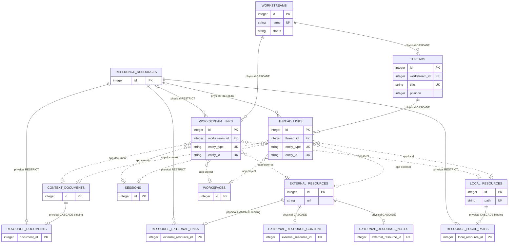

# Work Organization And Resources

<!-- schema-objects: workstreams, threads, workstream_links, thread_links, local_resources, external_resources, reference_resources, resource_documents, resource_local_paths, resource_external_links, external_resource_content, external_resource_notes -->

This subject owns user-created Workstreams and Threads, their current planning state, shared resource identities, legacy local/external metadata, and user-reviewed links to source-derived entities. User notes, organization and historical reference identities require backup; reindexing documents does not own their deletion.

[Value Dictionary](value-dictionaries/work-organization-and-resources.md) owns this subject's bounded physical/logical/presentation mappings.

## Focused ERD

Solid lines are physical ownership. Dotted lines represent the five validated polymorphic target types.

## Polymorphic Target Contract

`entity_type` is restricted by application code to `session`, `document`, `project`, `external`, or `local`, resolving respectively to `sessions`, `context_documents`, `workspaces`, `external_resources`, or `local_resources`. `_validate_entity` confirms the target exists; Session targets must also be primary work Sessions. `entity_id` remains text so the shared link shape can address heterogeneous integer identities. Legacy `entity_type`/`entity_id` remains application-validated. For document/local/external targets, the nullable `resource_id` additionally points to the shared registry with `ON DELETE RESTRICT`; session/project targets and unresolved historical links leave it NULL. Organization deletion removes its own mapping, never the resource. Session detail does not consume these memberships: its `관련 자료` rail uses direct Session reference evidence only, and it does not display the `연결된 작업` membership strip. Existing links remain available to Workstream/Thread consumers; removing the Session read projection creates or deletes no ownership edge.

## Shared Identity And Ownership

Session evidence points to `reference_resources`; it does not depend on Atlassian registration or organization. Local Context owns `context_documents` and their indexed text. `resource_documents`, `resource_local_paths` and `resource_external_links` associate existing IDs with the shared resource without merging their metadata or lifecycle. Workstreams and Threads own their outgoing mappings. Optional consumers may derive further mappings, but the base resource has no reverse FK to those features.

URL identity uses the pure safe locator grammar, including domain. Local path identity normalizes an absolute path without file reads, symlink resolution or content-hash merging; opaque Apple Notes locators remain distinct. Registering a bookmark never imports or indexes its contents. Same-path document reindexing restores its binding. Moving a file or crossing domains creates a separate identity unless a future explicit reconciliation defines otherwise.

`persistence/migrations/resources.py` backs up an existing DB to `<database>-pre-shared-resources-v1.bak`, validates it with `quick_check`, and never overwrites that recovery copy. A savepoint covers identity backfill, organization bindings, Session evidence replacement and body/note transfer. It preserves existing IDs, provenance, timestamps and manual metadata; a conflict rolls the batch back. Unsupported unsafe legacy destinations remain inactive evidence, and unresolved historical organization links retain their original IDs with a NULL shared binding. Completed target counts are recomputed; partial sets become stale/error until recollected. Ordinary successful startup applies the existing bounded backup-retirement policy.

## Catalog

### `workstreams`

- Purpose and authority: user-created top-level organization with current status, summary, and activity marker.
- Lifecycle: user-curated and non-rebuildable.
- Producers: `workstreams/service.py` create/update/touch operations.
- Consumers: Dashboard and Workstream detail, retrieval scope, Runner context and Run association, Suggestions, Threads, checkpoints, and resource memberships.
- Relations and deletion: physical parent of `threads`, `workstream_links`, and `checkpoints` with cascade; optional parent of `maintenance_runs` with set null. No ordinary delete workflow currently treats this as disposable.
- Recovery: LocalBrain database backup; source rescans cannot recover names, summaries, statuses, or grouping intent.
- DDL ownership: fresh definition in `schema.sql`; no compatible columns or explicit named index.

| Column | Contract |
| --- | --- |
| `id` | `INTEGER PRIMARY KEY`; stable Workstream identity. |
| `name` | `TEXT NOT NULL UNIQUE`; user-owned top-level name. |
| `status` | `TEXT NOT NULL DEFAULT 'active'`; application-bounded active, paused, done, or archived state. |
| `summary` | nullable `TEXT`; user-maintained purpose/context. |
| `last_activity_at` | nullable `TEXT`; latest linked/user organization activity signal. |
| `created_at` | `TEXT NOT NULL DEFAULT CURRENT_TIMESTAMP`; creation time. |
| `updated_at` | `TEXT NOT NULL DEFAULT CURRENT_TIMESTAMP`; latest mutation time. |

Constraints: uniqueness of `name`; status vocabulary is application-enforced. Explicit indexes: none.

### `threads`

- Purpose and authority: ordered, nested work track inside one Workstream, including status, summary, goal, and next action.
- Lifecycle: user-curated and non-rebuildable.
- Producers: `workstreams/service.py` create and update operations.
- Consumers: Workstream detail, retrieval scoping, Runner structured results, Suggestions, links, checkpoints, and membership queries.
- Relations and deletion: Workstream deletion cascades; Thread deletion cascades `thread_links` and sets historical `checkpoint_resource_refs.thread_id` null.
- Recovery: database backup. Recreating a title does not recreate identity, order, links, or checkpoint history.
- DDL ownership: fresh definition and `idx_threads_workstream` in `schema.sql`; `persistence/migrations/` repeats the index idempotently.

| Column | Contract |
| --- | --- |
| `id` | `INTEGER PRIMARY KEY`; stable Thread identity. |
| `workstream_id` | `INTEGER NOT NULL` FK to `workstreams.id`, `ON DELETE CASCADE`. |
| `title` | `TEXT NOT NULL`; title unique within its Workstream. |
| `status` | `TEXT NOT NULL DEFAULT 'active'`; application-bounded active, blocked, paused, or done state. |
| `summary` | nullable `TEXT`; current Thread context. |
| `current_goal` | nullable `TEXT`; current intended outcome. |
| `next_action` | nullable `TEXT`; next executable step. |
| `last_activity_at` | nullable `TEXT`; latest Thread-scoped activity signal. |
| `position` | `INTEGER NOT NULL DEFAULT 0`; user-facing order within the Workstream. |
| `created_at` | `TEXT NOT NULL DEFAULT CURRENT_TIMESTAMP`; creation time. |
| `updated_at` | `TEXT NOT NULL DEFAULT CURRENT_TIMESTAMP`; latest mutation time. |

Constraints: `UNIQUE(workstream_id, title)`; status vocabulary is application-enforced. Explicit index: `idx_threads_workstream`.

### `workstream_links`

- Purpose and authority: one reviewed or generated relationship from a Workstream to a heterogeneous resource, shared by multiple Threads.
- Lifecycle: user-curated and non-rebuildable; `linked_by` and `confidence` retain origin context.
- Producers: `workstreams/service.py` validated add/update/remove operations and accepted suggestions.
- Consumers: Workstream detail, latest activity, memberships, Atlassian Item detail, retrieval exclusions/scope, Runner manifests, checkpoint snapshots, and suggestion deduplication.
- Relations and deletion: Workstream deletion cascades. The shared resource FK restricts resource deletion; legacy target removal can leave historical/unresolved entity identity.
- Recovery: database backup or accepted external workflow record; source scanning does not infer the same relation reliably.
- DDL ownership: fresh definition and `idx_workstream_links_entity` in `schema.sql`; relation type compatible addition and repeated index in `persistence/migrations/`; shared `resource_id` addition/backfill in `persistence/migrations/resources.py`.

| Column | Contract |
| --- | --- |
| `id` | `INTEGER PRIMARY KEY`; link identity. |
| `workstream_id` | `INTEGER NOT NULL` FK to `workstreams.id`, `ON DELETE CASCADE`. |
| `entity_type` | `TEXT NOT NULL`; application-enforced target discriminator. |
| `entity_id` | `TEXT NOT NULL`; legacy target identity interpreted by `entity_type`. |
| `resource_id` | nullable FK to `reference_resources.id`, `ON DELETE RESTRICT`; shared document/local/external identity. |
| `relation_type` | `TEXT NOT NULL DEFAULT 'related-to'`; user/reviewed relation meaning. |
| `confidence` | nullable `REAL`; generated-link confidence when applicable. |
| `linked_by` | `TEXT NOT NULL DEFAULT 'user'`; user or generator provenance. |
| `created_at` | `TEXT NOT NULL DEFAULT CURRENT_TIMESTAMP`; link creation time. |

Constraints: `UNIQUE(workstream_id, entity_type, entity_id)`. Explicit index: `idx_workstream_links_entity`.

### `thread_links`

- Purpose and authority: one reviewed or generated relationship from a Thread to a heterogeneous resource.
- Lifecycle: user-curated and non-rebuildable.
- Producers: `workstreams/service.py` validated add/update/remove operations and accepted suggestions.
- Consumers: Workstream/Thread detail, activity, memberships, Atlassian Item detail, retrieval scope, Runner manifests, checkpoint snapshots, and suggestion deduplication.
- Relations and deletion: Thread deletion cascades. The shared resource FK restricts resource deletion; legacy target relations have no SQLite cascade.
- Recovery: database backup; inference may suggest a new link but cannot restore review provenance exactly.
- DDL ownership: fresh definition and `idx_thread_links_entity` in `schema.sql`; `persistence/migrations/` repeats the index idempotently and `persistence/migrations/resources.py` adds/backfills `resource_id`.

| Column | Contract |
| --- | --- |
| `id` | `INTEGER PRIMARY KEY`; link identity. |
| `thread_id` | `INTEGER NOT NULL` FK to `threads.id`, `ON DELETE CASCADE`. |
| `entity_type` | `TEXT NOT NULL`; application-enforced target discriminator. |
| `entity_id` | `TEXT NOT NULL`; legacy target identity interpreted by `entity_type`. |
| `resource_id` | nullable FK to `reference_resources.id`, `ON DELETE RESTRICT`; shared document/local/external identity. |
| `relation_type` | `TEXT NOT NULL DEFAULT 'related-to'`; relation meaning. |
| `confidence` | nullable `REAL`; generated-link confidence. |
| `linked_by` | `TEXT NOT NULL DEFAULT 'user'`; origin provenance. |
| `created_at` | `TEXT NOT NULL DEFAULT CURRENT_TIMESTAMP`; link creation time. |

Constraints: `UNIQUE(thread_id, entity_type, entity_id)`. Explicit index: `idx_thread_links_entity`.

### `local_resources`

- Purpose and authority: user-visible repository, directory, file, or generic path bookmark. It does not own a document body; `resource_local_paths` joins it to the shared identity also used by a matching Context Document.
- Lifecycle: user-curated and non-rebuildable as organization, even though existence can be rechecked.
- Producers: `resources/store.py` canonical registration and update; Runner structured output can propose/register reviewed local resources.
- Consumers: resource picker/detail, Workstream/Thread link resolution, retrieval context, and Runner reference manifests.
- Relations and deletion: legacy application target of organization/checkpoint links and physical parent of `resource_local_paths`. Bookmark deletion removes its binding, preserving shared identity, documents and Session evidence.
- Recovery: database backup plus local filesystem. A path scan cannot reconstruct title, summary, discovery provenance, or memberships.
- DDL ownership: fresh definition in `schema.sql`; path lookup and uniqueness use the `UNIQUE(path)` autoindex, and the compatible migration removes the former redundant named path index only after verifying that coverage.

| Column | Contract |
| --- | --- |
| `id` | `INTEGER PRIMARY KEY`; canonical local-resource identity. |
| `path` | `TEXT NOT NULL UNIQUE`; canonical local locator. |
| `resource_type` | `TEXT NOT NULL DEFAULT 'path'`; repository, directory, file, or generic path category. |
| `title` | `TEXT NOT NULL`; user-facing name. |
| `summary` | nullable `TEXT`; user/reviewed description. |
| `exists_now` | `INTEGER NOT NULL DEFAULT 0`; current existence signal. |
| `discovered_by` | `TEXT NOT NULL DEFAULT 'user'`; registration provenance. |
| `created_at` | `TEXT NOT NULL DEFAULT CURRENT_TIMESTAMP`; creation time. |
| `updated_at` | `TEXT NOT NULL DEFAULT CURRENT_TIMESTAMP`; latest metadata/existence update. |

Constraints: uniqueness of `path`; resource-type vocabulary is application-enforced. Explicit indexes: none; SQLite owns the path uniqueness autoindex.

### `external_resources`

- Purpose and authority: user-visible external reference metadata such as Jira, Wiki, Slack, Git, document, or generic URL; storage does not imply external ingestion or writes.
- Lifecycle: user-curated and non-rebuildable.
- Producers: `resources/store.py` registration/update and reviewed Runner structured output; Atlassian registration owns its strict one-to-one source-specific extension.
- Consumers: resource picker/detail, Atlassian browse/search/detail, link resolution, retrieval context, and Runner manifests.
- Relations and deletion: parent of `resource_external_links`, `external_resource_content`, `external_resource_notes` and optional Atlassian extensions. Explicit External Resource deletion cascades those rows but preserves `reference_resources` and Session evidence. Approved integrations remain read-only unless separately planned.
- Recovery: database backup or manual re-entry from the original reference system.
- DDL ownership: fresh definition in `schema.sql`; `persistence/migrations/` performs the approved backup-backed compatible rebuild that removes only the former global URL uniqueness constraint while preserving every row, ID, and polymorphic relation. No explicit named index remains.

| Column | Contract |
| --- | --- |
| `id` | `INTEGER PRIMARY KEY`; canonical external-resource identity. |
| `resource_type` | `TEXT NOT NULL`; application-bounded Jira, Wiki, Slack, Git, document, or URL type. |
| `title` | `TEXT NOT NULL`; user-facing label. |
| `url` | `TEXT NOT NULL`; user-visible external locator. Generic registration reuses an existing exact URL by application policy, while source-specific integrations own scoped identity separately. |
| `summary` | nullable `TEXT`; user/reviewed description. |
| `source_role` | nullable `TEXT`; role of the reference in the current work context. |
| `created_at` | `TEXT NOT NULL DEFAULT CURRENT_TIMESTAMP`; creation time. |
| `updated_at` | `TEXT NOT NULL DEFAULT CURRENT_TIMESTAMP`; latest metadata update. |

Constraints: resource type and generic exact-URL reuse are application-enforced. URL is deliberately not globally unique because different Source Instances and future source-specific extensions can observe the same locator independently. Explicit indexes: none.

### `external_resource_content`

- Purpose and authority: source-preserving remote body plus deterministic normalized document/text, hashes, version evidence, and FTS projection fingerprint.
- Lifecycle: external last-known content. Changed source replaces it only after validation; failure and `not_found` outcomes retain it.
- Producers: `atlassian/catalog.py` deterministic Jira ADF and Confluence ADF/HTML/Markdown/plain normalization and hash-gated result application, coordinated atomically for explicit refresh by `atlassian/refresh.py`.
- Consumers: indexed-only `search_index` projection, Item detail, no-change detection, and deterministic FTS rebuild.
- Relations and deletion: primary key is an FK to `external_resources.id` with `ON DELETE CASCADE`, enforcing zero-or-one current body per External Resource. Removing the optional Atlassian Item preserves the body; explicit full-resource purge deletes it.
- Recovery: explicit approved external read when accessible or database backup. The normalized projection can be rebuilt from `source_body`; FTS can be rebuilt from the normalized row.
- DDL ownership: fresh definition in `schema.sql`; `persistence/migrations/resources.py` copies every column from the former Atlassian-owned row; primary-key lookup needs no separate named index.

| Column | Contract |
| --- | --- |
| `external_resource_id` | `INTEGER PRIMARY KEY` and cascading FK to `external_resources`; one current body per External Resource. |
| `source_format` | `TEXT NOT NULL`; Jira ADF, Confluence ADF/HTML/Markdown, or plain text. |
| `source_body` | `TEXT NOT NULL`; exact text or canonical JSON source body, never rendered authority. |
| `source_hash` | `TEXT NOT NULL`; 64-character SHA-256 of `source_body`. |
| `normalized_document_json` | `TEXT NOT NULL`; versioned deterministic block and warning representation. |
| `normalized_text` | `TEXT NOT NULL`; inert text eligible for local FTS. |
| `normalizer_version` | `TEXT NOT NULL`; code contract that produced the normalized document. |
| `normalization_warning` | nullable `TEXT`; bounded unsupported-node or ignored-active-content evidence. |
| `remote_version` | nullable `TEXT`; version associated with the applied body. |
| `remote_updated_at` | nullable `TEXT`; provider update time associated with the applied body. |
| `applied_at` | `TEXT NOT NULL`; time the changed source hash was applied. |
| `search_projection_hash` | nullable `TEXT`; 64-character fingerprint of the complete current role-separated FTS row set when indexed body content exists. |
| `updated_at` | `TEXT NOT NULL DEFAULT CURRENT_TIMESTAMP`; latest content or projection update time. |

Constraints: source-format vocabulary; 64-character source hash and optional projection hash. Explicit indexes: none.

### `external_resource_notes`

- Purpose and authority: user-authored local note state for one stable External Resource, separate from every remotely replaceable field.
- Lifecycle: non-rebuildable local memory. Remote refresh, unavailable results, coverage changes, and evidence reconciliation cannot replace or clear it.
- Producers: `atlassian/browse.py` local-only Item detail update.
- Consumers: Atlassian browse/detail, local-role FTS projection, and grouped Atlassian search results.
- Relations and deletion: primary key is an FK to `external_resources.id` with `ON DELETE CASCADE`, enforcing zero-or-one note row per External Resource. Removing the optional Atlassian Item preserves it. Explicit full-resource purge removes the External Resource and cascades its note.
- Recovery: LocalBrain database backup. Neither provider access nor local evidence rescans can reconstruct user-authored text.
- DDL ownership: fresh definition in `schema.sql`; `persistence/migrations/resources.py` copies the former Atlassian-owned row without changing IDs, notes or timestamps.

| Column | Contract |
| --- | --- |
| `external_resource_id` | `INTEGER PRIMARY KEY` and cascading FK to `external_resources`; one local-state row per External Resource. |
| `note` | `TEXT NOT NULL DEFAULT ''`; user-authored local note up to 50,000 characters. |
| `created_at` | `TEXT NOT NULL DEFAULT CURRENT_TIMESTAMP`; first local-state creation time. |
| `updated_at` | `TEXT NOT NULL DEFAULT CURRENT_TIMESTAMP`; latest local note or classification-save time. |

Constraints: note length at most 50,000 characters. Explicit indexes: none.

### `reference_resources`

- Purpose and authority: shared, stable identity for an observed URL, local path or opaque note locator; content remains with its own source.
- Lifecycle: retained across optional feature, bookmark and document-index deletion. No automatic orphan cleanup.
- Producers: `resources/catalog.py` during admitted Session reference collection, document indexing, local/external registration and the preserving migration.
- Consumers: Session reference projection and feature-owned document, bookmark, external-link and organization mappings.
- Relations and deletion: parent of mappings and Session evidence, all with `ON DELETE RESTRICT`; no FK to optional feature tables.
- Recovery: database backup preserves identity and historical references. Recollection can recover currently available locators but cannot reconstruct every historical observation.
- DDL ownership: `schema.sql`; compatible backfill and table migration in `persistence/migrations/resources.py`.

| Column | Contract |
| --- | --- |
| `id` | `INTEGER PRIMARY KEY`; shared identity, distinct from legacy document/bookmark/external IDs. |
| `identity_key` | `TEXT NOT NULL UNIQUE`; safe URL semantic hash or normalized path/provider-locator hash with kind prefix. |
| `kind` | `TEXT NOT NULL`; checked `url`, `path` or `note`. |
| `locator` | `TEXT NOT NULL`; safe URL, absolute normalized path or opaque note locator. Migration preserves an unsafe legacy URL as inactive evidence using an `unavailable-url:` identity. |
| `product` | nullable `TEXT`, checked `jira` or `confluence`; pure URL grammar classification, never feature registration. |
| `remote_key` | nullable `TEXT`; recognized item key/page ID used only for unambiguous bare-hint lookup. Equal keys on different domains remain separate resources. |
| `created_at` | `TEXT NOT NULL DEFAULT CURRENT_TIMESTAMP`; first shared registration. |

Constraints: unique identity and checked kind/product. Explicit indexes: none; the identity uniqueness autoindex serves lookup. A bare product hint resolves only when exactly one shared URL matches; all bounded URLs in the current candidate set are admitted first, so source ordering cannot hide ambiguity.

### `resource_documents`

- Purpose and authority: current indexed Local Context Document binding to a shared path or note resource.
- Lifecycle: rebuilt by indexing; removing an index row removes only this binding.
- Producers: `resources/catalog.py`, called by Local Context ingestion, exact Session Markdown resolution and migration.
- Consumers: Session detail and feature-owned resource readers; no extra file read occurs during projection.
- Relations and deletion: `document_id` cascades on document removal; `resource_id` restricts shared-resource deletion. A new Document ID at the same normalized path reuses the resource.
- Recovery: reindex an explicitly registered, enabled source or restore database backup. Unregistered files are never automatically imported.
- DDL ownership: `schema.sql` and `persistence/migrations/resources.py`.

| Column | Contract |
| --- | --- |
| `document_id` | `INTEGER PRIMARY KEY`, FK to `context_documents.id`, `ON DELETE CASCADE`. |
| `resource_id` | `INTEGER NOT NULL UNIQUE`, FK to `reference_resources.id`, `ON DELETE RESTRICT`; one current document per identity. |

Constraints: primary-key document mapping and unique resource mapping. Explicit indexes: none; key autoindexes provide both directions.

### `resource_local_paths`

- Purpose and authority: preserves a local file/folder/repository bookmark's identity and metadata separately from any indexed document at its path.
- Lifecycle: exists with the bookmark; its shared resource survives removal.
- Producers: `resources/catalog.py` via bookmark registration, organization link binding and migration.
- Consumers: organization mappings and shared path lookup.
- Relations and deletion: bookmark FK cascades; shared resource FK restricts deletion. Does not require or create a Document.
- Recovery: database backup preserves manual metadata; rerunning registration can recreate only the binding.
- DDL ownership: `schema.sql` and `persistence/migrations/resources.py`.

| Column | Contract |
| --- | --- |
| `local_resource_id` | `INTEGER PRIMARY KEY`, FK to `local_resources.id`, `ON DELETE CASCADE`. |
| `resource_id` | `INTEGER NOT NULL`, FK to `reference_resources.id`, `ON DELETE RESTRICT`; multiple historical bookmark locators may normalize to one identity. |

Constraints: one binding per bookmark. Explicit indexes: none.

### `resource_external_links`

- Purpose and authority: associates existing external metadata IDs with the canonical safe URL identity without merging titles, notes, source-specific access or registration metadata.
- Lifecycle: exists with the external metadata row; unsafe legacy URLs keep their metadata without an active binding.
- Producers: `resources/catalog.py` through generic/Atlassian registration, organization linking and migration.
- Consumers: optional source readers, reconstruction and organization mappings.
- Relations and deletion: external metadata FK cascades; shared resource FK restricts deletion. Multiple source-specific registrations may point to one resource.
- Recovery: restore database backup for manual metadata; bindings can be rederived from retained valid URLs.
- DDL ownership: `schema.sql` and `persistence/migrations/resources.py`.

| Column | Contract |
| --- | --- |
| `external_resource_id` | `INTEGER PRIMARY KEY`, FK to `external_resources.id`, `ON DELETE CASCADE`. |
| `resource_id` | `INTEGER NOT NULL`, FK to `reference_resources.id`, `ON DELETE RESTRICT`. |

Constraints: one binding per external metadata row. Explicit indexes: none.

## Derived Workflow Focus Consumption

- The workflow Focus read model creates no Workstream, Thread, link, Resource,
  or graph row. It may show all current reviewed memberships and their related
  Resources as evidence, but only Session links whose `linked_by` is exactly
  `user` can participate in the current directional candidate matrix.
- A shared user Thread is one strong exact relation signal. A shared user
  Workstream needs the approved second direct-reference or Git-root signal;
  Workstream membership alone never establishes workflow direction. Accepted
  or generated links remain inspectable organization evidence without becoming
  implicit direction authority.
- Resource resolution reuses the bounded Session Related Materials consumer, so
  missing local targets and unsafe or unavailable external destinations retain
  their existing state. Resource title and safe destination may be projected;
  local path detail, body, summary, and opaque payload are not serialized into
  the workflow result.
- Deleting or changing organization state naturally changes the next derived
  Focus read. No inverse edge, cached graph, cleanup row, or additional recovery
  mechanism exists; database backup remains the authority for restoring user
  organization intent.

## Subject Recovery Boundary

Database backup is the recovery authority for organization and resources. Source rows may be rescanned and external/local locators may still exist, but neither operation recreates user intent, stable polymorphic identities, relation types, accepted suggestions, or Thread placement.
