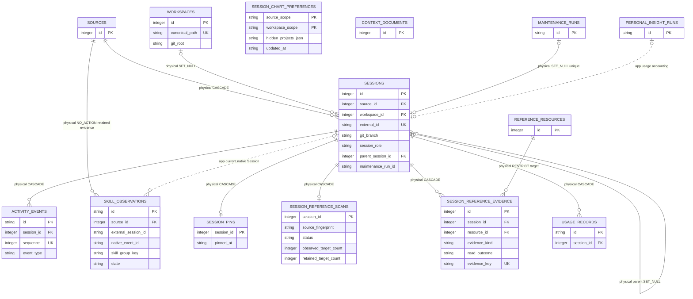

# Workspace And Session Activity

<!-- schema-objects: workspaces, sessions, activity_events, skill_observations, session_pins, session_chart_preferences, session_reference_scans, session_reference_evidence -->

This subject owns current workspace identity, source-backed Session identity and hierarchy, historical working context, normalized activity events, Session classification, separate user-owned Session pin intent and scoped Chart visibility preferences, and source-neutral derived evidence that a primary work Session referenced a target. Usage observations are owned separately. Atlassian Source Memory continues to own reusable Item identity and its legacy Session/Document URL sightings; generalized Session reference evidence owns only the Session-facing observed identity, outcome, and source location.

[Value Dictionary](value-dictionaries/workspace-and-session-activity.md) owns this subject's bounded physical/logical/presentation mappings.

## Focused ERD

## Catalog

### `workspaces`

- Purpose and authority: current canonical project/workspace identity discovered from Session working directories; the containing Git repository root is current discovery, not historical branch state.
- Lifecycle: mixed source identity and curated references. Discovery can rebuild path metadata, but Workstream/Thread links and Usage Record snapshot browsing use its stable ID, so delete-and-recreate is not equivalent to update-in-place.
- Producers: `ingest/sync/storage.py` upserts path, display name, Git root, existence, and activity; `persistence/migrations/` removes the obsolete `git_branch` column during compatible migration.
- Consumers: inventory/detail queries, retrieval, Workstream resource pickers and links, Runner context, activity attribution, and Usage Record attribution/browse joins.
- Relations and deletion: physical optional parent of `sessions` and `context_documents`, both `SET NULL`. It is an application target for `project` polymorphic links and `usage_records.workspace_id_snapshot`; those are not cascaded by SQLite.
- Recovery: rescan Sessions to rediscover paths. Preserve or restore the database to retain stable link targets and historical current-row resolution.
- DDL ownership: fresh definition in `schema.sql`; compatible migration in `persistence/migrations/` drops legacy `git_branch`. No explicit named index.

| Column | Contract |
| --- | --- |
| `id` | `INTEGER PRIMARY KEY`; stable local project identity. |
| `canonical_path` | `TEXT NOT NULL UNIQUE`; normalized current workspace path. |
| `display_name` | `TEXT NOT NULL`; current user-facing project label. |
| `git_root` | nullable `TEXT`; current discovered repository root, not branch history. |
| `exists_now` | `INTEGER NOT NULL DEFAULT 0`; current filesystem existence signal. |
| `last_activity_at` | nullable `TEXT`; latest attributed Session activity. |
| `created_at` | `TEXT NOT NULL DEFAULT CURRENT_TIMESTAMP`; first registry creation. |
| `updated_at` | `TEXT NOT NULL DEFAULT CURRENT_TIMESTAMP`; latest registry update. |

Constraints: uniqueness of `canonical_path`. Explicit indexes: none.

### `sessions`

- Purpose and authority: one normalized Claude or Codex Session/subsession per
  stable local source and native external identity. Source key owns provenance and
  statistical separation, while the Source registry provider kind owns parser and
  normalization behavior. An in-app Task Runner Run is represented by the selected
  runner's persisted native primary Session, linked to the Run ledger rather than
  duplicated by LocalBrain.
- Lifecycle: native Sessions are source-derived from meaningful retained native JSONL
  accepted by the owning provider's Session-candidate contract. Meaningful means
  the parsed file contains at least one normalized Activity Event, direct Usage
  Record, or admitted skill observation; metadata-only stubs retain no Session or source-file projection and are
  reconsidered on later syncs. Conversation normalization retains authored inputs,
  filters recognized generated context per text block, and reconciles native
  counterparts using provider-specific precedence. Assistant response phases
  require explicit provider provenance; absent or ambiguous signals remain unmarked.
  Claude
  primary files and direct `subagents/*.jsonl` children are accepted, while deeper
  internal `subagents` artifacts such as workflow journals are not Sessions. Codex
  `source.subagent.other=guardian` files remain normalized so their stable source
  identity, parent relation, and directly observed Usage Records survive, but the
  parser classifies them as maintenance plus metadata-only: their approval prompts
  and decisions produce no Activity Events, question counts, search text, or
  ordinary Session/Subsession presentation. A successful scan reconciles a
  previously imported row that is no longer an
  accepted candidate without deleting the native file. Native tools can remove
  accepted JSONL files under their own retention policies; Claude Code is a
  confirmed example because it deletes Session files older than
  `cleanupPeriodDays` at startup. LocalBrain is therefore a source mirror rather
  than an immutable Session archive. Stable IDs are preserved while their
  accepted source files remain so curated links and Usage Records remain valid.
  The same native external ID may exist under multiple profiles of
  one provider because Session identity is unique within `source_id`, not provider kind. A
  Run-linked primary and its resolved child Sessions keep metadata while
  maintenance index/event policy is restricted; the private Runner stream is an
  operational artifact only.
  Ephemeral personal insight executions are a bounded exception: a retained CLI usage observation creates a metadata-only Maintenance Session accounting parent with identity `localbrain-insight:<Run ID>`. It contains no conversation, events, search entry, workspace, or native source-file registration. The independent Run is its application owner; native-source disappearance does not delete this accounting projection.
- Producers: `ingest/sync/session_store.py` plus Claude/Codex parsers create Sessions and Usage Records; parent reconciliation updates self-references and propagates maintenance policy to Claude or Codex children. `maintenance/service.py` synchronizes the selected native source after terminal and recovered Runs. `source_files` versions Session projection freshness independently, allowing classification/parser changes to rebuild Sessions, Activity Events and search. A Session parser-version change rebuilds available projections on the next explicit Sync. Neither operation replaces Usage solely because the Session contract changed. `persistence/migrations/` owns the classification/Run-link constraint repair. `insights/usage.py` separately creates insight accounting parents and canonical Usage Records from observed ephemeral CLI usage.
- Consumers: Session inventory/detail, dashboard counts, normalized activity, retrieval, Workstream linking/suggestions, Runner context, search projection, Usage Records, and Usage Dashboard denominators. Sessions inventory headline, rows, pagination, and Project grouping share the same `work` plus `primary` denominator with no age cutoff. A selected source matches the stable `sources.id`, not `provider_kind`, so source profiles remain statistically separate even when sharing one adapter.
- Relations and deletion: physical `source_id` cascades; optional `workspace_id`, `parent_session_id`, and unique `maintenance_run_id` set null. After a successful scan of a present source root, stale-file reconciliation deletes a normalized Session when neither its owning native JSONL nor another tracked path remains valid; a valid tracked sibling instead becomes its owner. Parsed-empty reconciliation is a separate branch: for full-index Sessions, stale conversation/search can be cleared and the Session considered for retirement only when its current owner path belongs to the parsed-empty set AND every tracked sibling path also belongs to that set. A meaningful shared owner, including a source containing only admitted skill observations, prevents that parsed-empty cleanup; retained historical Usage keeps the Session meaningful even after its stale conversation is cleared. Deleting that Session cascades `activity_events`, `usage_records`, derived `session_reference_scans` and `session_reference_evidence`, and the optional user-owned `session_pins` row; scanner also removes its search and source-file projection while preserving a present native stub. A wholly missing source root does not trigger the same stale-file reconciliation. `skill_observations` has no cascading FK and keeps admitted historical uses. Polymorphic links and checkpoint refs are application edges and can retain an unresolved historical ID.
- Recovery: rescan the authoritative native source file and reconcile parents. Restoring only a Task Runner stream cannot rebuild a Session or Usage Record; restore the selected runner's native Claude or Codex JSONL and the Run ledger together. The insight accounting exception is recoverable from the independent Run ledger plus retained usage summaries or CLI usage events. A full database rebuild cannot restore user-curated links, exact operational history, or confirmed review state without backup.
- DDL ownership: fresh definition and `idx_sessions_last_event`, `idx_sessions_workspace` in `schema.sql`; compatible columns, backup-backed classification/Run-link table repair, and runtime-only `idx_sessions_class`, `idx_sessions_role`, `idx_sessions_parent` in `persistence/migrations/`. Before that structural repair, startup preserves `localbrain.db-pre-maintenance-session-contract-v1.bak` and validates it with SQLite `quick_check`. An older additive layout may have the same approved columns in a different physical order; migration validates every name/type/null/default/key contract, copies values by canonical column name, and converges only the physical order.

| Column | Contract |
| --- | --- |
| `id` | `INTEGER PRIMARY KEY`; stable normalized Session identity. |
| `source_id` | `INTEGER NOT NULL` FK to `sources.id`, `ON DELETE CASCADE`. |
| `workspace_id` | nullable `INTEGER` FK to `workspaces.id`, `ON DELETE SET NULL`. |
| `external_id` | `TEXT NOT NULL`; source-scoped Session or subsession identity. |
| `source_path` | `TEXT NOT NULL`; authoritative native Claude/Codex JSONL path, or the private stream path for an insight accounting parent. |
| `cwd_raw` | nullable `TEXT`; historical working directory exactly as normalized from source evidence. |
| `git_branch` | nullable `TEXT`; branch observed in authoritative Session metadata. |
| `title` | `TEXT NOT NULL`; normalized display title. |
| `started_at` | nullable `TEXT`; first known Session time. |
| `ended_at` | nullable `TEXT`; declared or last known end time. |
| `last_event_at` | nullable `TEXT`; latest normalized event time. |
| `event_count` | `INTEGER NOT NULL DEFAULT 0`; normalized source event count. |
| `user_message_count` | `INTEGER NOT NULL DEFAULT 0`; normalized user-message count. |
| `assistant_message_count` | `INTEGER NOT NULL DEFAULT 0`; normalized assistant-message count. |
| `session_class` | `TEXT NOT NULL DEFAULT 'work'`; checked to `work` or `maintenance` for rows in `sessions`. `maintenance` identifies retained non-work source Sessions, including linked maintenance Runs and recognized provider-internal helpers. An analysis-only `personal_insight_runs` row has no Session class; its optional usage-accounting parent is `maintenance` with `metadata_only` indexing and is excluded from ordinary Sessions. |
| `session_role` | `TEXT NOT NULL DEFAULT 'primary'`; checked to `primary` or `subsession`. |
| `parent_external_id` | nullable `TEXT`; source-backed parent identity retained even when unresolved. |
| `parent_session_id` | nullable self-FK, `ON DELETE SET NULL`; resolved same-source parent. |
| `index_policy` | `TEXT NOT NULL DEFAULT 'full'`; checked to `full` or `metadata_only`. |
| `maintenance_run_id` | nullable unique `TEXT` FK to `maintenance_runs.id`, `ON DELETE SET NULL`; present only for a primary metadata-only Maintenance Session. |
| `imported_at` | `TEXT NOT NULL DEFAULT CURRENT_TIMESTAMP`; latest normalized import write time. |

Constraints: `UNIQUE(source_id, external_id)`, unique nullable `maintenance_run_id`, checks for the two-value class, role, and index-policy vocabularies, and a linked-Session shape check requiring `maintenance`, `primary`, and `metadata_only`. Explicit indexes: `idx_sessions_last_event`, `idx_sessions_workspace`, `idx_sessions_class`, `idx_sessions_role`, `idx_sessions_parent`.

The [conversation normalization contract](#conversation-normalization-and-empty-sources) details authored inputs, generated context, counterpart precedence and parsed-empty ownership. Explicit completion provenance belongs to [Activity Events](#assistant-response-phase-provenance).

#### Conversation Normalization And Empty Sources

Codex normalization retains user inputs in source order, including the initial prompt and asynchronous question replies sharing one turn, subject to the recognized generated-context shapes below.
A complete, validated `<send_user_message_question_reply>` array becomes readable question quotations followed by the authored answers, in batch order; `questionItemId` stays in the source JSONL.
Missing optional questions permit an answer-only reply.
Malformed or ambiguous JSON, empty answers, unsupported shapes, unknown fields, duplicate keys, embedded/fenced examples and assistant quotations remain literal rather than losing content.

Source-expanded AGENTS instructions (with or without a repository path), environment instructions, `<skill>` bodies, known recommended-plugin catalogs and recovery/abort controls stay excluded from titles, conversation, search and reference evidence while literal `$skill` requests remain visible.
Each native text block is classified separately: removing a generated block cannot discard neighboring authored input, and retaining authored input cannot expose generated siblings.
General XML, image references and meaningful source notifications are not stripped merely for containing tags.

A standalone `<external_codex_apps_open_page>` envelope is recognized as generated
empty-page context only when its complete JSON object is exactly
`{"page_id": null}` with no duplicate keys. It is excluded from normalized
conversation, title selection, question/event counts, search and message-derived
reference evidence in both Codex native message formats. JSON whitespace is
immaterial; adjacent authored content blocks remain in order. Non-null page IDs,
missing or extra fields, duplicate keys, malformed JSON, embedded/fenced/quoted
examples and assistant messages remain literal. Native JSONL and Usage Records
are preserved; a Session contract upgrade reparses unchanged registered sources
on the next Sync without repricing Usage. A control-only source follows the
existing meaningful-Session and parsed-empty ownership rules.

Record types, roles and provider metadata establish the structural parsing route;
the generated-context filters and question-reply decoder also inspect message
text. These are content-based recognition rules, not proof of who authored a
block. An intentionally authored standalone block exactly matching a recognized
generated shape, including the null-page envelope, can therefore be filtered.
Explanatory framing or fencing preserves the tested examples. The shared
[maintenance-header classifier](maintenance-execution.md#maintenance_runs) also
uses text, but changes Session classification and indexing rather than merely
removing a generated block. Counterpart reconciliation compares normalized text
with the provider's role/turn rules; URL, path and established skill-identifier
extraction derive evidence without themselves hiding conversation. A skill
reference alone does not establish execution.

Legacy `event_msg` user duplicates match normalized readable text within the same turn, with text fallback when either side lacks a turn ID; distinct known turns may repeat the same text.
JSON layout differences do not duplicate the same question reply, and different questions sharing an answer remain distinct.
Legacy assistant events retain precedence over response items for their turn.

A parsed-empty source clears stale conversation and search only when the current Session owner path belongs to the parsed-empty set and no tracked sibling path lies outside that set; meaningful shared owners and retained Usage Records are preserved.
For parsed-empty reconciliation, these ownership checks apply before retiring the Session as well as before clearing its stale conversation. A tracked meaningful source containing only admitted skill observations is still an owner and cannot be deleted because an empty sibling shares its native ID. For full-index Sessions, parsed-empty cleanup proceeds only when the current owner path is in the parsed-empty set AND every tracked sibling path is also in that set; retained historical Usage continues to keep the Session meaningful.

### `activity_events`

- Purpose and authority: normalized, ordered Session events used for conversation presentation, activity calculation, retrieval evidence, and tool/message counts without exposing raw event payload files.
- Lifecycle: source-derived and rebuildable. Scanner replaces the Session's event set atomically during re-import. Existing event PKs are retained by matching `(session_id, sequence, event_type, source_line)`. New event IDs include the numeric source PK, so identical native events in different profiles coexist without an alias.
- Producers: `ingest/sync/session_store.py` from normalized parser events; provider-backed phase normalization retains only explicit, unambiguous completion or continuation evidence.
- Consumers: `sessions/queries.py` Session detail and counts, `sessions/activity.py` active-time attribution, `workstreams/retrieval.py` evidence loading, and `insights/evidence.py` bounded read-only message sampling for later personal insight Runs. Primary Session `관련 자료` consumes the separate normalized reference-evidence projection rather than reparsing Activity Event text at request time; workspace membership alone is not a related-material relation. The projection adds no Session column or relationship row.
- Relations and deletion: `session_id` cascades from `sessions`; replacement deletes prior rows before inserting the new normalized sequence.
- Recovery: rescan the Session source. Opaque tool arguments/results are not indexed by default; a later concrete metadata requirement must introduce an explicit bounded contract rather than relying on an unused generic JSON slot.
- DDL ownership: fresh definition in `schema.sql`; event ordering uses the leading `session_id, sequence` keys of the table's UNIQUE autoindex. Compatible migration removes the former redundant named index only after verifying that coverage and removes the legacy metadata column only when every value is `NULL`. An additive nullable `message_phase` column preserves existing rows; the next explicit Claude or Codex Sync backfills available source phases through the versioned Session contract without repricing unchanged source files.

| Column | Contract |
| --- | --- |
| `id` | `TEXT PRIMARY KEY`; deterministic normalized event identity, scoped by numeric Source ID for newly observed records; re-ingestion preserves retained PKs through native unique-key matching. |
| `session_id` | `INTEGER NOT NULL` FK to `sessions.id`, `ON DELETE CASCADE`. |
| `sequence` | `INTEGER NOT NULL`; normalized order within the Session. |
| `occurred_at` | nullable `TEXT`; observed event time. |
| `event_type` | `TEXT NOT NULL`; normalized message/tool event category. |
| `role` | nullable `TEXT`; conversational role when applicable. |
| `text` | nullable `TEXT`; normalized human/assistant content eligible under ingestion policy. |
| `tool_name` | nullable `TEXT`; tool identity without opaque arguments/results by default. |
| `source_line` | `INTEGER NOT NULL`; source evidence location. |
| `message_phase` | nullable `TEXT`, checked to `commentary` or `final_answer`; assistant-message phase normalized from explicit source evidence: Codex phase metadata or Claude `end_turn`/`tool_use` signals. Claude split records share signals only within the same native API message ID; missing IDs remain record-local and conflicting, malformed or error signals stay unmarked. `NULL` means unavailable or inapplicable; a final phase ends a response and does not establish task success. |

Constraints: `UNIQUE(session_id, sequence, event_type, source_line)` and the nullable two-value `message_phase` check. Explicit indexes: none; SQLite owns the composite uniqueness autoindex used for Session event ordering.

The [phase provenance contract](#assistant-response-phase-provenance) details provider signals, counterpart precedence and uncertainty handling.

#### Assistant Response Phase Provenance

Codex retains explicit assistant `commentary`/`final_answer` phases in Activity Events; one uniquely matched legacy/response counterpart may supply a missing phase. Ambiguous or conflicting counterpart hints leave a missing phase as `NULL`; an explicit phase on the retained native event stays authoritative. User messages, tool events, unknown source values and sources without a phase retain `NULL`; text and position never imply completion.

Claude normalizes native `end_turn` to `final_answer` and `tool_use` to `commentary` for both primary Sessions and Subsessions.
Split text, thinking and tool records share terminal signals only within the same native API message ID; records without a usable ID remain independent.
Tool blocks prevent a contradictory completion signal from becoming final, and missing, unknown, malformed, conflicting or error signals stay unmarked.
Message position, wording, the next user input and file end do not establish completion.

#### Personal Insight Evidence Manifest

The personal insight evidence manifest is a private derived value, not a new database subject or retained observation ledger. [Personal Insight Evidence](../personal-insights.md#personal-insight-evidence) owns current selection, eligibility, message positions, compatibility and reference review. The value neither retains disappeared Session content nor claims current verification from a historical skill count. A Run may freeze the value in its own private artifact owner; the producer itself persists nothing.

### `skill_observations`

- Purpose and authority: durable native calls/contexts, successful instruction reads, named conversation references and identifiable skill script executions. Names are established by source evidence within the Session; availability catalogs alone do not count. References are matched by identifiers without interpreting use wording or language. All observed evidence contributes to use/reference Session reach, not proof of application, success or benefit. Previously recorded declarations are retained as historical references; no new phrase-based declarations are extracted.
- Lifecycle: retained historical observation. Parser-version upgrades backfill available files once; subsequent changed/resumed files insert only new events. Native events deduplicate by source, Session and event identity; read/mention/script events also include normalized skill identity. Earlier declaration identities guard equivalent mention replay, including corrections. Request identity remains provenance, with null scope allowed. Missing files or Session rows, and removal of source registration, do not retract evidence. Maintenance Sessions and reconciled children are invalidated, and targeted corrections remain supported. Insights counts each normalized skill at most once per source and native Session across all requests/signals. Constituent events remain in the ledger.
- Producers: Claude/Codex parsers, `ingest/evidence/skill_loads.py` and `ingest/evidence/skill_usage.py` extract bounded signals; `ingest/sync/sessions.py` and `sessions/skills.py` persist them within the source scan transaction and reconcile maintenance exclusion. Native Codex turn IDs, Claude user UUIDs or retained user-message identity establish request scope. A targeted native-event correction can set erroneous evidence to `corrected` without making ordinary disappearance a deletion signal.
- Consumers: `insights/skills.py` all-time use/reference Session ranking, latest admitted reference time and extraction coverage for Insights. Compatible `use_count` and `last_used_at` fields mean Session count and latest reference time. No files means `not_scanned`; stale parser contracts mean `partial`. Historical observations without current files remain distinguishable. Usage & Cost does not query this table.
- Relations and deletion: `source_id` is a non-null FK to `sources.id` with `NO ACTION`; a source with retained skill evidence cannot be deleted. (`source_id`, `external_session_id`) may resolve to a current `sessions` row. Session deletion and registration removal do not cascade into this ledger. Evidence links appear only after a successful current-row join.
- Recovery: restore the database to retain observations whose native Session files have disappeared. Still-available files can be rescanned, but cannot reproduce lost historical events.
- DDL ownership: fresh additive table and `idx_skill_observations_group`, `idx_skill_observations_source_session` in `schema.sql`; compatible startup creates the absent table without rewriting existing Session rows.

| Column | Contract |
| --- | --- |
| `id` | `TEXT PRIMARY KEY`; deterministic source/Session/event evidence identity; read/declaration/mention/script IDs also include normalized skill name. Existing opaque IDs are retained. |
| `source_id` | `INTEGER NOT NULL REFERENCES sources(id)`; the existing numeric source PK, independently identifying profiles of the same provider. |
| `provider_kind` | `TEXT NOT NULL`; checked to `claude` or `codex`, identifying the source parser family. |
| `external_session_id` | `TEXT NOT NULL`; native Session identity for optional current-row lookup. |
| `native_event_id` | native provider identity for calls/contexts/reads; `mention:` prefixes a native message ID or deterministic normalized message fallback; `script:` prefixes a native execution ID. Historical `declaration:` identities remain retained. |
| `skill_name` | `TEXT NOT NULL`; source-visible name, trimmed and limited to 160 characters. |
| `skill_group_key` | `TEXT NOT NULL`; non-empty trimmed, case-folded name for cross-source display grouping. |
| `skill_locator` | nullable bounded skill instruction path established by a native wrapper or literal completed read. |
| `signal_kind` | native `claude_skill_tool`/`codex_skill_context`; provider-prefixed `skill_read`, `skill_mention`, `skill_script`; historical `skill_declaration`. Every observed kind can establish Session reach. |
| `source_line` | positive `INTEGER NOT NULL`; source file line where the admitted event was observed. |
| `occurred_at` | nullable `TEXT`; native event timestamp when available. |
| `request_key` | nullable bounded opaque request provenance; unknown scope remains null. Session counting does not depend on this field. |
| `state` | `observed` or `corrected`, default `observed`; only observed evidence enters Insights. |
| `recorded_at` | `TEXT NOT NULL DEFAULT CURRENT_TIMESTAMP`; first local persistence time. |

Constraints: `UNIQUE(source_id, external_session_id, native_event_id, skill_group_key)` plus application evidence guards, bounded fields and checked provider/signal/state values. Indexes: `idx_skill_observations_group` and `idx_skill_observations_source_session`. Startup extends the signal CHECK and optional legacy request field transactionally with exact retained-row parity.

### `session_pins`

- Purpose and authority: current owner-selected recall state for an eligible persisted primary work Session. Row presence means pinned; absence means unpinned. The table has no status, active, or soft-delete value.
- Lifecycle: user-curated and non-rebuildable. Pinning inserts one row, repeated pin is idempotent and preserves `pinned_at`, unpinning deletes only that row, and pinning again creates a new timestamp.
- Producers: trusted local pin/unpin operations in `sessions/pins.py`. Session scanners and source adapters never write this table.
- Consumers: pinned Session membership, bounded internal queries, and the uncapped product recall projection in `sessions/pins.py`; Sessions inventory/detail controls and the global `Pinned Sessions` panel are downstream consumers.
- Relations and deletion: `session_id` is both primary key and FK to `sessions.id`, `ON DELETE CASCADE`. Explicit Session or source deletion removes the pin because no reopenable Session remains. Ordinary Session upserts preserve the stable Session row and its pin.
- Recovery: restore the LocalBrain database backup. Native Claude or Codex Session files can rebuild the Session but cannot reconstruct owner pin intent or its pin time.
- DDL ownership: complete fresh definition in `schema.sql`; normal startup creates the absent table on a compatible older database through the same idempotent schema application. No explicit named index.

| Column | Contract |
| --- | --- |
| `session_id` | `INTEGER PRIMARY KEY` and FK to `sessions.id`, `ON DELETE CASCADE`; the one row is the complete pin state. |
| `pinned_at` | `TEXT NOT NULL`; first time of the current pin interval, preserved by repeated pin and replaced only after unpin plus re-pin. |

Constraints: one row per Session, required pin time, and cascading physical ownership. Application eligibility admits only persisted `work` plus `primary` Sessions. Explicit indexes: none; the primary-key index owns membership and join lookup.

### `session_chart_preferences`

- Purpose and authority: current user-selected Project visibility for the Sessions Chart, independent of browser storage. It stores display intent and never changes Session observations, membership, pins or work classification.
- Lifecycle: user-curated and non-rebuildable. One row per source/workspace scope contains the complete hidden-folder list; an empty list means all-selected. An absent row permits one-time browser migration through create-if-absent. Normal user changes replace this scope's current choice.
- Producers: trusted local Project visibility writes in `sessions/chart_preferences.py`, exposed by the bounded same-origin Sessions preference endpoint. Scanners and source adapters never write this table.
- Consumers: Sessions Chart GET and Project checkbox controls; browser camera and selection remain separate tab navigation state.
- Relations and deletion: composite scope identity has no physical or application FK. Empty workspace scope means all workspaces. Source/workspace removal does not delete the preference, and temporarily absent hidden folder identities remain retained. Removing this row resets that scope's visibility to default all; it never deletes imported or organized work.
- Recovery: restore the LocalBrain database backup or reselect Projects. Native Session files cannot reconstruct user display intent; browser site-data removal has no effect on a confirmed DB setting.
- DDL ownership: fresh definition in `schema.sql`; ordinary idempotent startup creates the missing table on an older compatible database without changing existing objects. No explicit named index.

| Column | Contract |
| --- | --- |
| `source_scope` | `TEXT NOT NULL`; numeric source PK serialized as text, with `all` as the unfiltered scope. First composite primary-key column. |
| `workspace_scope` | `TEXT NOT NULL DEFAULT ''`; empty string for all workspaces, otherwise the validated workspace ID serialized as text. Second composite primary-key column; not a cascading reference. |
| `hidden_projects_json` | `TEXT NOT NULL`; JSON array of deduplicated, sorted recorded folder keys, including the empty missing-folder key. Application validates array/string shape and size; only currently known keys affect rendering. |
| `updated_at` | `TEXT NOT NULL`; UTC time of the latest committed preference write, unchanged when migration encounters an existing row. |

Constraints: composite primary key on `(source_scope, workspace_scope)`; both scope columns are non-null. JSON shape and byte limits are application-owned. Explicit indexes: none.

### `session_reference_scans`

- Purpose and authority: the aggregate local extraction state for one eligible primary work Session across its current contributing source files. It owns source fingerprint/version compatibility, the latest completed or failed reconciliation state, and the observed-versus-retained target bound; it does not own Session content or source health for unrelated ingestion work.
- Lifecycle: fully derived and rebuildable. A successful `ok` or `partial` reconciliation replaces current evidence and advances the row; an `error` records only bounded diagnostics while prior valid evidence may remain stale. Maintenance Sessions and Subsessions are ineligible producer inputs.
- Producers: the Session reference reconciler after provider parsing and source-level Session reconciliation complete.
- Consumers: Session reference skip/retry diagnostics and the bounded primary Session detail projection. A detail request never reads JSONL to reinterpret this state.
- Relations and deletion: `session_id` is both primary key and FK to `sessions.id`, `ON DELETE CASCADE`. Removing the Session removes only its derived scan state and cannot delete a Document, Resource, remote Item fact, or organization link.
- Recovery: synchronize the still-available registered Session source. If the source is unavailable, retain prior valid evidence plus error state until a later successful reconciliation.
- DDL ownership: complete fresh definition in `schema.sql`; ordinary idempotent schema application creates an absent table. The shared-resource data migration in `persistence/migrations/resources.py` recomputes retained target counts after identity merging and observed counts for completed `ok` scans. For other prior states, observed count becomes `MAX(previous observed count, new retained count)`. Only prior `partial` scans become `error` with `resource-identity-migration` and require recollection because the full omitted set cannot be reconstructed. No separate named index is required.

| Column | Contract |
| --- | --- |
| `session_id` | `INTEGER PRIMARY KEY` and FK to `sessions.id`, `ON DELETE CASCADE`; one aggregate reference state per Session. |
| `source_fingerprint` | `TEXT NOT NULL`; exactly 64 characters identifying the ordered current contributing source set. |
| `extractor_version` | `TEXT NOT NULL`; non-empty version no longer than 80 characters. |
| `status` | `TEXT NOT NULL`; checked to `ok`, `partial`, or `error`. |
| `observed_target_count` | non-negative `INTEGER NOT NULL DEFAULT 0`; total unique targets observed before the safety bound. |
| `retained_target_count` | `INTEGER NOT NULL DEFAULT 0`; non-negative retained unique targets, never above observed count or 100. |
| `error_code` | nullable `TEXT`; required non-empty value no longer than 80 characters only for `error`. |
| `error_message` | nullable `TEXT`; application-generated diagnostic no longer than 500 characters and allowed only for `error`. |
| `scanned_at` | `TEXT NOT NULL`; latest reconciliation attempt time. |
| `updated_at` | `TEXT NOT NULL DEFAULT CURRENT_TIMESTAMP`; latest row write. |

Constraints: 64-character source fingerprint; bounded extractor and error values; non-negative counts; retained count no greater than observed count or 100; `ok` requires equal counts, `partial` requires 100 retained and more observed, and `error` requires a code while completed states prohibit diagnostics. Explicit indexes: none; the Session primary key owns lookup and uniqueness.

### `session_reference_evidence`

- Purpose and authority: one privacy-minimized normalized evidence location showing that an eligible primary work Session visibly mentioned, observed through an approved result, or completed an approved read attempt for one target. The row owns Session-facing observed identity and read outcome, not Activity Event text, Resource title, Document content, remote truth, or organization membership.
- Lifecycle: source-derived evidence retained for its owning Session, including
  references whose Document or optional Item is no longer present. Successful reconciliation
  replaces each contributing source path's current deterministic evidence-key set,
  then finalizes one aggregate Session bound and removes obsolete rows. Failed
  parsing or reconciliation retains the last valid set through
  `session_reference_scans.error`. Replays, compaction, and rescans reuse
  deterministic keys and cannot add duplicate locations. A partial/error
  multi-file Session reparses current siblings before finalization so evidence
  previously outside the 100-target bound can re-enter when stronger targets
  disappear.
- Producers: Claude/Codex `ParsedReferenceCandidate` adapters and `sessions/references.py` during Session synchronization. `references/` owns pure URL classification; `resources/catalog.py` owns shared identity. No Atlassian configuration or table is consulted. Bare Jira/page-ID hints require exactly one already-known shared URL; ambiguity is not guessed.
- Consumers: the bounded Session-reference read projection and primary Session `관련 자료` rail. The rail maps evidence to `MCP 조회`, `MCP 조회 실패`, `사용자 메시지에서 언급`, `Agent 응답에서 언급`, or `도구 결과에서 확인`, uses `observed_identity` before shared Resource titles, orders retained direct targets by their oldest `observed_at` with deterministic source-location fallback, and does not query organization memberships or merge their indirect targets into Session detail. Read counts use distinct completed resource-read call IDs; mention and observation counts use distinct normalized source locations.
- Relations and deletion: required Session FK cascades when its owner Session is removed; required `resource_id` FK points only to `reference_resources` and restricts resource deletion. Removing an Atlassian Item, bookmark or indexed Document preserves evidence and its shared identity. Missing/disabled/unreadable Documents have inactive destinations; same-path reindexing reconnects through `resource_documents`. Reconciliation never deletes source bodies, user notes or organization.
- Recovery: backup preserves historical observations. Current Session sources can be recollected; New Markdown admission requires an exact eligible indexed Document. Recollection of the same native location can retain its previously admitted path when the index is unavailable; it cannot guess a new unindexed target. Safe URL admission needs no registration. The shared-resource migration preserves existing evidence IDs, keys, locations and timestamps, then changes only target bindings/grouping keys. Extractor v4 schedules normal recollection.
- URL grouping always uses the shared key, regardless of registration. Recognized Jira/Confluence item, structure and site URLs hash domain/service/kind/identity; locator variants and container hints cannot split identity. `normalized_url` preserves only the allowlisted safe locator for deterministic reparse. RapidBoard may keep positive `rapidView` and a validated `projectKey`; raw query, JQL and unrelated parameters are discarded. Different domains are never automatically merged or followed through redirects.
- DDL ownership: `schema.sql` defines `idx_session_reference_evidence_session` and `idx_session_reference_evidence_resource`; `persistence/migrations/resources.py` rebuilds legacy evidence atomically after a verified recovery copy.

| Column | Contract |
| --- | --- |
| `id` | `INTEGER PRIMARY KEY`; local row identity while one deterministic evidence key remains. |
| `session_id` | `INTEGER NOT NULL` FK to `sessions.id`, `ON DELETE CASCADE`. |
| `source_path` | non-empty `TEXT NOT NULL` up to 8,000 characters; authoritative contributing Session file identity. |
| `source_event_id` | nullable non-empty `TEXT` up to 1,000 characters; provider event identity when available. |
| `source_line` | positive `INTEGER NOT NULL`; source JSONL location. |
| `evidence_ordinal` | positive `INTEGER NOT NULL`; normalized occurrence within the source location. |
| `resource_id` | `INTEGER NOT NULL` FK to `reference_resources.id`, `ON DELETE RESTRICT`; stable shared target. |
| `target_key` | non-empty `TEXT NOT NULL` up to 300 characters; shared resource identity key copied for deterministic grouping, never display copy. Generic URL grouping hashes the whole safe URL; a recognized Atlassian Item/structure/Site URL hashes its canonical semantic descriptor so locator aliases and container hints cannot split identity. |
| `evidence_kind` | `TEXT NOT NULL`; checked to `user_mention`, `assistant_mention`, `tool_result`, or `resource_read`. |
| `read_outcome` | nullable `TEXT`; `success` or `failure` and required only for `resource_read`. |
| `observed_identity` | non-empty `TEXT NOT NULL` up to 500 characters; bounded Session-facing issue key, file identity, or safe host/path identity. |
| `normalized_url` | nullable non-empty `TEXT` up to 8,000 characters; written for URL targets and omitted for indexed Document targets by the producer. It contains only approved normalized safe destination data. Generic URLs contain no query; a recognized Atlassian descriptor may retain only its canonical bounded identity-query projection and optional approved grouping hint. |
| `tool_name` | nullable non-empty `TEXT` up to 200 characters; required only for approved tool-result and resource-read evidence. |
| `tool_call_id` | nullable non-empty `TEXT` up to 500 characters; required only for approved tool-result and completed resource-read correlation. |
| `observed_at` | nullable `TEXT`; source event/result time when available. |
| `extractor_version` | non-empty `TEXT NOT NULL` up to 80 characters; producer contract version. |
| `evidence_key` | unique 64-character `TEXT NOT NULL` fingerprint of Session source path and native location, target, evidence kind/outcome, and extractor contract. |
| `first_observed_at` | `TEXT NOT NULL`; first local reconciliation of this evidence key. |
| `last_observed_at` | `TEXT NOT NULL`; latest successful reconciliation retaining the key. |
| `updated_at` | `TEXT NOT NULL DEFAULT CURRENT_TIMESTAMP`; latest row write. |

Constraints: required shared-resource FK; producer-owned identity-key/locator consistency; exact evidence-kind/read-outcome/tool identity parity; positive locations; bounded paths, identities, URLs, tool fields, and extractor version; unique 64-character evidence key. The producer retains at most 100 target keys per Session and at most 50 deterministic evidence locations per retained target. Explicit indexes: `idx_session_reference_evidence_session` for target grouping and stable evidence order, `idx_session_reference_evidence_resource` for target lookup and reverse diagnostics.

## Derived Workflow Episode And Relations

- This subject adds no table, index, migration, or value-registry family. The
  versioned `workflow/projection.py` descriptors are in-memory, fully
  rebuildable views over approved normalized facts.
- One Episode is eligible only when its source row is a primary work Session.
  Its opaque stable key hashes the length-delimited `sources.id` and
  `sessions.external_id`; `sessions.id` remains the current local navigation
  identity and is excluded from the rebuild-stable key. The descriptor never
  serializes the source-native ID or a source path.
- Earliest and latest observation bounds may use valid `started_at`, first and
  last Activity Event time, and `ended_at`. These bounds do not own activity,
  lifecycle, closure, or authority state, and `ended_at` does not imply closure.
- Directional relations are normalized outside persistence. They retain only
  `continues`, `branches-from`, or `merged-into` with bounded reason identities,
  strict forward time, at least one strong reason, and no directed cycle.
  Invalid candidates become bounded omission diagnostics rather than rows.
- Recovery is recomputation from retained normalized Session identity and
  approved evidence. Restoring or re-synchronizing source data may reproduce
  the Episode identity, while a changed local Session row ID may change only its
  navigation destination. There is no persisted inferred graph to restore or
  purge.
- The current Focus read model adds no physical relationship. It admits a
  persisted Session only when `session_class=work`, `session_role=primary`,
  `index_policy=full`, and existing Event/Usage evidence keeps it meaningful.
  Candidate discovery reads `workspace_id`, current `workspaces.git_root`,
  Session-owned `git_branch`, privacy-minimized reference target keys, and
  exact user organization membership; it does not read Activity Event text.
- Direct-child rows contribute only a bounded `session` evidence family with
  their current local destination and numeric source ID. They retain their existing
  subordinate ownership and never become Episode peers. The Focus projection
  has no lifecycle row, foreign key, cascade, migration, restore action, or
  purge action of its own.

## Derived Workstream Candidate Contract

- `workflow/candidates.py` adds only immutable derived descriptors. There is
  no candidate table, index, migration, schema/value-registry entry, cache, or
  database-backed discovery read in this contract.
- One seed has two canonical artifact identities and at least two distinct
  primary-work/full-index Session identities with direct supporting references
  to both. Local row IDs serve navigation, not rebuild-stable identity. The
  source owner must resolve Document/Item/Resource aliases before supplying a
  fact; the existing row-ID-based reference target keys are not reused as stable
  candidate identities.
- Membership is many-to-many and retains candidate-specific evidence. Global
  Episode directions, Workstream/Thread links, and workflow assertions are
  separate owners. Supporting reference timestamps own candidate observation
  bounds; Session ending, import time, and inactivity cannot close a candidate.
- Recovery is normalization of retained canonical facts. Restored identities
  reproduce the seed key; evidence changes update membership revision while
  labels, local navigation IDs, and source freshness remain separate. Missing
  anchors cause abstention and do not authorize deletion or reassignment of any
  future user review state.
- Privacy, serialized evidence samples, and partial coverage follow the
  [candidate architecture contract](../workstream-candidates.md#workstream-candidate-contract).

## Subject Recovery Boundary

Session source files can recreate Workspaces, Sessions, Activity Events, Session reference scan state, Session reference evidence, and skill observations only while those files remain available; current project resolution, exact target availability, and self-referential parent IDs may differ if local paths or source sets change. They cannot recreate Session pins or skill observations from vanished files. Preserve `cwd_raw`, `parent_external_id`, and Session branch evidence. Restore the database, not only source files, when pin intent, retained skill counts, curated polymorphic links, or exact stable IDs matter.
