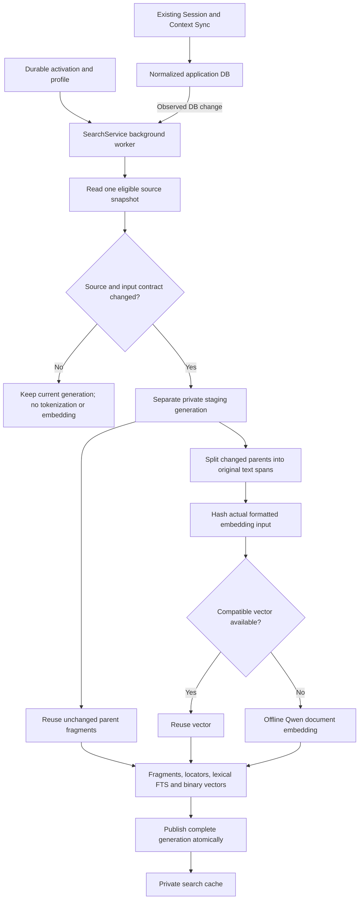
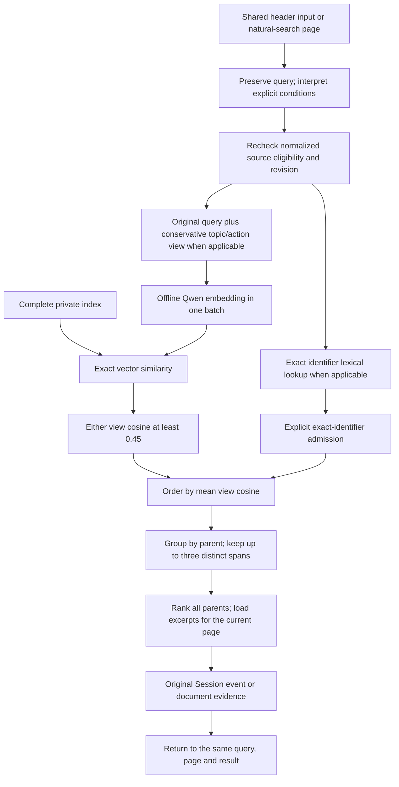

# Local Natural Language Search

## Purpose And Scope

LocalBrain retrieves original material from eligible primary work Sessions and
readable, registered Local Context documents. This contract defines source
eligibility, indexed text fragments, model roles, query interpretation, ranking,
preparation, recovery and evidence navigation. Code and schema remain
implementation truth; ordinary setup and readiness guidance belongs to the
[Search guide](../../../src/localbrain/content/docs/search.md).

The shared-header search entry has explicit keyword and AI modes. Keyword mode is
the model-free default. AI mode uses a prepared local embedding model. The
original keyword-search route `/search` is deprecated and retained for existing
URLs; its FTS data and legacy query behavior remain available for compatibility.

No private corpus, query, vector, evaluation, model adapter or machine inventory is publishable. Public examples and fixtures are synthetic. No remote inference, implicit downloads, personal fine-tuning, source editing or Workstream reorganization.

## Searchable Material And Indexed Fragments

Search reads normalized imported text while preserving the source's authority.
The exact eligibility and exclusion rules below determine which material can be
indexed; a display page or candidate limit does not narrow that source population.

An indexed text fragment, called a **molecule** in the implementation, keeps an
original span and its bounded source context. Its locators and content/input
identities lead back to the current Session message or document. It is not a
generated summary or a new authoritative document.

- Corpus: normalized `sessions` where `session_class='work' AND session_role='primary' AND index_policy='full'`; message text requires `event_type='message' AND role IN ('user','assistant')`. Tool names may be metadata, never opaque payloads. Context requires a joined enabled, readable root and nonempty extracted body. Maintenance records, child sessions, model/index/evaluation runtime directories and unregistered material are excluded. Talking about analysis does not itself exclude a normal Session.
- Every eligible body character range is represented; no first-N sampling, parent mean vector, silent tail truncation or title-only substitute. Empty Session/document bodies, policy-excluded Sessions, private runtime documents and unreadable Context roots are counted separately and available in the search coverage disclosure. A source is still a source when its fragment count is large.
- Each molecule has a stable parent kind/ID, ordinal, original event ID/role or document character and line range, parent content hash, body hash, actual embedding-input hash, preceding/following connection and processing profile. These addresses resolve current normalized text; they never establish a new authoritative document.
- Current default profile: target 512 Qwen tokens of body, maximum 768; title/heading/necessary preceding request context at most 128; complete formatted input at most 1024 including special tokens. Prefer paragraph, sentence and utterance boundaries. Default overlap zero; explicit comparisons may use up to 64 within the same budgets. Compare target 256/512/768. The selected vectors have 512 dimensions and float32 elements; token counts and vector dimensions are separate quantities.
- Long units split without loss, keeping original character offsets and neighbor relationships. Related short messages may be grouped; unrelated topics must not be joined to fill a budget. Context excerpts must retain provenance. If only a bounded portion fits, record that limitation and preserve the full-context pointer; do not imply the model read the complete context or resolve ambiguous references as fact.
- Qwen uses each actual assembled molecule independently. Both query and document outputs are normalized. Each query view receives the same fixed English task instruction: the full original query is always retained, and an optional focused view follows the query contract below. Documents have no query instruction. Embedding is inference, not weight training.
- Neighbor links are derived from parent ID and ordinal; the current splitter keeps messages separate and uses a bounded preceding user request for assistant context. It does not generate summaries or classify a new document hierarchy.
- Model revision/asset fingerprint, tokenizer/runtime/device/dtype, dimensions and splitting/input versions identify compatibility. One index never mixes incompatible vectors. The background splitter has its own tokenizer state, so a foreground encoding cannot change its padding/truncation settings. Identical inputs may reuse vector payloads while their source occurrences and permissions stay distinct.

## Model Roles And Context

| Model | Role | Installed default search |
| --- | --- | --- |
| Qwen3-Embedding-0.6B | Encode eligible document fragments and search queries into comparable vectors | Required only for AI mode; the same pinned checkpoint serves both inputs |
| Laya multilingual | Judge supplied query/candidate relevance in explicit local comparisons | Not loaded |
| Qwen3-Reranker-0.6B | Score supplied query/candidate pairs and reorder candidates in explicit local comparisons | Not loaded |
| Qwen3-4B / Qwen3-8B | Separate generation and work-context inference experiments | Not loaded |

Personal source text really enters the local embedding model: each input contains
an original span and its bounded source context. This is inference with pretrained
weights. It creates private vectors without training weights, fitting a personal
classifier, producing a LoRA adapter or storing the corpus inside the checkpoint.
At query time, only the query views are encoded; compatible document vectors are
reused. A pointer locates the original evidence; the model needs the actual text
to represent its meaning.

Molecularization supplies readable local context and exact provenance. The
pretrained model supplies contextual similarity, while rules interpret supported
filters and remove conservative request framing. As a synthetic illustration,
surrounding words can distinguish screen layout (`화면 배치`) from a nightly data
batch (`야간 데이터 배치`). The bare word `배치`, missing clues, or clues outside
the bounded input can still produce mixed results. This mechanism does not
establish complete intent understanding or reasoning over every Session together.

Each comparison model has its own pinned weights in the user-level public Hub
cache. Sharing that cache with the embedding checkpoint does not make them one
model. [Installation And Local Storage](installation-and-storage.md#optional-local-models)
owns these asset boundaries; the [Developer Guide](developer-guide.md#natural-language-search-comparisons)
owns reproduction, comparison-runtime isolation and private loader adaptations.
Keeping downloaded comparison weights does not enable those models in the app or establish that a past test
environment still exists.

## Query And Results

- A fresh query starts with all eligible parents. No current project, recent-N subset or old screen filter is inherited. Candidate and page limits are explicit retrieval/presentation limits, not corpus admission limits.
- Keep original query. An explicit request for Sessions or documents restricts kind. An unambiguous `오늘`, `어제`, `이번주`, `지난주`, `이번달`, `지난달` uses calendar boundaries in the configured local timezone. Session time is last recorded activity, with end/start fallback; document time is source modification time. Show the actual interval and field meaning. Conflicting/negated time or kind interpretations keep the broad range with a notice. Each condition is independent: ambiguous topic exclusion does not erase a clear kind/calendar filter. Quoted phrases and unsupported approximate/range expressions cannot silently become calendar restrictions.
- Quoted literal exclusion with an explicit exclusion operator can filter that literal. Unquoted topic exclusion whose meaning cannot be reliably grounded stays a visible unresolved condition; never replace topic negation with a single-word ban. Uncertain `만들던` does not imply a date/project/completion state.
- Comparison baselines: lexical-only, Qwen-only and hybrid. Korean lexical preparation uses normalized Unicode Hangul n-grams plus exact Latin identifiers, separately from original FTS. Parameterize FTS queries and escape query syntax.
- The default `hybrid` mode uses `semantic-dual-view-v3`. Keep the full original query and, when retrieval-request framing can be removed conservatively, add its topic/action text as a second view. Quoted or negative wording and interpretation notices keep a single original view. No synonym dictionary, private topic rules or generated expansion. Both views use the same existing English instruction and one foreground encoding batch. UI input, condition interpretation and return links always use the original query. `dense` remains an original-query cosine baseline; lexical-only remains BM25.
- Admit a fragment when either view's cosine reaches the shared internal cutoff 0.45; rank by the equal mean of the available view cosines. The original view's admitted evidence remains eligible. API `score` is the strongest view cosine for the selected evidence, while `rank_score` is the mean used for ordering; neither is a probability. A single view makes these equal. Exact single Latin identifiers keep lexical admission below cutoff with their explicit reason and raw cosine. Apply current scope and revision eligibility before the 500-fragment lexical cap. Repeated wording adds no lexical ranking bonus. Model instruction, document vectors and index compatibility are unchanged; no re-embedding, new model, settings UI or automatic personal calibration.
- Parent result uses its strongest evidence by ranking score, with up to three distinct supporting spans. Repeated overlaps do not add unlimited parent score. Stable ties use parent kind/ID. Rank and count all eligible parents, but fetch original excerpt text only for the displayed page. Pagination preserves query and interpreted scope; page size is never a corpus restriction.
- Resolve current source eligibility and revision before delivering evidence. Deleted, disabled or changed evidence is not returned as current; partial/stale coverage is explicit and schedules refresh. Failure to load a model/index is not an empty result. No remote fallback. Query failures retain the input and appear independently of index preparation state; model input overflow requests a shorter query.
- Sessions link to an actual message anchor; documents link to a dedicated evidence view containing the exact original span and a link to the document reader. Search return URL is local, bounded and restricted to this search route. Browser back retains query and scroll.

## Storage, Preparation And Recovery

- Durable application state stays in existing `<data>`: source selections, explicit search activation, chosen search settings and model registration. Public pinned weights/tokenizer use the existing Hub cache. Derived private search state is `<cache>/natural-search/`; honor the existing path resolver and permission rules.
- SQLite stores index metadata, source/fragment locators, bounded fragment text, FTS postings and float32 binary vectors. Main DB needs no new authoritative search tables. No full parent copy per fragment. Optional vector matrix memory cache is private and replaceable.
- First activation is explicit (CLI prepare or local prepare action). Page visits do not download models. Missing assets direct to the existing explicit model installation command. Offline inference reads verified local assets with telemetry disabled.
- Preparation has one writer lock. Build into a separate resumable generation, reuse compatible input hashes, commit bounded batches, then atomically publish the complete generation. Readers continue with the current complete index during rebuild and recheck current source permission/revision. Retire only owned inactive generations after publication. Interrupted work is resumable; a nonblocking lock probe distinguishes an external CLI writer from stale progress. An unchanged source/profile snapshot preserves its generation and skips molecularization. Incremental refresh splits only changed parents and reuses compatible vectors. Explicit `search prepare --rebuild` bypasses vector reuse only after ownership/binding validation; malformed or non-finite vector data is rejected and recoverable.
- After activation the running app observes changes to the normalized DB after Sync, queues coalesced refreshes and prioritizes foreground query encoding between background batches (default 8 molecules). It does not watch unobserved original files. CLI scan also completes/schedules refresh explicitly. Startup catches changes made while the app was stopped and warms an enabled nonempty search model after checking the index. Empty corpora skip model loading. Disabling a source removes it at query time even before regeneration.
- State: disabled, model-missing, preparing, partial, ready, failed, no-data. A completed eligible corpus with no matches is a distinct result state. Cache loss preserves activation and source data, triggers preparation and exposes recovery state. Failure keeps a prior compatible generation usable with an explicit limitation.
- Storage accounting separates active index, in-progress generation/journal, total/allocated disk, public weights and prior application DB/caches. Measure peak RSS and completed MPS work, not vector bytes as a RAM estimate. A single index generation has no arbitrary source quota.

### Desktop And Shared Settings Integration

Model download and resume require an explicit settings action. The app bundles the runtime libraries; only pinned public weights are downloaded. Install metadata retains its existing owner. Removed/unavailable Session registrations are excluded from both ordinary search modes. Sync health uses a separate local state file so health-only writes do not invalidate the source database stamp. Existing input hashes and incremental vector reuse remain authoritative.

## Implemented Data Flow

### Preparation Flow

`source.py` reads the canonical normalized data without editing it. `molecules.py`
keeps original text offsets while `index.py` owns resumable staging and publication.
`SearchService` notices normalized Sync changes; it does not scan original files
independently. Readers use the last complete compatible generation while a refresh
runs. Changed or disabled parents are withheld immediately when the next query
observes the changed normalized source snapshot.

### Query Flow

The shared encoder gives a waiting foreground query priority between background
batches. The splitter has separate tokenizer state. Neither the query path nor
the preparation path calls Laya or a reranker in the installed default. Those
models run only in the explicit comparison scripts. Exact vector lookup covers
the eligible indexed corpus; the lexical top 500 and result page size limit
candidates and display, not which sources may be indexed.

## Product Surface

The shared header has one search input in the global-search position, preserving the `세션, 질문, 문서 통합 검색` placeholder and the current query. Its label is available to assistive technology without visible search-mode copy. Enter and the header's Search submit button use the same native GET form targeting `/natural-search`; IME composition remains guarded. Keep Atlassian's current local-query exception and its header Search link to `/natural-search`. At narrow widths preserve keyboard reachability and containment. Use existing semantic tokens and search-result families; no fragment management UI or threshold control.

The deprecated `/search` route remains directly reachable with its existing filters and query contract, and is marked deprecated in the route schema. The shared `/natural-search` entry offers keyword mode and an explicit AI mode. Keyword mode reuses the legacy FTS5 token-AND expression with the same registered local-source admission as AI mode; it is not substring LIKE. Missing-model/disabled/failure states link to local model settings and preserve the query when changing modes. An empty AI result never silently switches modes. The legacy `/search` redirects to this keyword entry in the desktop edition; its development-web compatibility route keeps existing behavior. Return links preserve mode, query, page and the result anchor.

The natural-search page owns explicit first preparation/retry, truthful coverage, applied conditions, ranked parent results and source evidence navigation. Status polling cannot reset query, focus or scroll. Never put model internals or debug traces into normal result copy.

Search performs no automatic query collection or personal training and has no
threshold settings screen.

## Evaluation Criteria And Evidence Limits

- Prioritize useful related sources near the top, coverage of multiple relevant sources, how much irrelevant results displace useful ones or burden exploration, and fast access to original evidence. Loosely related lower-ranked candidates alone do not establish a search failure.
- No-answer false positives remain diagnostic evidence, not a zero-error acceptance gate. The product does not require 100% classification accuracy. Judge cutoff and model changes by useful recall, ordering, exploration burden and latency together; reducing false positives alone does not justify losing useful sources or adding inference cost. Source eligibility, privacy and exact provenance remain required contracts.
- Same corpus snapshot, queries, expected parents/spans, filters and candidate limits across comparisons. Report old FTS, new lexical, Qwen-only, hybrid, lexical+Laya, and identical-candidate Laya/Qwen Reranker comparisons separately. A missing candidate cannot be repaired by reranking it.
- Synthetic fixtures carry authored expected parents and deliberate distractors, paraphrases, Korean/English/code mixtures, negatives, no-answer and long-tail evidence. Assert candidate recall, parent ordering, cutoff/no-answer effects and exact provenance. Private examples remain local and distinguish human-provided expectations from analyst-reviewed observations; do not claim unreviewed model labels as ground truth.
- Fixed candidate sets isolate reranker value; full pipelines include query encoding and candidate fetch costs. Test model cold load separately from warm p50/p95 query, vector/lexical lookup, candidate fetch/judgment, parent aggregation and browser delivery. Record device/runtime/dtype/batch/threads and synchronize GPU completion.
- Compare body sizes 256/512/768, dimensions 512/1024 and candidate cutoffs including 0.7 without tuning the score scale to that number. Report the selected default and regressions. No claim of general Korean readiness from one small synthetic set.
- Measure current Mac only: full eligible index, incremental reuse, interrupted resume, changes/deletions, peak rebuild disk, model memory, and foreground search during background work. Any unavailable model trial is an evidence gap with its reason; it is not a win for another model.
- Unit/integration checks use isolated synthetic DBs and deterministic encoders where appropriate; these establish contracts, not model accuracy. Real-model runs establish only their observed corpus and query scope. Final report must distinguish them.
